深度学习
## Table of Contents
Introduction 1.1
课程介绍 1.2
深度学习 1.2.1
计算机视觉(CV) 1.2.2
tensorflow入门 1.3
tensorflow和keras简介 1.3.1
快速入门模型) 1.3.2
深度神经网络 1.4
神经网络简介 1.4.1
常见的损失函数 1.4.2
深度学习的优化方法 1.4.3
深度学习的正则化 1.4.4
神经网络案例 1.4.5
卷积神经网络CNN 1.4.6
图像分类 1.5
图像分类简介 1.5.1
AlexNet 1.5.2
VGG 1.5.3
GoogLeNet 1.5.4
ResNet 1.5.5
图像增强方法 1.5.6
模型微调 1.5.7
目标检测 1.6
目标检测概述 1.6.1
RCNN网络基础 1.6.2
Faster-RCNN原理与实现 1.6.3
YOLO系列算法 1.6.4
YOLOV3案例 1.6.5
SSD算法 1.6.6
目标分割 1.7
目标分割介绍 1.7.1
语义分割 1.7.2
1 

深度学习
UNet案例 1.7.3  
实例分割 1.7.4
2 

深度学习
Introduction 
3 

深度学习
## 计算机视觉简介
4 

深度学习
## 深度学习
学习⽬标
知道什么是深度学习
知道深度学习的应⽤场景


## 1.什么是深度学习
在介绍深度学习之前，我们先看下⼈⼯智能，机器学习和深度学习之间的关系：
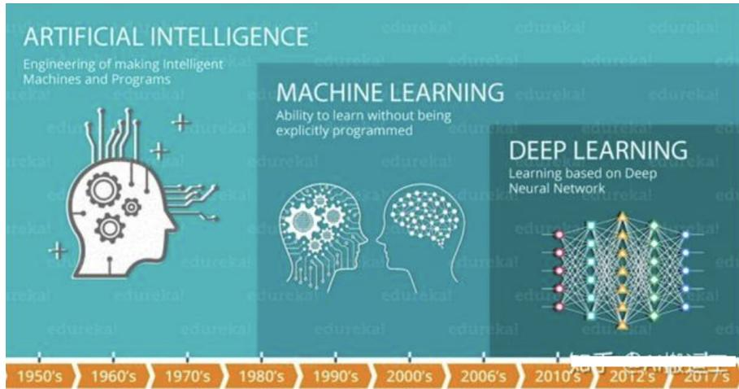

机器学习是实现⼈⼯智能的⼀种途径，深度学习是机器学习的⼀个⼦集，也就是说深度学习是实现机器学习的⼀种⽅法。与机器学习算法的主要区别如下图所示：
5 

## 深度学习
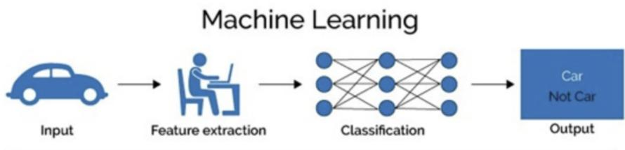

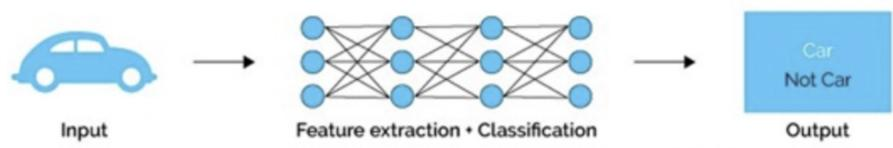

传统机器学习算术依赖⼈⼯设计特征，并进⾏特征提取，⽽深度学习⽅法不需要⼈⼯，⽽是依赖算法⾃动提取特征。深度学习模仿⼈类⼤脑的运⾏⽅式，从经验中学习获取知识。这也是深度学习被看做⿊盒⼦，可解释性差的原因。
随着计算机软硬件的⻜速发展，现阶段通过深度学习来模拟⼈脑来解释数据，包括图像，⽂本，⾳频等内容。⽬前深度学习的主要应⽤领域有：
## 智能⼿机


## 语⾳识别
⽐如苹果的智能语⾳助⼿sir


## 机器翻译
⾕歌将深度学习⽅法嵌⼊到⾕歌翻译中，能够⽀持100多种语⾔的即时翻译。
6 

深度学习
I love deep learning 
J'adore l'apprentissage en profondeur 
拍照翻译


## ⾃动驾驶


当然在其他领域也能⻅到深度学习的身影，⽐如⻛控，安防，智能零售，医疗领域，推荐系统等。

7 

深度学习
在该课程中，我们主要介绍：
深度学习框架TensorFlow的应⽤
深度神经⽹络
两部分内容。
## 2 发展历史（了解）
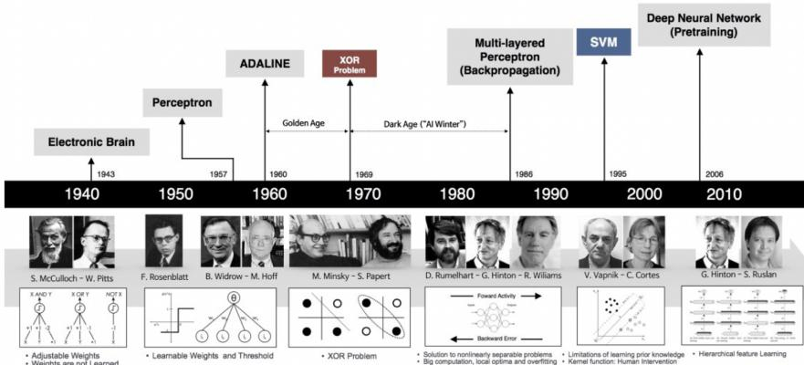

深度学习其实并不是新的事物，深度学习所需要的神经⽹络技术起源于20世纪50年代，叫做感知机。当时也通常使⽤单层感知机，尽管结构简单，但是能够解决复杂的问题。后来感知机被证明存在严重的问题，因为只能学习线性可分函数，连简单的异或(XOR)等线性不可分问题都⽆能为⼒，1969年Marvin Minsky写了⼀本叫做
《Perceptrons》的书，他提出了著名的两个观点：1.单层感知机没⽤，我们需要多层感知机来解决复杂问题 2.没有有效的训练算法。


20世纪80年代末期，⽤于⼈⼯神经⽹络的反向传播算法（也叫BackPropagation算法或者BP算法）的发明，给机器学习带来了希望，掀起了基于统计模型的机器学习热潮。这个热潮⼀直持续到今天。⼈们发现，利⽤BP算法可以让⼀个⼈⼯神经⽹络模型从⼤量训练样本中学习统计规律，从⽽对未知事件做预测。这种基于统计的机器学习⽅法⽐起过去基于⼈⼯规则的系统，在很多⽅⾯显出优越性。这个时候的⼈⼯神经⽹络，虽也被称作多层感知机（Multi-layerPerceptron），但实际是种只含有⼀层隐层节点的浅层模型。
8 

深度学习

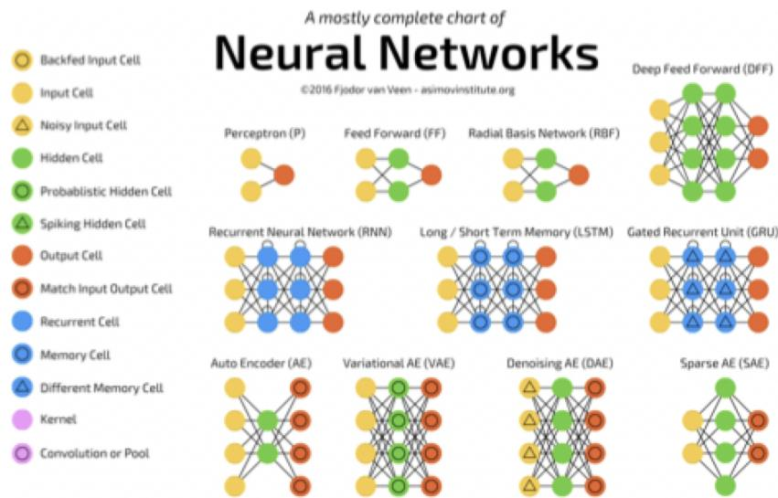

20世纪90年代，各种各样的浅层机器学习模型相继被提出，例如⽀撑向量机（SVM，Support Vector Machines）、 Boosting、最⼤熵⽅法（如LR，Logistic Regression）等。这些模型的结构基本上可以看成带有⼀层隐层节点（如SVM、Boosting），或没有隐层节点（如LR）。这些模型⽆论是在理论分析还是应⽤中都获得了巨⼤的成功。相⽐之下，由于理论分析的难度⼤，训练⽅法⼜需要很多经验和技巧，这个时期浅层⼈⼯神经⽹络反⽽相对沉寂.
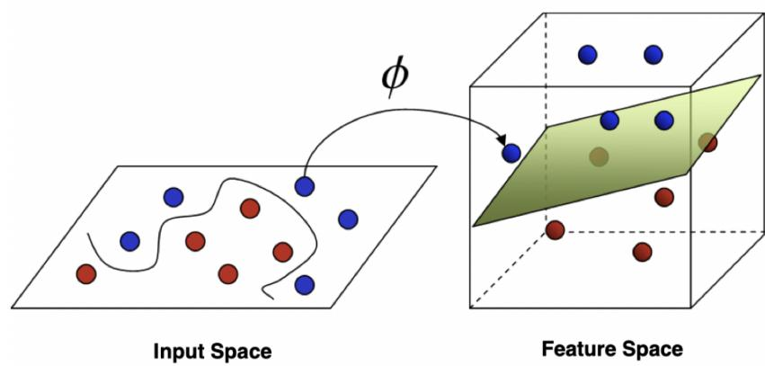

2006年，杰弗⾥·⾟顿以及他的学⽣鲁斯兰·萨拉赫丁诺夫正式提出了深度学习的概念。他们在世界顶级学术期刊《科学》发表的⼀篇⽂章中详细的给出了“梯度消失”问题的解决⽅案——通过⽆监督的学习⽅法逐层训练算法，再使⽤有监督的反向传播算法进⾏调优。该深度学习⽅法的提出，⽴即在学术圈引起了巨⼤的反响，以斯坦福⼤学、多伦多⼤学为代表的众多世界知名⾼校纷纷投⼊巨⼤的⼈⼒、财⼒进⾏深度学习领域的相关研究。⽽后⼜迅速蔓延到⼯业界中。
9 
# 
深度学习


2012年，在著名的ImageNet图像识别⼤赛中，杰弗⾥·⾟顿领导的⼩组采⽤深度学习模型AlexNet⼀举夺冠。AlexNet采⽤ReLU激活函数，从根本上解决了梯度消失问题，并采⽤GPU极⼤的提⾼了模型的运算速度。同年，由斯坦福⼤学著名的吴恩达教授和世界顶尖计算机专家Jeff Dean共同主导的深度神经⽹络——DNN技术在图像识别领域取得了惊⼈的成绩，在ImageNet评测中成功的把错误率从26％降低到了15％。深度学习算法在世界⼤赛的脱颖⽽出，也再⼀次吸引了学术界和⼯业界对于深度学习领域的关注。
2016年，随着⾕歌公司基于深度学习开发的AlphaGo以4:1的⽐分战胜了国际顶尖围棋⾼⼿李世⽯，深度学习的热度⼀时⽆两。后来，AlphaGo⼜接连和众多世界级围棋⾼⼿过招，均取得了完胜。这也证明了在围棋界，基于深度学习技术的机器⼈已经超越了⼈类。


2017年，基于强化学习算法的AlphaGo升级版AlphaGo Zero横空出世。其采⽤“从零开始”、“⽆师⾃通”的学习模式，以100:0的⽐分轻⽽易举打败了之前的AlphaGo。除了围棋，它还精通国际象棋等其它棋类游戏，可以说是真正的棋类“天才”。此外在这⼀年，深度学习的相关算法在医疗、⾦融、艺术、⽆⼈驾驶等多个领域均取得了显著的成果。所以，也有专家把2017年看作是深度学习甚⾄是⼈⼯智能发展最为突⻜猛进的⼀年。
10 

## 深度学习
2019年，基于Transformer 的⾃然语⾔模型的持续增⻓和扩散，这是⼀种语⾔建模神经⽹络模型，可以在⼏乎所有任务上提⾼NLP的质量。Google甚⾄将其⽤作相关性的主要信号之⼀，这是多年来最重要的更新
2020年，深度学习扩展到更多的应⽤场景，⽐如积⽔识别，路⾯塌陷等，⽽且疫情期间，在智能外呼系统，⼈群测温系统，⼝罩⼈脸识别等都有深度学习的应⽤。
## 总结
深度学习是什么
深度学习是机器学习算法的⼀种，通过模拟⼈脑实现相应的功能
深度学习应⽤场景
⼿机，机器翻译，⾃动驾驶，语⾳识别，医疗，安防等。
11 

深度学习
## 计算机视觉
## 学习⽬标
知道计算机视觉的定义
知道计算机视觉常⻅任务
知道计算机视觉的应⽤场景
## 1.计算机视觉定义
计算机视觉是指⽤摄像机和电脑及其他相关设备，对⽣物视觉的⼀种模拟。它的主要任务让计算机理解图⽚或者视频中的内容，就像⼈类和许多其他⽣物每天所做的那样。
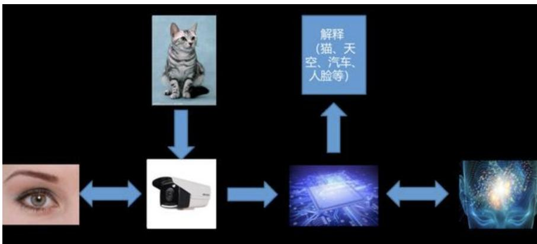

我们可以将其任务⽬标拆分为：
让计算机理解图⽚中的场景（办公室，客厅，咖啡厅等）
让计算机识别场景中包含的物体（宠物，交通⼯具，⼈等）
让计算机定位物体在图像中的位置（物体的⼤⼩，边界等）
让计算机理解物体之间的关系或⾏为（是在对话，⽐赛或吵架等），以及图像表达的意义（喜庆的，悲伤的等）
那我们在OpenCV阶段，主要学习图像处理，⽽图像处理主要⽬的是对图像的处理，⽐如平滑，缩放等，想、从⽽为其他任务（⽐如“计算机视觉”）做好前期⼯作。
## 2.常⻅任务
根据上述对计算机视觉⽬标任务的分解，可将其分为三⼤经典任务：图像分类、⽬标检测、图像分割
12 

## 深度学习
Classification 


CAT


Classification + Localization

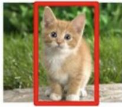


CAT


Object Detection

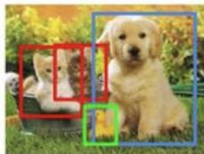


Instance Segmentation


Single object


Multiple objects

图像分类（Classification）：即是将图像结构化为某⼀类别的信息，⽤事先确定好的类别(category)来描述图⽚。
⽬标检测（Detection）：分类任务关⼼整体，给出的是整张图⽚的内容描述，⽽检测则关注特定的物体⽬标，要求同时获得这⼀⽬标的类别信息和位置信息（classification + localization）。
图像分割（Segmentation）：分割是对图像的像素级描述，它赋予每个像素类别（实例）意义，适⽤于理解要求较⾼的场景，如⽆⼈驾驶中对道路和⾮道路的分割。
接下来的课程中我们将围绕这三个任务对计算机视觉进⾏介绍。
## 3.应⽤场景
计算机视觉涉及的领域复杂，具有⼴泛的实际应⽤范围。总体⽽⾔，依赖于⼈⼯智能和机器学习，尤其是计算机视觉的创新的好处是，从电⼦商务⾏业到更经典的各种类型和规模的公司都可以利⽤其强⼤的功能，下图展示了相关的应⽤场景及相关的企业：
13 
深度学习


## 3.1 ⼈脸识别
⼈脸识别技术⽬前已经⼴泛应⽤于⾦融、司法、军队、公安、边检、政府、航天、电⼒、⼯⼚、教育、医疗等⾏业。据业内⼈⼠分析，我国的⼈脸识别产业的需求旺盛，需求推动导致企业敢于投⼊资⾦。
代表企业：Face++旷视科技、依图科技、商汤科技、深醒科技、云从科技等。
14 
深度学习

<table><tr><td>人脸识别主要应用场景:</td></tr><tr><td>考勤、门禁</td></tr><tr><td>身份认证</td></tr><tr><td>人脸属性认知</td></tr><tr><td>人脸检测跟踪</td></tr><tr><td>真人检测(活体检测)</td></tr><tr><td>人脸对比</td></tr><tr><td>人脸搜索</td></tr><tr><td>人脸关键点定位</td></tr></table>
## 3.2 视频监控
⼈⼯智能技术可以对结构化的⼈、⻋、物等视频内容信息进⾏快速检索、查询。这项应⽤使得让公安系统在繁杂的监控视频中搜寻到罪犯的有了可能。在⼤量⼈群流动的交通枢纽，该技术也被⼴泛⽤于⼈群分析、防控预警等。
代表企业：SenseTime 商汤科技、DeepGlint 格灵深瞳、依图科技、云天励⻜、深⽹视界等。
<table><tr><td>视频/监控分析主要应用场景:</td></tr><tr><td>物体、商品智能识别/分析定位</td></tr><tr><td>行人属性/行为分析及跟踪</td></tr><tr><td>人群密度客流分析</td></tr><tr><td>道路车辆行为分析</td></tr></table>
## 3.3 图⽚识别分析
代表企业：Face++旷视科技、图普科技、码隆科技、酒咔嚓、YI+陌上花科技等。
15 

深度学习
<table><tr><td>图片识别分析主要应用场景:</td></tr><tr><td>以图搜图(相似图片)</td></tr><tr><td>物体/场景识别</td></tr><tr><td>车型识别</td></tr><tr><td>人物属性、服装、时尚分析</td></tr><tr><td>商品识别</td></tr><tr><td>鉴别黄色、暴力</td></tr></table>
## 3.4 辅助驾驶
随着汽⻋的普及，汽⻋已经成为⼈⼯智能技术⾮常⼤的应⽤投放⽅向，但就⽬前来说，想要完全实现⾃动驾驶/⽆⼈驾驶，距离技术成熟还有⼀段路要⾛。不过利⽤⼈⼯智能技术，汽⻋的驾驶辅助的功能及应⽤越来越多，这些应⽤多半是基于计算机视觉和图像处理技术来实现。
代表企业：纵⽬科技、TuSimple 图森科技、驭势科技、MINIEYE 佑驾创新、中天安驰等。
<table><tr><td>驾驶辅助主要应用场景:</td></tr><tr><td>车辆及物体检测碰撞预警</td></tr><tr><td>车道检测偏移预警</td></tr><tr><td>交通标识识别</td></tr><tr><td>行人检测</td></tr><tr><td>车距检测</td></tr></table>
除了上述这些，计算机视觉在三维视觉，三维重建，⼯业仿真，地理信息系统，⼯业视觉，医疗影像诊断，⽂字识别（OCR），图像及视频编辑等领域也有⼴泛的应⽤。
## 5.发展历史（了解）
1963年，Larry Roberts发表了CV领域的第⼀篇专业论⽂，⽤以对简单⼏何体进⾏边缘提取和三维重建。
16 

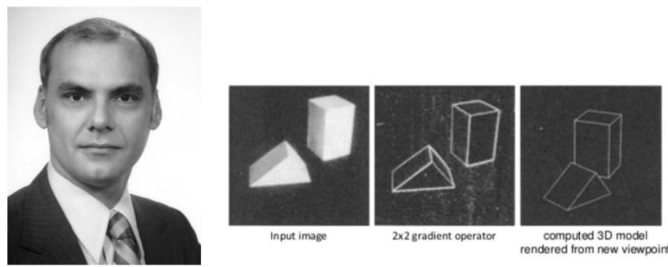

## 深度学习
In put image 
2x2 gradient operator 
computed 3D mode rendered from new viewpoint 

Larry Roerts 1963, 1st thesis of Computer Visior

1966年，麻省理⼯学院(MIT)发起了⼀个夏季项⽬，⽬标是搭建⼀个机器视觉系统，完成模式识别(pattern recognition)等⼯作。虽然未成功，但是计算机视觉作为⼀个科学领域的正式诞⽣的标志。
1982年，学者David Marr发表的著作《Vision》从严谨⼜⻓远的⻆度给出了CV的发展⽅向和⼀些基本算法，其中不乏现在为⼈熟知的“图层”的概念、边缘提取、三维重建等，标志着计算机视觉成为了⼀⻔独⽴学科。
17 

深度学习
# VISION


## DAVID MARR
1999年David Lowe提出了尺度不变特征变换（SIFT, Scale-invariantfeature transform）⽬标检测算法，⽤于匹配不同拍摄⽅向、纵深、光线等图⽚中的相同元素。
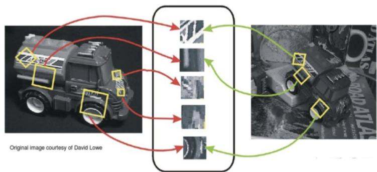


2009年，由Felzenszwalb教授在提出基于HOG的deformableparts model，可变形零件模型开发，它是深度学习之前最好的最成功的objectdetection & recognition算法。

18 
深度学习

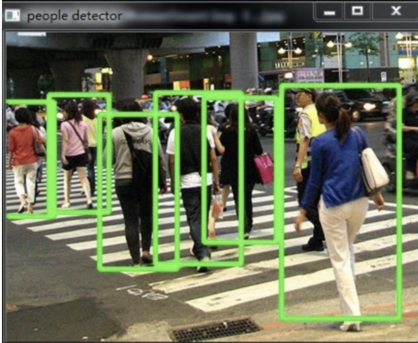

Everingham等⼈在2006年⾄2012年间搭建了⼀个⼤型图⽚数据库，供机器识别和训练，称为PASCAL Visual ObjectChallenge，该数据库中有20种类别的图⽚，每种图⽚数量在⼀千⾄⼀万张不等。
2009年，李⻜⻜教授等在CVPR2009上发表了⼀篇名为《ImageNet: A Large-Scale Hierarchical Image Database》的论⽂，发布了ImageNet数据集，这是为了检测计算机视觉能否识别⾃然万物，回归机器学习，克服过拟合问题。


IMAGENET

2012 年，Alex Krizhevsky、Ilya Sutskever 和 Geoffrey Hinton创造了⼀个“⼤型的深度卷积神经⽹络”，也即现在众所周知的AlexNet，赢得了当年的 ILSVRC。这是史上第⼀次有模型在ImageNet 数据集表现如此出⾊。⾃那时起，CNN 才成了家喻户晓的名字。
19 
# 
## 深度学习

IMGENETClassification Task

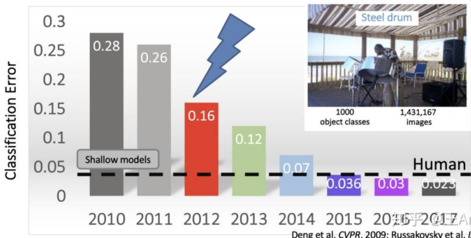


Deng et al. CVPR. 2009: Russakoysky et al.

2014年，蒙特利尔⼤学提出⽣成对抗⽹络（GAN）：拥有两个相互竞争的神经⽹络可以使机器学习得更快。⼀个⽹络尝试模仿真实数据⽣成假的数据，⽽另⼀个⽹络则试图将假数据区分出来。随着时间的推移，两个⽹络都会得到训练，⽣成对抗⽹络（GAN）被认为是计算机视觉领域的重⼤突破。
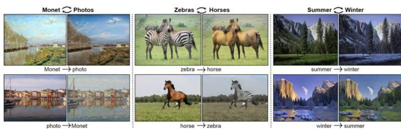

2018年末，英伟达发布的视频到视频⽣成（Video-to-Videosynthesis），它通过精⼼设计的发⽣器、鉴别器⽹络以及时空对抗物镜，合成⾼分辨率、照⽚级真实、时间⼀致的视频，实现了让AI更具物理意识，更强⼤，并能够推⼴到新的和看不⻅的更多场景。
2019，更强⼤的GAN，BigGAN，是拥有了更聪明的学习技巧的GAN，由它训练⽣成的图像连它⾃⼰都分辨不出真假，因为除⾮拿显微镜看，否则将⽆法判断该图像是否有任何问题，因⽽，它更被誉为史上最强的图像⽣成器.
## 总结
计算机视觉的定义
让计算机理解图⽚或者视频中的内容
计算机视觉的任务
图像分类，⽬标检测，图像分割
计算机视觉的应⽤场景
⼈脸识别，视频监控，图⽚识别分析，辅助驾驶
20 

深度学习
21 

深度学习
## 深⼊浅出TensorFlow
了解Tensorflow框架的组成 接⼝
了解TensorFlow框架的安装
知道tf.keras的特点和使⽤
掌握TensorFlow基本张量操作
掌握TensorFlow的⾃动求导机制
模型的构建： `tf.keras.Model` 和 `tf.keras.layers`
模型的损失函数： `tf.keras.losses`
模型的优化器： `tf.keras.optimizer
模型的评估： `tf.keras.metrics`
掌握keras pipline的使⽤
掌握keras⾃定义层 损失函数和评估指标的使⽤
掌握Checkpoint使⽤
掌握TensorBoard使⽤
掌握data模块使⽤
掌握tf的图执⾏模式原理与会话模式的区别
掌握TensorFlow的分布式训练接⼝使⽤
应⽤Tensorflow完成垃圾分类的训练和预测
应⽤完成垃圾分类的训练和推理
22 

深度学习
## 深度学习框架-TensorFlow
## 学习⽬标
了解Tensorflow2.0框架的⽤途及流程
知道tf2.0的张量及其操作
知道tf.keras中的相关模块及常⽤⽅法


## 1.1 TensorFlow介绍
深度学习框架TensorFlow⼀经发布，就受到了⼴泛的关注，并在计算机视觉 ⾳频处理 推荐系统和⾃然语⾔处理等场景下都被⼤⾯积推⼴使⽤，现在已发布2.3.0版本，接下来我们深⼊浅出的介绍Tensorflow的相关应⽤<sub>。</sub>
TensorFlow的依赖视图如下所示：
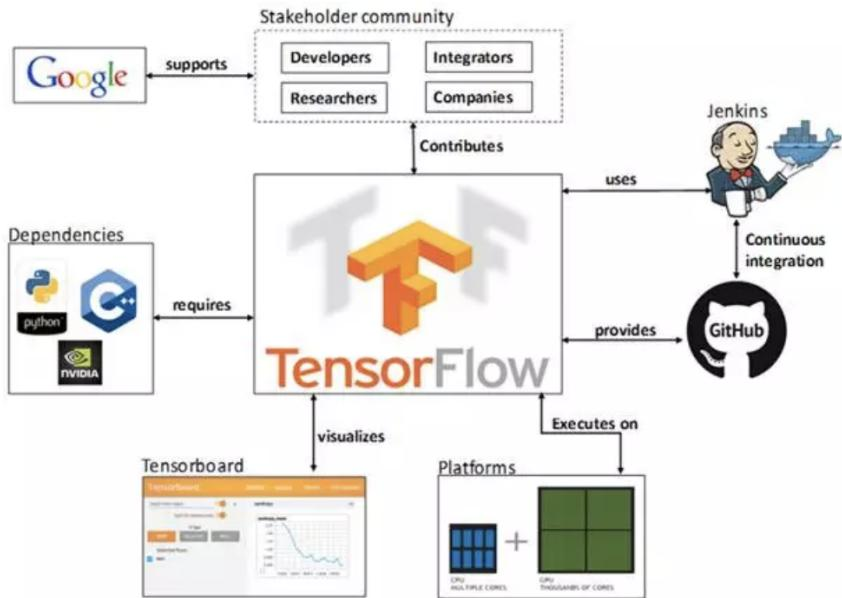


TF托管在github平台，有google groups和contributors共同维护

TF提供了丰富的深度学习相关的API，⽀持Python和C/C++接⼝
TF提供了可视化分析⼯具Tensorboard，⽅便分析和调整模型
23 

深度学习
TF⽀持Linux平台，Windows平台，Mac平台，甚⾄⼿机移动设备等各种平台<sub>。</sub>
TensorFlow 2.0 将专注于简单性和易⽤性，⼯作流程如下所示：
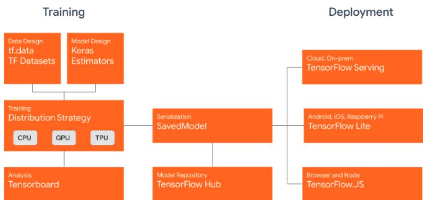

1 使⽤tf.data加载数据 使⽤tf.data实例化读取训练数据和测试数据
2<sub>、</sub>模型的建⽴与调试： 使⽤动态图模式 Eager Execution 和著名的神经⽹络⾼层 API 框架 Keras，结合可视化⼯具 TensorBoard，简易 快速地建⽴和调试模型；
3 模型的训练： ⽀持 CPU / 单 GPU / 单机多卡 GPU / 多机集群 / TPU训练模型，充分利⽤海量数据和计算资源进⾏⾼效训练；
4 预训练模型调⽤： 通过 TensorFlow Hub，可以⽅便地调⽤预训练完毕的已有成熟模型
5 模型的部署： 通过 TensorFlow Serving TensorFlow Lite
TensorFlow.js 等组件，可以将TensorFlow 模型部署到服务器 移动端嵌⼊式端等多种使⽤场景；
## 1.2 TensorFlow的安装
安装 TensorFlow在64 位系统上测试这些系统⽀持 TensorFlow：
Ubuntu 16.04 或更⾼版本
Windows 7 或更⾼版本
macOS 10.12.6 (Sierra) 或更⾼版本（不⽀持 GPU）
进⼊虚拟环境当中再安装 推荐使⽤anoconda进⾏安装
1 ⾮GPU版本安装
ubuntu安装
pip install tensorflow==2.3.0 -i https://pypi.tuna.tsinghu 
24 
深度学习

## 2 GPU版本安装
pip install tensorflow-gpu==2.3.0 -i https://pypi.tuna.tsi 
注：如果需要下载GPU版本的（TensorFlow只提供windows和linux版本的，没有Macos版本的）
## 1.3 张量及其操作
## 1.3.1 张量Tensor
张量是⼀个多维数组 与NumPy ndarray对象类似，tf.Tensor对象也具有数据类型和形状 如下图所示：
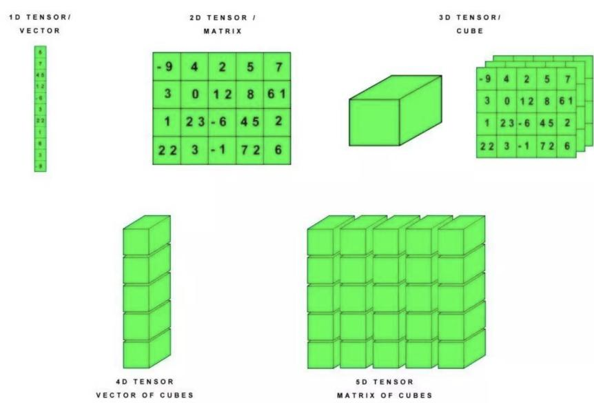

此外，tf.Tensors可以保留在GPU中 TensorFlow提供了丰富的操作库（tf.add，tf.matmul，tf.linalg.inv等），它们使⽤和⽣成tf.Tensor 在进⾏张量操作之前先导⼊相应的⼯具包：
```python
import tensorflow as tf
import numpy as np 
```
## 1.基本⽅法
⾸先让我们创建基础的张量：
25 

## 深度学习
```python
# 创建int32类型的0维张量，即标量
rank_0_tensor = tf.constant(4)
print(rank_0_tensor)
# 创建float32类型的1维张量
rank_1_tensor = tf.constant([2.0, 3.0, 4.0])
print(rank_1_tensor)
# 创建float16类型的二维张量
rank_2_tensor = tf.constant([[1, 2],
    [3, 4],
    [5, 6]], dtype=tf.float16)
print(rank_2_tensor)
```
## 输出结果为：
```txt
tf.Tensor(4, shape=(), dtype=int32)
tf.Tensor([2. 3. 4.], shape=(3,), dtype=float32)
tf.Tensor(
[[1. 2.]
[3. 4.]
[5. 6.]], shape=(3, 2), dtype=float16) 
```
A scalar, shape: [] 
```txt
A vector, shape: [3] 
```
A matrix, shape: [3, 2] 
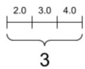

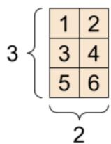

我们也可以创建更⾼维的张量：
```python
# 创建float32类型的张量
rank_3_tensor = tf.constant([
    [[0, 1, 2, 3, 4],
    [5, 6, 7, 8, 9]],
    [[10, 11, 12, 13, 14],
    [15, 16, 17, 18, 19]],
    [[20, 21, 22, 23, 24],
    [25, 26, 27, 28, 29]],])

print(rank_3_tensor)
```
该输出结果我们有更多的⽅式将其展示出来：
26 

深度学习
```txt
A 3-axis tensor, shape: [3, 2, 5] 
```
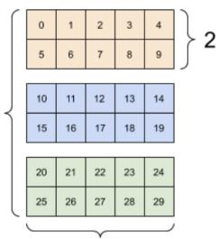


5

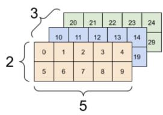

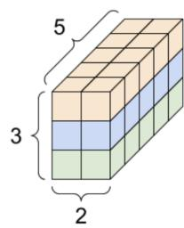

## 2.转换成numpy
我们可将张量转换为numpy中的ndarray的形式，转换⽅法有两种，以张量rank_2_tensor为例：
```txt
- np.array 
```
```python
np.array(rank_2_tensor) 
```
```lua
- Tensor.numpy() 
```
```txt
rank_2_tensor.numpy() 
```
## 3.常⽤函数
我们可以对张量做⼀些基本的数学运算，包括加法 元素乘法和矩阵乘法等：
```python
# 定义张量a和b
a = tf.constant([[1, 2], [3, 4]])
b = tf.constant([[1, 1], [1, 1]])
print(tf.add(a, b), "\n") # 计算张量的和
print(tf.multiply(a, b), "\n") # 计算张量的元素乘法
print(tf.matmul(a, b), "\n") # 计算乘法
```
## 输出结果为：
27 

## 深度学习
```txt
tf.Tensor(
[[2 3]
[4 5]], shape=(2, 2), dtype=int32)
tf.Tensor(
[[1 2]
[3 4]], shape=(2, 2), dtype=int32)
tf.Tensor(
[[3 3]
[7 7]], shape=(2, 2), dtype=int32) 
```
## 另外张量也可⽤于各种聚合运算：
```txt
tf.reduce_sum() # 求和
tf.reduce_mean() # 平均值
tf.reduce_max() # 最大值
tf.reduce_min() # 最小值
tf.argmax() # 最大值的索引
tf.argmin() # 最小值的索引
```
## 例如：
```python
c = tf.constant([[4.0, 5.0], [10.0, 1.0]])
# 最大值
print(tf.reduce_max(c))
# 最大值索引
print(tf.argmax(c))
# 计算均值
print(tf.reduce_mean(c))
```
## 输出为：
```txt
tf.Tensor(10.0, shape=(), dtype=float32)
tf.Tensor([1 0], shape=(2,), dtype=int64)
tf.Tensor(5.0, shape=(), dtype=float32) 
```
## 4.变量
变量是⼀种特殊的张量，形状是不可变，但可以更改其中的参数 定义时的⽅法是：
```txt
my_variable = tf.Variable([[1.0, 2.0], [3.0, 4.0]]) 
```
28 

深度学习
我们也可以获取它的形状，类型及转换为ndarray:
```python
print("Shape: ",my_variable.shape)
print("DType: ",my_variable.dtype)
print("As NumPy: ", my_variable.numpy) 
```
## 输出为：
```txt
Shape: (2, 2)
DType: <dtype: 'float32'>
As NumPy: <bound method BaseResourceVariable.numpy of <tf array([[1., 2.], [3., 4.]], dtype=float32)>> 
```
## 1.4 tf.keras介绍
tf.keras是TensorFlow 2.0的⾼阶API接⼝，为TensorFlow的代码提供了新的⻛格和设计模式，⼤⼤提升了TF代码的简洁性和复⽤性，官⽅也推荐使⽤tf.keras来进⾏模型设计和开发
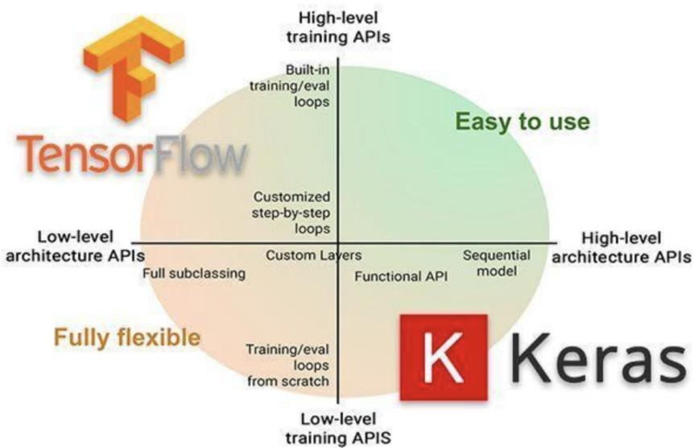

## 1.4.1 常⽤模块
tf.keras中常⽤模块如下表所示：
29 
# 
深度学习
<table><tr><td>模块</td><td>概述</td></tr><tr><td>activations</td><td>激活函数</td></tr><tr><td>applications</td><td>预训练网络模块</td></tr><tr><td>Callbacks</td><td>在模型训练期间被调用</td></tr><tr><td>datasets</td><td>tf.keras数据集模块,包括boston_housing,cifar10,fashion_mnist,imdb,mnist</td></tr><tr><td>layers</td><td>Keras层API</td></tr><tr><td>losses</td><td>各种损失函数</td></tr><tr><td>metircs</td><td>各种评价指标</td></tr><tr><td>models</td><td>模型创建模块,以及与模型相关的API</td></tr><tr><td>optimizers</td><td>优化方法</td></tr><tr><td>preprocessing</td><td>Keras数据的预处理模块</td></tr><tr><td>regularizers</td><td>正则化,L1,L2等</td></tr><tr><td>utils</td><td>辅助功能实现</td></tr></table>
## 1.4.2 常⽤⽅法
深度学习实现的主要流程：1.数据获取，2，数据处理，3.模型创建与训练，4 模型测试与评估，5.模型预测
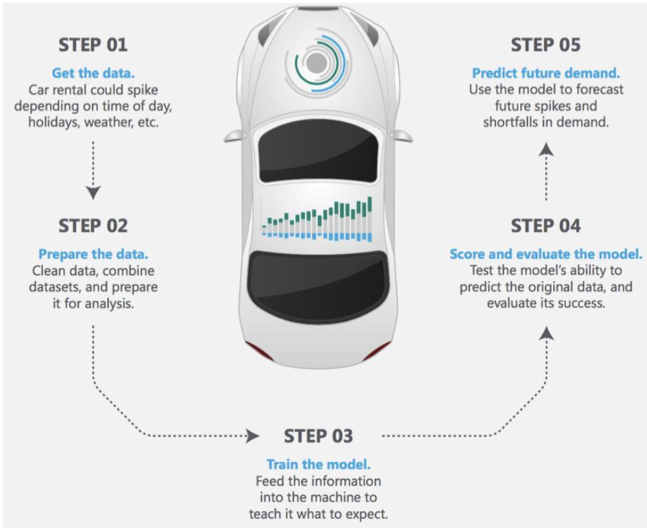

30 

深度学习
## 1.导⼊tf.keras
使⽤ tf.keras ，⾸先需要在代码开始时导⼊ tf.keras
```python
import tensorflow as tf
from tensorflow import keras 
```
## 2.数据输⼊
对于⼩的数据集，可以直接使⽤numpy格式的数据进⾏训练 评估模型，对于⼤型数据集或者要进⾏跨设备训练时使⽤tf.data.datasets来进⾏数据输⼊<sub>。</sub>
## 3.模型构建
简单模型使⽤Sequential进⾏构建
复杂模型使⽤函数式编程来构建
⾃定义layers
## 4.训练与评估
配置训练过程：
```python
# 配置优化方法，损失函数和评价指标
model.compile(optimizer=tf.train.AdamOptimizer(0.001), loss='categorical_crossentropy', metrics=['accuracy'])
```
## 模型训练
```python
# 指明训练数据集，训练epoch,批次大小和验证集数据
model.fit/fit_generator(dataset, epochs=10,
    batch_size=3,
    validation_data=val_dataset,
)
```
## 模型评估
```txt
# 指明评估数据集和批次大小
model.evaluate(x, y, batch_size=32)
```
## 模型预测
31 

深度学习
```txt
# 对新的样本进行预测
model.predict(x, batch_size=32)
```
## 5.回调函数（callbacks）
回调函数⽤在模型训练过程中，来控制模型训练⾏为，可以⾃定义回调函数，也可使⽤tf.keras.callbacks 内置的 callback ：
ModelCheckpoint：定期保存 checkpoints<sub>。</sub> LearningRateScheduler：动态改变学习速率<sub>。</sub> EarlyStopping：当验证集上的性能不再提⾼时，终⽌训练 TensorBoard：使⽤ TensorBoard 监测模型的状态
## 6.模型的保存和恢复
## 只保存参数
```txt
# 只保存模型的权重
model.save_weights('./my_model')
# 加载模型的权重
model.load_weights('my_model')
```
## 保存整个模型
```python
# 保存模型架构与权重在h5文件中
model.save('my_model.h5')
# 加载模型：包括架构和对应的权重
model = keras.models.load_model('my_model.h5')
```
## 总结
了解Tensorflow2.0框架的⽤途及流程
1.使⽤tf.data加载数据
2 模型的建⽴与调试
3 模型的训练
4 预训练模型调⽤
5<sub>、</sub>模型的部署
知道tf2.0的张量及其操作
32 

深度学习
张量是多维数组
1 创建⽅法：tf.constant()
2 转换为numpy: np.array()或tensor.asnumpy()
3 常⽤函数：加法，乘法，及各种聚合运算
4 变量：tf.Variable()
## 知道tf.keras中的相关模块及常⽤⽅法
常⽤模块：models,losses,application等
常⽤⽅法：
1 导⼊tf.keras
2 数据输⼊
3 模型构建
4 训练与评估
5 回调函数
6 模型的保存与恢复
33 

深度学习
## 1.2 快速⼊⻔模型
## 学习⽬标
知道使⽤tf.keras的基本流程
了解tf.keras实现模型构建的⽅法
了解tf.keras中模型训练验证的相关⽅法


山鸢尾Iris setosa,变色鸢尾Iris versicolor，和维吉尼亚鸢尾Iris virginica


今天我们通过鸢尾花分类案例，来给⼤家介绍tf.keras的基本使⽤流程tf.keras使⽤tensorflow中的⾼级接⼝，我们调⽤它即可完成：
1. 导⼊和解析数据集
2. 构建模型
3. 使⽤样本数据训练该模型
4. 评估模型的效果
由于与scikit -learn的相似性，接下来我们将通过将Keras与scikit -learn进⾏⽐较，介绍tf.Keras的相关使⽤⽅法
## 1.相关的库的导⼊
在这⾥使⽤sklearn和tf.keras完成鸢尾花分类，导⼊相关的⼯具包：
34 

深度学习
```python
# 绘图
import seaborn as sns
# 数值计算
import numpy as np
# sklearn中的相关工具
# 划分训练集和测试集
from sklearn.model_selection import train_test_split
# 逻辑回归
from sklearn.linear_model import LogisticRegressionCV
# tf.keras中使用的相关工具
# 用于模型搭建
from tensorflow.keras.models import Sequential
# 构建模型的层和激活方法
from tensorflow.keras.layers import Dense, Activation
# 数据处理的辅助工具
from tensorflow.keras import utils
```
## 2.数据展示和划分
利⽤seborn导⼊相关的数据，iris数据以dataFrame的⽅式在seaborn进⾏存储，我们读取后并进⾏展示：
```python
# 读取数据
iris = sns.load_dataset("iris")
# 展示数据的前五行
iris.head()
```
<table><tr><td></td><td>sepal_length</td><td>sepal_width</td><td>petal_length</td><td>petal_width</td><td>species</td></tr><tr><td>0</td><td>5.1</td><td>3.5</td><td>1.4</td><td>0.2</td><td>setosa</td></tr><tr><td>1</td><td>4.9</td><td>3.0</td><td>1.4</td><td>0.2</td><td>setosa</td></tr><tr><td>2</td><td>4.7</td><td>3.2</td><td>1.3</td><td>0.2</td><td>setosa</td></tr><tr><td>3</td><td>4.6</td><td>3.1</td><td>1.5</td><td>0.2</td><td>setosa</td></tr><tr><td>4</td><td>5.0</td><td>3.6</td><td>1.4</td><td>0.2</td><td>setosa</td></tr></table>
另外，利⽤seaborn中pairplot函数探索数据特征间的关系：
```python
# 将数据之间的关系进行可视化
sns.pairplot(iris, hue='species')
```
35 

```txt
深度学习
```
```txt
sepal_length, sepal_width, petal_length, petal_width
species setosa versicolor virginica 
```
将数据划分为训练集和测试集：从iris dataframe中提取原始数据，将花瓣和萼⽚数据保存在数组X中，标签保存在相应的数组y中：
```txt
# 花瓣和花萼的数据
X = iris.values[:, :4]
# 标签值
y = iris.values[:, 4]
```
利⽤train_test_split完成数据集划分：
```python
# 将数据集划分为训练集和测试集
train_X, test_X, train_y, test_y = train_test_split(X, y, t)
```
接下来，我们就可以使⽤sklearn和tf.keras来完成预测
## 3.sklearn实现
利⽤逻辑回归的分类器，并使⽤交叉验证的⽅法来选择最优的超参数，实例化LogisticRegressionCV分类器，并使⽤fit⽅法进⾏训练：
```txt
# 实例化分类器
lr = LogisticRegressionCV()
# 训练
lr.fit(train_X, train_y)
```
36 

深度学习
利⽤训练好的分类器进⾏预测，并计算准确率：
```python
# 计算准确率并进行打印
print("Accuracy = {:.2f}".format(lr.score(test_X, test_y)))
```
逻辑回归的准确率为：
```txt
Accuracy = 0.93 
```
## 4.tf.keras实现
在sklearn中我们只要实例化分类器并利⽤fit⽅法进⾏训练，最后衡量它的性能就可以了，那在tf.keras中与在sklearn⾮常相似，不同的是：
构建分类器时需要进⾏模型搭建
数据采集时，sklearn可以接收字符串型的标签，如：“setosa”，但是在tf.keras中需要对标签值进⾏热编码，如下所示：
setosa versicolor virginica 
<table><tr><td>1</td><td>0</td><td>0</td></tr><tr><td>0</td><td>1</td><td>0</td></tr><tr><td>1</td><td>0</td><td>0</td></tr><tr><td>0</td><td>0</td><td>1</td></tr></table>
有很多⽅法可以实现热编码，⽐如pandas中的get_dummies(),在这⾥我们使⽤tf.keras中的⽅法进⾏热编码：
```python
# 进行热编码
def one_hot_encode_object_array(arr):
    # 去重获取全部的类别
    uniques, ids = np.unique(arr, return_inverse=True)
    # 返回热编码的结果
    return utils.to_categorical(ids, len(uniques))
```
## 4.1 数据处理
接下来对标签值进⾏热编码：
37 

深度学习
```python
# 训练集热编码
train_y_ohe = one_hot_encode_object_array(train_y)
# 测试集热编码
test_y_ohe = one_hot_encode_object_array(test_y)
```
## 4.2 模型搭建
在sklearn中，模型都是现成的 tf.Keras是⼀个神经⽹络库,我们需要根据数据和标签值构建神经⽹络 神经⽹络可以发现特征与标签之间的复杂关系 神经⽹络是⼀个⾼度结构化的图，其中包含⼀个或多个隐藏层 每个隐藏层都包含⼀个或多个神经元 神经⽹络有多种类别，该程序使⽤的是密集型神经⽹络，也称为全连接神经⽹络：⼀个层中的神经元将从上⼀层中的每个神经元获取输⼊连接 例如，图 2 显示了⼀个密集型神经⽹络，其中包含 1 个输⼊层 2 个隐藏层以及 1 个输出层，如下图所示：
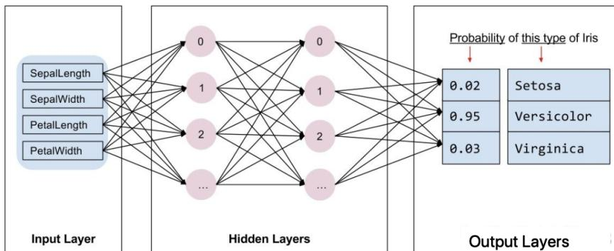

上图 中的模型经过训练并馈送未标记的样本时，它会产⽣ 3 个预测结果：相应鸢尾花属于指定品种的可能性 对于该示例，输出预测结果的总和是 1.0 该预测结果分解如下：⼭鸢尾为 0.02，变⾊鸢尾为 0.95，维吉尼亚鸢尾为 0.03 这意味着该模型预测某个⽆标签鸢尾花样本是变⾊鸢尾的概率为 95％
TensorFlow tf.keras API 是创建模型和层的⾸选⽅式 通过该 API，您可以轻松地构建模型并进⾏实验，⽽将所有部分连接在⼀起的复杂⼯作则由 Keras 处理
tf.keras.Sequential 模型是层的线性堆叠 该模型的构造函数会采⽤⼀系列层实例；在本示例中，采⽤的是 2 个密集层（分别包含 10 个节点）以及 1 个输出层（包含 3 个代表标签预测的节点） 第⼀个层的input_shape 参数对应该数据集中的特征数量：
38 
# 
深度学习
```python
# 利用sequential方式构建模型
model = Sequential([
    # 隐藏层1，激活函数是relu，输入大小有input_shape指定
    Dense(10, activation="relu", input_shape=(4,))
    # 隐藏层2，激活函数是relu
    Dense(10, activation="relu"),
    # 输出层
    Dense(3, activation="softmax")
])
```
通过model.summary可以查看模型的架构：
<table><tr><td colspan="3">Model: &quot;sequential&quot;</td></tr><tr><td>Layer (type)</td><td>Output Shape</td><td>Para</td></tr><tr><td>dense (Dense)</td><td>(None, 10)</td><td>50</td></tr><tr><td>dense_1 (Dense)</td><td>(None, 10)</td><td>110</td></tr><tr><td>dense_2 (Dense)</td><td>(None, 3)</td><td>33</td></tr><tr><td colspan="3">Total params: 193Trainable params: 193Non-trainable params: 0</td></tr></table>
激活函数可决定层中每个节点的输出形状 这些⾮线性关系很重要，如果没有它们，模型将等同于单个层 激活函数有很多，但隐藏层通常使⽤ReLU
隐藏层和神经元的理想数量取决于问题和数据集 与机器学习的多个⽅⾯⼀样，选择最佳的神经⽹络形状需要⼀定的知识⽔平和实验基础 ⼀般来说，增加隐藏层和神经元的数量通常会产⽣更强⼤的模型，⽽这需要更多数据才能有效地进⾏训练
## 4.3 模型训练和预测
在训练和评估阶段，我们都需要计算模型的损失 这样可以衡量模型的预测结果与预期标签有多⼤偏差，也就是说，模型的效果有多差 我们希望尽可能减⼩或优化这个值，所以我们设置优化策略和损失函数，以及模型精度的计算⽅法：
```txt
# 设置模型的相关参数：优化器，损失函数和评价指标
model.compile(optimizer='adam', loss='categorical_crossentropy')
```
39 

深度学习
接下来与在sklearn中相同，分别调⽤fit和predict⽅法进⾏预测即可
```python
# 模型训练：epochs, 训练样本送入到网络中的次数，batch_size: 每次训练
model.fit(train_X, train_y_ohe, epochs=10, batch_size=1, ve
```
## 上述代码完成的是：
1. 迭代每个epoch 通过⼀次数据集即为⼀个epoch
2. 在⼀个epoch中，遍历训练 Dataset 中的每个样本，并获取样本的特征 (x) 和标签 (y)<sub>。</sub>
3. 根据样本的特征进⾏预测，并⽐较预测结果和标签 衡量预测结果的不准确性，并使⽤所得的值计算模型的损失和梯度
4. 使⽤ optimizer 更新模型的变量
5. 对每个epoch重复执⾏以上步骤，直到模型训练完成
## 训练过程展示如下：
```txt
Epoch 1/10
75/75 [====================] - 0s 616us/step - lo
Epoch 2/10
75/75 [====================] - 0s 535us/step - lo
Epoch 3/10
75/75 [====================] - 0s 545us/step - lo
Epoch 4/10
75/75 [====================] - 0s 542us/step - lo
Epoch 5/10
75/75 [====================] - 0s 510us/step - lo
Epoch 6/10
75/75 [====================] - 0s 659us/step - lo
Epoch 7/10
75/75 [====================] - 0s 497us/step - lo
Epoch 8/10
75/75 [====================] - 0s 497us/step - lo
Epoch 9/10
75/75 [====================] - 0s 493us/step - lo
Epoch 10/10
75/75 [====================] - 0s 482us/step - lo 
```
与sklearn中不同，对训练好的模型进⾏评估时，与sklearn.score⽅法对应的是tf.keras.evaluate()⽅法，返回的是损失函数和在compile模型时要求的指标:
```python
# 计算模型的损失和准确率
loss, accuracy = model.evaluate(test_X, test_y_ohe, verbose)
print("Accuracy = {:.2f}".format(accuracy))
```
40 

深度学习
分类器的准确率为：
```txt
3/3 [====================] - 0s 591us/step - loss
Accuracy = 0.97 
```
到此我们对tf.kears的使⽤有了⼀个基本的认知，在接下来的课程中会给⼤家解释神经⽹络以及在计算机视觉中的常⽤的CNN的使⽤
## 总结
1.使⽤tf.keras进⾏分类时的主要流程：
数据处理-构建模型-模型训练-模型验证
2.tf.keras中构建模型可通过squential()来实现并利⽤.fit()⽅法进⾏训练
3.使⽤evaluate()⽅法计算损失函数和准确率
41 

深度学习
## 图像分类1(Image Classification)
了解图像分类任务以及挑战
知道最近邻分类器的特点<sub>、</sub>L1与L2距离的特点
知道神经⽹络的定义
了解感知机与神经⽹络的联系
了解神经⽹络的发展历史
知道基于图像像素映射的分类评分函数
说明SVM和Softmax线性分类器及其损失函数特点原理
知道最优化的定义
掌握神经⽹络的链式法则和反向传播算法
掌握计算图的向量计算⽅式
应⽤完成单神经元神经⽹络
知道浅层/深层神经⽹络的前向和反向计算过程
掌握激活函数的使⽤以及选择
知道神经⽹络的参数和超参数
42 

深度学习
## 2.1 深度学习简介
## 学习⽬标
知道深度学习与机器学习的关系
知道神经⽹络是什么
知道常⻅的激活函数
知道参数初始化的常⻅⽅法
能够利⽤tf.keras构建神经⽹络模型
了解神经⽹络的优缺点
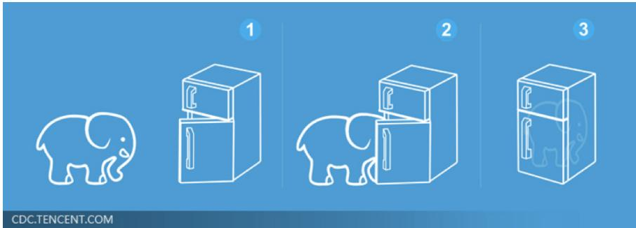


CDC.TENCENT.COM

## 1 深度学习简介
在介绍深度学习之前，我们先看下这幅图：⼈⼯智能>机器学习>深度学习


深度学习是机器学习的⼀个⼦集，也就是说深度学习是实现机器学习的⼀种⽅法 与机器学习算法的主要区别如下图所示：
43 

深度学习
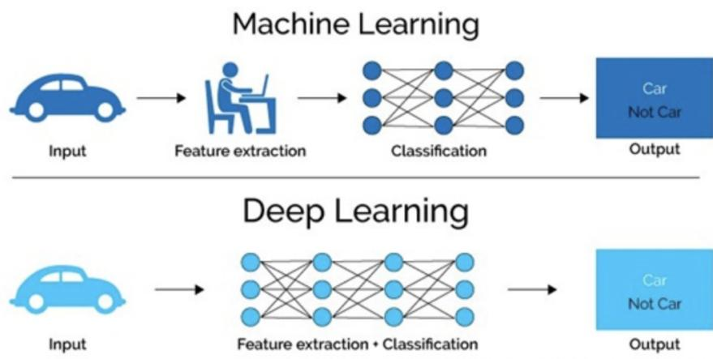

传统机器学习算术依赖⼈⼯设计特征，并进⾏特征提取，⽽深度学习⽅法不需要⼈⼯，⽽是依赖算法⾃动提取特征，这也是深度学习被看做⿊盒⼦，可解释性差的原因
随着计算机软硬件的⻜速发展，现阶段通过拥有众多层数神经⽹络(Neural Network)来模拟⼈脑来解释数据，包括图像，⽂本，⾳频等内容 ⽬前来看常⽤的神经⽹络包括：
卷积神经⽹络(Convolutional Neural Network)
循环神经⽹络(Recurrent Neural Network)
⽣成对抗⽹络(Generative Adversarial Networks)
深度强化学习(Deep Reinforcement Learning)等
## 2 什么是神经⽹络
⼈⼯神经⽹络（ Artificial Neural Network， 简写为ANN）也简称为神经⽹络（NN），是⼀种模仿⽣物神经⽹络结构和功能的 计算模型 ⼈脑可以看做是⼀个⽣物神经⽹络，由众多的神经元连接⽽成 各个神经元传递复杂的电信号，树突接收到输⼊信号，然后对信号进⾏处理，通过轴突输出信号 下图是⽣物神经元示意图：
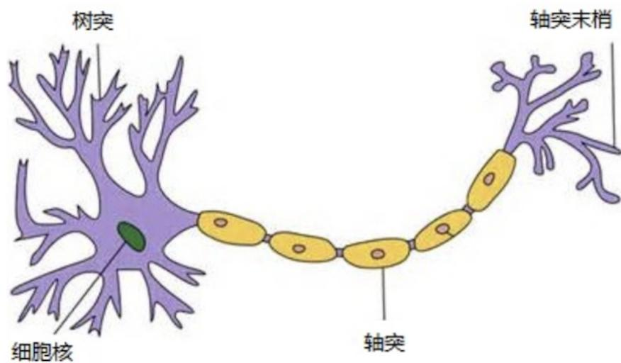

44 

深度学习
那怎么构建⼈⼯神经⽹络中的神经元呢？
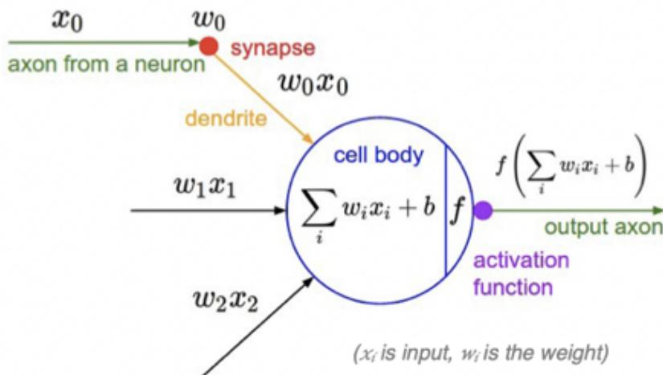

受⽣物神经元的启发，⼈⼯神经元接收来⾃其他神经元或外部源的输⼊，每个输⼊都有⼀个相关的权值(w)，它是根据该输⼊对当前神经元的重要性来确定的，对该输⼊加权并与其他输⼊求和后，经过⼀个激活函数f，计算得到该神经元的输出
那接下来我们就利⽤神经元来构建神经⽹络，相邻层之间的神经元相互连接，并给每⼀个连接分配⼀个强度，如下图所示：
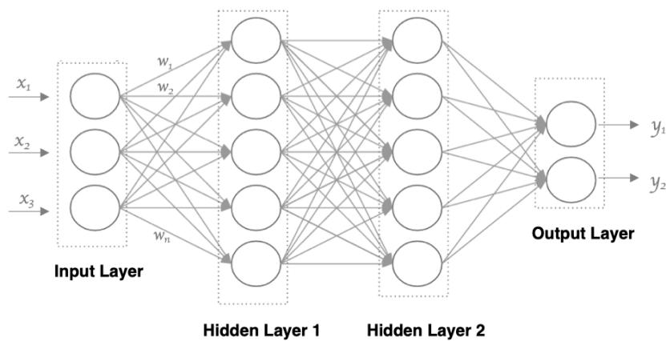

神经⽹络中信息只向⼀个⽅向移动，即从输⼊节点向前移动，通过隐藏节点，再向输出节点移动，⽹络中没有循环或者环 其中的基本构件是：
输⼊层：即输⼊x的那⼀层
输出层：即输出y的那⼀层
隐藏层：输⼊层和输出层之间都是隐藏层
## 特点是：
同⼀层的神经元之间没有连接
第N层的每个神经元和第N-1层的所有神经元相连(这就是fullconnected的含义)，第N-1层神经元的输出就是第N层神经元的输⼊<sub>。</sub>
每个连接都有⼀个权值
45 

深度学习
## 3 神经元是如何⼯作的？
⼈⼯神经元接收到⼀个或多个输⼊，对他们进⾏加权并相加，总和通过⼀个⾮线性函数产⽣输出
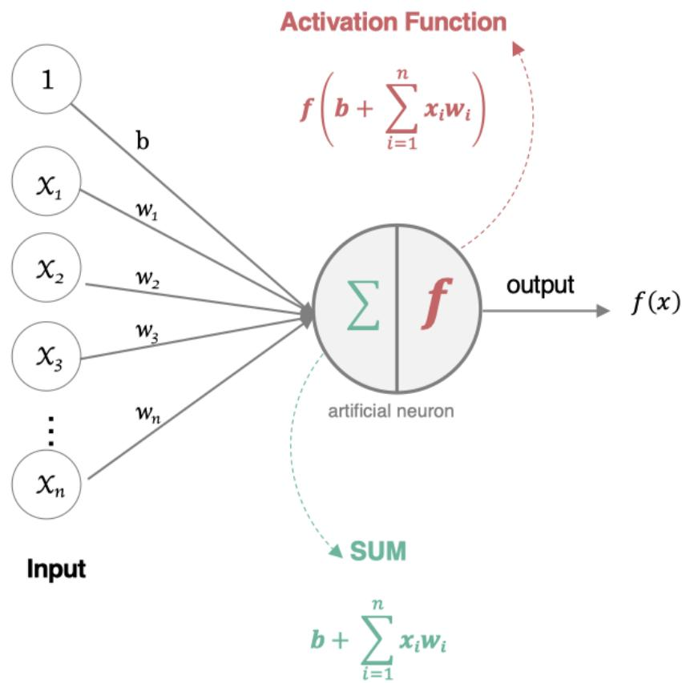

所有的输⼊xi，与相应的权重wi相乘并求和：
$$
w e i g h t e d s u m = b ^ {*} 1 + x _ {1} ^ {*} w _ {1} + \ldots + x _ {n} ^ {*} w _ {n} = b + \sum_ {i = 1} ^ {n} x _ {i} w _ {i}
$$
将求和结果送⼊到激活函数中，得到最终的输出结果：
$$
f (x) = f \left(b + \sum_ {i = 1} ^ {n} x _ {i} w _ {i}\right)
$$
## 3.1 激活函数
在神经元中引⼊了激活函数，它的本质是向神经⽹络中引⼊⾮线性因素的，通过激活函数，神经⽹络就可以拟合各种曲线 如果不⽤激活函数，每⼀层输出都是上层输⼊的线性函数，⽆论神经⽹络有多少层，输出都是输⼊的线性组合，引⼊⾮线性函数作为激活函数，那输出不再是输⼊的线性组合，可以逼近任意函数 常⽤的激活函数有：
46 

深度学习

## 3.1.1.Sigmoid/logistics函数
数学表达式为：
$$
f (x) = \frac {1}{1 + e ^ {- x}}
$$
曲线如下图所示：
https://cdn-mineru.openxlab.org.cn/result/2026-10-20/67634768-2e5b-4fbe-adb5-9150a97d5969/b145cbe34185fbf7a348f9f1e8a8f2da3ff24f06421b8992c4d28151cc0ae35d.jpg
sigmoid 在定义域内处处可导，且两侧导数逐渐趋近于0 如果X的值很⼤或者很⼩的时候，那么函数的梯度（函数的斜率）会⾮常⼩，在反向传播的过程中，导致了向低层传递的梯度也变得⾮常⼩ 此时，⽹络参数很难得到有效训练 这种现象被称为梯度消失 ⼀般来说， sigmoid ⽹络在 5层之内就会产⽣梯度消失现象 ⽽且，该激活函数并不是以0为中⼼的，所以在实践中这种激活函数使⽤的很少 sigmoid函数⼀般只⽤于⼆分类的输出层
实现⽅法：
47 

深度学习
```python
# 导入相应的工具包
import tensorflow as tf
import tensorflow.keras as keras
import matplotlib.pyplot as plt
import numpy as np
# 定义x的取值范围
x = np.linspace(-10, 10, 100)
# 直接使用tensorflow实现
y = tf.nn.sigmoid(x)
# 绘图
plt.plot(x,y)
plt.grid()
```
输出结果为：
https://cdn-mineru.openxlab.org.cn/result/2026-10-20/67634768-2e5b-4fbe-adb5-9150a97d5969/9053df1b9f5a7c8130007d818d609cd97b626d8dae9c8a1ea453e9bbd6b75309.jpg

3.1.2.tanh(双曲正切曲线)

数学表达式如下：
$$
\tanh (x) = \frac {e ^ {x} - e ^ {- x}}{e ^ {x} + e ^ {- x}}
$$
曲线如下图所示：
48 

深度学习
https://cdn-mineru.openxlab.org.cn/result/2026-10-20/67634768-2e5b-4fbe-adb5-9150a97d5969/6eb542e31c056d12b7cde842c43eebd7b369c814adfa2c62f889c94e4a7310d3.jpg
tanh也是⼀种⾮常常⻅的激活函数 与sigmoid相⽐，它是以0为中⼼的，使得其收敛速度要⽐sigmoid快，减少迭代次数 然⽽，从图中可以看出，tanh两侧的导数也为0，同样会造成梯度消失
若使⽤时可在隐藏层使⽤tanh函数，在输出层使⽤sigmoid函数
实现⽅法为：
```python
# 导入相应的工具包
import tensorflow as tf
import tensorflow.keras as keras
import matplotlib.pyplot as plt
import numpy as np
# 定义x的取值范围
x = np.linspace(-10, 10, 100)
# 直接使用tensorflow实现
y = tf.nn.tanh(x)
# 绘图
plt.plot(x,y)
plt.grid()
```
绘制结果为：
49 

深度学习

3.1.3.RELU

https://cdn-mineru.openxlab.org.cn/result/2026-10-20/67634768-2e5b-4fbe-adb5-9150a97d5969/74c344fbe3b9b3b1761d57a25019c5797f523f75eebbd2fccbf3c7b7460380cd.jpg
数学表达式为：
$$
f (x) = \max (0, x)
$$
曲线如下图所示：
https://cdn-mineru.openxlab.org.cn/result/2026-10-20/67634768-2e5b-4fbe-adb5-9150a97d5969/5b31fbdc202208ea3019fbd5f2f02aec12a8f7abf20b0ecacf1541a21b37e0ca.jpg

the ReLU is half rectified (from bottom

ReLU是⽬前最常⽤的激活函数 从图中可以看到，当x<0时，relu导数为0，⽽当x>0时，则不存在饱和问题 所以，ReLU 能够在x>0时保持梯度不衰减，从⽽缓解梯度消失问题 然⽽，随着训练的推进，部分输⼊会落⼊⼩于0区域，导致对应权重⽆法更新 这种现象被称为“神经元死亡”
与sigmoid相⽐，RELU的优势是：
50 

深度学习
采⽤sigmoid函数，计算量⼤（指数运算），反向传播求误差梯度时，求导涉及除法，计算量相对⼤，⽽采⽤Relu激活函数，整个过程的计算量节省很多
sigmoid函数反向传播时，很容易就会出现梯度消失的情况，从⽽⽆法完成深层⽹络的训练
Relu会使⼀部分神经元的输出为0，这样就造成了⽹络的稀疏性，并且减少了参数的相互依存关系，缓解了过拟合问题的发⽣
## 实现⽅法为：
```python
# 导入相应的工具包
import tensorflow as tf
import tensorflow.keras as keras
import matplotlib.pyplot as plt
import numpy as np
# 定义x的取值范围
x = np.linspace(-10, 10, 100)
# 直接使用tensorflow实现
y = tf.nn.relu(x)
# 绘图
plt.plot(x,y)
plt.grid()
```
## 绘制结果为：
https://cdn-mineru.openxlab.org.cn/result/2026-10-20/67634768-2e5b-4fbe-adb5-9150a97d5969/cc34bffbcb997715960f4686a4d5f19477969806b014fea87692b2ed2b42a532.jpg
## 3.1.4.LeakReLu
该激活函数是对RELU的改进，数学表达式为：
$$
f (x) = \max (0. 1 x, x)
$$
51 

深度学习
曲线如下所示：
https://cdn-mineru.openxlab.org.cn/result/2026-10-20/67634768-2e5b-4fbe-adb5-9150a97d5969/cf01cb9ea60d7feb3657e303109336aa1d32a13b254ef6374c5ac187e96e367f.jpg
实现⽅法为：
```python
# 导入相应的工具包
import tensorflow as tf
import tensorflow.keras as keras
import matplotlib.pyplot as plt
import numpy as np
# 定义x的取值范围
x = np.linspace(-10, 10, 100)
# 直接使用tensorflow实现
y = tf.nn.leaky_relu(x)
# 绘图
plt.plot(x, y)
plt.grid()
```
## 3.1.5. SoftMax
softmax⽤于多分类过程中，它是⼆分类函数sigmoid在多分类上的推⼴，⽬的是将多分类的结果以概率的形式展现出来
计算⽅法如下图所示：
$$
\operatorname{softmax} \left(z _ {i}\right) = \frac {e ^ {z _ {i}}}{\sum_ {j} e ^ {z _ {j}}}
$$
使⽤⽅法：
52 

深度学习
https://cdn-mineru.openxlab.org.cn/result/2026-10-20/67634768-2e5b-4fbe-adb5-9150a97d5969/12a37075b53c1b91d12c3aa63f878f99705012e609903b6bc58d88751d1163a6.jpg
softmax直⽩来说就是将⽹络输出的logits通过softmax函数，就映射成为(0,1)的值，⽽这些值的累和为1（满⾜概率的性质），那么我们将它理解成概率，选取概率最⼤（也就是值对应最⼤的）接点，作为我们的预测⽬标类别
实现，以上图中数字9的分类结果为例给⼤家进⾏演示：
```python
# 导入相应的工具包
import tensorflow as tf
import tensorflow.keras as keras
import matplotlib.pyplot as plt
import numpy as np
# 数字中的score
x = tf.constant([0.2, 0.02, 0.15, 1.3, 0.5, 0.06, 1.1, 0.05, 3.75])
# 将其送入到softmax中计算分类结果
y = tf.nn.softmax(x)
# 将结果进行打印
print(y)
```
分类结果为：
```txt
tf.Tensor(
[0.02167152 0.01810157 0.02061459 0.06510484 0.02925349 0.0
0.05330333 0.01865285 0.75445753], shape=(9,), dtype=float 
```
## 3.1.6. 其他激活函数
53 

深度学习
<table><tr><td>Name</td><td>Plot</td><td>Equation</td><td>Derivative (with respect to x)</td><td>Range</td></tr><tr><td>Identity function</td><td></td><td><eq>f(x) = x</eq></td><td><eq>f&#x27;(x) = 1</eq></td><td><eq>(-\infty, \infty)</eq></td></tr><tr><td>Binary step</td><td></td><td><eq>f(x) = \begin{cases} 0 &amp; \text{for } x &lt; 0 \\ 1 &amp; \text{for } x \geq 0 \end{cases}</eq></td><td><eq>f&#x27;(x) = \begin{cases} 0 &amp; \text{for } x \neq 0 \\ ? &amp; \text{for } x = 0 \end{cases}</eq></td><td><eq>\{0, 1\}</eq></td></tr><tr><td>Logistic</td><td></td><td><eq>f(x) = \frac{1}{1 + e^{-x}}</eq></td><td><eq>f&#x27;(x) = f(x)(1 - f(x))</eq></td><td><eq>(0, 1)</eq></td></tr><tr><td>TanH</td><td></td><td><eq>f(x) = \tanh(x) = \frac{2}{1 + e^{-2x}} - 1</eq></td><td><eq>f&#x27;(x) = 1 - f(x)^2</eq></td><td><eq>(-1, 1)</eq></td></tr><tr><td>Rectified linear unit (ReLU)</td><td></td><td><eq>f(x) = \begin{cases} 0 &amp; \text{for } x &lt; 0 \\ x &amp; \text{for } x \geq 0 \end{cases}</eq></td><td><eq>f&#x27;(x) = \begin{cases} 0 &amp; \text{for } x &lt; 0 \\ 1 &amp; \text{for } x \geq 0 \end{cases}</eq></td><td><eq>[0, \infty)</eq></td></tr><tr><td>Leaky ReLU</td><td></td><td><eq>f(x) = \begin{cases} 0.01x &amp; \text{for } x &lt; 0 \\ x &amp; \text{for } x \geq 0 \end{cases}</eq></td><td><eq>f&#x27;(x) = \begin{cases} 0.01 &amp; \text{for } x &lt; 0 \\ 1 &amp; \text{for } x \geq 0 \end{cases}</eq></td><td><eq>(-\infty, \infty)</eq></td></tr><tr><td>Parametric rectified linear unit (PReLU)</td><td></td><td><eq>f(\alpha, x) = \begin{cases} \alpha x &amp; \text{for } x &lt; 0 \\ x &amp; \text{for } x \geq 0 \end{cases}</eq></td><td><eq>f&#x27;(\alpha, x) = \begin{cases} \alpha &amp; \text{for } x &lt; 0 \\ 1 &amp; \text{for } x \geq 0 \end{cases}</eq></td><td><eq>(-\infty, \infty)</eq></td></tr><tr><td>Randomized leaky rectified linear unit (RReLU)</td><td></td><td><eq>f(\alpha, x) = \begin{cases} \alpha x &amp; \text{for } x &lt; 0 \\ x &amp; \text{for } x \geq 0 \end{cases}</eq></td><td><eq>f&#x27;(\alpha, x) = \begin{cases} \alpha &amp; \text{for } x &lt; 0 \\ 1 &amp; \text{for } x \geq 0 \end{cases}</eq><eq>^{[1]}</eq></td><td><eq>(-\infty, \infty)</eq></td></tr><tr><td>Exponential linear unit (ELU)</td><td></td><td><eq>f(\alpha, x) = \begin{cases} \alpha (e^x - 1) &amp; \text{for } x &lt; 0 \\ x &amp; \text{for } x \geq 0 \end{cases}</eq></td><td><eq>f&#x27;(\alpha, x) = \begin{cases} f(\alpha, x) + \alpha &amp; \text{for } x &lt; 0 \\ 1 &amp; \text{for } x \geq 0 \end{cases}</eq></td><td><eq>(-\alpha, \infty)</eq></td></tr></table>
## 3.1.7.如何选择激活函数
## 隐藏层
优先选择RELU激活函数
如果ReLu效果不好，那么尝试其他激活，如Leaky ReLu等
如果你使⽤了Relu， 需要注意⼀下Dead Relu问题， 避免出现⼤的梯度从⽽导致过多的神经元死亡
不要使⽤sigmoid激活函数，可以尝试使⽤tanh激活函数
## 输出层
⼆分类问题选择sigmoid激活函数
多分类问题选择softmax激活函数
回归问题选择identity激活函数
## 3.2 参数初始化
对于某⼀个神经元来说，需要初始化的参数有两类：⼀类是权重W，还有⼀类是偏置b,偏置b初始化为0即可 ⽽权重W的初始化⽐较重要，我们着重来介绍常⻅的初始化⽅式
54 

深度学习
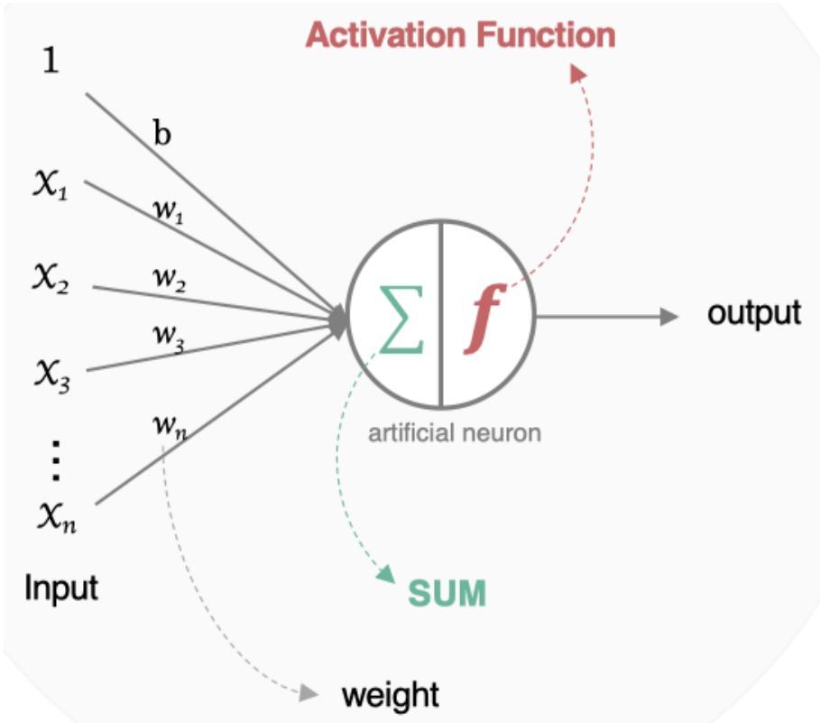

## 3.2.1.随机初始化
随机初始化从均值为0，标准差是1的⾼斯分布中取样，使⽤⼀些很⼩的值对参数W进⾏初始化
## 3.2.2.标准初始化
权重参数初始化从区间均匀随机取值 即在(-1/√d,1/√d)均匀分布中⽣成当前神经元的权重，其中d为每个神经元的输⼊数量
## 3.2.3.Xavier初始化
该⽅法的基本思想是各层的激活值和梯度的⽅差在传播过程中保持⼀致，也叫做Glorot初始化 在tf.keras中实现的⽅法有两种：
## 正态化Xavier初始化：
Glorot 正态分布初始化器，也称为 Xavier 正态分布初始化器 它从以 0为中⼼，标准差为 $\mathsf { s t d d e v } \ = \ \mathsf { s q r t } \left( 2 \ / \ \left( \mathsf { f a n \_ i n } \ + \ \mathsf { f a n \_ o u t } \right) \right)$ 的正态分布中抽取样本， 其中 fan_in 是输⼊神经元的个数， fan_out是输出的神经元个数
实现⽅法为：
55 

## 深度学习
```python
# 导入工具包
import tensorflow as tf
# 进行实例化
initializer = tf.keras.initializers.glorot_normal()
# 采样得到权重值
values = initializer(shape=(9, 1))
# 打印结果
print(values)
```
## 输出结果为：
```txt
tf.Tensor(
[[ 0.71967787]
[ 0.56188506]
[-0.7327265 ]
[-0.05581591]
[-0.05519835]
[ 0.11283273]
[ 0.8377778 ]
[ 0.5832906 ]
[ 0.10221979]], shape=(9, 1), dtype=float32) 
```
## 标准化Xavier初始化
Glorot 均匀分布初始化器，也称为 Xavier 均匀分布初始化器 它从 [-limit，limit] 中的均匀分布中抽取样本， 其中 limit 是 sqrt(6 /(fan_in + fan_out)) ， 其中 fan_in 是输⼊神经元的个数，
fan_out 是输出的神经元个数
```python
# 导入工具包
import tensorflow as tf
# 进行实例化
initializer = tf.keras.initializers.glorot_uniform()
# 采样得到权重值
values = initializer(shape=(9, 1))
# 打印结果
print(values)
```
## 输出结果为：
56 

## 深度学习
```python
tf.Tensor(
    [[-0.59119344]]
    [ 0.06239486]
    [ 0.65161395]
    [-0.30347362]
    [-0.5407096]
    [ 0.35138106]
    [ 0.41150713]
    [ 0.32143414]
    [-0.57354397]], shape=(9, 1), dtype=float32) 
```
## 3.2.4.He初始化
he初始化，也称为Kaiming初始化，出⾃⼤神何恺明之⼿，它的基本思想是正向传播时，激活值的⽅差保持不变；反向传播时，关于状态值的梯度的⽅差保持不变 在tf.keras中也有两种：
## 正态化的he初始化
He 正态分布初始化是以 0 为中⼼，标准差为 stddev = sqrt(2 /fan_in) 的截断正态分布中抽取样本， 其中 fan_in 是输⼊神经元的个数，在tf.keras中的实现⽅法为：
```python
# 导入工具包
import tensorflow as tf
# 进行实例化
initializer = tf.keras.initializers.he_normal()
# 采样得到权重值
values = initializer(shape=(9, 1))
# 打印结果
print(values)
```
## 输出结果为：
```python
tf.Tensor(
    [[-0.1488019 ]]
    [-0.12102155]
    [-0.0163257]
    [-0.36920077]
    [-0.89464396]
    [-0.28749225]
    [-0.5467023]
    [ 0.27031776]
    [-0.1831588 ]], shape=(9, 1), dtype=float32) 
```
## 标准化的he初始化
57 

深度学习
He 均匀⽅差缩放初始化器 它从 [-limit，limit] 中的均匀分布中抽取样本， 其中 limit 是 sqrt(6 / fan_in) ， 其中 fan_in 输⼊神经元的个数 实现为：
```python
# 导入工具包
import tensorflow as tf
# 进行实例化
initializer = tf.keras.initializers.he_uniform()
# 采样得到权重值
values = initializer(shape=(9, 1))
# 打印结果
print(values)
```
## 输出结果为：
```python
tf.Tensor(
    [[ 0.80033934]
    [-0.18773115]
    [ 0.6726284 ]
    [-0.23672342]
    [-0.6323329 ]
    [ 0.6048162 ]
    [ 0.1637358 ]
    [ 0.60797024]
    [-0.46316862]], shape=(9, 1), dtype=float32) 
```
## 4 神经⽹络的搭建
接下来我们来构建如下图所示的神经⽹络模型：
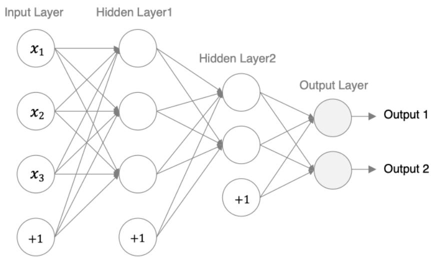

58 

深度学习
tf.Keras中构建模有两种⽅式，⼀种是通过Sequential构建，⼀种是通过Model类构建 前者是按⼀定的顺序对层进⾏堆叠，⽽后者可以⽤来构建较复杂的⽹络模型 ⾸先我们介绍下⽤来构建⽹络的全连接层：
```python
tf.keras.layers.Dense(
    units, activation=None, use_bias=True, kernel_initializer
    bias_initializer='zeros') 
```
## 主要参数：
units: 当前层中包含的神经元个数
Activation: 激活函数，relu,sigmoid等
use_bias: 是否使⽤偏置，默认使⽤偏置
Kernel_initializer: 权重的初始化⽅式，默认是Xavier初始化
bias_initializer: 偏置的初始化⽅式，默认为0
## 4.1通过Sequential构建
Sequential() 提供⼀个层的列表，就能快速地建⽴⼀个神经⽹络模型，实现⽅法如下所示：
```python
# 导入相关的工具包
import tensorflow as tf
from tensorflow import keras

from tensorflow.keras import layers
# 定义一个Sequential模型，包含3层
model = keras.Sequential(
    [
    # 第一层：激活函数为relu，权重初始化为he_normal
    layers.Dense(3, activation="relu",
    kernel_initializer="he_normal", name=' 
    # 第二层：激活函数为relu，权重初始化为he_normal
    layers.Dense(2, activation="relu",
    kernel_initializer="he_normal", name=' 
    # 第三层（输出层）：激活函数为sigmoid，权重初始化为he_normal
    layers.Dense(2, activation="sigmoid",
    kernel_initializer="he_normal", name=' 
    ],
    name="my_Sequential"
)
```
接下来我们使⽤：
59 

深度学习
```txt
# 展示模型结果
model.summary()
```
如下所示：
```txt
Model: "my_Sequential"
Layer (type) Output Shape Para
layer1 (Dense) (None, 3) 12
layer2 (Dense) (None, 2) 8
layer3 (Dense) (None, 2) 6
Total params: 26
Trainable params: 26
Non-trainable params: 0 
```
通过这种sequential的⽅式只能构建简单的序列模型，较复杂的模型没有办法实现
## 4.2 利⽤function API构建
tf.keras 提供了 Functional API，建⽴更为复杂的模型，使⽤⽅法是将层作为可调⽤的对象并返回张量，并将输⼊向量和输出向量提供给tf.keras.Model 的 inputs 和 outputs 参数，实现⽅法如下：
```python
# 导入工具包
import tensorflow as tf

# 定义模型的输入
inputs = tf.keras.Input(shape=(3,),name="input")

# 第一层：激活函数为relu，其他默认
x = tf.keras.layers.Dense(3, activation="relu",name="layer")
# 第二层：激活函数为relu，其他默认
x = tf.keras.layers.Dense(2, activation="relu",name="layer")
# 第三层（输出层）：激活函数为sigmoid
outputs = tf.keras.layers.Dense(2, activation="sigmoid",name="layer")
# 使用Model来创建模型，指明输入和输出
model = tf.keras.Model(inputs=inputs, outputs=outputs,name=
```
```txt
同样通过：
```
60 
深度学习

# 展示模型结果
model.summary() 
## 结果如下所示：
<table><tr><td colspan="3">Model: &quot;my_model&quot;</td></tr><tr><td>Layer (type)</td><td>Output Shape</td><td>Para</td></tr><tr><td>input (InputLayer)</td><td>[(None, 3)]</td><td>0</td></tr><tr><td>layer1 (Dense)</td><td>(None, 3)</td><td>12</td></tr><tr><td>layer2 (Dense)</td><td>(None, 2)</td><td>8</td></tr><tr><td>layer3 (Dense)</td><td>(None, 2)</td><td>6</td></tr><tr><td colspan="3">Total params: 26Trainable params: 26Non-trainable params: 0</td></tr></table>
## 另外也可以通过：
# 模型展示
keras.utils.plot_model(model,show_shapes=True) 
61 

深度学习
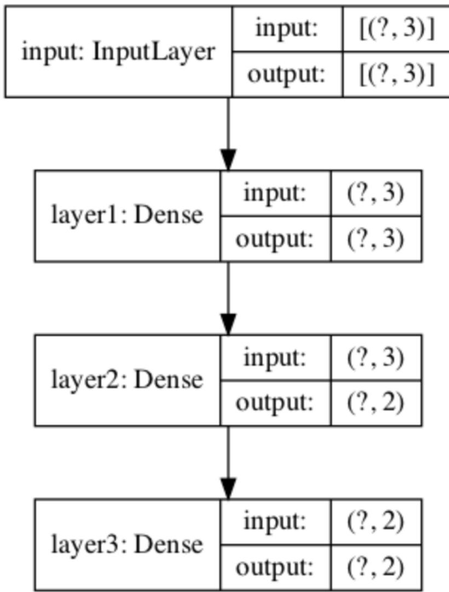

## 4.3 通过model的⼦类构建
通过model的⼦类构建模型，此时需要在init中定义神经⽹络的层，在cal⽅法中定义⽹络的前向传播过程，实现⽅法如下：
62 

深度学习
```python
# 导入工具包
import tensorflow as tf

# 定义model的子类
class MyModel(tf.keras.Model):
    # 在init方法中定义网络的层结构
    def __init__(self):
    super(MyModel, self).__init__()

    # 第一层：激活函数为relu，权重初始化为he_normal
    self.layer1 = tf.keras.layers.Dense(3, activation="kernel_initializer="he_normal", name=')

    # 第二层：激活函数为relu，权重初始化为he_normal
    self.layer2 =tf.keras.layers.Dense(2, activation="kernel_initializer="he_normal", name=')

    # 第三层（输出层）：激活函数为sigmoid，权重初始化为he_normal
    self.layer3 =tf.keras.layers.Dense(2, activation="kernel_initializer="he_normal", name=')

    # 在call方法中万完成前向传播
    def call(self, inputs):
    x = self.layer1(inputs)
    x = self.layer2(x)
    return self.layer3(x)

# 实例化模型
model = MyModel()
# 设置一个输入，调用模型（否则无法使用summay())
x = tf.ones((1, 3))
y = model(x)
```
同样的我们也可以通过summay⽅法来查看模型构建的结果
## 5 神经⽹络的优缺点
## 1.优点
精度⾼，性能优于其他的机器学习⽅法，甚⾄在某些领域超过了⼈类
可以近似任意的⾮线性函数
随之计算机硬件的发展，近年来在学界和业界受到了热捧，有⼤量的框架和库可供调⽤
## 2.缺点
⿊箱，很难解释模型是怎么⼯作的
训练时间⻓，需要⼤量的计算⼒
⽹络结构复杂，需要调整超参数
⼩数据集上表现不佳，容易发⽣过拟合
63 
# 
## 深度学习
## 总结
知道深度学习与机器学习的关系
深度学习是机器学习的⼀个⼦集，主要区别在是否包含特征⼯程
知道神经⽹络是什么
⼀种模仿⽣物神经⽹络结构和功能的 计算模型
知道常⻅的激活函数
默认使⽤relu，⼆分类是sigmoid, 多分类是softmaxs
知道参数初始化的常⻅⽅法
随机初始化，标准初始化，Xavier初始化，He初始化
能够利⽤tf.keras构建神经⽹络模型
Sequential的⽅法，Model的函数式编程，构建model的⼦类实现
了解神经⽹络的优缺点
64 

深度学习
## 2.2 常⻅的损失函数
学习⽬标
知道分类任务的损失函数
知道回归任务的损失函数
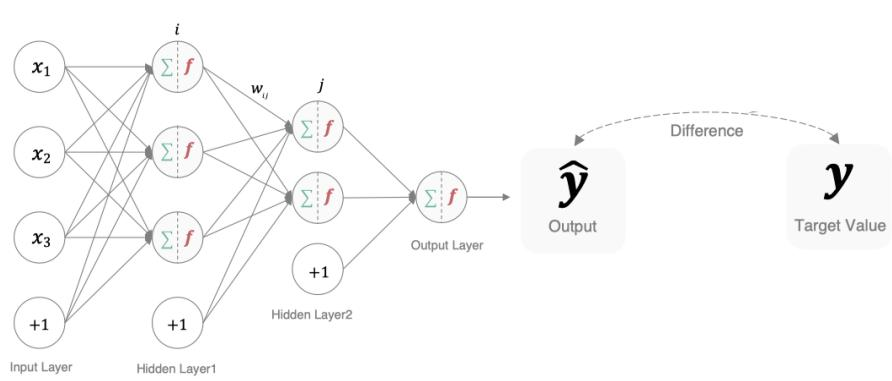

在深度学习中, 损失函数是⽤来衡量模型参数的质量的函数, 衡量的⽅式是⽐较⽹络输出和真实输出的差异，损失函数在不同的⽂献中名称是不⼀样的，主要有以下⼏种命名⽅式：
损失函数
function 
cost function 
误差函数
error function 
65 

深度学习
## 1.分类任务
在深度学习的分类任务中使⽤最多的是交叉熵损失函数，所以在这⾥我们着重介绍这种损失函数
## 1.1 多分类任务
在多分类任务通常使⽤softmax将logits转换为概率的形式，所以多分类的交叉熵损失也叫做softmax损失，它的计算⽅法是：
$$
\mathcal {L} = - \sum_ {i = 1} ^ {n} \mathbf {y} _ {i} \log (S (f _ {\theta} (\mathbf {x} _ {i})))
$$
其中，y是样本x属于某⼀个类别的真实概率，⽽f(x)是样本属于某⼀类别的预测分数，S是softmax函数，L⽤来衡量 $\mathsf { \Phi } _ { : \mathsf { p } , \mathsf { q } }$ 之间差异性的损失结果
例⼦：
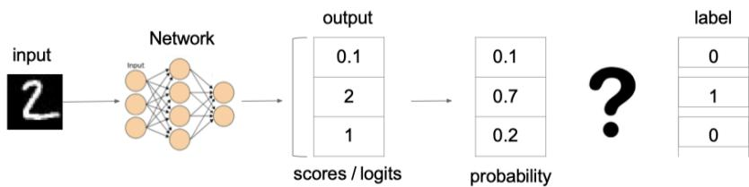


上图中的交叉熵损失为：

$$
- (0 \log (0. 1 0) + 1 \log (0. 7) + 0 \log (0. 2)) = - \log 0. 7
$$
从概率⻆度理解，我们的⽬的是最⼩化正确类别所对应的预测概率的对数的负值，如下图所示：
66 

深度学习
https://cdn-mineru.openxlab.org.cn/result/2026-10-20/67634768-2e5b-4fbe-adb5-9150a97d5969/e4949b41daeda8fea04094be5f463e9afd5b3c1d437fe86ada4ea53c0866087d.jpg
在tf.keras中使⽤CategoricalCrossentropy实现，如下所示：
```python
# 导入相应的包
import tensorflow as tf

# 设置真实值和预测值
y_true = [[0, 1, 0], [0, 0, 1]]
y_pred = [[0.05, 0.95, 0], [0.1, 0.8, 0.1]]

# 实例化交叉熵损失
cce = tf.keras.losses.CategoricalCrossentropy()

# 计算损失结果
cce(y_true, y_pred).numpy()
```
结果为：
```txt
1.176939 
```
## 1.2 ⼆分类任务
在处理⼆分类任务时，我们不在使⽤softmax激活函数，⽽是使⽤sigmoid激活函数，那损失函数也相应的进⾏调整，使⽤⼆分类的交叉熵损失函数：
$$
L = - y \log \hat {y} - (1 - y) \log (1 - \hat {y})
$$
其中，y是样本x属于某⼀个类别的真实概率，⽽y^是样本属于某⼀类别的预测概率，L⽤来衡量真实值与预测值之间差异性的损失结果
67 

深度学习
在tf.keras中实现时使⽤BinaryCrossentropy()，如下所示：
```python
# 导入相应的包
import tensorflow as tf
# 设置真实值和预测值
y_true = [[0], [1]]
y_pred = [[0.4], [0.6]]
# 实例化二分类交叉熵损失
bce = tf.keras.losses.BinaryCrossentropy()
# 计算损失结果
bce(y_true, y_pred).numpy()
```
结果为：
0.5108254 
## 2.回归任务
回归任务中常⽤的损失函数有以下⼏种：
## 2.1 MAE损失
Mean absolute loss(MAE)也被称为L1 Loss，是以绝对误差作为距离：
$$
\mathcal {L} = \frac {1}{n} \sum_ {i = 1} ^ {n} | y _ {i} - f _ {\theta} (x _ {i}) |
$$
曲线如下图所示：
68 

深度学习
https://cdn-mineru.openxlab.org.cn/result/2026-10-20/67634768-2e5b-4fbe-adb5-9150a97d5969/839026c3b8de8f3bf69bf2e60ed5d7b8a22077c5810bc90116192cca15ff5ae2.jpg
特点是：由于L1 loss具有稀疏性，为了惩罚较⼤的值，因此常常将其作为正则项添加到其他loss中作为约束 L1 loss的最⼤问题是梯度在零点不平滑，导致会跳过极⼩值
在tf.keras中使⽤MeanAbsoluteError实现，如下所示：
```python
# 导入相应的包
import tensorflow as tf
# 设置真实值和预测值
y_true = [[0.], [0.]]
y_pred = [[1.], [1.]]
# 实例化MAE损失
mae = tf.keras.losses.MeanAbsoluteError()
# 计算损失结果
mae(y_true, y_pred).numpy()
```
结果为：
```txt
1.0 
```
## 2.2 MSE损失
Mean Squared Loss/ Quadratic Loss(MSE loss)也被称为L2 loss，或欧⽒距离，它以误差的平⽅和作为距离：
69 

深度学习
$$
\mathcal {L} = \frac {1}{n} \sum_ {i = 1} ^ {n} \left(y _ {i} - f _ {\theta} (x _ {i})\right) ^ {2}
$$
曲线如下图所示：
https://cdn-mineru.openxlab.org.cn/result/2026-10-20/67634768-2e5b-4fbe-adb5-9150a97d5969/6f771bab5dda9f41095f11e67ca2208f02f41173b3c01dcb141b0856b30263f9.jpg
特点是：L2 loss也常常作为正则项 当预测值与⽬标值相差很⼤时, 梯度容易爆炸
在tf.keras中通过MeanSquaredError实现：
```python
# 导入相应的包
import tensorflow as tf
# 设置真实值和预测值
y_true = [[0.], [1.]]
y_pred = [[1.], [1.]]
# 实例化MSE损失
mse = tf.keras.losses.MeanSquaredError()
# 计算损失结果
mse(y_true, y_pred).numpy()
```
结果为：
70 

深度学习
```python
# 导入相应的包
import tensorflow as tf
# 设置真实值和预测值
y_true = [[0], [1]]
y_pred = [[0.6], [0.4]]
# 实例化smooth L1损失
h = tf.keras.losses.Huber()
# 计算损失结果
h(y_true, y_pred).numpy()
结果：
0.18
```
## 2.3 smooth L1 损失
Smooth L1损失函数如下式所示：
$$
\operatorname{smooth} _ {L _ {1}} (x) = \left\{ \begin{array}{l l} 0. 5 x ^ {2} & \text { if } | x | <   1 \\ | x | - 0. 5 & \text { otherwise } \end{array} \right.
$$
其中：�=f(x)−y 为真实值和预测值的差值
https://cdn-mineru.openxlab.org.cn/result/2026-10-20/67634768-2e5b-4fbe-adb5-9150a97d5969/218f0648a05989f029c8a64b20ee22b4c9f727adbe640792fc0a7267017f2958.jpg
从上图中可以看出，该函数实际上就是⼀个分段函数，在[-1,1]之间实际上就是L2损失，这样解决了L1的不光滑问题，在[-1,1]区间外，实际上就是L1损失，这样就解决了离群点梯度爆炸的问题 通常在⽬标检测中使⽤该损失函数
在tf.keras中使⽤Huber计算该损失，如下所示：
71 

深度学习
总结
知道分类任务的损失函数
多分类的交叉熵损失函数和⼆分类的交叉熵损失函数
知道回归任务的损失函数
MAE，MSE，smooth L1损失函数
72 

深度学习
## 2.3 深度学习的优化⽅法
学习⽬标
知道梯度下降算法
理解神经⽹络的链式法则
掌握反向传播算法（BP算法）
知道梯度下降算法的优化⽅法
了解学习率退⽕
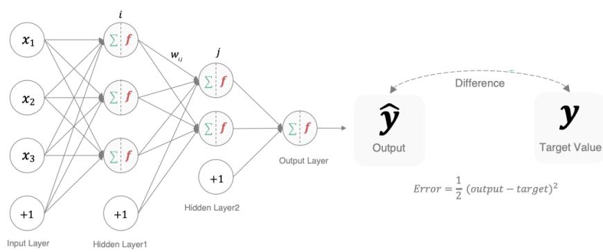

## 1.梯度下降算法【回顾】
梯度下降法简单来说就是⼀种寻找使损失函数最⼩化的⽅法。⼤家在机器学习阶段已经学过该算法，所以我们在这⾥就简单的回顾下，从数学上的⻆度来看，梯度的⽅向是函数增⻓速度最快的⽅向，那么梯度的反⽅向就是函数减少最快的⽅向，所以有：
$$
w _ {i j} ^ {n e w} = w _ {i j} ^ {o l d} - \eta \frac {\partial E}{\partial w _ {i j}}
$$
其中，η是学习率，如果学习率太⼩，那么每次训练之后得到的效果都太⼩，增⼤训练的时间成本。如果，学习率太⼤，那就有可能直接跳过最优解，进⼊⽆限的训练中。解决的⽅法就是，学习率也需要随着训练的进⾏⽽变化。
73 

深度学习
https://cdn-mineru.openxlab.org.cn/result/2026-10-20/67634768-2e5b-4fbe-adb5-9150a97d5969/0ff660429ed4e68ae63d75ddaa7aaa7dae3e44fb0c91b335e7cca677184701a0.jpg
https://cdn-mineru.openxlab.org.cn/result/2026-10-20/67634768-2e5b-4fbe-adb5-9150a97d5969/154479b907c283893a97ca639e243440ae0b61d3c8a8d12b65d59968ec71ebf2.jpg
在上图中我们展示了⼀维和多维的损失函数，损失函数呈碗状。在训练过程中损失函数对权重的偏导数就是损失函数在该位置点的梯度。我们可以看到，沿着负梯度⽅向移动，就可以到达损失函数底部，从⽽使损失函数最⼩化。这种利⽤损失函数的梯度迭代地寻找局部最⼩值的过程就是梯度下降的过程。
根据在进⾏迭代时使⽤的样本量，将梯度下降算法分为以下三类：
<table><tr><td>梯度下降算法</td><td>定义</td><td>缺点</td><td>优点</td></tr><tr><td>BGD(批量梯度下降)</td><td>每次迭代时需要计算每个样本上损失函数的梯度并求和</td><td>计算量大、迭代速度慢</td><td>全局最优化</td></tr><tr><td>SGD(随机梯度下降)</td><td>每次迭代时只采集一个样本,计算这个样本损失函数的梯度并更新参数</td><td>准确度下降、存在噪音、非全局最优化</td><td>训练速度快、支持在线学习</td></tr><tr><td>MBGD(小批量梯度下降)</td><td>每次迭代时,我们随机选取一小部分训练样本来计算梯度并更新参数</td><td>准确度不如BGD、非全局最优解</td><td>计算小批量数据的梯度更加高效、支持在线学习</td></tr></table>
实际中使⽤较多的是⼩批量的梯度下降算法，在tf.keras中通过以下⽅法实现：
```python
tf.keras.optimizers.SGD(
    learning_rate=0.01, momentum=0.0, nesterov=False, name=)
) 
```
例⼦：
```python
# 导入相应的工具包
import tensorflow as tf
# 实例化优化方法：SGD
opt = tf.keras.optimizers.SGD(learning_rate=0.1)
# 定义要调整的参数
var = tf.Variable(1.0)
# 定义损失函数：无参但有返回值
loss = lambda: (var ** 2)/2.0
# 计算梯度，并对参数进行更新，步长为 `- learning_rate * grad` opt.minimize(loss, [var]).numpy()
# 展示参数更新结果
var.numpy()
```
更新结果为：
74 

深度学习
```markdown
# 1-0.1*1=0.9
0.9 
```
在进⾏模型训练时，有三个基础的概念：
```txt
名词 定义
Epoch 使用训练集的全部数据对模型进行一次完整训练，被称之为“一代训练”
Batch 使用训练集中的一小部分样本对模型权重进行一次反向传播的参数更新，这一小部分样本被称为“一批数据”
Iteration 使用一个 Batch 数据对模型进行一次参数更新的过程，被称之为“一次训练”
```
实际上，梯度下降的⼏种⽅式的根本区别就在于 Batch Size不同,，如下表所示：
<table><tr><td>梯度下降方式</td><td>Training Set Size</td><td>Batch Size</td><td>Number of Batches</td></tr><tr><td>BGD</td><td>N</td><td>N</td><td>1</td></tr><tr><td>SGD</td><td>N</td><td>1</td><td>N</td></tr><tr><td>Mini-Batch</td><td>N</td><td>B</td><td><eq>N/B + 1</eq></td></tr></table>
注：上表中 Mini-Batch 的 Batch 个数为 N / B + 1 是针对未整除的情况。整除则是 N / B。
假设数据集有 50000 个训练样本，现在选择 Batch Size = 256 对模型进⾏训练。
每个 Epoch 要训练的图⽚数量：50000
训练集具有的 Batch 个数：50000/256+1=196
每个 Epoch 具有的 Iteration 个数：196
10个 Epoch 具有的 Iteration 个数：1960
## 2.反向传播算法（BP算法）
利⽤反向传播算法对神经⽹络进⾏训练。该⽅法与梯度下降算法相结合，对⽹络中所有权重计算损失函数的梯度，并利⽤梯度值来更新权值以最⼩化损失函数。在介绍BP算法前，我们先看下前向传播与链式法则的内容。
## 2.1 前向传播与反向传播
前向传播指的是数据输⼊的神经⽹络中，逐层向前传输，⼀直到运算到输出层为⽌。
75 


Feedforward

深度学习
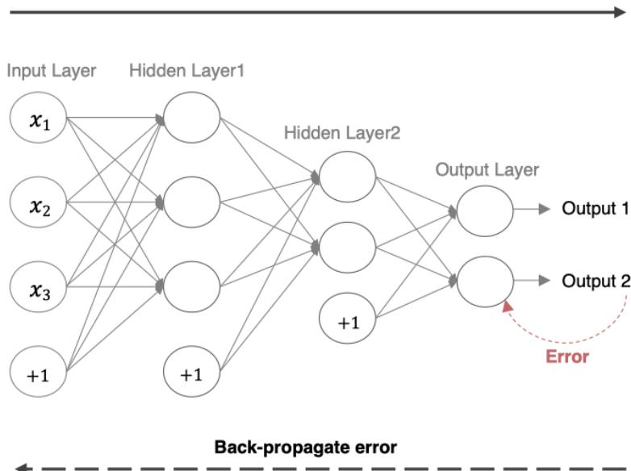

在⽹络的训练过程中经过前向传播后得到的最终结果跟训练样本的真实值总是存在⼀定误差，这个误差便是损失函数。想要减⼩这个误差，就⽤损失函数ERROR，从后往前，依次求各个参数的偏导，这就是反向传播（Back Propagation）。
## 2.2 链式法则
反向传播算法是利⽤链式法则进⾏梯度求解及权重更新的。对于复杂的复合函数，我们将其拆分为⼀系列的加减乘除或指数，对数，三⻆函数等初等函数，通过链式法则完成复合函数的求导。为简单起⻅，这⾥以⼀个神经⽹络中常⻅的复合函数的例⼦来说明 这个过程. 令复合函数 �(�; �, �)为:
$$
f (x; w, b) = \frac {1}{\exp (- (w x + b)) + 1}
$$
其中x是输⼊数据，w是权重，b是偏置。我们可以将该复合函数分解为：
76 
## 
深度学习
<table><tr><td>函数</td><td colspan="2">导数</td></tr><tr><td><eq>h_{1} = x \times w</eq></td><td><eq>\frac{\partial h_{1}}{\partial w} = x</eq></td><td><eq>\frac{\partial h_{1}}{\partial x} = w</eq></td></tr><tr><td><eq>h_{2} = h_{1} + b</eq></td><td><eq>\frac{\partial h_{2}}{\partial h_{1}} = 1</eq></td><td><eq>\frac{\partial h_{2}}{\partial b} = 1</eq></td></tr><tr><td><eq>h_{3} = h_{2} \times -1</eq></td><td><eq>\frac{\partial h_{3}}{\partial h_{2}} = -1</eq></td><td></td></tr><tr><td><eq>h_{4} = \exp(h_{3})</eq></td><td><eq>\frac{\partial h_{4}}{\partial h_{3}} = \exp(h_{3})</eq></td><td></td></tr><tr><td><eq>h_{5} = h_{4} + 1</eq></td><td><eq>\frac{\partial h_{5}}{\partial h_{4}} = 1</eq></td><td></td></tr><tr><td><eq>h_{6} = 1/h_{5}</eq></td><td><eq>\frac{\partial h_{6}}{\partial h_{5}} = -\frac{1}{h_{5}^{2}}</eq></td><td></td></tr></table>
并进⾏图形化表示，如下所示：
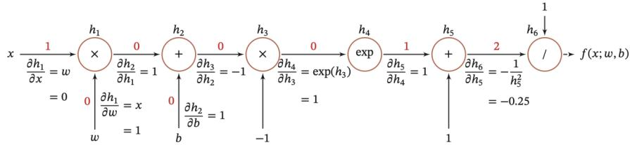

整个复合函数 $f ( x ; w , b )$ 关于参数 � 和 � 的导数可以通过 $f ( x ; w , b )$ 与参数 � 和 � 之间路径上所有的导数连乘来得到，即：
$$
\begin{array}{r} \frac {\partial f (x ; w , b)}{\partial w} = \frac {\partial f (x ; w , b)}{\partial h _ {6}} \frac {\partial h _ {6}}{\partial h _ {5}} \frac {\partial h _ {5}}{\partial h _ {4}} \frac {\partial h _ {4}}{\partial h _ {3}} \frac {\partial h _ {3}}{\partial h _ {2}} \frac {\partial h _ {2}}{\partial h _ {1}} \frac {\partial h _ {1}}{\partial w}, \\ \frac {\partial f (x ; w , b)}{\partial b} = \frac {\partial f (x ; w , b)}{\partial h _ {6}} \frac {\partial h _ {6}}{\partial h _ {5}} \frac {\partial h _ {5}}{\partial h _ {4}} \frac {\partial h _ {4}}{\partial h _ {3}} \frac {\partial h _ {3}}{\partial h _ {2}} \frac {\partial h _ {2}}{\partial b}. \end{array}
$$
以w为例，当 $x = 1 , w = 0 , b = 0$ 时，可以得到：
$$
\begin{array}{r l} & {\frac {\partial f (x ; w , b)}{\partial w} | _ {x = 1, w = 0, b = 0} = \frac {\partial f (x ; w , b)}{\partial h _ {6}} \frac {\partial h _ {6}}{\partial h _ {5}} \frac {\partial h _ {5}}{\partial h _ {4}} \frac {\partial h _ {4}}{\partial h _ {3}} \frac {\partial h _ {3}}{\partial h _ {2}} \frac {\partial h _ {2}}{\partial h _ {1}} \frac {\partial h _ {1}}{\partial w}} \\ & {\qquad = 1 \times - 0. 2 5 \times 1 \times 1 \times - 1 \times 1 \times 1} \\ & {\qquad = 0. 2 5.} \end{array}
$$
注意：常⽤函数的导数：
77 
深度学习

<table><tr><td>函数</td><td>导数</td></tr><tr><td><eq>f(a) = a^{2}</eq></td><td><eq>2a</eq></td></tr><tr><td><eq>f(a) = a^{3}</eq></td><td><eq>3a^{2}</eq></td></tr><tr><td><eq>f(a) = ln(a)</eq></td><td><eq>\frac{1}{a}</eq></td></tr><tr><td><eq>f(a) = e^{a}</eq></td><td><eq>e^{a}</eq></td></tr><tr><td><eq>\sigma(z) = \frac{1}{1 + e^{-z}}</eq></td><td><eq>\sigma(z)(1 - \sigma(z))</eq></td></tr><tr><td><eq>g(z) = tanh(z) = \frac{e^{z} - e^{-z}}{e^{z} + e^{-z}}</eq></td><td><eq>1 - (tanh(z))^{2} = 1 - (g(z))^{2}</eq></td></tr></table>

注：sigmoid的导数计算

$$
\sigma (x) = \frac {1}{1 + e ^ {- x}} \rightarrow \frac {d \sigma (x)}{d x} = \frac {e ^ {- x}}{(1 + e ^ {- x}) ^ {2}} = \left(\frac {1 + e ^ {- x} - 1}{1 + e ^ {- x}}\right)\left(\frac {1}{1 + e ^ {- x}}\right) = (1 - \sigma (x)) \sigma (x)
$$
## 2.3 反向传播算法
反向传播算法利⽤链式法则对神经⽹络中的各个节点的权重进⾏更新。我们通过⼀个例⼦来给⼤家介绍整个流程，假设当前前向传播的过程如下图所以：
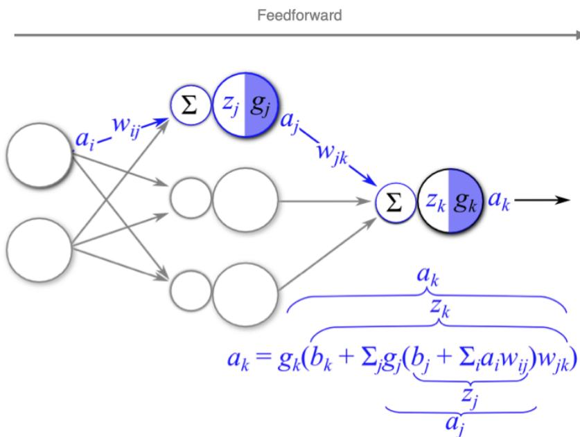


计算损失函数，并进⾏反向传播：

78 

深度学习
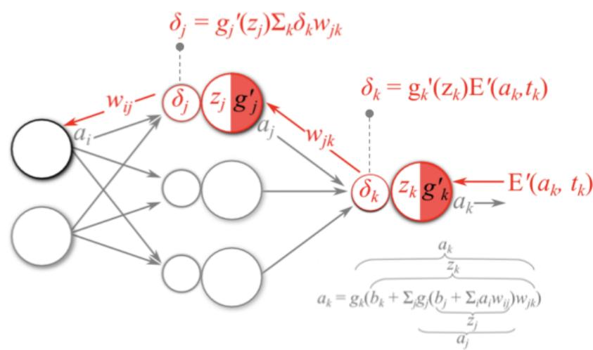


Back-Propagate the error to previous layers

计算梯度值：
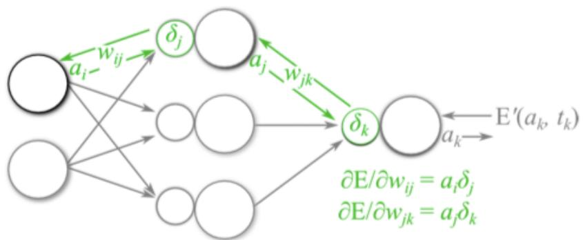

输出层梯度值：
$$
\frac {\partial E}{\partial w _ {j k}} = a _ {j} \delta_ {k}
$$
隐藏层梯度值：
$$
\frac {\partial E}{\partial w _ {i j}} = a _ {i} \delta_ {j}
$$
偏置的梯度值：
$$
\frac {\partial E}{\partial b _ {k}} = \delta_ {k}
$$
79 

深度学习
参数更新：
输出层权重：
$$
w _ {j k} = w _ {j k} - \eta \frac {\partial E}{\partial w _ {j k}}
$$
隐藏层权重：
$$
w _ {i j} = w _ {i j} - \eta \frac {\partial E}{\partial w _ {i j}}
$$
偏置更新：
$$
\boldsymbol {b} _ {j} = \boldsymbol {b} _ {j} - \eta \frac {\partial E}{\partial b _ {j}}
$$
重复上述过程完成模型的训练，整个流程如下表所示：
算法 4.1: 使用反向传播算法的随机梯度下降训练过程

输入: 训练集 $\mathcal{D} = \{(\boldsymbol{x}^{(n)}, \boldsymbol{y}^{(n)})\}_{n=1}^{N}$ ，验证集 V，学习率 $\alpha$ ，正则化系数 $\lambda$ ，网络层数 L，神经元数量 $M_{l}, 1 \leq l \leq L$ .

1 随机初始化 W, b;

2 repeat

3 对训练集 D 中的样本随机重排序;

4 for $n = 1 \cdots N$ do

5 从训练集 D 中选取样本 $(\boldsymbol{x}^{(n)}, \boldsymbol{y}^{(n)})$ ;

6 前馈计算每一层的净输入 $\boldsymbol{z}^{(l)}$ 和激活值 $\boldsymbol{a}^{(l)}$ ，直到最后一层；

7 反向传播计算每一层的误差 $\delta^{(l)}$ ;

// 计算每一层参数的导数

8 $\forall l, \frac{\partial \mathcal{L}(\boldsymbol{y}^{(n)}, \hat{\boldsymbol{y}}^{(n)})}{\partial \boldsymbol{w}^{(l)}} = \delta^{(l)}(\boldsymbol{a}^{(l-1)})^{\top}$ ;

9 $\forall l, \frac{\partial \mathcal{L}(\boldsymbol{y}^{(n)}, \hat{\boldsymbol{y}}^{(n)})}{\partial \boldsymbol{b}^{(l)}} = \delta^{(l)}$ ;

// 更新参数

10 $\boldsymbol{W}^{(l)} \leftarrow \boldsymbol{W}^{(l)} - \alpha(\delta^{(l)}(\boldsymbol{a}^{(l-1)})^{\top} + \lambda \boldsymbol{W}^{(l)})$ ;

11 $\boldsymbol{b}^{(l)} \leftarrow \boldsymbol{b}^{(l)} - \alpha\delta^{(l)}$ ;

12 end

13 until 神经网络模型在验证集 V 上的错误率不再下降；
输出: W, b
80 

深度学习
【举个栗⼦�：】
如下图是⼀个简单的神经⽹络⽤来举例：激活函数为sigmoid
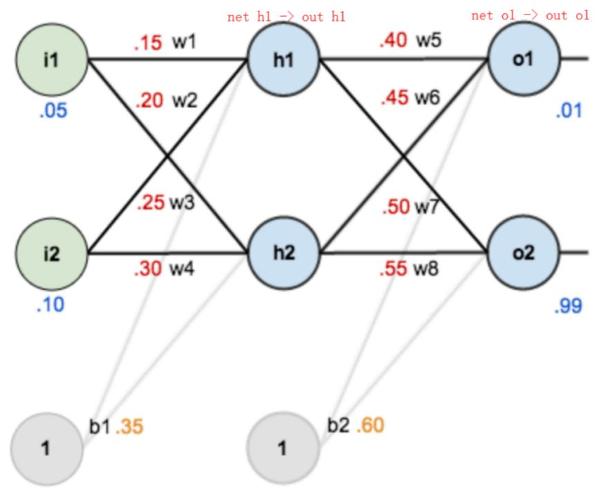

前向传播运算：
netb1 = 0.15 * 0.05 + 0.2 * 0.1 + 0.35 * 1 = 0.3775 $\begin{array} { r } { o u t _ { h 1 } = \frac { 1 } { 1 + e ^ { - n e t _ { h 1 } } } = \frac { 1 } { 1 + e ^ { - 0 . 3 7 7 5 } } = 0 . 5 9 3 2 6 9 9 9 2 } \end{array}$ outh2 = 0.596884378 $\begin{array} { r } { o u t _ { o 1 } = \frac { 1 } { 1 + e ^ { - n e t _ { o 1 } } } = \frac { 1 } { 1 + e ^ { - 1 . 1 0 5 9 0 5 9 6 7 } } = 0 . 7 5 1 3 6 5 0 7 } \end{array}$ outρ2 = 0.772928465 Etotal = Eo1 + E02 = 0.274811083 + 0.023560026 = 0.298371109 
接下来是反向传播（求⽹络误差对各个权重参数的梯度）：
81 

深度学习
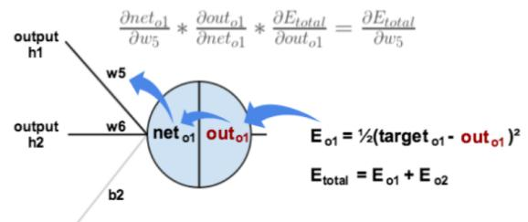

我们先来求最简单的，求误差E对w5的导数。⾸先明确这是⼀个“链式法则”的求导过程，要求误差E对w5的导数，需要先求误差E对out o1的导数，再求out o1对net o1的导数，最后再求net o1对w5的导数，经过这个链式法则，我们就可以求出误差E对w5的导数（偏导），如下图所示：
$$
\begin{array}{l} \frac {\partial n e t _ {o 1}}{\partial w _ {5}} * \frac {\partial o u t _ {o 1}}{\partial n e t _ {o 1}} * \frac {\partial E _ {t o t a l}}{\partial o u t _ {o 1}} = \frac {\partial E _ {t o t a l}}{\partial w _ {5}} \\ \text {output h1} \\ \text {output h2} \\ \text {net o1} \\ \text {out o1} \\ \text {E} _ {o 1} = \frac {1}{2} (\text {target} _ {o 1} - \text {out} _ {o 1}) ^ {2} \\ \text {E} _ {\text {total}} = \text {E} _ {o 1} + \text {E} _ {o 2} \\ E _ {\text {total}} = \frac {1}{2} (\text {target} _ {o 1} - \text {out} _ {o 1}) ^ {2} + \frac {1}{2} (\text {target} _ {o 2} - \text {out} _ {o 2}) ^ {2} \\ \frac {\partial E _ {\text {total}}}{\partial o u t _ {o 1}} = 2 * \frac {1}{2} (\text {target} _ {o 1} - \text {out} _ {o 1}) ^ {2 - 1} * - 1 + 0 \\ \frac {\partial E _ {\text {total}}}{\partial o u t _ {o 1}} = - (\text {target} _ {o 1} - \text {out} _ {o 1}) = - (0. 0 1 - 0. 7 5 1 3 6 5 0 7) = 0. 7 4 1 3 6 5 0 7 \\ \text {out o1} = \frac {1}{1 + e ^ {- n e t _ {o 1}}} \\ \frac {\partial o u t _ {o 1}}{\partial n e t _ {o 1}} = \text {out o1} (1 - \text {out o1}) = 0. 7 5 1 3 6 5 0 7 (1 - 0. 7 5 1 3 6 5 0 7) = 0. 1 8 6 8 1 5 6 0 2 \\ \text {net o1} = w _ {5} * \text {out h1} + w _ {6} * \text {out h2} + b _ {2} * 1 \\ \frac {\partial n e t _ {o 1}}{\partial w _ {5}} = 1 * \text {out h1} * w _ {5} ^ {(1 - 1)} + 0 + 0 = \text {out h1} = 0. 5 9 3 2 6 9 9 9 2 \\ \frac {\partial E _ {\text {total}}}{\partial w _ {5}} = 0. 7 4 1 3 6 5 0 7 * 0. 1 8 6 8 1 5 6 0 2 * 0. 5 9 3 2 6 9 9 9 2 = = = = = = = = = = = = = = = = = = = = = = = = = = = = = = = = = = = = = = = = = = = = = = = = = = = = = = = = = = = = = = = = = = = = = = = = = = = = = = = = = = = = = = = = = = = = = = = = = = = == \\ \end{array}
$$
导数（梯度）已经计算出来了，下⾯就是反向传播与参数更新过程：
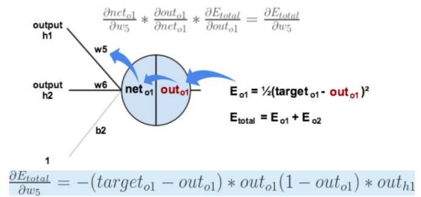

$$
\begin{array}{c} w _ {5} ^ {+} = w _ {5} - \eta * \frac {\partial E _ {t o t a l}}{\partial w _ {5}} = 0. 4 - 0. 5 * 0. 0 8 2 1 6 7 0 4 1 = 0. 3 5 8 9 1 6 4 8 \\ w _ {6} ^ {+} = 0. 4 0 8 6 6 6 1 8 6 \\ w _ {7} ^ {+} = 0. 5 1 1 3 0 1 2 7 0 \\ w _ {8} ^ {+} = 0. 5 6 1 3 7 0 1 2 1 \end{array}
$$
如果要想求误差E对w1的导数，误差E对w1的求导路径不⽌⼀条，这会稍微复杂⼀点，但换汤不换药，计算过程如下所示：
82 

深度学习
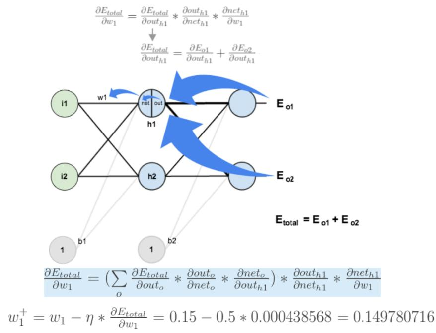


⾄此，“反向传播算法”的过程就讲完了啦！

## 3.梯度下降优化⽅法
梯度下降算法在进⾏⽹络训练时，会遇到鞍点，局部极⼩值这些问题，那我们怎么改进SGD呢？在这⾥我们介绍⼏个⽐较常⽤的
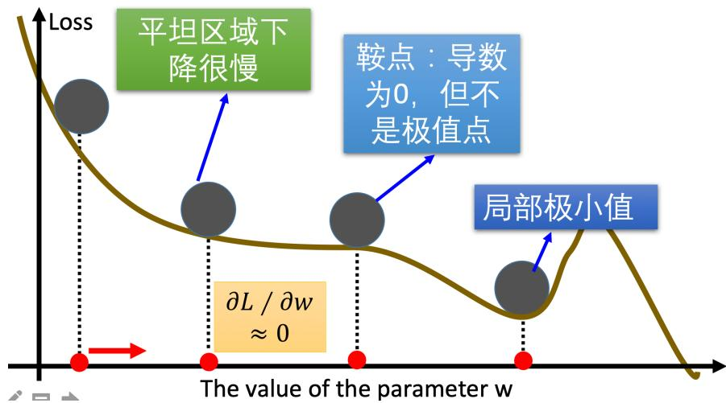

## 3.1 动量算法（Momentum）
动量算法主要解决鞍点问题。在介绍动量法之前，我们先来看下指数加权平均数的计算⽅法。
## 指数加权平均
假设给定⼀个序列，例如北京⼀年每天的⽓温值，图中蓝⾊的点代表真实数据，
83 

深度学习
https://cdn-mineru.openxlab.org.cn/result/2026-10-20/67634768-2e5b-4fbe-adb5-9150a97d5969/c4d551c05b9db18f9f1b71f0ac4f9b9a2198d10db1008a3c1fd91dc5a4e5ab56.jpg

这时温度值波动⽐较⼤，那我们就使⽤加权平均值来进⾏平滑，如下图红线就是平滑后的结果：

https://cdn-mineru.openxlab.org.cn/result/2026-10-20/67634768-2e5b-4fbe-adb5-9150a97d5969/940e2a8a2752b0249c26131a7d24a0834bc6ffa88742f71eb08b5d2c55ecb7ae.jpg
计算⽅法如下所示：
$$
S _ {t} = \left\{ \begin{array}{l l} Y _ {1}, & t = 1 \\ \beta S _ {t - 1} + (1 - \beta) Y _ {t}, & t > 1 \end{array} \right.
$$
其中Yt为 t 时刻时的真实值，St为t加权平均后的值，β为权重值。红线即是指数加权平均后的结果。
上图中β设为0.9，那么指数加权平均的计算结果为：
84 

深度学习
$$
S _ {1} = Y 1
$$
$$
S _ {2} = 0. 9 S _ {1} + 0. 1 Y _ {2}
$$
$$
S _ {9 9} = 0. 9 S _ {9 8} + 0. 1 Y _ {9 9}
$$
$$
S _ {1 0 0} = 0. 9 S _ {9 9} + 0. 1 Y _ {1 0 0}
$$
那么第100天的结果就可以表示为：
$$
S _ {1 0 0} = 0. 1 Y _ {1 0 0} + 0. 1 * 0. 9 Y _ {9 9} + 0. 1 * (0. 9) ^ {2} Y _ {9 8} + \dots
$$
## 动量梯度下降算法
动量梯度下降（Gradient Descent with Momentum）计算梯度的指数加权平均数，并利⽤该值来更新参数值。动量梯度下降法的整个过程为，其中β通常设置为0.9：
85 

深度学习
$$
S _ {d W} [ l ] = \beta S _ {d W} [ l ] + (1 - \beta) d W ^ {[ l ]}
$$
$$
S _ {d b} [ l ] = \beta S _ {d b} [ l ] + (1 - \beta) d b ^ {[ l ]}
$$
$$
W ^ {[ l ]} := W ^ {[ l ]} - \alpha S _ {d W} [ l ]
$$
$$
b ^ {[ l ]} := b ^ {[ l ]} - \alpha S _ {d b} [ l ]
$$
与原始的梯度下降算法相⽐，它的下降趋势更平滑。
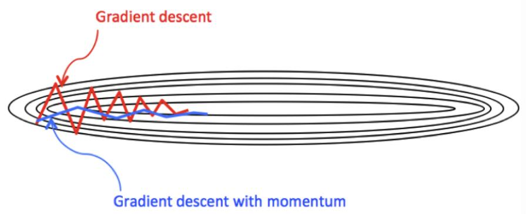

在tf.keras中使⽤Momentum算法仍使⽤功能SGD⽅法，但要设置momentum参数，实现过程如下：
86 

## 深度学习
```python
# 导入相应的工具包
import tensorflow as tf

# 实例化优化方法：SGD 指定参数beta=0.9
opt = tf.keras.optimizers.SGD(learning_rate=0.1, momentum=0.1)
# 定义要调整的参数，初始值
var = tf.Variable(1.0)
val0 = var.value()

# 定义损失函数
loss = lambda: (var ** 2)/2.0
#第一次更新：计算梯度，并对参数进行更新，步长为 `- learning_rate * learning_rate * optimization(loss, [var]).numpy()
val1 = var.value()

# 第二次更新：计算梯度，并对参数进行更新，因为加入了momentum，步长会增加
opt.minimize(loss, [var]).numpy()
val2 = var.value()

# 打印两次更新的步长
print("第一次更新步长={}".format((val0 - val1).numpy()))
print("第二次更新步长={}".format((val1 - val2).numpy()))
```
## 结果为：
第⼀次更新步⻓=0.10000002384185791
另外还有⼀种动量算法Nesterov accelerated gradient(NAG)，使⽤了根据动量项预先估计的参数，在Momentum的基础上进⼀步加快收敛，提⾼响应性，该算法实现依然使⽤SGD⽅法，要设置nesterov设置为true.
## 3.2 AdaGrad
AdaGrad算法会使⽤⼀个⼩批量随机梯度$$g_t$$按元素平⽅的累加变量st。在⾸次迭代时，AdaGrad将s0中每个元素初始化为0。在t次迭代，⾸先将⼩批量随机梯度gt按元素平⽅后累加到变量st：
$$
\boldsymbol {s} _ {t} \leftarrow \boldsymbol {s} _ {t - 1} + \boldsymbol {g} _ {t} \odot \boldsymbol {g} _ {t}
$$
其中<sub>⊙</sub>是按元素相乘。接着，我们将⽬标函数⾃变量中每个元素的学习率通过按元素运算重新调整⼀下：
87 

深度学习
$$
w _ {t} \leftarrow w _ {t - 1} - \frac {\alpha}{\sqrt {s _ {t} + \epsilon}} \odot g _ {t}
$$
其中α是学习率，ϵ是为了维持数值稳定性⽽添加的常数，如
$$10^{-6}$$。这⾥开⽅、除法和乘法的运算都是按元素运算的。这些按元素运算使得⽬标函数⾃变量中每个元素都分别拥有⾃⼰的学习率。
在tf.keras中的实现⽅法是：
```python
tf.keras.optimizers.Adagrad(
    learning_rate=0.001, initial_accumulator_value=0.1, eps
) 
```
例⼦是：
```python
# 导入相应的工具包
import tensorflow as tf

# 实例化优化方法：SGD
opt = tf.keras.optimizers.Adagrad(
    learning_rate=0.1, initial_accumulator_value=0.1, epsilon)
# 定义要调整的参数
var = tf.Variable(1.0)

# 定义损失函数：无参但有返回值
def loss(): return (var ** 2)/2.0

# 计算梯度，并对参数进行更新，
opt.minimize(loss, [var]).numpy()

# 展示参数更新结果
var.numpy()
```
## 3.3 RMSprop
AdaGrad算法在迭代后期由于学习率过⼩,能较难找到最优解。为了解决这⼀问题，RMSProp算法对AdaGrad算法做了⼀点⼩⼩的修改。
不同于AdaGrad算法⾥状态变量st是截⾄时间步t所有⼩批量随机梯度gt按元素平⽅和，RMSProp（Root Mean Square Prop）算法将这些梯度按元素平⽅做指数加权移动平均
88 

深度学习
$$
s _ {d w} = \beta s _ {d w} + (1 - \beta) (d w) ^ {2}
$$
$$
s d b = \beta s d b + (1 - \beta) (d b) ^ {2}
$$
$$
w := w - \frac {\alpha}{\sqrt {s d w + \epsilon}} d w
$$
$$
b := b - \frac {\alpha}{\sqrt {s d b + \epsilon}} d b
$$
其中ϵ是⼀样为了维持数值稳定⼀个常数。最终⾃变量每个元素的学习率在迭代过程中就不再⼀直降低。RMSProp 有助于减少抵达最⼩值路径上的摆动，并允许使⽤⼀个更⼤的学习率 α，从⽽加快算法学习速度。
在tf.keras中实现时，使⽤的⽅法是：
```python
tf.keras.optimizers.RMSprop(
    learning_rate=0.001, rho=0.9, momentum=0.0, epsilon=1e-
    name='RMSprop', **kwargs
) 
```
例⼦：
```python
# 导入相应的工具包
import tensorflow as tf
# 实例化优化方法RMSprop
opt = tf.keras.optimizers.RMSprop(learning_rate=0.1)
# 定义要调整的参数
var = tf.Variable(1.0)
# 定义损失函数：无参但有返回值
def loss(): return (var ** 2)/2.0

# 计算梯度，并对参数进行更新，
opt.minimize(loss, [var]).numpy()
# 展示参数更新结果
var.numpy()
```
输出结果为：
89 

深度学习
0.6837723 
## 3.4 Adam
Adam 优化算法（Adaptive Moment Estimation，⾃适应矩估计）将Momentum 和 RMSProp 算法结合在⼀起。Adam算法在RMSProp算法基础上对⼩批量随机梯度也做了指数加权移动平均。
假设⽤每⼀个 mini-batch 计算 dW、db，第t次迭代时：
$$
v d W = \beta 1 v d W + (1 - \beta 1) d W
$$
$$
v _ {d b} = \beta_ {1} v _ {d b} + (1 - \beta_ {1}) d b
$$
$$
v _ {d W} ^ {c o r r e c t e d} [ l ] = \frac {v _ {d W} [ l ]}{1 - (\beta 1) t}
$$
$$
s d W = \beta 2 s d W + (1 - \beta 2) (d W) ^ {2}
$$
$$
s d b = \beta_ {2} s d b + (1 - \beta_ {2}) (d b) ^ {2}
$$
$$
s _ {d W} ^ {c o r r e c t e d} [ l ] = \frac {s _ {d W} [ l ]}{1 - (\beta 2) t}
$$
其中l为某⼀层，t为移动平均第次的值
Adam 算法的参数更新：
$$
W := W - \alpha \frac {v _ {d W} ^ {\text { corrected }}}{\sqrt {s _ {d W} ^ {\text { corrected }}} + \epsilon}
$$
$$
b := b - \alpha \frac {v _ {d b} ^ {\text { corrected }}}{\sqrt {s _ {d b} ^ {\text { corrected }}} + \epsilon}
$$
90 

深度学习
建议的参数设置的值：
学习率α：需要尝试⼀系列的值，来寻找⽐较合适的
β1：常⽤的缺省值为 0.9
β2：建议为 0.999
ϵ：默认值1e-8
在tf.keras中实现的⽅法是：
```python
tf.keras.optimizers.Adam(
    learning_rate=0.001, beta_1=0.9, beta_2=0.999, epsilon=
) 
```
例⼦：
```python
# 导入相应的工具包
import tensorflow as tf
# 实例化优化方法Adam
opt = tf.keras.optimizers.Adam(learning_rate=0.1)
# 定义要调整的参数
var = tf.Variable(1.0)
# 定义损失函数：无参但有返回值
def loss(): return (var ** 2)/2.0

# 计算梯度，并对参数进行更新，
opt.minimize(loss, [var]).numpy()
# 展示参数更新结果
var.numpy()
```
结果为：
```markdown
0.90000033 
```
## 4.学习率退⽕
在训练神经⽹络时，⼀般情况下学习率都会随着训练⽽变化，这主要是由于，在神经⽹络训练的后期，如果学习率过⾼，会造成loss的振荡，但是如果学习率减⼩的过快，⼜会造成收敛变慢的情况。
## 4.1 分段常数衰减
分段常数衰减是在事先定义好的训练次数区间上，设置不同的学习率常数。刚开始学习率⼤⼀些，之后越来越⼩，区间的设置需要根据样本量调整，⼀般样本量越⼤区间间隔应该越⼩。
91 
```txt

```
深度学习
https://cdn-mineru.openxlab.org.cn/result/2026-10-20/67634768-2e5b-4fbe-adb5-9150a97d5969/277d2841ea71adb86b1bcb057f7c44fd421384cb8dd18b9d01f9b4cafe82906e.jpg
在tf.keras中对应的⽅法是：
tf.keras.optimizers.schedules.PiecewiseConstantDecay(bound 
## 参数：
Boundaries: 设置分段更新的step值
Values: 针对不⽤分段的学习率值
例⼦：对于前100000步，学习率为1.0，对于接下来的100000-110000步，学习率为0.5，之后的步骤学习率为0.1
```python
设置的分段的step值
boundaries = [100000, 110000]
# 不同的step对应的学习率
values = [1.0, 0.5, 0.1]
# 实例化进行学习的更新
learning_rate_fn = keras.optimizers.schedules.PiecewiseCons boundaries, values)
```
## 4.2 指数衰减
指数衰减可以⽤如下的数学公式表示,
$$
\alpha = \alpha_ {0} e ^ {- k t}.
$$
其中，t表示迭代次数，α0,k是超参数
92 

深度学习
https://cdn-mineru.openxlab.org.cn/result/2026-10-20/67634768-2e5b-4fbe-adb5-9150a97d5969/fee88666bc72e9bd85b45973f760fef54a8b9a80332cae493a1434688d09d8cf.jpg

This plot shows decay for decay rates

## 在tf.keras中的实现是：
tf.keras.optimizers.schedules.ExponentialDecay(initial_lea decay_rate) 
## 具体的实现是：
```python
def decayed_learning_rate(step):
    return initial_learning_rate * decay_rate^(step / c) 
```
参数：
Initial_learning_rate: 初始学习率，α0
decay_steps: k值
decay_rate: 指数的底
## 4.3 1/t衰减
1/t衰减可以⽤如下的数学公式表示：
$$
\alpha = \alpha_ {0} / (1 + k t)
$$
其中，t表示迭代次数，α0,k是超参数
93 

深度学习
https://cdn-mineru.openxlab.org.cn/result/2026-10-20/67634768-2e5b-4fbe-adb5-9150a97d5969/1f77c4f0e296ad546ac51021320ec6ed357e6a2759e5d81229bd9bfa2c972622.jpg
在tf.keras中的实现是：
tf.keras.optimizers.schedules.InverseTimeDecay(initial_lea decay_rate) 
具体的实现是：
```python
def decayed_learning_rate(step):
    return initial_learning_rate / (1 + decay_rate * step / c) 
```
## 参数：
Initial_learning_rate: 初始学习率，α0
decay_step/decay_steps: k值
## 总结
知道梯度下降算法
⼀种寻找使损失函数最⼩化的⽅法：批量梯度下降，随机梯度下降，⼩批量梯度下降
理解神经⽹络的链式法则
复合函数的求导
掌握反向传播算法（BP算法）
神经⽹络进⾏参数更新的⽅法
知道梯度下降算法的优化⽅法
动量算法，adaGrad,RMSProp,Adam
了解学习率退⽕
94 

深度学习
分段常数衰减，指数衰减，1/t衰减
95 

深度学习
## 2.4 深度学习正则化
学习⽬标
知道L2正则化与L1正则化的⽅法
知道随机失活droupout的应⽤
知道提前停⽌的使⽤⽅法
知道BN层的使⽤⽅法
https://cdn-mineru.openxlab.org.cn/result/2026-10-20/67634768-2e5b-4fbe-adb5-9150a97d5969/4d02bbcc286e5b90a9607f17a84c64653da42a7329f516a0281c8964a2203042.jpg
https://cdn-mineru.openxlab.org.cn/result/2026-10-20/67634768-2e5b-4fbe-adb5-9150a97d5969/fa863ba5838d0af86e303de9d4d4b97118db64c4b5a50d79d7bd0c2514600991.jpg
https://cdn-mineru.openxlab.org.cn/result/2026-10-20/67634768-2e5b-4fbe-adb5-9150a97d5969/a6f2d0d4f4deb9cf10470d6dab9686310956e51a2e107084c083f7a7e9665197.jpg
在设计机器学习算法时不仅要求在训练集上误差⼩，⽽且希望在新样本上的泛化能⼒强 许多机器学习算法都采⽤相关的策略来减⼩测试误差，这些策略被统称为正则化 因为神经⽹络的强⼤的表示能⼒经常遇到过拟合，所以需要使⽤不同形式的正则化策略
正则化通过对算法的修改来减少泛化误差，⽬前在深度学习中使⽤较多的策略有参数范数惩罚，提前终⽌，DropOut等，接下来我们对其进⾏详细的介绍
## 1. L1与L2正则化(回顾)
L1和L2是最常⻅的正则化⽅法 它们在损失函数（cost function）中增加⼀个正则项，由于添加了这个正则化项，权重矩阵的值减⼩，因为它假定具有更⼩权重矩阵的神经⽹络导致更简单的模型 因此，它也会在⼀定程度上减少过拟合 然⽽，这个正则化项在L1和L2中是不同的
L2正则化
$$
J (w, b) = \frac {1}{m} \sum_ {i = 1} ^ {m} L (\hat {y} ^ {(i)}, y ^ {(i)}) + \frac {\lambda}{2 m} | | w | | _ {2} ^ {2}
$$
这⾥的λ是正则化参数，它是⼀个需要优化的超参数 L2正则化⼜称为权重衰减，因为其导致权重趋向于0（但不全是0）
L1正则化
$$
J (w, b) = \frac {1}{m} \sum_ {i = 1} ^ {m} L (\hat {y} ^ {(i)}, y ^ {(i)}) + \frac {\lambda}{2 m} | | w | | _ {1}
$$
96 

深度学习
这⾥，我们惩罚权重矩阵的绝对值 其中，λ 为正则化参数，是超参数，不同于L2，权重值可能被减少到0.因此，L1对于压缩模型很有⽤ 其它情况下，⼀般选择优先选择L2正则化
在tf.keras中实现使⽤的⽅法是：
L1正则化
```javascript
tf.keras.regularizers.L1(l1=0.01) 
```
L2正则化
```javascript
tf.keras.regularizers.L2(l2=0.01) 
```
L1L2正则化
```txt
tf.keras.regularizers.L1L2(
    l1=0.0, l2=0.0
) 
```
我们直接在某⼀层的layers中指明正则化类型和超参数即可：
```python
# 导入相应的工具包
import tensorflow as tf
from tensorflow.keras import regularizers
# 创建模型
model = tf.keras.models.Sequential()
# L2正则化，lambda为0.01
model.add(tf.keras.layers.Dense(16, kernel_regularizer=reg
    activation='relu', input_shape=(10,))
# L1正则化，lambda为0.01
model.add(tf.keras.layers.Dense(16, kernel_regularizer=reg
    activation='relu'))
# L1L2正则化，lambda1为0.01，lambda2为0.01
model.add(tf.keras.layers.Dense(16, kernel_regularizer=reg
    activation='relu'))
```
## 2.Dropout正则化
dropout是在深度学习领域最常⽤的正则化技术 Dropout的原理很简单：假设我们的神经⽹络结构如下所示，在每个迭代过程中，随机选择某些节点，并且删除前向和后向连接
97 

深度学习
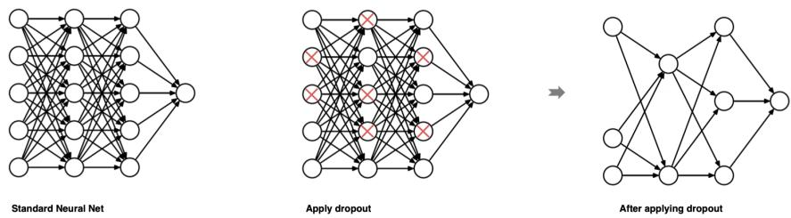

因此，每个迭代过程都会有不同的节点组合，从⽽导致不同的输出，这可以看成机器学习中的集成⽅法（ensemble technique）<sub>。</sub>集成模型⼀般优于单⼀模型，因为它们可以捕获更多的随机性 相似地，dropout使得神经⽹络模型优于正常的模型
在tf.keras中实现使⽤的⽅法是dropout：
tf.keras.layers.Dropout(rate) 
参数：
rate： 每⼀个神经元被丢弃的概率
例⼦：
```python
# 导入相应的库
import numpy as np
import tensorflow as tf
# 定义dropout层,每一个神经元有0.2的概率被失活，未被失活的输入将按1
layer = tf.keras.layers.Dropout(0.2, input_shape=(2,))
# 定义五个批次的数据
data = np.arange(1, 11).reshape(5, 2).astype(np.float32)
# 原始数据进行打印
print(data)
# 进行随机失活：在training模式中，返回应用dropout后的输出；或者在非
outputs = layer(data, training=True)
# 打印失活后的结果
print(outputs)
```
结果为：
98 

深度学习
```txt
[[ 1. 2.]
[ 3. 4.]
[ 5. 6.]
[ 7. 8.]
[ 9. 10.]]
tf.Tensor(
[[ 1.25 2.5 ]
[ 0. 5. ]
[ 6.25 7.5 ]
[ 8.75 10. ]
[ 0. 12.5 ]], shape=(5, 2), dtype=float32) 
```
## 3.提前停⽌
提前停⽌（early stopping）是将⼀部分训练集作为验证集（validationset） 当验证集的性能越来越差时或者性能不再提升，则⽴即停⽌对该模型的训练 这被称为提前停⽌
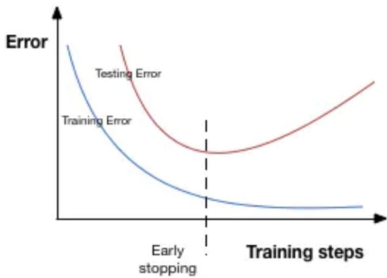

在上图中，在虚线处停⽌模型的训练，此时模型开始在训练数据上过拟合<sub>。</sub>
在tf.keras中，我们可以使⽤callbacks函数实现早期停⽌:
```python
tf.keras.callbacks.EarlyStopping(
    monitor='val_loss', patience=5
) 
```
上⾯，monitor参数表示监测量，这⾥val_loss表示验证集损失 ⽽patience参数epochs数量，当在这个过程性能⽆提升时会停⽌训练 为了更好地理解，让我们再看看上⾯的图⽚ 在虚线之后，每个epoch都会导致更⾼的验证集误差 因此，虚线后patience个epoch，模型将停⽌训练，因为没有进⼀步的改善
99 

深度学习

```python
# 导入相应的工具包
import tensorflow as tf
import numpy as np
# 当连续3个epoch loss不下降则停止训练
callback = tf.keras.callbacks.EarlyStopping(monitor='loss')
# 定义只有一层的神经网络
model = tf.keras.models.Sequential([tf.keras.layers.Dense(1))
# 设置损失函数和梯度下降算法
model.compile(tf.keras.optimizers.SGD(), loss='mse')
# 模型训练
history = model.fit(np.arange(100).reshape(5, 20), np.array
epochs=10, batch_size=1, callbacks=[cal
verbose=1)
# 打印运行的epoch
len(history.history['loss'])
```
## 输出：
```txt
Epoch 1/10
5/5 [====================] - 0s 600us/step - loss:
Epoch 2/10
5/5 [====================] - 0s 522us/step - loss:
Epoch 3/10
5/5 [====================] - 0s 1ms/step - loss:
Epoch 4/10
5/5 [====================] - 0s 1ms/step - loss:
# 只运行了4次
4
```
## 4. 批标准化
批标准化(BN层,Batch Normalization)是2015年提出的⼀种⽅法，在进⾏深度⽹络训练时，⼤多会采取这种算法，与全连接层⼀样，BN层也是属于⽹络中的⼀层
BN层是针对单个神经元进⾏，利⽤⽹络训练时⼀个 mini-batch 的数据来计算该神经元xi 的均值和⽅差,归⼀化后并重构，因⽽称为 Batch
Normalization 在每⼀层输⼊之前，将数据进⾏BN，然后再送⼊后续⽹络中进⾏学习：
100 

深度学习


⾸先我们对某⼀批次的数据的神经元的输出进⾏标准化，

$$
\mu = \frac {1}{m} \sum_ {i} z ^ {(i)}
$$
$$
\sigma^ {2} = \frac {1}{m} \sum_ {i} (z _ {i} - \mu) ^ {2}
$$
$$
z _ {n o r m} ^ {(i)} = \frac {z ^ {(i)} - \mu}{\sqrt {\sigma^ {2} + \epsilon}}
$$
然后在使⽤变换重构，引⼊了可学习参数γ $\beta ,$ ，如果各隐藏层的输⼊均值在靠近0的区域，即处于激活函数的线性区域，不利于训练⾮线性神经⽹络，从⽽得到效果较差的模型 因此，需要⽤ γ 和 β 对标准化后的结果做进⼀步处理：
$$
\tilde {z} ^ {(i)} = \gamma z _ {n o r m} ^ {(i)} + \beta
$$
这就是BN层最后的结果 整体流程如下图所示：
101 

深度学习
Input: Values of x over a mini-batch: $B = \{x_{1\ldots m}\}$ ;
Parameters to be learned: $\gamma, \beta$ Output: $\{y_i = \text{BN}_{\gamma,\beta}(x_i)\}$ $\mu_{B} \leftarrow \frac{1}{m} \sum_{i=1}^{m} x_i$ // mini-batch mean $\sigma_{B}^{2} \leftarrow \frac{1}{m} \sum_{i=1}^{m} (x_i - \mu_B)^2$ // mini-batch variance $\widehat{x}_i \leftarrow \frac{x_i - \mu_B}{\sqrt{\sigma_B^2 + \epsilon}}$ // normalize $y_i \leftarrow \gamma \widehat{x}_i + \beta \equiv \text{BN}_{\gamma,\beta}(x_i)$ // scale and shift 
在tf.keras中实现使⽤：
```python
# 直接将其放入构建神经网络的结构中即可
tf.keras.layers.BatchNormormalization(
    epsilon=0.001, center=True, scale=True,
    beta_initializer='zeros', gamma_initializer='ones',
)
```
<table><tr><td>参数</td><td>意义</td></tr><tr><td>epsilon</td><td>防止分母为0</td></tr><tr><td>center</td><td>如果为True,则将的偏移beta量添加到标准化张量。如果为False,则将beta被忽略。</td></tr><tr><td>scale</td><td>如果为True,则乘以gamma。如果为False,gamma则不使用。</td></tr><tr><td>beta_initializer</td><td>Beta权重的初始化程序。</td></tr><tr><td>gamma_initializer</td><td>伽玛权重的初始化程序。</td></tr></table>
## 3.2.8 总结
知道L2正则化与L1正则化的⽅法
在损失函数（cost function）中增加⼀个正则项，由于添加了这个正则化项，权重矩阵的值减⼩，因为它假定具有更⼩权重矩阵的神经⽹络导致更简单的模型
知道随机失活droupout的应⽤
在每个迭代过程中，随机选择某些节点，并且删除前向和后向连接
知道提前停⽌的使⽤⽅法
当看到验证集的性能越来越差时或者性能不再提升，⽴即停⽌对该模型的训练
## 知道BN层的使⽤⽅法
102 

深度学习
利⽤⽹络训练时⼀个 mini-batch 的数据来计算该神经元xi 的均值和⽅差,归⼀化后并重构，因⽽称为 Batch Normalization
103 

深度学习
## 2.5 神经⽹络案例
## 学习⽬标
能够利⽤tf.keras获取数据集
能够⽹络多层神经⽹络的构建
能够完成⽹络的训练和评估


使⽤⼿写数字的MNIST数据集如上图所示，该数据集包含60,000个⽤于训练的样本和10,000个⽤于测试的样本，图像是固定⼤⼩(28x28像素)，其值为0到255
整个案例的实现流程是：
数据加载
数据处理
模型构建
模型训练
模型测试
模型保存
⾸先要导⼊所需的⼯具包：
104 

## 深度学习
```python
# 导入相应的工具包
import numpy as np
import matplotlib.pyplot as plt
plt.rcParams['figure.figsize'] = (7, 7) # Make the figures a
import tensorflow as tf
# 数据集
from tensorflow.keras.datasets import mnist
# 构建序列模型
from tensorflow.keras.models import Sequential
# 导入需要的层
from tensorflow.keras.layers import Dense, Dropout, Activation
# 导入辅助工具包
from tensorflow.keras import utils
# 正则化
from tensorflow.keras import regularizers
```
## 1.数据加载
## ⾸先加载⼿写数字图像
```python
# 类别总数
nb_classes = 10
# 加载数据集
(X_train, y_train), (X_test, y_test) = mnist.load_data()
# 打印输出数据集的维度
print("训练样本初始维度", X_train.shape)
print("训练样本目标值初始维度", y_train.shape)
```
## 结果为：
```txt
训练样本初始维度（60000，28，28）  
训练样本目标值初始维度（60000，）
```
## 数据展示：
```python
# 数据展示：将数据集的前九个数据集进行展示
for i in range(9):
    plt.subplot(3,3,i+1)
    # 以灰度图显示，不进行插值
    plt.imshow(X_train[i], cmap='gray', interpolation='no')
    # 设置图片的标题：对应的类别
    plt.title("数字{}".format(y_train[i]))
```
效果如下所示：
105 
# 
深度学习


## 2.数据处理
神经⽹络中的每个训练样本是⼀个向量，因此需要对输⼊进⾏重塑，使每个28x28的图像成为⼀个的784维向量 另外，将输⼊数据进⾏归⼀化处理，从0-255调整到0-1


106 

深度学习
```python
# 调整数据维度：每一个数字转换成一个向量
X_train = X_train.reshape(60000, 784)
X_test = X_test.reshape(10000, 784)
# 格式转换
X_train = X_train.astype('float32')
X_test = X_test.astype('float32')
# 归一化
X_train /= 255
X_test /= 255
# 维度调整后的结果
print("训练集：", X_train.shape)
print("测试集：", X_test.shape)
```
输出为：
```txt
训练集：（60000，784）  
测试集：（10000，784）
```
另外对于⽬标值我们也需要进⾏处理，将其转换为热编码的形式：
$$
\begin{array}{l} 0 \text {- - > [ 1 , 0 , 0 , 0 , 0 , 0 , 0 , 0 , 0 ]} \\ 1 \text {- - > [ 0 , 1 , 0 , 0 , 0 , 0 , 0 , 0 , 0 ]} \\ 2 \text {- - > [ 0 , 0 , 1 , 0 , 0 , 0 , 0 , 0 , 0 ]} \\ \text {etc.} \end{array}
$$
```txt
实现方法如下所示：
```
```python
# 将目标值转换为热编码的形式
Y_train = utils.to_categorical(y_train, nb_classes)
Y_test = utils.to_categorical(y_test, nb_classes)
```
## 3.模型构建
在这⾥我们构建只有3层全连接的⽹络来进⾏处理：
107 

深度学习


构建⽅法如下所示：
```txt
# 利用序列模型来构建模型
model = Sequential()

# 全连接层，共512个神经元，输入维度大小为784
model.add(Dense(512, input_shape=(784,)))
# 激活函数使用relu
model.add(Activation('relu'))
# 使用正则化方法drouout
model.add(Dropout(0.2))
# 全连接层，共512个神经元，并加入L2正则化
model.add(Dense(512, kernel_regularizer=regularizers.l2(0.0))
# BN层
model.add(BatchNormalization())
# 激活函数
model.add(Activation('relu'))
model.add(Dropout(0.2))
# 全连接层，输出层共10个神经元
model.add(Dense(10))
# softmax将神经网络输出的score转换为概率值
model.add(Activation('softmax'))
```
我们通过model.summay来看下结果：
108 

深度学习
```coffeescript
Model: "sequential_6" 
```
<table><tr><td>Layer (type)</td><td>Output Shape</td><td>Para</td></tr><tr><td>dense_13 (Dense)</td><td>(None, 512)</td><td>4019</td></tr><tr><td>activation_8 (Activation)</td><td>(None, 512)</td><td>0</td></tr><tr><td>dropout_7 (Dropout)</td><td>(None, 512)</td><td>0</td></tr><tr><td>dense_14 (Dense)</td><td>(None, 512)</td><td>2626</td></tr><tr><td>batch_normalization (BatchNo</td><td>(None, 512)</td><td>2048</td></tr><tr><td>activation_9 (Activation)</td><td>(None, 512)</td><td>0</td></tr><tr><td>dropout_8 (Dropout)</td><td>(None, 512)</td><td>0</td></tr><tr><td>dense_15 (Dense)</td><td>(None, 10)</td><td>5130</td></tr><tr><td>activation_10 (Activation)</td><td>(None, 10)</td><td>0</td></tr><tr><td colspan="3">Total params: 671,754Trainable params: 670,730Non-trainable params: 1,024</td></tr></table>
## 4.模型编译
设置模型训练使⽤的损失函数交叉熵损失和优化⽅法adam，损失函数⽤来衡量预测值与真实值之间的差异，优化器⽤来使⽤损失函数达到最优：
```python
# 模型编译，指明损失函数和优化器，评估指标
model.compile(loss='categorical_crossentropy', optimizer='a
```
## 5.模型训练
```python
# batch_size是每次送入模型中样本个数，epochs是所有样本的迭代次数，并
history = model.fit(X_train, Y_train,
    batch_size=128, epochs=4, verbose=1,
    validation_data=(X_test, Y_test))
```
训练过程如下所示：
109 

深度学习
```txt
Epoch 1/4
469/469 [====================] - 2s 4ms/step - lo
Epoch 2/4
469/469 [====================] - 2s 4ms/step - lo
Epoch 3/4
469/469 [====================] - 2s 4ms/step - lo
Epoch 4/4
469/469 [====================] - 2s 4ms/step - lo 
```
## 将损失绘制成曲线：
```python
# 绘制损失函数的变化曲线
plt.figure()
# 训练集损失函数变换
plt.plot(history.history["loss"], label="train_loss")
# 验证集损失函数变化
plt.plot(history.history["val_loss"], label="val_loss")
plt.legend()
plt.grid()
```
https://cdn-mineru.openxlab.org.cn/result/2026-10-20/67634768-2e5b-4fbe-adb5-9150a97d5969/2d25bbafc761846eeeb5b1e131beb552d539f5f34015bfbf341c3235e9532805.jpg

将训练的准确率绘制为曲线：

110 

深度学习
```python
# 绘制准确率的变化曲线
plt.figure()
# 训练集准确率
plt.plot(history.history["accuracy"], label="train_acc")
# 验证集准确率
plt.plot(history.history["val_accuracy"], label="val_acc")
plt.legend()
plt.grid()
```
https://cdn-mineru.openxlab.org.cn/result/2026-10-20/67634768-2e5b-4fbe-adb5-9150a97d5969/1ad62b7d5bc7c154801993fe2bd7cba1a13fb8a20025b548eeedda6ba27976df.jpg

另外可通过tensorboard监控训练过程，这时我们指定回调函数：

```txt
添加tensoboard观察
tensorboard = tf.keras.callbacks.TensorBoard(log_dir='/gra
    write_graph
```
## 在进⾏训练：
```python
# 训练
history = model.fit(X_train, Y_train,
    batch_size=128, epochs=4, verbose=1, callbacks=[ter
    validation_data=(X_test, Y_test))
```
## 打开终端：
111 

深度学习
```shell
# 指定存在文件的目录，打开下面命令
tensorboard --logdir="./"
```
在浏览器中打开指定⽹址，可查看损失函数和准确率的变化，图结构等
<table><tr><td colspan="3">epoch_accuracy</td></tr><tr><td></td><td></td><td></td></tr><tr><td></td><td></td><td></td></tr><tr><td></td><td></td><td></td></tr></table>
<table><tr><td></td><td>0</td><td>1</td><td>2</td><td>3</td></tr><tr><td>0.127</td><td>0.124</td><td>0.124</td><td>0.123</td><td>0.122</td></tr><tr><td>0.088</td><td>0.086</td><td>0.085</td><td>0.084</td><td>0.083</td></tr></table>
## 6.模型测试
```python
# 模型测试
score = model.evaluate(X_test, Y_test, verbose=1)
# 打印结果
print('测试集准确率:', score)
```
## 结果：
Test accuracy: 0.9776999950408936 
## 7.模型保存
112 

深度学习
```python
# 保存模型架构与权重在h5文件中
model.save('my_model.h5')
# 加载模型：包括架构和对应的权重
model = tf.keras.models.load_model('my_model.h5')
```
## 总结
能够利⽤tf.keras获取数据集：
load_data() 
能够进⾏多层神经⽹络的构建
dense,激活函数，dropout,BN层等
能够完成⽹络的训练和评估
fit，回调函数，evaluate, 保存模型
113 

深度学习
## 2.6 卷积神经⽹络(CNN)
## 学习⽬标
了解卷积神经⽹络的构成
知道卷积的原理以及计算过程
了解池化的作⽤以及计算过程


利⽤全连接神经⽹络对图像进⾏处理存在以下两个问题：

1. 需要处理的数据量⼤，效率低
假如我们处理⼀张 1000×1000 像素的图⽚，参数量如下：
$$
1 0 0 0 \times 1 0 0 0 \times 3 = 3, 0 0 0, 0 0 0
$$
这么⼤量的数据处理起来是⾮常消耗资源的


1. 图像在维度调整的过程中很难保留原有的特征，导致图像处理的准确率不⾼
114 

深度学习


假如有圆形是1，没有圆形是0，那么圆形的位置不同就会产⽣完全不同的数据表达 但是从图像的⻆度来看，图像的内容（本质）并没有发⽣变化，只是位置发⽣了变化 所以当我们移动图像中的物体，⽤全连接升降得到的结果会差异很⼤，这是不符合图像处理的要求的
## 1.CNN⽹络的构成
CNN⽹络受⼈类视觉神经系统的启发，⼈类的视觉原理：从原始信号摄⼊开始（瞳孔摄⼊像素 Pixels），接着做初步处理（⼤脑⽪层某些细胞发现边缘和⽅向），然后抽象（⼤脑判定，眼前的物体的形状，是圆形的），然后进⼀步抽象（⼤脑进⼀步判定该物体是只⼈脸） 下⾯是⼈脑进⾏⼈脸识别的⼀个示例：


CNN⽹络主要有三部分构成：卷积层 池化层和全连接层构成，其中卷积层负责提取图像中的局部特征；池化层⽤来⼤幅降低参数量级(降维)；全连接层类似⼈⼯神经⽹络的部分，⽤来输出想要的结果

115 
深度学习

卷积层
池化层
全连接层
提取图像特征
降维、防止过拟合
输出结果
整个CNN⽹络结构如下图所示：


## 2. 卷积层
卷积层是卷积神经⽹络中的核⼼模块，卷积层的⽬的是提取输⼊特征图的特征，如下图所示，卷积核可以提取图像中的边缘信息


Input image


Edge detection


Apply Convolution Filter


Feature Map is generated

## 2.1 卷积的计算⽅法
那卷积是怎么进⾏计算的呢？
<table><tr><td>1</td><td>1</td><td>1</td><td>0</td><td>0</td></tr><tr><td>0</td><td>1</td><td>1</td><td>1</td><td>0</td></tr><tr><td>0</td><td>0</td><td>1</td><td>1</td><td>1</td></tr><tr><td>0</td><td>0</td><td>1</td><td>1</td><td>0</td></tr><tr><td>0</td><td>1</td><td>1</td><td>0</td><td>0</td></tr></table>

Input 


Filter


Output (Feature Map)

116 

深度学习
卷积运算本质上就是在滤波器和输⼊数据的局部区域间做点积


左上⻆的点计算⽅法：

$$
1 \times 1 + 1 \times 0 + 1 \times 1 + 0 \times 0 + 1 \times 1 + 1 \times 0 + 0 \times 1 + 0 \times 0 + 1 \times 1 = 4
$$

同理可以计算其他各点，得到最终的卷积结果，


最后⼀点的计算⽅法是：

$$
1 \times 1 + 1 \times 0 + 1 \times 1 + 1 \times 0 + 1 \times 1 + 0 \times 0 + 1 \times 1 + 0 \times 0 + 0 \times 1 =
$$
## 2.2 padding
在上述卷积过程中，特征图⽐原始图减⼩了很多，我们可以在原图像的周围进⾏padding,来保证在卷积过程中特征图⼤⼩不变
117 

深度学习


Stride 1 with Padding


Feature Map

## 2.3 stride
按照步⻓为1来移动卷积核，计算特征图如下所示：


如果我们把stride增⼤,⽐如设为2，也是可以提取特征图的，如下图所示：


## 2.4 多通道卷积
实际中的图像都是多个通道组成的，我们怎么计算卷积呢？


Input Image


5×5×3


118 

## 深度学习
计算⽅法如下：当输⼊有多个通道（channel）时(例如图⽚可以有 RGB三个通道)，卷积核需要拥有相同的channel数,每个卷积核 channel 与输⼊层的对应 channel 进⾏卷积，将每个 channel 的卷积结果按位相加得到最终的 Feature Map


## 2.5 多卷积核卷积
如果有多个卷积核时怎么计算呢？当有多个卷积核时，每个卷积核学习到不同的特征，对应产⽣包含多个 channel 的 Feature Map, 例如下图有两个 filter，所以 output 有两个 channel


## 2.6 特征图⼤⼩
输出特征图的⼤⼩与以下参数息息相关：
size:卷积核/过滤器⼤⼩，⼀般会选择为奇数，⽐如有1 1 3 3， 5 *5
padding：零填充的⽅式
stride:步⻓
那计算⽅法如下图所示：
119 
# 
深度学习
• 输入体积大小 $H 1 * W 1 * D 1$ 
• 四个超参数：
。Filter数量K
。Filter大小F
。步长S
。零填充大小P
• 输出体积大小H2 * W2 * D2
$$
\begin{array}{l l} \circ & H _ {2} = (H _ {1} - F + 2 P) / S + 1 \\ \circ & W _ {2} = (W _ {1} - F + 2 P) / S + 1 \\ \circ & D _ {2} = K \end{array}
$$
输⼊特征图为5x5，卷积核为3x3，外加padding 为1，则其输出尺⼨为：
$$
\frac {5 - 3 + 2 \times 1}{1} + 1 = 5
$$
如下图所示：


在tf.keras中卷积核的实现使⽤
120 

深度学习
<table><tr><td>4</td><td>9</td><td>2</td><td>5</td></tr><tr><td>5</td><td>6</td><td>2</td><td>4</td></tr><tr><td>2</td><td>4</td><td>5</td><td>4</td></tr><tr><td>5</td><td>6</td><td>8</td><td>4</td></tr></table>
Max Pooling 
```python
tf.keras.layers.Conv2D(
    filters, kernel_size, strides=(1, 1), padding='valid',
    activation=None
) 
```
## 主要参数说明如下：
<table><tr><td>参数</td><td>描述</td></tr><tr><td>filters</td><td>卷积过滤器的数量,对应输出特征图的通道数</td></tr><tr><td>kernel_size</td><td>过滤器filter的大小</td></tr><tr><td>strides</td><td>步长</td></tr><tr><td>padding</td><td>valid:在输入周围不进行padding; same: padding后使输出特征图和输入特征图形状相同</td></tr></table>
## 3 池化层(Pooling)
池化层迎来降低了后续⽹络层的输⼊维度，缩减模型⼤⼩，提⾼计算速度，并提⾼了Feature Map 的鲁棒性，防⽌过拟合，
它主要对卷积层学习到的特征图进⾏下采样（subsampling）处理，主要由两种
## 3.1 最⼤池化
Max Pooling,取窗⼝内的最⼤值作为输出，这种⽅式使⽤较⼴泛
## 在tf.keras中实现的⽅法是：
```python
tf.keras.layers.MaxPool2D(
    pool_size=(2, 2), strides=None, padding='valid'
) 
```
参数：
121 

深度学习
```yaml
pool_size: 池化窗口的大小
strides: 窗口移动的步长，默认为1
padding: 是否进行填充，默认是不进行填充的
```
## 3.2 平均池化
Avg Pooling,取窗⼝内的所有值的均值作为输出


在tf.keras中实现池化的⽅法是：
```python
tf.keras.layers.AveragePooling2D(
    pool_size=(2, 2), strides=None, padding='valid'
) 
```
## 4. 全连接层
全连接层位于CNN⽹络的末端，经过卷积层的特征提取与池化层的降维后，将特征图转换成⼀维向量送⼊到全连接层中进⾏分类或回归的操作


在tf.keras中全连接层使⽤tf.keras.dense实现

122 

深度学习
## 5.卷积神经⽹络的构建
我们构建卷积神经⽹络在mnist数据集上进⾏处理，如下图所示：LeNet-5是⼀个较简单的卷积神经⽹络, 输⼊的⼆维图像，先经过两次卷积层,池化层，再经过全连接层，最后使⽤softmax分类作为输出层


## 导⼊⼯具包：
```python
import tensorflow as tf
# 数据集
from tensorflow.keras.datasets import mnist
```
## 5.1 数据加载
与神经⽹络的案例⼀致，⾸先加载数据集：
```txt
(train_images, train_labels), (test_images, test_labels) = 
```
## 5.2 数据处理
卷积神经⽹络的输⼊要求是：N H W C ，分别是图⽚数量，图⽚⾼度，图⽚宽度和图⽚的通道，因为是灰度图，通道为1.
```python
# 数据处理：num,h,w,c
# 训练集数据
train_images = tf.reshape(train_images, (train_images.shape)
print(train_images.shape)
# 测试集数据
test_images = tf.reshape(test_images, (test_images.shape[0])
```
结果为：
```txt
(60000, 28, 28, 1) 
```
## 5.3 模型搭建
123 

深度学习
Lenet-5模型输⼊的⼆维图像，先经过两次卷积层,池化层，再经过全连接层，最后使⽤softmax分类作为输出层，模型构建如下：
```python
# 模型构建
net = tf.keras.models.Sequential([
    # 卷积层：6个5*5的卷积核，激活是sigmoid
    tf.keras.layers.Conv2D(filters=6, kernel_size=5, activa)
    # 最大池化
    tf.keras.layers.MaxPool2D(pool_size=2, strides=2),
    # 卷积层：16个5*5的卷积核，激活是sigmoid
    tf.keras.layers.Conv2D(filters=16, kernel_size=5, activa)
    # 最大池化
    tf.keras.layers.MaxPool2D(pool_size=2, strides=2),
    # 维度调整为1维数据
    tf.keras.layers.Flatten(),
    # 全卷积层，激活sigmoid
    tf.keras.layers.Dense(120, activation='sigmoid'),
    # 全卷积层，激活sigmoid
    tf.keras.layers.Dense(84, activation='sigmoid'),
    # 全卷积层，激活softmax
    tf.keras.layers.Dense(10, activation='softmax')
])
```
我们通过net.summary()查看⽹络结构：
124 

深度学习
```txt
Model: "sequential_11" 
```
<table><tr><td>Layer (type)</td><td>Output Shape</td><td>Para</td></tr><tr><td>conv2d_4 (Conv2D)</td><td>(None, 24, 24, 6)</td><td>156</td></tr><tr><td>max_pooling2d_4 (MaxPooling2</td><td>(None, 12, 12, 6)</td><td>0</td></tr><tr><td>conv2d_5 (Conv2D)</td><td>(None, 8, 8, 16)</td><td>2416</td></tr><tr><td>max_pooling2d_5 (MaxPooling2</td><td>(None, 4, 4, 16)</td><td>0</td></tr><tr><td>flatten_2 (Flatten)</td><td>(None, 256)</td><td>0</td></tr><tr><td>dense_25 (Dense)</td><td>(None, 120)</td><td>3084</td></tr><tr><td>dense_26 (Dense)</td><td>(None, 84)</td><td>1016</td></tr><tr><td>dense_27 (Dense)</td><td>(None, 10)</td><td>850</td></tr><tr><td colspan="3">Total params: 44,426</td></tr><tr><td colspan="3">Trainable params: 44,426</td></tr><tr><td colspan="3">Non-trainable params: 0</td></tr></table>
## 5.4 模型编译
设置优化器和损失函数：
```python
# 优化器
optimizer = tf.keras.optimizers.SGD(learning_rate=0.9)
# 模型编译：损失函数，优化器和评价指标
net.compile(optimizer=optimizer,
    loss='sparse_categorical_crossentropy',
    metrics=['accuracy'])
```
## 5.5 模型训练
模型训练：
```python
# 模型训练
net.fit(train_images, train_labels, epochs=5, validation_sp
```
训练流程：
125 

深度学习
```txt
Epoch 1/5
1688/1688 [====================] - 10s 6ms/step -
Epoch 2/5
1688/1688 [====================] - 10s 6ms/step -
Epoch 3/5
1688/1688 [====================] - 10s 6ms/step -
Epoch 4/5
1688/1688 [====================] - 11s 6ms/step -
Epoch 5/5
1688/1688 [====================] - 11s 6ms/step - 
```
## 5.6 模型评估
```python
# 模型评估
score = net.evaluate(test_images, test_labels, verbose=1)
print('Test accuracy:', score[1])
```
## 输出为：
```txt
313/313 [====================] - 1s 2ms/step - lo
Test accuracy: 0.9779999852180481 
```
与使⽤全连接⽹络相⽐，准确度提⾼了很多
卷积神经⽹路的组成
卷积层，池化层，全连接层
卷积层
卷积的计算过程，stride,padding...
池化层
最⼤池化和平均池化
CNN结构的实现和构建实现程序
126 

深度学习
## 图像分类(Image Classification)2
知道局部最优问题 鞍点与海森矩阵
说明批梯度下降算法的优化
说明三种类型的优化算法
知道学习率退⽕策略
知道参数初始化策略与输⼊归⼀化策略
应⽤完成梯度下降优化算法的实现
知道偏差与⽅差的意义
掌握L2正则化与L1正则化的数学原理
掌握droupout原理以及⽅法
知道正则化的作⽤应⽤
应⽤完成dropout的实现
了解卷积神经⽹络的构成
记忆卷积的原理以及计算过程
了解池化的作⽤以及计算过程
知道LeNet-5⽹络结构
了解经典的分类⽹络结构
说明⼀些常⻅的卷机⽹络结构的优化
知道NIN中1x1卷积原理以及作⽤
知道Inception的作⽤
说明ResNet的结构特点
了解卷积神经⽹络学习过程内容
127 

深度学习
## 3.1 图像分类简介
学习⽬标
知道图像分类的⽬的
知道imageNet数据集
## 1 图像分类
图像分类实质上就是从给定的类别集合中为图像分配对应标签的任务 也就是说我们的任务是分析⼀个输⼊图像并返回⼀个该图像类别的标签
假定类别集为categories = {dog, cat, panda}，之后我们提供⼀张图⽚给分类模型，如下图所示：


分类模型给图像分配多个标签，每个标签的概率值不同，如dog:95%，cat:4%，panda:1%，根据概率值的⼤⼩将该图⽚分类为dog，那就完成了图像分类的任务
## 2 常⽤数据集
## 2.1 mnist数据集
该数据集是⼿写数字0-9的集合，共有60k训练图像 10k测试图像 10个类别 图像⼤⼩28×28×1.我们可以通过tf.keras直接加载该数据集：
128 

深度学习
from tensorflow.keras.datasets import mnist# 加载mnist数据集(train_images, train_labels), (test_images, test_labels) =
随机选择图像展示结果如下所示：


## 2.2 CIFAR-10和CIFAR-100
CIFAR-10数据集5万张训练图像 1万张测试图像 10个类别 每个类别有6k个图像，图像⼤⼩32×32×3 下图列举了10个类，每⼀类随机展示了10张图⽚：
129 
# 
深度学习


CIFAR-100数据集也是有5万张训练图像 1万张测试图像 包含100个类别 图像⼤⼩32×32×3
在tf.keras中加载数据集时：
```python
import tensorflow as tf
from tensorflow.keras.datasets import cifar10, cifar100
# 加载Cifar10数据集
(train_images, train_labels), (test_images, test_labels) = 0
# 加载Cifar100数据集
(train_images, train_labels), (test_images, test_labels) = 0
```
## 2.3 ImageNet
130 

深度学习
ImageNet数据集是ILSVRC竞赛使⽤的是数据集，由斯坦福⼤学李⻜⻜教授主导，包含了超过1400万张全尺⼨的有标记图⽚，⼤约有22000个类别的数据<sub>。</sub>ILSVRC全称ImageNet Large-Scale Visual RecognitionChallenge，是视觉领域最受追捧也是最具权威的学术竞赛之⼀，代表了图像领域的最⾼⽔平 从2010年开始举办到2017年最后⼀届，使⽤ImageNet数据集的⼀个⼦集，总共有1000类<sub>。</sub>


该⽐赛的获胜者从2012年开始都是使⽤的深度学习的⽅法：

https://cdn-mineru.openxlab.org.cn/result/2026-10-20/67634768-2e5b-4fbe-adb5-9150a97d5969/99a79569f38e2b9e37250497283bf0f46053071ae270d4cb5ac8c110ee8e53ea.jpg
2012年冠军是AlexNet,由于准确率远超传统⽅法的第⼆名（top5错误率为15.3%，第⼆名为26.2%），引起了很⼤的轰动 ⾃此之后，CNN成为在图像识别分类的核⼼算法模型，带来了深度学习的⼤爆发
2013年冠军是ZFNet，结构和AlexNet区别不⼤，分类效果也差不多<sub>。</sub>
2014年亚军是VGG⽹络，⽹络结构⼗分简单，因此⾄今VGG-16仍在⼴泛使⽤<sub>。</sub>
2014年的冠军⽹络是GooLeNet ，核⼼模块是Inception ModuleInception历经了V1 V2 V3 V4等多个版本的发展，不断趋于完善<sub>。</sub>GoogLeNet取名中L⼤写是为了向LeNet致敬，⽽Inception的名字来源于盗梦空间中的"we need to go deeper"梗<sub>。</sub>
131 

深度学习

2015年冠军⽹络是ResNet 核⼼是带短连接的残差模块，其中主路径有两层卷积核（Res34），短连接把模块的输⼊信息直接和经过两次卷积之后的信息融合，相当于加了⼀个恒等变换 短连接是深度学习⼜⼀重要思想，除计算机视觉外，短连接思想也被⽤到了机器翻译 语⾳识别/合成领域
2017年冠军SENet是⼀个模块，可以和其他的⽹络架构结合，⽐如GoogLeNet ResNet等
上述图像分类模型都⽐较经典，特别是VGG16 GoogLeNet和ResNet，现在仍然在⼴泛使⽤，在接下来的课程中我们对这些⽹络进⾏逐⼀介绍
## 总结
1.图像分类是什么？
从给定的类别集合中为图像分配对应的类别标签
2.常⽤的数据集
Mnist,cifar数据集,ImageNet数据集
132 

深度学习
## 3.2 AlexNet
## 学习⽬标
知道AlexNet⽹络结构
能够利⽤AlexNet完成图像分类


https://cdn-mineru.openxlab.org.cn/result/2026-10-20/67634768-2e5b-4fbe-adb5-9150a97d5969/03c093a403e934ab34bc578dc8ccdeae7421780d4b167b2cadea9cacad88cf19.jpg
2012年，AlexNet横空出世，该模型的名字源于论⽂第⼀作者的姓名AlexKrizhevsky AlexNet使⽤了8层卷积神经⽹络，以很⼤的优势赢得了ImageNet 2012图像识别挑战赛 它⾸次证明了学习到的特征可以超越⼿⼯设计的特征，从⽽⼀举打破计算机视觉研究的⽅向
## 1.AlexNet的⽹络架构
AlexNet与LeNet的设计理念⾮常相似，但也有显著的区别，其⽹络架构如下图所示：


## 该⽹络的特点是：
AlexNet包含8层变换，有5层卷积和2层全连接隐藏层，以及1个全连接输出层
133 

深度学习
AlexNet第⼀层中的卷积核形状是$11\times11$ 第⼆层中的卷积核形状减⼩到$5\times5$，之后全采⽤$3\times3$ 所有的池化层窗⼝⼤⼩为$3\times3$ 步幅为2的最⼤池化
AlexNet将sigmoid激活函数改成了ReLU激活函数，使计算更简单，⽹络更容易训练
AlexNet通过dropOut来控制全连接层的模型复杂度
AlexNet引⼊了⼤量的图像增强，如翻转 裁剪和颜⾊变化，从⽽进⼀步扩⼤数据集来缓解过拟合
## 在tf.keras中实现AlexNet模型：
```python
# 构建AlexNet模型
net = tf.keras.models.Sequential([
    # 卷积层：96个卷积核，卷积核为11*11，步幅为4，激活函数relu
    tf.keras.layers.Conv2D(filters=96, kernel_size=11, stride)
    # 池化：窗口大小为3*3、步幅为2
    tf.keras.layers.MaxPool2D(pool_size=3, strides=2),
    # 卷积层：256个卷积核，卷积核为5*5，步幅为1，padding为same，激
    tf.keras.layers.Conv2D(filters=256, kernel_size=5, padding)
    # 池化：窗口大小为3*3、步幅为2
    tf.keras.layers.MaxPool2D(pool_size=3, strides=2),
    # 卷积层：384个卷积核，卷积核为3*3，步幅为1，padding为same，激
    tf.keras.layers.Conv2D(filters=384, kernel_size=3, padding)
    # 卷积层：384个卷积核，卷积核为3*3，步幅为1，padding为same，激
    tf.keras.layers.Conv2D(filters=384, kernel_size=3, padding)
    # 卷积层：256个卷积核，卷积核为3*3，步幅为1，padding为same，激
    tf.keras.layers.Conv2D(filters=256, kernel_size=3, padding)
    # 池化：窗口大小为3*3、步幅为2
    tf.keras.layers.MaxPool2D(pool_size=3, strides=2),
    # 伸展为1维向量
    tf.keras.layers.Flatten(),
    # 全连接层：4096个神经元，激活函数relu
    tf.keras.layers.Dense(4096, activation='relu'),
    # 随机失活
    tf.keras.layers.Dropout(0.5),
    # 全链接层：4096个神经元，激活函数relu
    tf.keras.layers.Dense(4096, activation='relu'),
    # 随机失活
    tf.keras.layers.Dropout(0.5),
    # 输出层：10个神经元，激活函数softmax
    tf.keras.layers.Dense(10, activation='softmax')
])
```
我们构造⼀个⾼和宽均为227的单通道数据样本来看⼀下模型的架构：
134 

深度学习
```txt
# 构造输入X，并将其送入到net网络中
X = tf.random.uniform((1, 227, 227, 1)
y = net(X)
# 通过net.summay()查看网络的形状
net.summay()
```
## ⽹络架构如下：
<table><tr><td colspan="3">Model: &quot;sequential&quot;</td></tr><tr><td>Layer (type)</td><td>Output Shape</td><td>Para</td></tr><tr><td>conv2d (Conv2D)</td><td>(1, 55, 55, 96)</td><td>1171</td></tr><tr><td>max_pooling2d (MaxPooling2D)</td><td>(1, 27, 27, 96)</td><td>0</td></tr><tr><td>conv2d_1 (Conv2D)</td><td>(1, 27, 27, 256)</td><td>6146</td></tr><tr><td>max_pooling2d_1 (MaxPooling2</td><td>(1, 13, 13, 256)</td><td>0</td></tr><tr><td>conv2d_2 (Conv2D)</td><td>(1, 13, 13, 384)</td><td>8851</td></tr><tr><td>conv2d_3 (Conv2D)</td><td>(1, 13, 13, 384)</td><td>1327</td></tr><tr><td>conv2d_4 (Conv2D)</td><td>(1, 13, 13, 256)</td><td>8849</td></tr><tr><td>max_pooling2d_2 (MaxPooling2</td><td>(1, 6, 6, 256)</td><td>0</td></tr><tr><td>flatten (Flatten)</td><td>(1, 9216)</td><td>0</td></tr><tr><td>dense (Dense)</td><td>(1, 4096)</td><td>3775</td></tr><tr><td>dropout (Dropout)</td><td>(1, 4096)</td><td>0</td></tr><tr><td>dense_1 (Dense)</td><td>(1, 4096)</td><td>1678</td></tr><tr><td>dropout_1 (Dropout)</td><td>(1, 4096)</td><td>0</td></tr><tr><td>dense_2 (Dense)</td><td>(1, 10)</td><td>4097</td></tr><tr><td colspan="3">Total params: 58,299,082Trainable params: 58,299,082Non-trainable params: 0</td></tr></table>
135 

```txt
深度学习
```
## 2.⼿写数字势识别
AlexNet使⽤ImageNet数据集进⾏训练，但因为ImageNet数据集较⼤训练时间较⻓，我们仍⽤前⾯的MNIST数据集来演示AlexNet 读取数据的时将图像⾼和宽扩⼤到AlexNet使⽤的图像⾼和宽227 这个通过 tf.image.resize_with_pad 来实现<sub>。</sub>
## 2.1 数据读取
⾸先获取数据,并进⾏维度调整：
```python
import numpy as np
# 获取手写数字数据集
(train_images, train_labels), (test_images, test_labels) = 
# 训练集数据维度的调整：N H W C
train_images = np.reshape(train_images, (train_images.shape)
# 测试集数据维度的调整：N H W C
test_images = np.reshape(test_images, (test_images.shape[0])
```
由于使⽤全部数据训练时间较⻓，我们定义两个⽅法获取部分数据，并将图像调整为227*227⼤⼩，进⾏模型训练：
```python
# 定义两个方法随机抽取部分样本演示
# 获取训练集数据
def get_train(size):
    # 随机生成要抽样的样本的索引
    index = np.random.randint(0, np.shape(train_images)[0], 
    # 将这些数据resize成227*227大小
    resized_images = tf.image.resize_with_pad(train_images)
    # 返回抽取的
    return resized_images.numpy(), train_labels[index]
# 获取测试集数据
def get_test(size):
    # 随机生成要抽样的样本的索引
    index = np.random.randint(0, np.shape(test_images)[0], 
    # 将这些数据resize成227*227大小
    resized_images = tf.image.resize_with_pad(test_images):
    # 返回抽样的测试样本
    return resized_images.numpy(), test_labels[index]
```
调⽤上述两个⽅法，获取参与模型训练和测试的数据集：
136 


深度学习
```txt
# 获取训练样本和测试样本
train_images, train_labels = get_train(256)
test_images, test_labels = get_test(128)
```
为了让⼤家更好的理解，我们将数据展示出来：
```python
# 数据展示：将数据集的前九个数据集进行展示
for i in range(9):
    plt.subplot(3,3,i+1)
    # 以灰度图显示，不进行插值
    plt.imshow(train_images[i].astype(np.int8).squeeze(), c)
    # 设置图片的标题：对应的类别
    plt.title("数字{}".format(train_labels[i]))
```
## 结果为：
我们就使⽤上述创建的模型进⾏训练和评估
## 2.2 模型编译
```python
# 指定优化器，损失函数和评价指标
optimizer = tf.keras.optimizers.SGD(learning_rate=0.01, more)
net.compile(optimizer=optimizer,
    loss='sparse_categorical_crossentropy',
    metrics=['accuracy'])
```
137 
# 
深度学习
## 2.3 模型训练
```python
# 模型训练：指定训练数据，batchsize, epoch, 验证集
net.fit(train_images, train_labels, batch_size=128, epochs=3,
```
## 训练输出为：
```txt
Epoch 1/3
2/2 [====================] - 3s 2s/step - loss: 2
Epoch 2/3
2/2 [====================] - 3s 2s/step - loss: 2
Epoch 3/3
2/2 [====================] - 4s 2s/step - loss: 2 
```
## 2.4 模型评估
```python
# 指定测试数据
net.evaluate(test_images, test_labels, verbose=1)
```
## 输出为：
```txt
4/4 [====================] - 1s 168ms/step - loss
[2.3025851249694824, 0.078125] 
```
如果我们使⽤整个数据集训练⽹络，并进⾏评估的结果：
```json
[0.4866700246334076, 0.8395] 
```
## 总结
知道AlexNet的⽹络架构
动⼿实现⼿写数字的识别
138 

深度学习
## 3.3 VGG
## 学习⽬标
知道VGG⽹络结构的特点
能够利⽤VGG完成图像分类
https://cdn-mineru.openxlab.org.cn/result/2026-10-20/67634768-2e5b-4fbe-adb5-9150a97d5969/017c43a08a98ed7c7ec568dad3d4a266dcf817c118ebe86e2b28994f60d39bb6.jpg

2014年，⽜津⼤学计算机视觉组（Visual Geometry Group）和GoogleDeepMind公司的研究员⼀起研发出了新的深度卷积神经⽹络：

VGGNet，并取得了ILSVRC2014⽐赛分类项⽬的第⼆名，主要贡献是使⽤很⼩的卷积核(3×3)构建卷积神经⽹络结构，能够取得较好的识别精度，常⽤来提取图像特征的VGG-16和VGG-19
## 1.VGG的⽹络架构
VGG可以看成是加深版的AlexNet，整个⽹络由卷积层和全连接层叠加⽽成，和AlexNet不同的是，VGG中使⽤的都是⼩尺⼨的卷积核(3×3)，其⽹络架构如下图所示：
139 

深度学习


VGGNet使⽤的全部都是3x3的⼩卷积核和2x2的池化核，通过不断加深⽹络来提升性能 VGG可以通过重复使⽤简单的基础块来构建深度模型


在tf.keras中实现VGG模型，⾸先来实现VGG块，它的组成规律是：连续使⽤多个相同的填充为1 卷积核⼤⼩为$3\times 3$的卷积层后接上⼀个步幅为2 窗⼝形状为$2\times 2$的最⼤池化层 卷积层保持输⼊的⾼和宽不变，⽽池化层则对其减半 我们使⽤ vgg_block 函数来实现这个基础的VGG块，它可以指定卷积层的数量 num_convs 和每层的卷积核个数num_filters：
```python
# 定义VGG网络中的卷积块：卷积层的个数，卷积层中卷积核的个数
def vgg_block(num_convs, num_filters):
    # 构建序列模型
    blk = tf.keras.models.Sequential()
    # 遍历所有的卷积层
    for _ in range(num_convs):
    # 每个卷积层：num_filter个卷积核，卷积核大小为3*3，padding= 'same', activation= 'same', padding='same', activation= 'same', padding='same', padding='same', padding='same', padding='same', padding='same', padding='same', padding='same', padding='same', padding='same', padding='same', padding='same', padding='same', padding='same', padding='same', padding='same', padding='same', padding='same', padding='same', padding='same', padding='same', padding='same', padding='same', padding='same', padding='same', padding='same', padding('Same')
```
140 

VGG16⽹络有5个卷积块，前2块使⽤两个卷积层，⽽后3块使⽤三个卷积层 第⼀块的输出通道是64，之后每次对输出通道数翻倍，直到变为512<sub>。</sub>
```txt
定义5个卷积块，指明每个卷积块中的卷积层个数及相应的卷积核个数
conv_arch = ((2, 64), (2, 128), (3, 256), (3, 512), (3, 512))
```
因为这个⽹络使⽤了13个卷积层和3个全连接层，所以经常被称为VGG-16,通过制定conv_arch得到模型架构后构建VGG16：
```python
# 定义VGG网络
def vgg(conv_arch):
    # 构建序列模型
    net = tf.keras.models.Sequential()
    # 根据conv_arch生成卷积部分
    for (num_convs, num_filters) in conv_arch:
    net.add(vgg_block(num_convs, num_filters))
    # 卷积块序列后添加全连接层
    net.add(tf.keras.models.Sequential([
    # 将特征图展成一维向量
    tf.keras.layers.Flatten(),
    # 全连接层：4096个神经元，激活函数是relu
    tf.keras.layers.Dense(4096, activation='relu'),
    # 随机失活
    tf.keras.layers.Dropout(0.5),
    # 全连接层：4096个神经元，激活函数是relu
    tf.keras.layers.Dense(4096, activation='relu'),
    # 随机失活
    tf.keras.layers.Dropout(0.5),
    # 全连接层：10个神经元，激活函数是softmax
    tf.keras.layers.Dense(10, activation='softmax')]))
    return net
# 网络实例化
net = vgg(conv_arch)
```
我们构造⼀个⾼和宽均为224的单通道数据样本来看⼀下模型的架构：
```txt
# 构造输入X，并将其送入到net网络中
X = tf.random.uniform((1, 224, 224, 1))
y = net(X)
# 通过net.summay()查看网络的形状
net.summay()
```
⽹络架构如下：
141 

深度学习
Model: "sequential_15" 
<table><tr><td>Layer (type)</td><td>Output Shape</td><td>Para</td></tr><tr><td>sequential_16 (Sequential)</td><td>(1, 112, 112, 64)</td><td>3756</td></tr><tr><td>sequential_17 (Sequential)</td><td>(1, 56, 56, 128)</td><td>2214</td></tr><tr><td>sequential_18 (Sequential)</td><td>(1, 28, 28, 256)</td><td>1475</td></tr><tr><td>sequential_19 (Sequential)</td><td>(1, 14, 14, 512)</td><td>5899</td></tr><tr><td>sequential_20 (Sequential)</td><td>(1, 7, 7, 512)</td><td>7079</td></tr><tr><td>sequential_21 (Sequential)</td><td>(1, 10)</td><td>1195</td></tr><tr><td colspan="3">Total params: 134,300,362</td></tr><tr><td colspan="3">Trainable params: 134,300,362</td></tr><tr><td colspan="3">Non-trainable params: 0</td></tr></table>
## 2.⼿写数字势识别
因为ImageNet数据集较⼤训练时间较⻓，我们仍⽤前⾯的MNIST数据集来演示VGGNet 读取数据的时将图像⾼和宽扩⼤到VggNet使⽤的图像⾼和宽224<sub>。</sub>这个通过 tf.image.resize_with_pad 来实现<sub>。</sub>
## 2.1 数据读取
⾸先获取数据,并进⾏维度调整：
```python
import numpy as np
# 获取手写数字数据集
(train_images, train_labels), (test_images, test_labels) = 
# 训练集数据维度的调整：N H W C
train_images = np.reshape(train_images, (train_images.shape)
# 测试集数据维度的调整：N H W C
test_images = np.reshape(test_images, (test_images.shape[0])
```
由于使⽤全部数据训练时间较⻓，我们定义两个⽅法获取部分数据，并将图像调整为224*224⼤⼩，进⾏模型训练：
142 

```txt
深度学习
```
```python
# 定义两个方法随机抽取部分样本演示
# 获取训练集数据
def get_train(size):
    # 随机生成要抽样的样本的索引
    index = np.random.randint(0, np.shape(train_images)[0], 
    # 将这些数据resize成22*227大小
    resized_images = tf.image.resize_with_pad(train_images)
    # 返回抽取的
    return resized_images.numpy(), train_labels[index]
# 获取测试集数据
def get_test(size):
    # 随机生成要抽样的样本的索引
    index = np.random.randint(0, np.shape(test_images)[0], 
    # 将这些数据resize成224*224大小
    resized_images = tf.image.resize_with_pad(test_images)
    # 返回抽样的测试样本
    return resized_images.numpy(), test_labels[index]
```
调⽤上述两个⽅法，获取参与模型训练和测试的数据集：
```txt
# 获取训练样本和测试样本
train_images, train_labels = get_train(256)
test_images, test_labels = get_test(128)
```
为了让⼤家更好的理解，我们将数据展示出来：
```python
# 数据展示：将数据集的前九个数据集进行展示
for i in range(9):
    plt.subplot(3,3,i+1)
    # 以灰度图显示，不进行插值
    plt.imshow(train_images[i].astype(np.int8).squeeze(), c)
    # 设置图片的标题：对应的类别
    plt.title("数字{}".format(train_labels[i]))
```
结果为：
143 

深度学习


我们就使⽤上述创建的模型进⾏训练和评估

## 2.2 模型编译
```python
# 指定优化器，损失函数和评价指标
optimizer = tf.keras.optimizers.SGD(learning_rate=0.01, more)
net.compile(optimizer=optimizer,
    loss='sparse_categorical_crossentropy',
    metrics=['accuracy'])
```
## 2.3 模型训练
```python
# 模型训练：指定训练数据，batchsize, epoch, 验证集
net.fit(train_images, train_labels, batch_size=128, epochs=3,
```
## 训练输出为：
```txt
Epoch 1/3
2/2 [====================] - 34s 17s/step - loss;
Epoch 2/3
2/2 [====================] - 27s 14s/step - loss;
Epoch 3/3
2/2 [====================] - 29s 14s/step - loss; 
```
144 
# 
深度学习
## 2.4 模型评估
```python
# 指定测试数据
net.evaluate(test_images, test_labels, verbose=1)
```
输出为：
```json
4/4 [====================] - 5s 1s/step - loss: 2
[2.2955007553100586, 0.1015625] 
```
如果我们使⽤整个数据集训练⽹络，并进⾏评估的结果：
```json
[0.31822608125209806, 0.8855] 
```
## 总结
知道VGG的⽹络架构
动⼿实现⼿写数字的识别
145 

深度学习
## 3.4 GoogLeNet
## 学习⽬标
知道GoogLeNet⽹络结构的特点
能够利⽤GoogLeNet完成图像分类
https://cdn-mineru.openxlab.org.cn/result/2026-10-20/67634768-2e5b-4fbe-adb5-9150a97d5969/81c49c5038b8734cbedaa00e30e926e2386a5017351cbf715674051e3be3e0c6.jpg
GoogLeNet的名字不是GoogleNet，⽽是GoogLeNet，这是为了致敬LeNet。GoogLeNet和AlexNet/VGGNet这类依靠加深⽹络结构的深度的思想不完全⼀样。GoogLeNet在加深度的同时做了结构上的创新，引⼊了⼀个叫做Inception的结构来代替之前的卷积加激活的经典组件。GoogLeNet在ImageNet分类⽐赛上的Top-5错误率降低到了6.7%。。
## 1.Inception 块
GoogLeNet中的基础卷积块叫作Inception块，得名于同名电影《盗梦空间》（Inception）。Inception块在结构⽐较复杂，如下图所示：


146 

深度学习
Inception块⾥有4条并⾏的线路。前3条线路使⽤窗⼝⼤⼩分别是$1\times1$、$3\times 3$和$5\times 5$的卷积层来抽取不同空间尺⼨下的信息，其中中间2个线路会对输⼊先做$1\times 1$卷积来减少输⼊通道数，以降低模型复杂度。第4条线路则使⽤$3\times 3$最⼤池化层，后接$1\times1$卷积层来改变通道数。4条线路都使⽤了合适的填充来使输⼊与输出的⾼和宽⼀致。最后我们将每条线路的输出在通道维上连结,并向后进⾏传输。
## $1\times 1$卷积：
它的计算⽅法和其他卷积核⼀样，唯⼀不同的是它的⼤⼩是$1\times1$，没有考虑在特征图局部信息之间的关系。


它的作⽤主要是：

实现跨通道的交互和信息整合
卷积核通道数的降维和升维，减少⽹络参数
在tf.keras中实现Inception模块，各个卷积层卷积核的个数通过输⼊参数来控制，如下所示：
147 

```txt
深度学习
```
```python
# 定义Inception模块
class Inception(tf.keras.layers.Layer):
    # 输入参数为各个卷积的卷积核个数
    def __init__(self, c1, c2, c3, c4):
    super().__init__()
    # 线路1: 1 × 1卷积层，激活函数是RELU，padding是same
    self.p1_1 = tf.keras.layers.Conv2D(
    c1, kernel_size=1, activation='relu', padding=
    # 线路2, 1 × 1卷积层后接3 × 3卷积层，激活函数是RELU，padding是same)
    self.p2_1 = tf.keras.layers.Conv2D(
    c2[0], kernel_size=1, padding='same', activation='relu', padding=
    self.p2_2 = tf.keras.layers.Conv2D(c2[1], kernel_size=1), activation='relu', padding='same', activation='relu', padding=
    # 线路3, 1 × 1卷积层后接5 × 5卷积层，激活函数是RELU，padding是same)
    self.p3_1 = tf.keras.layers.Conv2D(
    c3[0], kernel_size=1, padding='same', activation='relu', padding=
    self.p3_2 = tf.keras.layers.Conv2D(c3[1], kernel_size=1), kernel_size=1), activation='relu', padding='same', activation='relu', padding=
    # 线路4, 3 × 3最大池化层后接1 × 1卷积层，激活函数是RELU，padding是same)
    self.p4_1 = tf.keras.layers.MaxPool2D(
    pool_size=3, padding='same', strides=1)
    self.p4_2 = tf.keras.layers.Conv2D(
    c4, kernel_size=1, padding='same', activation='relu', padding=
    # 完成前向传播过程
    def call(self, x):
    # 线路1
    p1 = self.p1_1(x)
    # 线路2
    p2 = self.p2_2(self.p2_1(x))
    # 线路3
    p3 = self.p3_2(self.p3_1(x))
    # 线路4
    p4 = self.p4_2(self.p4_1(x))
    # 在通道维上concat输出
    outputs = tf.concat([p1, p2, p3, p4], axis=-1)
    return outputs
```
指定通道数，对Inception模块进⾏实例化：
```txt
Inception(64, (96, 128), (16, 32), 32) 
```
## 2.GoogLeNet模型
GoogLeNet主要由Inception模块构成，如下图所示：
148 

深度学习


整个⽹络架构我们分为五个模块，每个模块之间使⽤步幅为2的$3\times3$最⼤池化层来减⼩输出⾼宽。


## 2.1 B1模块
第⼀模块使⽤⼀个64通道的$7\times 7$卷积层。
```python
# 定义模型的输入
inputs = tf.keras.Input(shape=(224,224,3),name="input")
# b1 模块
# 卷积层7*7的卷积核，步长为2，pad是same，激活函数RELU
x = tf.keras.layers.Conv2D(64, kernel_size=7, strides=2, pad)
# 最大池化：窗口大小为3*3，步长为2，pad是same
x = tf.keras.layers.MaxPool2D(pool_size=3, strides=2, pad):
# b2 模块
```
## 2.2 B2模块
第⼆模块使⽤2个卷积层：⾸先是64通道的$1\times 1$卷积层，然后是将通道增⼤3倍的$3\times 3$卷积层。
149 
# 
深度学习
```python
# b2 模块
# 卷积层1*1的卷积核，步长为2，pad是same，激活函数RELU
x = tf.keras.layers.Conv2D(64, kernel_size=1, padding='same')
# 卷积层3*3的卷积核，步长为2，pad是same，激活函数RELU
x = tf.keras.layers.Conv2D(192, kernel_size=3, padding='same')
# 最大池化：窗口大小为3*3，步长为2，pad是same
x = tf.keras.layers.MaxPool2D(pool_size=3, strides=2, padd
```
## 2.3 B3模块
第三模块串联2个完整的Inception块。第⼀个Inception块的输出通道数为$64+128+32+32=256$。第⼆个Inception块输出通道数增⾄$128+192+96+64=480$。
```python
# b3 模块
# Inception
x = Inception(64, (96, 128), (16, 32), 32)(x)
# Inception
x = Inception(128, (128, 192), (32, 96), 64)(x)
# 最大池化：窗口大小为3*3，步长为2，pad是same
x = tf.keras.layers.MaxPool2D(pool_size=3, strides=2, padd
```
## 2.4 B4模块
第四模块更加复杂。它串联了5个Inception块，其输出通道数分别是
$256+320+128+128=832$。并且增加了辅助分类器，根据实验发现⽹络的中间层具有很强的识别能⼒，为了利⽤中间层抽象的特征，在某些中间层中添加含有多层的分类器，如下图所示：


实现如下所示：
150 

深度学习
```python
def aux_classifier(x, filter_size):
    # x: 输入数据，filter_size: 卷积层卷积核个数，全连接层神经元个数
    # 池化层
    x = tf.keras.layers.AveragePooling2D(
    pool_size=5, strides=3, padding='same')(x)
    # 1x1 卷积层
    x = tf.keras.layers.Conv2D(filters=filter_size[0], kernel=valid), activation=
    # 展平
    x = tf.keras.layers.Flatten()(x)
    # 全连接层1
    x = tf.keras.layers.Dense(units=filter_size[1], activation);
    # softmax输出层
    x = tf.keras.layers.Dense(units=10, activation='softmax')
    return x
```
## b4模块的实现：
```python
# b4 模块
# Inception
x = Inception(192, (96, 208), (16, 48), 64)(x)
# 辅助输出1
aux_output_1 = aux_classifier(x, [128, 1024])
# Inception
x = Inception(160, (112, 224), (24, 64), 64)(x)
# Inception
x = Inception(128, (128, 256), (24, 64), 64)(x)
# Inception
x = Inception(112, (144, 288), (32, 64), 64)(x)
# 辅助输出2
aux_output_2 = aux_classifier(x, [128, 1024])
# Inception
x = Inception(256, (160, 320), (32, 128), 128)(x)
# 最大池化
x = tf.keras.layers.MaxPool2D(pool_size=3, strides=2, padd
```
## 2.5 B5模块
第五模块有输出通道数为$256+320+128+128=832$和
$384+384+128+128=1024$的两个Inception块。后⾯紧跟输出层，该模块使⽤全局平均池化层（GAP）来将每个通道的⾼和宽变成1。最后输出变成⼆维数组后接输出个数为标签类别数的全连接层。
全局平均池化层（GAP）
151 

## 深度学习
⽤来替代全连接层，将特征图每⼀通道中所有像素值相加后求平均，得到就是GAP的结果，在将其送⼊后续⽹络中进⾏计算
https://cdn-mineru.openxlab.org.cn/result/2026-10-20/67634768-2e5b-4fbe-adb5-9150a97d5969/19566575b4e9aee57e2c0b54807f3bf7b0327794f83bfb35c84cc0f86965e164.jpg
实现过程是：
```python
# b5 模块
# Inception
x = Inception(256, (160, 320), (32, 128), 128)(x)
# Inception
x = Inception(384, (192, 384), (48, 128), 128)(x)
# GAP
x = tf.keras.layers.GlobalAvgPool2D()(x)
# 输出层
main_outputs = tf.keras.layers.Dense(10, activation='softmax')
# 使用Model来创建模型，指明输入和输出
```
构建GoogLeNet模型并通过summary来看下模型的结构：
```python
# 使用Model来创建模型，指明输入和输出
model = tf.keras.Model(inputs=inputs, outputs=[main_outputs]
model.summary()
```
152 

深度学习
Model: "functional_3" 
<table><tr><td>Layer (type)</td><td>Output Shape</td><td>Para</td></tr><tr><td>input (InputLayer)</td><td>[(None, 224, 224, 3)]</td><td>0</td></tr><tr><td>conv2d_122 (Conv2D)</td><td>(None, 112, 112, 64)</td><td>9472</td></tr><tr><td>max_pooling2d_27 (MaxPooling</td><td>(None, 56, 56, 64)</td><td>0</td></tr><tr><td>conv2d_123 (Conv2D)</td><td>(None, 56, 56, 64)</td><td>4160</td></tr><tr><td>conv2d_124 (Conv2D)</td><td>(None, 56, 56, 192)</td><td>1107</td></tr><tr><td>max_pooling2d_28 (MaxPooling</td><td>(None, 28, 28, 192)</td><td>0</td></tr><tr><td>inception_19 (Inception)</td><td>(None, 28, 28, 256)</td><td>1636</td></tr><tr><td>inception_20 (Inception)</td><td>(None, 28, 28, 480)</td><td>3887</td></tr><tr><td>max_pooling2d_31 (MaxPooling</td><td>(None, 14, 14, 480)</td><td>0</td></tr><tr><td>inception_21 (Inception)</td><td>(None, 14, 14, 512)</td><td>3761</td></tr><tr><td>inception_22 (Inception)</td><td>(None, 14, 14, 512)</td><td>4491</td></tr><tr><td>inception_23 (Inception)</td><td>(None, 14, 14, 512)</td><td>5101</td></tr><tr><td>inception_24 (Inception)</td><td>(None, 14, 14, 528)</td><td>6053</td></tr><tr><td>inception_25 (Inception)</td><td>(None, 14, 14, 832)</td><td>8683</td></tr><tr><td>max_pooling2d_37 (MaxPooling</td><td>(None, 7, 7, 832)</td><td>0</td></tr><tr><td>inception_26 (Inception)</td><td>(None, 7, 7, 832)</td><td>1043</td></tr><tr><td>inception_27 (Inception)</td><td>(None, 7, 7, 1024)</td><td>1444</td></tr><tr><td>global_average_pooling2d_2 (</td><td>(None, 1024)</td><td>0</td></tr><tr><td>dense_10 (Dense)</td><td>(None, 10)</td><td>1025</td></tr><tr><td colspan="3">Total params: 5,983,802Trainable params: 5,983,802Non-trainable params: 0</td></tr></table>
153 

```txt
深度学习
```
## 3.⼿写数字识别
因为ImageNet数据集较⼤训练时间较⻓，我们仍⽤前⾯的MNIST数据集来演示GoogLeNet。读取数据的时将图像⾼和宽扩⼤到图像⾼和宽224。这个通过 tf.image.resize_with_pad 来实现。
## 2.1 数据读取
⾸先获取数据,并进⾏维度调整：
```python
import numpy as np
# 获取手写数字数据集
(train_images, train_labels), (test_images, test_labels) = 
# 训练集数据维度的调整：N H W C
train_images = np.reshape(train_images, (train_images.shape)
# 测试集数据维度的调整：N H W C
test_images = np.reshape(test_images, (test_images.shape[0])
```
由于使⽤全部数据训练时间较⻓，我们定义两个⽅法获取部分数据，并将图像调整为224*224⼤⼩，进⾏模型训练：(与VGG中是⼀样的)
```python
# 定义两个方法随机抽取部分样本演示
# 获取训练集数据
def get_train(size):
    # 随机生成要抽样的样本的索引
    index = np.random.randint(0, np.shape(train_images)[0], 
    # 将这些数据resize成22*227大小
    resized_images = tf.image.resize_with_pad(train_images)
    # 返回抽取的
    return resized_images.numpy(), train_labels[index]
# 获取测试集数据
def get_test(size):
    # 随机生成要抽样的样本的索引
    index = np.random.randint(0, np.shape(test_images)[0], 
    # 将这些数据resize成224*224大小
    resized_images = tf.image.resize_with_pad(test_images[0], 
    # 返回抽样的测试样本
    return resized_images.numpy(), test_labels[index]
```
调⽤上述两个⽅法，获取参与模型训练和测试的数据集：
```txt
# 获取训练样本和测试样本
train_images, train_labels = get_train(256)
test_images, test_labels = get_test(128)
```
154 
# 
深度学习
## 3.2 模型编译
```python
# 指定优化器，损失函数和评价指标
optimizer = tf.keras.optimizers.SGD(learning_rate=0.01, more)
# 模型有3个输出，所以指定损失函数对应的权重系数
net.compile(optimizer=optimizer,
    loss='sparse_categorical_crossentropy',
    metrics=['accuracy'], loss_weights=[1,0.3,0.3])
```
## 3.3 模型训练
```python
# 模型训练：指定训练数据，batchsize, epoch, 验证集
net.fit(train_images, train_labels, batch_size=128, epochs=3,
```
## 训练过程：
```txt
Epoch 1/3
2/2 [====================] - 8s 4s/step - loss: 2
Epoch 2/3
2/2 [====================] - 7s 4s/step - loss: 2
Epoch 3/3
2/2 [====================] - 7s 4s/step - loss: 2 
```
## 2.4 模型评估
```python
# 指定测试数据
net.evaluate(test_images, test_labels, verbose=1)
```
## 输出为：
```json
4/4 [====================] - 1s 338ms/step - loss
[2.310971260070801, 0.078125] 
```
## 4.延伸版本
GoogLeNet是以InceptionV1为基础进⾏构建的，所以GoogLeNet也叫做InceptionNet,在随后的⼏年⾥，研究⼈员对GoogLeNet进⾏了数次改进，就⼜产⽣了InceptionV2，V3,V4等版本。
## 4.1 InceptionV2
155 

深度学习
在InceptionV2中将⼤卷积核拆分为⼩卷积核，将V1中的$5\times 5$的卷积⽤两个$3\times 3$的卷积替代，从⽽增加⽹络的深度，减少了参数。


## 4.2 InceptionV3
将n×n卷积分割为1×n和n×1两个卷积，例如，⼀个的$3\times3$卷积⾸先执⾏⼀个$1\times3$的卷积，然后执⾏⼀个$3\times1$的卷积,这种⽅法的参数量和计算量都⽐原来降低。
156 

深度学习


## 总结
知道GoogLeNet的⽹络架构：有基础模块Inception构成
能够利⽤GoogleNet完成图像分类
157 

深度学习
## 2.5 ResNet
学习⽬标
知道ResNet⽹络结构的特点
能够利⽤ResNet完成图像分类


https://cdn-mineru.openxlab.org.cn/result/2026-10-20/67634768-2e5b-4fbe-adb5-9150a97d5969/594a50208197c4e22e2195a250c826d35aa2841901fbe9d165fd40e395fa1187.jpg
⽹络越深，获取的信息就越多，特征也越丰富 但是在实践中，随着⽹络的加深，优化效果反⽽越差，测试数据和训练数据的准确率反⽽降低了
https://cdn-mineru.openxlab.org.cn/result/2026-10-20/67634768-2e5b-4fbe-adb5-9150a97d5969/15d857cb45a82c11762ec3f38dbf92bc7ac2c3b48ad54ea2c407add5731b6df5.jpg
https://cdn-mineru.openxlab.org.cn/result/2026-10-20/67634768-2e5b-4fbe-adb5-9150a97d5969/23c67fb42b71591bfd78008e602caa8bb28a7b154b1ad624cf4e7988890ccc66.jpg

针对这⼀问题，何恺明等⼈提出了残差⽹络（ResNet）在2015年的ImageNet图像识别挑战赛夺魁，并深刻影响了后来的深度神经⽹络的设计<sub>。</sub>

## 1 残差块
假设 F(x) 代表某个只包含有两层的映射函数， x 是输⼊， F(x)是输出假设他们具有相同的维度 在训练的过程中我们希望能够通过修改⽹络中的 w和b去拟合⼀个理想的 H(x)(从输⼊到输出的⼀个理想的映射函数)也就是我们的⽬标是修改F(x) 中的 w和b逼近 H(x) 如果我们改变思路，⽤F(x) 来逼近 H(x)-x ，那么我们最终得到的输出就变为 F(x)+x（这⾥的加指的是对应位置上的元素相加，也就是element-wise addition），这⾥将直接从输⼊连接到输出的结构也称为shortcut，那整个结构就是残差块，ResNet的基础模块
158 
# 
深度学习


ResNet沿⽤了VGG全$3\times 3$卷积层的设计 残差块⾥⾸先有2个有相同输出通道数的$3\times 3$卷积层 每个卷积层后接BN层和ReLU激活函数，然后将输⼊直接加在最后的ReLU激活函数前，这种结构⽤于层数较少的神经⽹络中，⽐如ResNet34 若输⼊通道数⽐较多，就需要引⼊$1\times 1$卷积层来调整输⼊的通道数，这种结构也叫作瓶颈模块，通常⽤于⽹络层数较多的结构中 如下图所示：


Figure 5. A deeper residual function F for ImageNet. Left: a building block (on 56×56 feature maps) as in Fig. 3 for ResNet-34. Right: a “bottleneck" building block for ResNet-50/101/152.

上图左中的残差块的实现如下，可以设定输出通道数，是否使⽤1*1的卷积及卷积层的步幅
159 

深度学习


160 

深度学习
```python
# 导入相关的工具包
import tensorflow as tf
from tensorflow.keras import layers, activations

# 定义ResNet的残差块
class Residual(tf.keras.Model):
    # 指明残差块的通道数，是否使用1*1卷积，步长
    def __init__(self, num_channels, use_1x1conv=False, str)
    super(Residual, self).__init__()
    # 卷积层：指明卷积核个数，padding，卷积核大小，步长
    self.conv1 = layers.Conv2D(num_channels,
    padding='same',
    kernel_size=3,
    strides=strides)

    # 卷积层：指明卷积核个数，padding，卷积核大小，步长
    self.conv2 = layers.Conv2D(num_channels, kernel_size=1, str)
    if use_1x1conv:
    self.conv3 = layers.Conv2D(num_channels,
    kernel_size=1,
    strides=strides)

    else:
    self.conv3 = None
    # 指明BN层
    self.bn1 = layers.BatchNorm()
    self.bn2 = layers.BatchNorm()

# 定义前向传播过程
def call(self, X):
    # 卷积，BN，激活
    Y = activations.relu(self.bn1(self.conv1(X)))
    # 卷积，BN
    Y = self.bn2(self.conv2(Y))
    # 对输入数据进行1*1卷积保证通道数相同
    if self.conv3:
    X = self.conv3(X)
    # 返回与输入相加后激活的结果
    return activations.relu(Y + X)
```
1*1卷积⽤来调整通道数
## 2 ResNet模型
ResNet模型的构成如下图所示：
161 

深度学习


ResNet⽹络中按照残差块的通道数分为不同的模块 第⼀个模块前使⽤了步幅为2的最⼤池化层，所以⽆须减⼩⾼和宽 之后的每个模块在第⼀个残差块⾥将上⼀个模块的通道数翻倍，并将⾼和宽减半
下⾯我们来实现这些模块 注意，这⾥对第⼀个模块做了特别处理
```python
# ResNet网络中模块的构成
class ResnetBlock(tf.keras.layers.Layer):
    # 网络层的定义：输出通道数（卷积核个数），模块中包含的残差块个数，
    def __init__(self,num_channels, num_residuals, first_block) {
    super(ResnetBlock, self).__init__()
    # 模块中的网络层
    self.listLayers=[]
    # 遍历模块中所有的层
    for i in range(num_residuals):
    # 若为第一个残差块并且不是第一个模块，则使用1*1卷积，步长为1
    if i == 0 and not first_block:
    self.listLayers.append(Residual(num_channels))
    # 否则不使用1*1卷积，步长为1
    else:
    self.listLayers.append(Residual(num_channels))
    # 定义前向传播过程
    def call(self, X):
    # 所有层依次向前传播即可
    for layer in self.listLayers.layers:
    X = layer(X)
    return X
```
ResNet的前两层跟之前介绍的GoogLeNet中的⼀样：在输出通道数为64 步幅为2的$7\times 7$卷积层后接步幅为2的$3\times 3$的最⼤池化层 不同之处在于ResNet每个卷积层后增加了BN层,接着是所有残差模块，最后，与GoogLeNet⼀样，加⼊全局平均池化层（GAP）后接上全连接层输出
162 

深度学习
```python
# 构建ResNet网络
class ResNet(tf.keras.Model):
    # 初始化：指定每个模块中的残差快的个数
    def __init__(self,num_blocks):
    super(ResNet, self).__init__()
    # 输入层：7*7卷积，步长为2
    self.conv=layers.Conv2D(64, kernel_size=7, strides=
    # BN层
    self.bn=layers.BatchNormNormalization()
    # 激活层
    self.relu=layers.Activation('relu')
    # 最大池化层
    self.mp=layers.MaxPool2D(pool_size=3, strides=2, pa)
    # 第一个block，通道数为64
    self.resnet_block1=ResnetBlock(64,num_blocks[0], f:
    # 第二个block，通道数为128
    self.resnet_block2=ResnetBlock(128,num_blocks[1])
    # 第三个block，通道数为256
    self.resnet_block3=ResnetBlock(256,num_blocks[2])
    # 第四个block，通道数为512
    self.resnet_block4=ResnetBlock(512,num_blocks[3])
    # 全局平均池化
    self.gap=layers.GlobalAvgPool2D()
    # 全连接层：分类
    self.fc=layers.Dense(units=10, activation=tf.keras.a
    # 前向传播过程
    def call(self, x):
    # 卷积
    x=self.conv(x)
    # BN
    x=self.bn(x)
    # 激活
    x=self.relu(x)
    # 最大池化
    x=self.mp(x)
    # 残差模块
    x=self.resnet_block1(x)
    x=self.resnet_block2(x)
    x=self.resnet_block3(x)
    x=self.resnet_block4(x)
    # 全局平均池化
    x=self.gap(x)
    # 全链接层
    x=self.fc(x)
    return x

# 模型实例化：指定每个block中的残差块个数
mynet=ResNet([2,2,2,2])
```
163 

深度学习
这⾥每个模块⾥有4个卷积层（不计算 1×1卷积层），加上最开始的卷积层和最后的全连接层，共计18层 这个模型被称为ResNet-18 通过配置不同的通道数和模块⾥的残差块数可以得到不同的ResNet模型，例如更深的含152层的ResNet-152 虽然ResNet的主体架构跟GoogLeNet的类似，但ResNet结构更简单，修改也更⽅便 这些因素都导致了ResNet迅速被⼴泛使⽤ 在训练ResNet之前，我们来观察⼀下输⼊形状在ResNe的架构：
```python
X = tf.random.uniform(shape=(1, 224, 224, 1))
y = mynet(X)
mynet.summary() 
```
<table><tr><td colspan="3">Model: &quot;res_net&quot;</td></tr><tr><td>Layer (type)</td><td>Output Shape</td><td>Para</td></tr><tr><td>conv2d_2 (Conv2D)</td><td>multiple</td><td>3200</td></tr><tr><td>batch_normalization_2 (Batch</td><td>multiple</td><td>256</td></tr><tr><td>activation (Activation)</td><td>multiple</td><td>0</td></tr><tr><td>max_pooling2d (MaxPooling2D)</td><td>multiple</td><td>0</td></tr><tr><td>resnet_block (ResnetBlock)</td><td>multiple</td><td>1487</td></tr><tr><td>resnet_block_1 (ResnetBlock)</td><td>multiple</td><td>5269</td></tr><tr><td>resnet_block_2 (ResnetBlock)</td><td>multiple</td><td>2102</td></tr><tr><td>resnet_block_3 (ResnetBlock)</td><td>multiple</td><td>8399</td></tr><tr><td>global_average_pooling2d (Gl</td><td>multiple</td><td>0</td></tr><tr><td>dense (Dense)</td><td>multiple</td><td>5130</td></tr><tr><td colspan="3">Total params: 11,186,186Trainable params: 11,178,378Non-trainable params: 7,808</td></tr></table>
## 2.⼿写数字势识别
164 

```txt
深度学习
```
因为ImageNet数据集较⼤训练时间较⻓，我们仍⽤前⾯的MNIST数据集来演示resNet 读取数据的时将图像⾼和宽扩⼤到ResNet使⽤的图像⾼和宽224<sub>。</sub>这个通过 tf.image.resize_with_pad 来实现<sub>。</sub>
## 2.1 数据读取
⾸先获取数据,并进⾏维度调整：
```python
import numpy as np
# 获取手写数字数据集
(train_images, train_labels), (test_images, test_labels) = 
# 训练集数据维度的调整：N H W C
train_images = np.reshape(train_images, (train_images.shape)
# 测试集数据维度的调整：N H W C
test_images = np.reshape(test_images, (test_images.shape[0])
```
由于使⽤全部数据训练时间较⻓，我们定义两个⽅法获取部分数据，并将图像调整为224*224⼤⼩，进⾏模型训练：
```python
# 定义两个方法随机抽取部分样本演示
# 获取训练集数据
def get_train(size):
    # 随机生成要抽样的样本的索引
    index = np.random.randint(0, np.shape(train_images)[0],
    # 将这些数据resize成22*227大小
    resized_images = tf.image.resize_with_pad(train_images)
    # 返回抽取的
    return resized_images.numpy(), train_labels[index]
# 获取测试集数据
def get_test(size):
    # 随机生成要抽样的样本的索引
    index = np.random.randint(0, np.shape(test_images)[0],
    # 将这些数据resize成224*224大小
    resized_images = tf.image.resize_with_pad(test_images):
    # 返回抽样的测试样本
    return resized_images.numpy(), test_labels[index]
```
调⽤上述两个⽅法，获取参与模型训练和测试的数据集：
```txt
# 获取训练样本和测试样本
train_images, train_labels = get_train(256)
test_images, test_labels = get_test(128)
```
## 2.2 模型编译
165 
深度学习

```python
# 指定优化器，损失函数和评价指标
optimizer = tf.keras.optimizers.SGD(learning_rate=0.01, more)
mynet.compile(optimizer=optimizer,
    loss='sparse_categorical_crossentropy',
    metrics=['accuracy'])
```
## 2.3 模型训练
```python
# 模型训练：指定训练数据，batchsize, epoch, 验证集
mynet.fit(train_images, train_labels, batch_size=128, epochs=3)
```
## 训练输出为：
```txt
Epoch 1/3
2/2 [====================] - 10s 5s/step - loss:
Epoch 2/3
2/2 [====================] - 8s 4s/step - loss: 2
Epoch 3/3
2/2 [====================] - 15s 7s/step - loss: 
```
## 2.4 模型评估
```javascript
# 指定测试数据
mynet.evaluate(test_images, test_labels, verbose=1)
```
## 输出为：
```txt
4/4 [====================] - 1s 370ms/step - loss
[3.4342570304870605, 0.1015625] 
```
## 总结
知道ResNet的⽹络结构，残差块的构成
能够搭建ResNet⽹络结构
166 

深度学习
## 2.6 图像增强
## 学习⽬标
知道图像增强的常⽤⽅法
能够利⽤tf.keras来完成图像增强


⼤规模数据集是成功应⽤深度神经⽹络的前提 例如，我们可以对图像进⾏不同⽅式的裁剪，使感兴趣的物体出现在不同位置，从⽽减轻模型对物体出现位置的依赖性 我们也可以调整亮度 ⾊彩等因素来降低模型对⾊彩的敏感度 可以说，在当年AlexNet的成功中，图像增强技术功不可没

## 1.常⽤的图像增强⽅法
图像增强（image augmentation）指通过剪切 旋转/反射/翻转变换 缩放变换 平移变换 尺度变换 对⽐度变换 噪声扰动 颜⾊变换等⼀种或多种组合数据增强变换的⽅式来增加数据集的⼤⼩ 图像增强的意义是通过对训练图像做⼀系列随机改变，来产⽣相似但⼜不同的训练样本，从⽽扩⼤训练数据集的规模，⽽且随机改变训练样本可以降低模型对某些属性的依赖，从⽽提⾼模型的泛化能⼒
常⻅的图像增强⽅式可以分为两类：⼏何变换类和颜⾊变换类
⼏何变换类，主要是对图像进⾏⼏何变换操作，包括翻转 旋转 裁剪 变形 缩放等
167 

深度学习


颜⾊变换类，指通过模糊 颜⾊变换 擦除 填充等⽅式对图像进⾏处理


实现图像增强可以通过tf.image来完成，也可以通过tf.keras.imageGenerator来完成

## 2.tf.image进⾏图像增强
## 导⼊所需的⼯具包并读取要处理的图像：
```python
# 导入工具包
import tensorflow as tf
import matplotlib.pyplot as plt
import numpy as np
# 读取图像并显示
cat = plt.imread('./cat.jpg')
plt.imshow(cat)
```
## 2.1 翻转和裁剪
左右翻转图像是最早也是最⼴泛使⽤的⼀种图像增⼴⽅法 可以通过 tf.image.random_flip_left_right 来实现图像左右翻转
168 

深度学习
```python
# 左右翻转并显示
cat1 = tf.image.random_flip_left_right(cat)
plt.imshow(cat1)
```


创建 tf.image.random_flip_up_down 实例来实现图像的上下翻转，上下翻转使⽤的较少

```python
# 上下翻转
cat2 = tf.image.random_flip_up_down(cat)
plt.imshow(cat2)
```
169 

深度学习


随机裁剪出⼀块⾯积为原⾯积$10\% \sim 100\%$的区域，且该区域的宽和⾼之⽐随机取⾃$0.5 \sim 2$，然后再将该区域的宽和⾼分别缩放到200像素
# 随机裁剪cat3 = tf.image.random_crop(cat,(200,200,3))plt.imshow(cat3)
170 

深度学习


## 2.2 颜⾊变换
另⼀类增⼴⽅法是颜⾊变换 我们可以从4个⽅⾯改变图像的颜⾊：亮度 对⽐度 饱和度和⾊调 接下来将图像的亮度随机变化为原图亮度的$50\%$（即$1-0.5$）$\sim 150\%$（即$1+0.5$）
171 

深度学习


类似地，我们也可以随机变化图像的⾊调


cat5 = tf.image.random_hue(cat,0.5) plt.imshow(cat5)


## 3 使⽤ImageDataGenerator()进⾏图像增强
ImageDataGenerator()是keras.preprocessing.image模块中的图⽚⽣成器，可以在batch中对数据进⾏增强，扩充数据集⼤⼩，增强模型的泛化能⼒ ⽐如旋转，变形等，如下所示：
172 

深度学习
```python
keras.preprocessing.image.ImageDataGenerator(
    rotation_range=0, #整数。随机旋转的度数范围。
    width_shift_range=0.0, #浮点数、宽度平移
    height_shift_range=0.0, #浮点数、高度平移
    brightness_range=None, #亮度调整
    shear_range=0.0, #裁剪
    zoom_range=0.0, #浮点数或[lower, upper]。随右翻转
    horizontal_flip=False, #左右翻转
    vertical_flip=False, #垂直翻转
    rescale=None #尺度调整
)
```
## 来看下⽔平翻转的结果：
```python
# 获取数据集
(x_train, y_train), (x_test, y_test) = tf.keras.datasets.mn
# 将数据转换为4维的形式
x_train = X_train.reshape(X_train.shape[0], 28, 28, 1)
x_test = X_test.reshape(X_test.shape[0], 28, 28, 1)
# 设置图像增强方式：水平翻转
datagen = ImageDataGenerator(horizontal_flip=True)
# 查看增强后的结果
for X_batch, y_batch in datagen.flow(x_train, y_train, batch_s
    plt.figure(figsize=(8, 8)) # 设定每个图像显示的大小
    # 产生一个3*3网格的图像
    for i in range(0, 9):
    plt.subplot(330 + 1 + i)
    plt.title(y_batch[i])
    plt.axis('off')
    plt.imshow(X_batch[i].reshape(28, 28), cmap='gray')
    plt.show()
    break
```
173 
## 
## 深度学习
3 


5 
## 总结
常⽤的图像增强⽅法：⼏何和颜⾊
在tf,keras中可以通过：tf.image和ImageDataGenerator()完成图像增强
174 
深度学习

## 2.7微调
学习⽬标
知道微调的原理
能够利⽤微调模型来完成图像的分类任务
## 1.微调
如何在只有6万张图像的MNIST训练数据集上训练模型 学术界当下使⽤最⼴泛的⼤规模图像数据集ImageNet，它有超过1,000万的图像和1,000类的物体 然⽽，我们平常接触到数据集的规模通常在这两者之间 假设我们想从图像中识别出不同种类的椅⼦，然后将购买链接推荐给⽤户 ⼀种可能的⽅法是先找出100种常⻅的椅⼦，为每种椅⼦拍摄1,000张不同⻆度的图像，然后在收集到的图像数据集上训练⼀个分类模型 另外⼀种解决办法是应⽤迁移学习（transfer learning），将从源数据集学到的知识迁移到⽬标数据集上 例如，虽然ImageNet数据集的图像⼤多跟椅⼦⽆关，但在该数据集上训练的模型可以抽取较通⽤的图像特征，从⽽能够帮助识别边缘 纹理 形状和物体组成等 这些类似的特征对于识别椅⼦也可能同样有效
微调由以下4步构成
1. 在源数据集（如ImageNet数据集）上预训练⼀个神经⽹络模型，即源模型<sub>。</sub>
2. 创建⼀个新的神经⽹络模型，即⽬标模型 它复制了源模型上除了输出层外的所有模型设计及其参数 我们假设这些模型参数包含了源数据集上学习到的知识，且这些知识同样适⽤于⽬标数据集 我们还假设源模型的输出层跟源数据集的标签紧密相关，因此在⽬标模型中不予采⽤
3. 为⽬标模型添加⼀个输出⼤⼩为⽬标数据集类别个数的输出层，并随机初始化该层的模型参数
4. 在⽬标数据集（如椅⼦数据集）上训练⽬标模型 我们将从头训练输出层，⽽其余层的参数都是基于源模型的参数微调得到的
175 

深度学习


当⽬标数据集远⼩于源数据集时，微调有助于提升模型的泛化能⼒

## 2.热狗识别
接下来我们来实践⼀个具体的例⼦：热狗识别 将基于⼀个⼩数据集对在ImageNet数据集上训练好的ResNet模型进⾏微调 该⼩数据集含有数千张热狗或者其他事物的图像 我们将使⽤微调得到的模型来识别⼀张图像中是否包含热狗
⾸先，导⼊实验所需的⼯具包
```python
import tensorflow as tf
import numpy as np 
```
## 2.1 获取数据集
我们⾸先将数据集放在路径hotdog/data之下:
https://cdn-mineru.openxlab.org.cn/result/2026-10-20/67634768-2e5b-4fbe-adb5-9150a97d5969/c99522b1c3387fb51a6d2bed556abaa12c6b1883900850184cede45366c8db33.jpg
176 

深度学习
每个类别⽂件夹⾥⾯是图像⽂件
上⼀节中我们介绍了ImageDataGenerator进⾏图像增强，我们可以通过以下⽅法读取图像⽂件，该⽅法以⽂件夹路径为参数,⽣成经过图像增强后的结果，并产⽣batch数据：
```python
flow_from_directory(self, directory,
    target_size=(256, 256), color_n
    classes=None, class_mode='categ'
    batch_size=32, shuffle=True, se
    save_to_dir=None) 
```
## 主要参数：
directory: ⽬标⽂件夹路径，对于每⼀个类对应⼀个⼦⽂件夹，该⼦⽂件夹中任何JPG PNG BNP PPM的图⽚都可以读取
target_size: 默认为(256, 256)，图像将被resize成该尺⼨
batch_size: batch数据的⼤⼩，默认32
shuffle: 是否打乱数据，默认为True
## 我们创建两
个 tf.keras.preprocessing.image.ImageDataGenerator 实例来分别读取训练数据集和测试数据集中的所有图像⽂件 将训练集图⽚全部处理为⾼和宽均为224像素的输⼊ 此外，我们对RGB（红 绿 蓝）三个颜⾊通道的数值做标准化
177 

深度学习
```python
# 获取数据集
import pathlib
train_dir = 'transferdata/train'
test_dir = 'transferdata/test'

# 获取训练集数据
train_dir = pathlib.Path(train_dir)
train_count = len(list(train_dir.glob coul'*/*.jpg'))
# 获取测试集数据
test_dir = pathlib.Path(test_dir)
test_count = len(list(test_dir.glob(*/*.jpg Agreement))
# 创建imageDataGenerator进行图像处理
image_generator = tf.keras.preprocessing.image.ImageDataGenerator
# 设置参数
BATCH_SIZE = 32
IMG_HEIGHT = 224
IMG_WIDTH = 224

# 获取训练数据
train_data_gen = image_generator.flow_from_directory(direction)
batch_s
target_
shuffle

# 获取测试数据
test_data_gen = image_generator.flow_from_directory(direction)
batch_s
target_
shuffle
```
下⾯我们随机取1个batch的图⽚然后绘制出来
```python
import matplotlib.pyplot as plt
# 显示图像
def show_batch(image_batch, label_batch):
    plt.figure(figsize=(10, 10))
    for n in range(15):
    ax = plt.subplot(5, 5, n+1)
    plt.imshow(image_batch[n])
    plt.axis('off')
# 随机选择一个batch的图像
image_batch, label_batch = next(train_data_gen)
# 图像显示
show_batch(image_batch, label_batch)
```
178 
# 
深度学习


## 2.2 模型构建与训练
我们使⽤在ImageNet数据集上预训练的ResNet-50作为源模型 这⾥指定 weights='imagenet' 来⾃动下载并加载预训练的模型参数 在第⼀次使⽤时需要联⽹下载模型参数
Keras应⽤程序（keras.applications）是具有预先训练权值的固定架构，该类封装了很多重量级的⽹络架构，如下图所示：
179 

深度学习
```csv
NASNetMobile
ResNet101
ResNet101V2
ResNet152
ResNet152V2
ResNet50
ResNet50V2
VGG16
VGG19
Xception
► densenet
► efficientnet 
```


## 1F TensorFlow
实现时实例化模型架构：
```python
tf.keras.applications.ResNet50(
    include_top=True, weights='imagenet', input_tensor=None
    pooling=None, classes=1000, **kwargs
) 
```
## 主要参数：
include_top: 是否包括顶层的全连接层
weights: None 代表随机初始化， 'imagenet' 代表加载在 ImageNet上预训练的权值
180 

input_shape: 可选，输⼊尺⼨元组，仅当 include_top=False 时有效，否则输⼊形状必须是 (224, 224, 3)（channels_last 格式）或 (3,224, 224)（channels_first 格式） 它必须为 3 个输⼊通道，且宽⾼必须不⼩于 32，⽐如 (200, 200, 3) 是⼀个合法的输⼊尺⼨
在该案例中我们使⽤resNet50预训练模型构建模型：
```python
# 加载预训练模型
ResNet50 = tf.keras.applications.ResNet50(weights='imagene')
# 设置所有层不可训练
for layer in ResNet50.layers:
    layer.trainable = False
# 设置模型
net = tf.keras.models.Sequential()
# 预训练模型
net.add(ResNet50)
# 展开
net.add(tf.keras.layers.Flatten())
# 二分类的全连接层
net.add(tf.keras.layers.Dense(2, activation='softmax'))
```
接下来我们使⽤之前定义好的ImageGenerator将训练集图⽚送⼊ResNet50进⾏训练
```python
# 模型编译：指定优化器，损失函数和评价指标
net.compile(optimizer='adam',
    loss='categorical_crossentropy',
    metrics=['accuracy'])
# 模型训练：指定数据，每一个epoch中只运行10个迭代，指定验证数据集
history = net.fit(
    train_data_gen,
    steps_per_epoch=10,
    epochs=3,
    validation_data=test_data_gen,
    validation_steps=10
)
```
```txt
Epoch 1/3
10/10 [====================] - 28s 3s/step - loss
Epoch 2/3
10/10 [====================] - 29s 3s/step - loss
Epoch 3/3
10/10 [====================] - 31s 3s/step - loss 
```
181 
# 
## 深度学习
## 总结
微调是⽬标模型复制了源模型上除了输出层外的所有模型设计及其参数，并基于⽬标数据集微调这些参数 ⽽⽬标模型的输出层需要从头训练<sub>。</sub>
利⽤tf.keras中的application实现迁移学习
182 

深度学习
⽬标检测(Object Detection)
183 

深度学习
## 4.1 ⽬标检测概述
## 学习⽬标
了解⽬标检测的任务
知道⽬标检测的常⽤数据集
知道⽬标检测算法的评价指标
掌握⾮极⼤值NMS算法的应⽤
了解常⽤的⽬标检测算法分类
## 1. ⽬标检测
⽬标检测（Object Detection）的任务是找出图像中所有感兴趣的⽬标，并确定它们的类别和位置


⽬标检测中能检测出来的物体取决于当前任务（数据集）需要检测的物体有哪些 假设我们的⽬标检测模型定位是检测动物（⽜ ⽺ 猪 狗 猫五种结果），那么模型对任何⼀张图⽚输出结果不会输出鸭⼦ 书籍等其它类型结果
⽬标检测的位置信息⼀般由两种格式（以图⽚左上⻆为原点(0,0)）：
1<sub>、</sub>极坐标表示：(xmin, ymin, xmax, ymax)
xmin,ymin:x,y坐标的最⼩值
xmin,ymin:x,y坐标的最⼤值
2<sub>、</sub>中⼼点坐标：(x_center, y_center, w, h)
x_center, y_center:⽬标检测框的中⼼点坐标
w,h:⽬标检测框的宽 ⾼
假设在下⾯的图像中进⾏检测，：
184 

深度学习


那⽬标检测结果的中⼼点表示形式如下所示：
<table><tr><td>Class</td><td>X coordinate</td><td>Y coordinate</td><td>Box Width</td><td>Box Height</td></tr><tr><td>Dog</td><td>100</td><td>600</td><td>150</td><td>100</td></tr><tr><td>Horse</td><td>700</td><td>300</td><td>200</td><td>250</td></tr><tr><td>Person</td><td>400</td><td>400</td><td>100</td><td>500</td></tr></table>
## 2.常⽤的开源数据集
经典的⽬标检测数据集有两种，PASCAL VOC数据集 和 MS COCO数据集<sub>。</sub>
## 2.1 PASCAL VOC数据集
PASCAL VOC是⽬标检测领域的经典数据集 PASCAL VOC包含约10,000张带有边界框的图⽚⽤于训练和验证 PASCAL VOC数据集是⽬标检测问题的⼀个基准数据集，很多模型都是在此数据集上得到的，常⽤的是VOC2007和VOC2012两个版本数据，共20个类别，分别是：
1. Person:person 
2. Animal:bird, cat, cow, dog, horse, sheep 
3. Vehicle:aeroplane, bicycle, boat, bus, car, motorbike, train 
4. Indoor:bottle, chair, dining table, potted plant, sofa, tv/monitor 
也就是：
1.⼈: ⼈ 
185 

深度学习
2.动物: ⻦，猫，⽜，狗，⻢，⽺
3.交通⼯具: ⻜机，⾃⾏⻋，船，公共汽⻋，汽⻋，摩托⻋，⽕⻋
4.室内: 瓶⼦，椅⼦，餐桌，盆栽，沙发，电视/显示器
下载地址：https://pjreddie.com/projects/pascal-voc-dataset-mirror
整个数据的⽬录结构如下所示：
Annotations ImageSets JPEGImages SegmentationClass SegmentationObject 
## 其中：
1. JPEGImages存放图⽚⽂件
2. Annotations下存放的是xml⽂件,描述了图⽚信息，如下图所示，需要关注的就是节点下的数据,尤其是bndbox下的数据.xmin,ymin构成了boundingbox的左上⻆,xmax,ymax构成了boundingbox的右下⻆，也就是图像中的⽬标位置信息


1. ImageSets包含以下4个⽂件夹：

2. Action下存放的是⼈的动作（例如running jumping等等）
186 

深度学习
3. Layout下存放的是具有⼈体部位的数据（⼈的head hand feet等等）
4. Segmentation下存放的是可⽤于分割的数据
5. Main下存放的是图像物体识别的数据，总共分为20类，这是进⾏⽬标检测的重点 该⽂件夹中的数据对负样本⽂件进⾏了描述
<table><tr><td>chair_train.txt</td><td>2007/4/8 0:36</td><td colspan="5">chair_train.txt - 记事本</td></tr><tr><td>chair_trainval.txt</td><td>2007/4/8 0:36</td><td>文件(F)</td><td>编辑(E)</td><td>格式(O)</td><td>查看(V)</td><td>帮助(H)</td></tr><tr><td>chair_val.txt</td><td>2007/4/8 0:36</td><td>000012</td><td>-1</td><td></td><td></td><td></td></tr><tr><td>cow_train.txt</td><td>2007/4/8 0:36</td><td>000017</td><td>-1</td><td></td><td></td><td></td></tr><tr><td>cow_trainval.txt</td><td>2007/4/8 0:36</td><td>000023</td><td>-1</td><td></td><td></td><td>负样本标签</td></tr><tr><td>cow_val.txt</td><td>2007/4/8 0:36</td><td>000026</td><td>-1</td><td></td><td></td><td></td></tr><tr><td>diningtable_train.txt</td><td>2007/4/8 0:36</td><td>000032</td><td>-1</td><td></td><td></td><td></td></tr><tr><td>diningtable_trainval.txt</td><td>2007/4/8 0:36</td><td>000033</td><td>-1</td><td></td><td></td><td></td></tr><tr><td>diningtable_val.txt</td><td>2007/4/8 0:36</td><td>000034</td><td>-1</td><td></td><td></td><td></td></tr><tr><td>dog_train.txt</td><td>2007/4/8 0:36</td><td></td><td></td><td></td><td></td><td></td></tr><tr><td>dog_trainval.txt</td><td>2007/4/8 0:36</td><td></td><td></td><td></td><td></td><td></td></tr><tr><td>dog_val.txt</td><td>2007/4/8 0:36</td><td></td><td></td><td></td><td></td><td></td></tr><tr><td>horse_train.txt</td><td>2007/4/8 0:36</td><td></td><td></td><td></td><td></td><td></td></tr><tr><td>horse_trainval.txt</td><td>2007/4/8 0:36</td><td></td><td></td><td></td><td></td><td></td></tr><tr><td>horse_val.txt</td><td>2007/4/8 0:36</td><td></td><td></td><td></td><td></td><td></td></tr></table>
## 2.2 MS COCO数据集
MS COCO的全称是Microsoft Common Objects in Context，微软于2014年出资标注的Microsoft COCO数据集，与ImageNet竞赛⼀样，被视为是计算机视觉领域最受关注和最权威的⽐赛之⼀
COCO数据集是⼀个⼤型的 丰富的物体检测，分割和字幕数据集 这个数据集以场景理解为⽬标，主要从复杂的⽇常场景中截取，图像中的⽬标通过精确的分割进⾏位置的标定 图像包括91类⽬标，328,000影像和2,500,000个label ⽬前为⽌⽬标检测的最⼤数据集，提供的类别有80类，有超过33 万张图⽚，其中20 万张有标注，整个数据集中个体的数⽬超过150 万个
## 图像示例：


coco数据集的标签⽂件标记了每个segmentation+bounding box的精确坐标，其精度均为⼩数点后两位⼀个⽬标的标签示意如下：

{"segmentation":[[392.87, 275.77, 402.24, 284.2, 382.54, 342.36, 375.99, 356.43, 372.23, 357.37, 372.23, 397.7, 383.48, 419.27,407.87, 439.91, 427.57, 389.25, 447.26, 346.11, 447.26, 328.29, 468.84, 290.77,472.59, 266.38], [429.44,465.23, 453.83, 473.67, 636.73, 474.61, 
187 

深度学习
636.73, 392.07, 571.07, 364.88, 546.69,363.0]], "area": 
28458.996150000003, "iscrowd": 0,"image_id": 503837, "bbox": 
[372.23, 266.38, 264.5,208.23], "category_id": 4, "id": 151109}, 
## 3.常⽤的评价指标
## 3.1 IOU
在⽬标检测算法中，IoU（intersection over union，交并⽐）是⽬标检测算法中⽤来评价2个矩形框之间相似度的指标：
IoU = 两个矩形框相交的⾯积 / 两个矩形框相并的⾯积，
如下图所示：


通过⼀个例⼦看下在⽬标检测中的应⽤：
188 
# 
深度学习


其中上图蓝⾊框框为检测结果，红⾊框框为真实标注

那我们就可以通过预测结果与真实结果之间的交并⽐来衡量两者之间的相似度 ⼀般情况下对于检测框的判定都会存在⼀个阈值，也就是 IoU 的阈值，⼀般可以设置当 IoU 的值⼤于 0.5 的时候，则可认为检测到⽬标物体
实现⽅法：
189 
深度学习

```python
import numpy as np
# 定义方法计算IOU
def Iou(box1, box2, wh=False):
    # 判断bbox的表示形式
    if wh == False:
    # 使用极坐标形式表示：直接获取两个bbox的坐标
    xmin1, ymin1, xmax1, ymax1 = box1
    xmin2, ymin2, xmax2, ymax2 = box2
    else:
    # 使用中心点形式表示：获取两个两个bbox的极坐标表示形式
    # 第一个框左上角坐标
    xmin1, ymin1 = int(box1[0]-box1[2]/2.0), int(box1[1])
    # 第一个框右下角坐标
    xmax1, ymax1 = int(box1[0]+box1[2]/2.0), int(box1[1])
    # 第二个框左上角坐标
    xmin2, ymin2 = int(box2[0]-box2[2]/2.0), int(box2[1])
    # 第二个框右下角坐标
    xmax2, ymax2 = int(box2[0]+box2[2]/2.0), int(box2[1])
# 获取矩形框交集对应的左上角和右下角的坐标（intersection）
xx1 = np.max([xmin1, xmin2])
yy1 = np.max([ymin1, ymin2])
xx2 = np.min([xmax1, xmax2])
yy2 = np.min([ymax1, ymax2])
# 计算两个矩形框面积
area1 = (xmax1-xmin1) * (ymax1-ymin1)
area2 = (xmax2-xmin2) * (ymax2-ymin2)
# 计算交集面积
inter_area = (np.max([0, xx2-xx1])) * (np.max([0, yy2-ymin1], ymax((0, 0, 0)) * (np.max([0, yy2-ymin2], ymax((0, 0, 0))) * (np.max([0, yy2-ymin3], ymax((0, yy2-ymin4), ymax((0, yy2-ymin5), ymax((0, yy2-ymin6), ymax((0, yy2-ymin7), ymax((0, yy2-ymin8), ymax((0, yy2-ymin9), ymax((0, yy2-ymin10), ymax((0, yy2-ymin11), ymax((0, yy2-ymin12), ymax((0, yy2-ymin13), ymax((0, yy2-ymin14), ymax((0, yy2-ymin15), ymax((0, yy2-ymin16), ymax((0, yy2-ymin17), ymax((0, yy2-ymin18), ymax((0, yy2-ymin19), ymax((0, yy2-ymin20), ymax((0, yy2-ymin21), ymax((0, yy2-ymin22), ymax((0, yy2-ymin23), ymax((0, yy2-ymin24), ymax((0, yy2-ymin25), ymax((0, yy2-ymin26), ymax((0, yy2-ymin27), ymax((0, yy2-ymin28), ymax((0, yy2-ymin29), ymax((0, yy2-ymin30), ymax((0, yy2-ymin31), ymax((0, yy2-ymin32), ymax((0, yy2-ymin33), ymax((0, yy2-ymin34), ymax((0, yy2-ymin35), ymax((0, yy2-ymin36), ymax((0, yy2-ymin37), ymax((0, yy2-ymin38), ymax((0, yy2-ymin39), ymax((0, yy2-ymin40), ymax((0, yy2-ymin41), ymax((0, yy2-ymin42), ymax((0, yy2-ymin43), ymax((0, yy2-ymin44), ymax((0, yy2-ymin45), ymax((0, yy2-ymin46), ymax((0, yy2-ymin47), ymax((0, yy2-ymin48), ymax((0, yy2-ymin49), ymax((0, yy2-ymin50), ymax((0, yy2-ymin51)), ymax((0, yy2-ymin52), ymax((0, yy2-ymin53), ymax((0, yy2-ymin54), ymax((0, yy2-ymin55), ymax((0, yy2-ymin56), ymax((0, yy2-ymin57), ymax((0, yy2-ymin58), ymax((0, yy2-ymin59), ymax((0, yy2-ymin60), ymax((0, yy2-ymin61)), ymax((0, yy2-ymin62), ymax((0, yy2-ymin63), ymax((0, yy2-ymin64), ymax((0, yy2-ymin65), ymax((0, yy2-ymin66), ymax((0, yy2-ymin67), ymax((0, yy2-ymin68), ymax((0, yy2-ymin69), ymax((0, yy2-ymin70)), ymax((0, yy2-ymin71)), ymax((0, yy2-ymin72)), ymax((0, yy2-ymin73)), ymax((0, yy2-ymin74)), ymax((0, yy2-ymin75)), return iou
```
假设我们检测结果如下所示，并展示在图像上：
190 

深度学习
```python
import matplotlib.pyplot as plt
import matplotlib.patches as patches
# 真实框与预测框
True_bbox, predict_bbox = [100, 35, 398, 400], [40, 150, 35]
# bbox是bounding box的缩写
img = plt.imread('dog.jpeg')
fig = plt.imshow(img)
# 将边界框(左上x，左上y，右下x，右下y)格式转换成matplotlib格式：( ) 
# 真实框绘制
fig.axes.add_patch(plt.Rectangle(
    xy = (True_bbox[0], True_bbox[1]), width=True_bbox[2] - True closing[, width=False], edgecolor="blue", linewidth=2))
# 预测框绘制
fig.axes.add_patch(plt.Rectangle(
    xy = (predict_bbox[0], predict_bbox[1]), width=predict_bbox[2], width=False], edgecolor="red", linewidth=2))
```


计算IoU：
Iou(True_bbox,predict_bbox) 
结果为：
0.5114435907762924 
## 3.2 mAP（Mean Average Precision）
191 

深度学习
⽬标检测问题中的每个图⽚都可能包含⼀些不同类别的物体，需要评估模型的物体分类和定位性能 因此，⽤于图像分类问题的标准指标precision不能直接应⽤于此 在⽬标检测中，mAP是主要的衡量指标
mAP是多个分类任务的AP的平均值，⽽AP（average precision）是PR曲线下的⾯积，所以在介绍mAP之前我们要先得到PR曲线
## TP<sub>、</sub>FP<sub>、</sub>FN<sub>、</sub>TN
True Positive (TP): IoU> ( ⼀般取 0.5 ) 的检测框数量（同⼀Ground Truth 只计算⼀次）
False Positive (FP): IoU<= 的检测框数量，或者是检测到同⼀个GT 的多余检测框的数量
False Negative (FN): 没有检测到的 GT 的数量
True Negative (TN): 在 mAP 评价指标中不会使⽤到
## 查准率<sub>、</sub>查全率
查准率（Precision）: TP/(TP + FP)
查全率（Recall）: ${ \sf T P } / ( { \sf T P } + { \sf F N } )$ 
⼆者绘制的曲线称为 P-R 曲线
https://cdn-mineru.openxlab.org.cn/result/2026-10-20/67634768-2e5b-4fbe-adb5-9150a97d5969/c8bdbe01b2631fc7f3c18b1d5cb3c4e5b63972f2e1d7e0e7f610abf410917f38.jpg
先定义两个公式，⼀个是 Precision，⼀个是 Recall，与上⾯的公式相同，扩展开来，⽤另外⼀种形式进⾏展示，其中 all detctions 代表所有预测框的数量， all ground truths 代表所有 GT 的数量
192 

深度学习
$$
\begin{array}{l} \text { Precision } = \frac {T P}{T P + F P} = \frac {T P}{\text { all   detections }} \\ \text { Recall } = \frac {T P}{T P + F N} = \frac {T P}{\text { all   ground   truths }} \end{array}
$$
AP 是计算某⼀类 P-R 曲线下的⾯积，mAP 则是计算所有类别 P-R 曲线下⾯积的平均值
假设我们有 7 张图⽚（Images1-Image7），这些图⽚有 15 个⽬标（绿⾊的框，GT 的数量，上⽂提及的 all ground truths ）以及 24 个预测边框（红⾊的框，A-Y 编号表示，并且有⼀个置信度值）：


根据上图以及说明，我们可以列出以下表格，其中 Images 代表图⽚的编号，Detections 代表预测边框的编号，Confidences 代表预测边框的置信度，TP or FP 代表预测的边框是标记为 TP 还是 FP（认为预测边框与GT 的 IOU 值⼤于等于 0.3 就标记为 TP；若⼀个 GT 有多个预测边框，则认为 IOU 最⼤且⼤于等于 0.3 的预测框标记为 TP，其他的标记为FP，即⼀个 GT 只能有⼀个预测框标记为 TP），这⾥的 0.3 是随机取的⼀个值<sub>。</sub>

193 

深度学习
<table><tr><td>Images</td><td>Detections</td><td>Confidences</td><td>TP or FP</td></tr><tr><td>Image 1</td><td>A</td><td>88%</td><td>FP</td></tr><tr><td>Image 1</td><td>B</td><td>70%</td><td>TP</td></tr><tr><td>Image 1</td><td>C</td><td>80%</td><td>FP</td></tr><tr><td>Image 2</td><td>D</td><td>71%</td><td>FP</td></tr><tr><td>Image 2</td><td>E</td><td>54%</td><td>TP</td></tr><tr><td>Image 2</td><td>F</td><td>74%</td><td>FP</td></tr><tr><td>Image 3</td><td>G</td><td>18%</td><td>TP</td></tr><tr><td>Image 3</td><td>H</td><td>67%</td><td>FP</td></tr><tr><td>Image 3</td><td>1</td><td>38%</td><td>FP</td></tr><tr><td>Image 3</td><td>J</td><td>91%</td><td>TP</td></tr><tr><td>Image 3</td><td>K</td><td>44%</td><td>FP</td></tr><tr><td>Image 4</td><td>L</td><td>35%</td><td>FP</td></tr><tr><td>Image 4</td><td>M</td><td>78%</td><td>FP</td></tr><tr><td>Image 4</td><td>N</td><td>45%</td><td>FP</td></tr><tr><td>Image 4</td><td>O</td><td>14%</td><td>FP</td></tr><tr><td>Image 5</td><td>P</td><td>62%</td><td>TP</td></tr><tr><td>Image 5</td><td>Q</td><td>44%</td><td>FP</td></tr><tr><td>Image 5</td><td>R</td><td>95%</td><td>TP</td></tr><tr><td>Image 5</td><td>S</td><td>23%</td><td>FP</td></tr><tr><td>Image 6</td><td>T</td><td>45%</td><td>FP</td></tr><tr><td>Image 6</td><td>U</td><td>84%</td><td>FP</td></tr><tr><td>Image 6</td><td>V</td><td>43%</td><td>FP</td></tr><tr><td>Image 7</td><td>X</td><td>48%</td><td>TP</td></tr><tr><td>Image 7</td><td>Y</td><td>95%</td><td>FP</td></tr></table>
通过上表，我们可以绘制出 P-R 曲线（因为 AP 就是 P-R 曲线下⾯的⾯积），但是在此之前我们需要计算出 P-R 曲线上各个点的坐标，根据置信度从⼤到⼩排序所有的预测框，然后就可以计算 Precision 和 Recall 的值，⻅下表 （需要记住⼀个叫累加的概念，就是下图的 ACC TP 和ACC FP）
<table><tr><td>Images</td><td>Detections</td><td>Confidences</td><td>TP</td><td>FP</td><td>ACC TP</td><td>Acc FP</td><td>Precision</td><td>Recall</td><td>标号</td></tr><tr><td>Image 5</td><td>R</td><td>95%置信度从到小排序</td><td rowspan="24">1</td><td>0</td><td>1</td><td>0</td><td>1</td><td>0.0666</td><td>1</td></tr><tr><td>Image 7</td><td>Y</td><td>95%</td><td>0</td><td>1</td><td>1</td><td>1</td><td>0.0666</td><td>2</td></tr><tr><td>Image 3</td><td>J</td><td>91%</td><td>1</td><td>0</td><td>2</td><td>1</td><td>0.6666</td><td>3</td></tr><tr><td>Image 1</td><td>A</td><td>88%</td><td>0</td><td>1</td><td>2</td><td>2</td><td>0.5</td><td>4</td></tr><tr><td>Image 6</td><td>U</td><td>84%</td><td>0</td><td>1</td><td>2</td><td>3</td><td>0.4</td><td>5</td></tr><tr><td>Image 1</td><td>C</td><td>80%</td><td>0</td><td>1</td><td>2</td><td>4</td><td>0.3333</td><td>6</td></tr><tr><td>Image 4</td><td>M</td><td>78%</td><td>0</td><td>1</td><td>2</td><td>5</td><td>0.2857</td><td>7</td></tr><tr><td>Image 2</td><td>F</td><td>74%</td><td>0</td><td>1</td><td>2</td><td>6</td><td>0.25</td><td>8</td></tr><tr><td>Image 2</td><td>D</td><td>71%</td><td>0</td><td>1</td><td>2</td><td>7</td><td>0.2222</td><td>9</td></tr><tr><td>Image 1</td><td>B</td><td>70%</td><td>1</td><td>0</td><td>3</td><td>7</td><td>0.3</td><td>10</td></tr><tr><td>Image 3</td><td>H</td><td>67%</td><td>0</td><td>1</td><td>3</td><td>8</td><td>0.2727</td><td>11</td></tr><tr><td>Image 5</td><td>P</td><td>62%</td><td>1</td><td>0</td><td>4</td><td>8</td><td>0.3333</td><td>12</td></tr><tr><td>Image 2</td><td>E</td><td>54%</td><td>1</td><td>0</td><td>5</td><td>8</td><td>0.3846</td><td>13</td></tr><tr><td>Image 7</td><td>X</td><td>48%</td><td>1</td><td>0</td><td>6</td><td>8</td><td>0.4285</td><td>14</td></tr><tr><td>Image 4</td><td>N</td><td>45%</td><td>0</td><td>1</td><td>6</td><td>9</td><td>0.4</td><td>15</td></tr><tr><td>Image 6</td><td>T</td><td>45%</td><td>0</td><td>1</td><td>6</td><td>10</td><td>0.375</td><td>16</td></tr><tr><td>Image 3</td><td>K</td><td>44%</td><td>0</td><td>1</td><td>6</td><td>11</td><td>0.3529</td><td>17</td></tr><tr><td>Image 5</td><td>Q</td><td>44%</td><td>0</td><td>1</td><td>6</td><td>12</td><td>0.3333</td><td>18</td></tr><tr><td>Image 6</td><td>V</td><td>43%</td><td>0</td><td>1</td><td>6</td><td>13</td><td>0.3157</td><td>19</td></tr><tr><td>Image 3</td><td>1</td><td>38%</td><td>0</td><td>1</td><td>6</td><td>14</td><td>0.3</td><td>20</td></tr><tr><td>Image 4</td><td>L</td><td>35%</td><td>0</td><td>1</td><td>6</td><td>15</td><td>0.2857</td><td>21</td></tr><tr><td>Image 5</td><td>S</td><td>23%</td><td>0</td><td>1</td><td>6</td><td>16</td><td>0.2727</td><td>22</td></tr><tr><td>Image 3</td><td>G</td><td>18%</td><td>1</td><td>0</td><td>7</td><td>16</td><td>0.3043</td><td>23</td></tr><tr><td>Image 4</td><td>O</td><td>14%</td><td>0</td><td>1</td><td>7</td><td>17</td><td>0.2916</td><td>24</td></tr></table>
194 

深度学习
标号为 1 的 Precision 和 Recall 的计算⽅式：Precision=TP/(TP+FP)=1/(1+0)=1，Recall=TP/(TP+FN)=TP/( allground truths )=1/15=0.0666 （ all ground truths 上⾯有定义过了 ）
标号 2： $\scriptstyle \mathsf { P r e c i s i o n } = \mathsf { T P } / ( \mathsf { T P } + \mathsf { F P } ) = 1 / ( 1 + 1 ) = 0 . 5 ,$ Recall=TP/(TP+FN)=TP/( all ground truths )=1/15=0.0666
标号 3：Precision=TP/(TP+FP)=2/(2+1)=0.6666，Recall=TP/(TP+FN)=TP/( all ground truths )=2/15=0.1333
## 其他的依次类推
## 然后就可以绘制出 P-R 曲线
https://cdn-mineru.openxlab.org.cn/result/2026-10-20/67634768-2e5b-4fbe-adb5-9150a97d5969/77dc7f60f3259176a36d1b5fc9288e2cd6b38d574ab407dc6bfcb0ca8ae3d463.jpg
得到 P-R 曲线就可以计算 AP（P-R 曲线下的⾯积），要计算 P-R 下⽅的⾯积，有两种⽅法：
在VOC2010以前，只需要选取当 $\mathsf { R e c a l l } > = 0 , 0 . 1 , 0 . 2 ,$ ..., 1共11个点时的Precision最⼤值，然后AP就是这11个Precision的平均值，取 11个点 [0, 0.1, 0.2, 0.3, 0.4, 0.5, 0.6, 0.7, 0.8, 0.9, 1] 的插值所得
195 

深度学习
https://cdn-mineru.openxlab.org.cn/result/2026-10-20/67634768-2e5b-4fbe-adb5-9150a97d5969/c3f6f19418599bc1ec8740f5891fa9cdbdd0ce8b4a6cb88a04ac218dda598293.jpg

得到⼀个类别的 AP 结果如下：

$$
\begin{aligned} & AP = \frac{1}{11}\sum_{r\in \{0,0,1,\dots ,1\}}\rho_{\text{interp (}r\text{)}}\\ & AP = \frac{1}{11}(1 + 0.6666 + 0.4285 + 0.4285 + 0.4285 + 0 + 0 + 0 + 0 + 0 + 0)\\ & AP = 26.84\% \end{aligned}
$$
要计算 mAP，就把所有类别的 AP 计算出来，然后求取平均即可
在VOC2010及以后，需要针对每⼀个不同的Recall值（包括0和1），选取其⼤于等于这些Recall值时的Precision最⼤值，如下图所示：
https://cdn-mineru.openxlab.org.cn/result/2026-10-20/67634768-2e5b-4fbe-adb5-9150a97d5969/e8ff1eabaf6598fd3e3fb446c2ac11a678f9bdcac02e88406ce9248a4c2b4f3f.jpg
196 

深度学习
然后计算PR曲线下⾯积作为AP值：
https://cdn-mineru.openxlab.org.cn/result/2026-10-20/67634768-2e5b-4fbe-adb5-9150a97d5969/d2a0fd809df279d7e679a2de316c3abd530f608932bba56eb0bb3413119bb9c8.jpg

计算⽅法如下所示：

$$
\begin{array}{l} {A P = A 1 + A 2 + A 3 + A 4} \\ {\mathrm{with:}} \\ {A 1 = (0. 0 6 6 6 - 0) \times 1 = \mathbf {0 . 0 6 6 6}} \\ {A 2 = (0. 1 3 3 3 - 0. 0 6 6 6) \times 0. 6 6 6 6 = \mathbf {0 . 0 4 4 4 6 2 2 2}} \\ {A 3 = (0. 4 - 0. 1 3 3 3) \times 0. 4 2 8 5 = \mathbf {0 . 1 1 4 2 8 0 9 5}} \\ {A 4 = (0. 4 6 6 6 - 0. 4) \times 0. 3 0 4 3 = \mathbf {0 . 0 2 0 2 6 6 3 8}} \\ {A P = 0. 0 6 6 6 + 0. 0 4 4 4 6 2 2 2 + 0. 1 1 4 2 8 0 9 5 + 0. 0 2 0 2 6 6 3 8} \\ {A P = 0. 2 4 5 6 0 9 5 5} \\ {A P = \mathbf {2 4 .} \mathbf {5} \mathbf {6 \%}} \end{array}
$$
## 4.NMS（⾮极⼤值抑制）
⾮极⼤值抑制（Non-Maximum Suppression，NMS），顾名思义就是抑制不是极⼤值的元素 例如在⾏⼈检测中，滑动窗⼝经提取特征，经分类器分类识别后，每个窗⼝都会得到⼀个分数 但是滑动窗⼝会导致很多窗⼝与其他窗⼝存在包含或者⼤部分交叉的情况 这时就需要⽤到NMS来选取那些邻域⾥分数最⾼（是⾏⼈的概率最⼤），并且抑制那些分数低的窗⼝ NMS在计算机视觉领域有着⾮常重要的应⽤，如视频⽬标跟踪 数据挖掘 3D重建 ⽬标识别以及纹理分析等
在⽬标检测中，NMS的⽬的就是要去除冗余的检测框,保留最好的⼀个，如下图所示：
197 
# 
深度学习


NMS的原理是对于预测框的列表B及其对应的置信度S,选择具有最⼤score的检测框M,将其从B集合中移除并加⼊到最终的检测结果D中.通常将B中剩余检测框中与M的IoU⼤于阈值Nt的框从B中移除.重复这个过程,直到B为空
使⽤流程如下图所示：
⾸先是检测出⼀系列的检测框
将检测框按照类别进⾏分类
对同⼀类别的检测框应⽤NMS获取最终的检测结果


通过⼀个例⼦看些NMS的使⽤⽅法，假设定位⻋辆，算法就找出了⼀系列的矩形框，我们需要判别哪些矩形框是没⽤的，需要使⽤NMS的⽅法来实现
198 
# 
深度学习


假设现在检测窗⼝有：A B C D E 5个候选框，接下来进⾏迭代计算：
第⼀轮：因为B是得分最⾼的，与B的IoU＞0.5删除 A，CDE中现在与B计算IoU，DE结果＞0.5，剔除DE，B作为⼀个预测结果，有个检测框留下B，放⼊集合
第⼆轮：A的得分最⾼，与A计算IoU，C的结果＞0.5，剔除C，A作为⼀个结果
最终结果为在这个5个中检测出了两个⽬标为A和B
单类别的NMS的实现⽅法如下所示：
199 

```python
import numpy as np
def nms(bboxes, confidence_score, threshold):
    """非极大抑制过程
    :param bboxes: 同类别候选框坐标
    :param confidence: 同类别候选框分数
    :param threshold: iou阈值
    :return:
    """
    # 1、传入无候选框返回空
    if len(bboxes) == 0:
    return [], []
    # 强转数组
    bboxes = np.array(bboxes)
    score = np.array(confidence_score)

    # 取出n个的极坐标点
    x1 = bboxes[:, 0]
    y1 = bboxes[:, 1]
    x2 = bboxes[:, 2]
    y2 = bboxes[:, 3]

    # 2、对候选框进行NMS筛选
    # 返回的框坐标和分数
    picked_boxes = []
    picked_score = []
    # 对置信度进行排序，获取排序后的下标序号，argsort默认从小到大排
    order = np.argsort(score)
    areas = (x2 - x1) * (y2 - y1)
    while order.size > 0:
    # 将当前置信度最大的框加入返回值列表中
    index = order[-1]
    #保留该类剩余box中得分最高的一个
    picked_boxes.append(bboxes[index])
    picked_score.append(confidence_score[index])

    # 获取当前置信度最大的候选框与其他任意候选框的相交面积
    x11 = np.maximum(x1[index], x1[order[:-1]])
    y11 = np.maximum(y1[index], y1[order[:-1]])
    x22 = np.minimum(x2[index], x2[order[:-1]])
    y22 = np.minimum(y2[index], y2[order[:-1]])

    # 计算相交的面积，不重叠时面积为0
    w = np.maximum(0.0, x22 - x11)
    h = np.maximum(0.0, y22 - y11)
    intersection = w * h

    # 利用相交的面积和两个框自身的面积计算框的交并比
    ratio = intersection / (areas[index] + areas[order]: 0);
    # 保留IoU小于阈值的box
```
200 