## 深度学习

```
keep_boxes_indics = np.where(ratio < threshold)
# 保留剩余的框
order = order[keep_boxes_indics]
# 返回NMS后的框及分类结果
return picked_boxes, picked_score
```

## 假设有检测结果如下：

```
bounding = [(187, 82, 337, 317), (150, 67, 305, 282), (246, confidence_score = [0.9, 0.65, 0.8]
threshold = 0.3
picked_boxes, picked_score = nms(bounding, confidence_score)
print('阈值threshold为:', threshold)
print('NMS后得到的bbox是:', picked_boxes)
print('NMS后得到的bbox的confidences是:', picked_score)
```

## 返回结果：

```
阈值threshold为：0.3  
NMS后得到的bbox是：[array([187, 82, 337, 317])]  
NMS后得到的bbox的confidences是：[0.9]
```

## 5.⽬标检测⽅法分类

⽬标检测算法主要分为two-stage（两阶段）和one-stage（单阶段）两类：

## two-stage的算法

先由算法⽣成⼀系列作为样本的候选框，再通过卷积神经⽹络进⾏样本分类 如下图所示，主要通过⼀个卷积神经⽹络来完成⽬标检测过程，其提取的是CNN卷积特征，进⾏候选区域的筛选和⽬标检测两部分 ⽹络的准确度⾼ 速度相对较慢

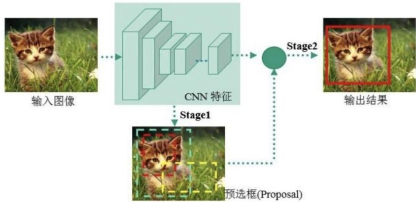

201


## 深度学习

two-stages算法的代表是RCNN系列：R-CNN到Faster R-CNN⽹络

One-stage的算法

直接通过主⼲⽹络给出⽬标的类别和位置信息，没有使⽤候选区域的筛选⽹路，这种算法速度快，但是精度相对Two-stage⽬标检测⽹络降低了很多。


输入图像

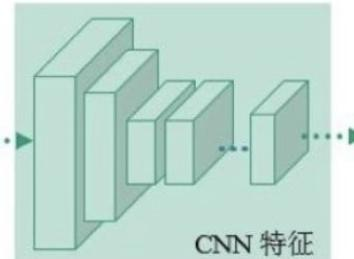

CNN特征

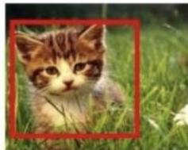

输出结果

one-stage算法的代表是： YOLO系列：YOLOv1 YOLOv2 YOLOv3SSD等

总结

了解⽬标检测的任务

找出图像中所有感兴趣的⽬标，并确定它们的类别和位置

知道⽬标检测的常⽤数据集

PASCAL VOC数据集 和 MS COCO数据集

知道⽬标检测算法的评价指标

IOU和mAP

掌握⾮极⼤值NMS算法的应⽤

要去除冗余的检测框,保留最好的⼀个

了解常⽤的⽬标检测算法分类

two-stage（两阶段）和one-stage（单阶段）

202


深度学习

## 4.2 R-CNN⽹络基础

## 学习⽬标

了解Overfeat模型的移动窗⼝⽅法

了解RCNN⽬标检测的思想

了解fastRCNN⽬标检测的思想

知道多任务损失

## Two-stage object detectors

R-CNN

Fast R-CNN

Faster R-CNN

## 1.Overfeat模型

Overfeat⽅法使⽤滑动窗⼝进⾏⽬标检测，也就是使⽤滑动窗⼝和神经⽹络来检测⽬标 滑动窗⼝使⽤固定宽度和⾼度的矩形区域，在图像上“滑动”，并将扫描结果送⼊到神经⽹络中进⾏分类和回归

例如要检测汽⻋，就使⽤下图中红⾊滑动窗⼝进⾏扫描，将所有的扫描结果送⼊⽹络中进⾏分类和回归，得到最终的汽⻋的检测结果

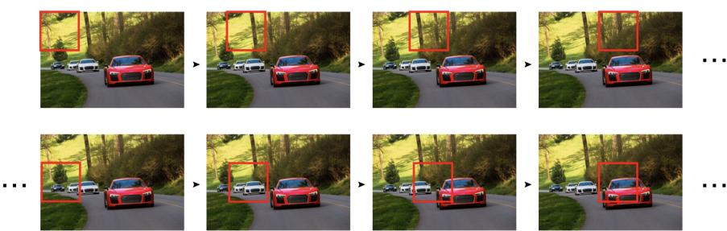

这种⽅法类似⼀种暴⼒穷举的⽅式，会消耗⼤量的计算⼒，并且由于窗⼝⼤⼩问题可能会造成效果不准确

## 2.RCNN模型

2014年提出R-CNN⽹络，该⽹络不再使⽤暴⼒穷举的⽅法，⽽是使⽤候选区域⽅法（region proposal method）创建⽬标检测的区域来完成⽬标检测的任务，R-CNN是以深度神经⽹络为基础的⽬标检测的模型 ，以R-CNN为基点，后续的Fast R-CNN Faster R-CNN模型都延续了这种⽬标检测思路

203


深度学习

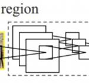

## 2.1 算法流程

RCNN的流程如下图所示：

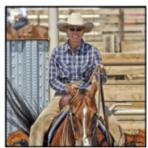

R-CNN: Regions with CNN features

1. Input image

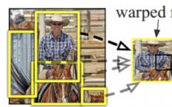

1. Extract region proposals (~2k)

1. Compute CNN features

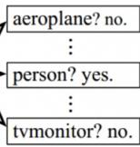

1. Classify regions

步骤是：

1. 候选区域⽣成：使⽤选择性搜索（Selective Search）的⽅法找出图⽚中可能存在⽬标的侯选区域

1. CNN⽹络提取特征：选取预训练卷积神经⽹⽹络（AlexNet或VGG）⽤于进⾏特征提取

1. ⽬标分类：训练⽀持向量机（SVM）来辨别⽬标物体和背景，对每个类别，都要训练⼀个⼆元SVM

1. ⽬标定位：训练⼀个线性回归模型，为每个辨识到的物体⽣成更精确的边界框

## 2.1.1 候选区域⽣成【了解】

在选择性搜索（SelectiveSearch，SS）中，使⽤语义分割的⽅法，它将颜⾊ 边界 纹理等信息作为合并条件，采⽤多尺度的综合⽅法，将图像在像素级上划分出⼀系列的区域，这些区域要远远少于传统的滑动窗⼝的穷举法产⽣的候选区域

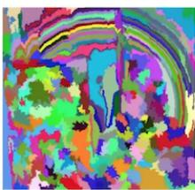

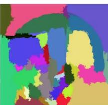

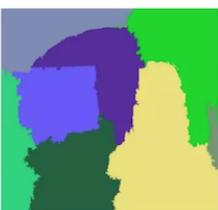

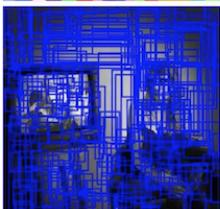

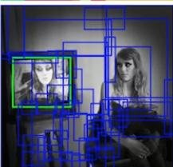

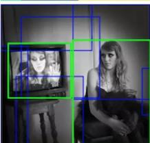

SelectiveSearch在⼀张图⽚上提取出来约2000个侯选区域，需要注意的是这些候选区域的⻓宽不固定 ⽽使⽤CNN提取候选区域的特征向量，需要接受固定⻓度的输⼊，所以需要对候选区域做⼀些尺⼨上的修改

## 2.1.2 CNN⽹络提取特征

204


深度学习

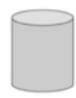

采⽤预训练模型(AlexNet或VGG)在⽣成的候选区域上进⾏特征提取，将提取好的特征保存在磁盘中，⽤于后续步骤的分类和回归

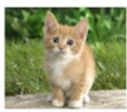

Image

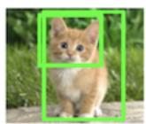

Region Proposals

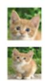

Crop + Warp

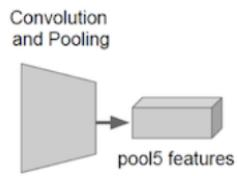

Forward pass

Save to disk

1.全连接层的输⼊数据的尺⼨是固定的，因此在将候选区域送⼊CNN⽹络中时，需进⾏裁剪或变形为固定的尺⼨，在进⾏特征提取

2.预训练模型在ImageNet数据集上获得，最后的全连接层是1000，在这⾥我们需要将其改为N+1(N为⽬标类别的数⽬，例如VOC数据集中N=20，coco数据集中N=80，1是加⼀个背景)后，进⾏微调即可

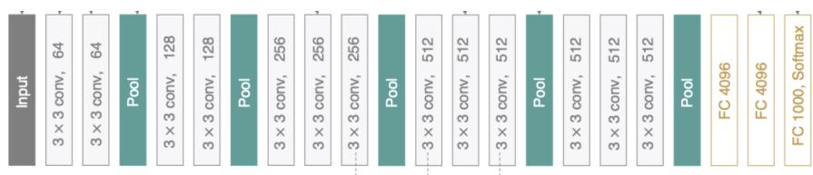

3.利⽤微调后的CNN⽹络，提取每⼀个候选区域的特征，获取⼀个4096维的特征，⼀幅图像就是2000x4096维特征存储到磁盘中

## 2.1.3 ⽬标分类（SVM）

假设我们要检测猫狗两个类别，那我们需要训练猫和狗两个不同类别的SVM分类器，然后使⽤训练好的分类器对⼀幅图像中2000个候选区域的特征向量分别判断⼀次，这样得出[2000, 2]的得分矩阵，如下图所示：

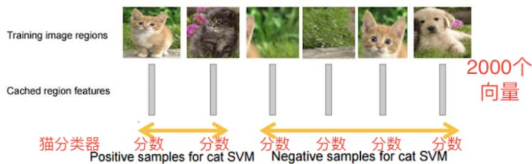

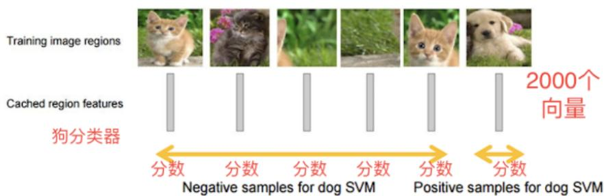

205


深度学习

对于N个类别的检测任务，需要训练N（⽬标类别数⽬）个SVM分类器，对候选区域的特征向量（4096维）进⾏⼆分类，判断其是某⼀类别的⽬标，还是背景来完成⽬标分类

## 2.1.4 ⽬标定位

通过选择性搜索获取的⽬标位置不是⾮常的准确，实验证明，训练⼀个线性回归模型在给定的候选区域的结果上去预测⼀个新的检测窗⼝，能够获得更精确的位置 修正过程如下图所示：

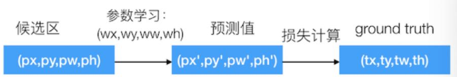

通过训练⼀个回归器来对候选区域的范围进⾏⼀个调整，这些候选区域最开始只是⽤选择性搜索的⽅法粗略得到的，通过调整之后得到更精确的位置，如下所示：

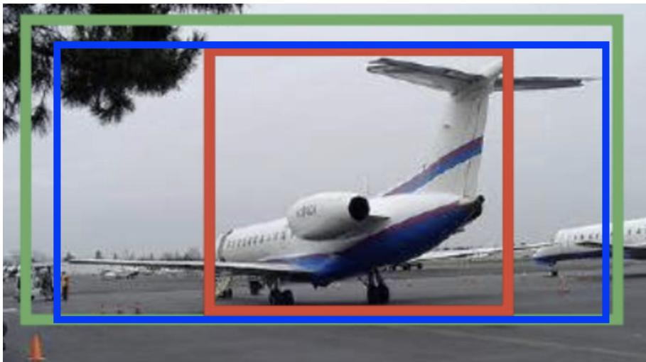

## 2.1.5 预测过程

使⽤选择性搜索的⽅法从⼀张图⽚中提取2000个候选区域，将每个区域送⼊CNN⽹络中进⾏特征提取，然后送⼊到SVM中进⾏分类，并使⽤候选框回归器，计算出每个候选区域的位置 候选区域较多，有2000个，需要剔除掉部分检测结果 针对每个类，通过计算IOU,采取⾮最⼤值抑制NMS的⽅法，保留⽐较好的检测结果

## 2.2 算法总结

1 训练阶段多，训练耗时： 微调CNN⽹络+训练SVM+训练边框回归器

2 预测速度慢: 使⽤GPU, VGG16模型处理⼀张图像需要47s

206


深度学习

3 占⽤磁盘空间⼤：5000张图像产⽣⼏百G的特征⽂件

4 数据的形状变化：候选区域要经过缩放来固定⼤⼩，⽆法保证⽬标的不变形

## 3. Fast RCNN模型

考虑到R-CNN存在的问题，2015年提出了⼀个改善模型:Fast R-CNN相⽐于R-CNN, Fast R-CNN主要在以下三个⽅⾯进⾏了改进：

## 1 提⾼训练和预测的速度

R-CNN⾸先从测试图中提取2000个候选区域，然后将这2000个候选区域分别输⼊到预训练好的CNN中提取特征 由于候选区域有⼤量的重叠，这种提取特征的⽅法，就会重复的计算重叠区域的特征 在Fast-RCNN中，将整张图输⼊到CNN中提取特征，将候选区域映射到特征图上，这样就避免了对图像区域进⾏重复处理，提⾼效率减少时间

## 2 不需要额外的空间保存CNN⽹络提取的特征向量

RCNN中需要将提取到的特征保存下来，⽤于为每个类训练单独的SVM分类器和边框回归器 在Fast-RCNN中，将类别判断和边框回归统⼀使⽤CNN实现，不需要在额外的空间存储特征

## 3 不在直接对候选区域进⾏缩放

RCNN中需要对候选区域进⾏缩放送⼊CNN中进⾏特征提取，在Fast-RCNN中使⽤ROIpooling的⽅法进⾏尺⼨的调整

## 3.1 算法流程

Fast_RCNN的流程如下图所示：

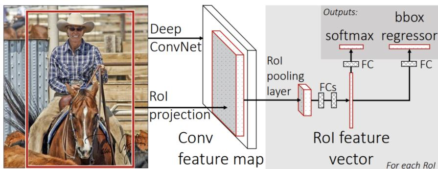

## 步骤是：

1 候选区域⽣成：使⽤选择性搜索（Selective Search）的⽅法找出图⽚中可能存在⽬标的侯选区域，只需要候选区域的位置信息

207


深度学习

2 CNN⽹络特征提取：将整张图像输⼊到CNN⽹络中，得到整副图的特征图，并将上⼀步获取的候选区域位置从原图映射到该特征图上

3、ROIPooling: 对于每个特征图上候选框，RoI pooling层从特征图中提取固定⻓度的特征向量每个特征向量被送⼊⼀系列全连接（fc）层中

4 ⽬标检测：分两部分完成，⼀个输出各类别加上1个背景类别的Softmax概率估计，另⼀个为各类别的每⼀个类别输出四个实数值，来确定⽬标的位置信息

## 3.1.1 候选区域⽣成【了解】

与RCNN中⼀样，不再赘述

## 3.1.2 CNN⽹络特征提取

与RCNN中⼀样，使⽤预训练模型进⾏特征提取

## 3.1.3 ROI Pooling

候选区域从原图映射到特征图中后，进⾏ROIpooling的计算，如下图所示：

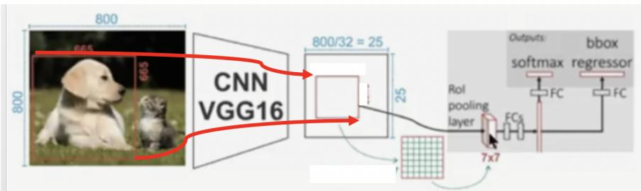

ROI Pooling层使⽤最⼤池化将输⼊的特征图中的任意区域（候选区域对应的区域）内的特征转化为固定的�×�的特征图，其中�和�是超参数对于任意输⼊的ℎ×�的候选区域，将其分割为�×�的⼦⽹格，每个⼦⽹格的⼤⼩为：(h/H) x (w/W)，取每个⼦⽹格中的最⼤值，送⼊后续⽹络中进⾏处理

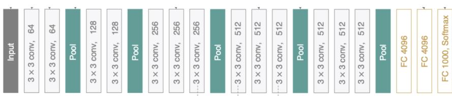

使⽤ROI Pooling层替换预训练⽹络中最后的池化层，并将并将超参�,�设置为和⽹络第⼀个全连接兼容的值，例如VGG16，设�=�=7

## 3.1.4 ⽬标分类和回归

原⽹络的最后⼀个全连接层替换为两个同级层:K+1个类别的SoftMax分类层和边框的回归层

208


深度学习

## 3.2 模型训练

R-CNN中的特征提取和检测部分是分开进⾏的，Fast R-CNN提出⼀个⾼效的训练⽅法：多任务训练

Fast R-CNN有两种输出：

1. ⼀部分输出在K+1个类别上的离散概率分布（每个候选区域）， $0= $( \mathsf { p 0 } , \mathsf { p 1 } , . . . , \mathsf { p k } ) $ $ 。通常，通过全连接层的K+1个输出上的Softmax来计算概率值。

1. 另⼀部分输出对于由K个类别中的每⼀个检测框回归偏移， $123, 456 $( { \mathrm t } \{ \chi \} ^ { \wedge } \{ k \} , t \{ y \} ^ { \wedge } \{ { \sf k } \} , { \mathrm t } \{ w \} ^ { \wedge } \{ k \} , t \{ { \sf h } \} ^ { \wedge } \{ { \sf k } \} ) \Phi$ 其中*t**k*指定相对于候选框的尺度不变转换和对数空间⾼度/宽度移位

将上⾯的两个任务的损失函数放在⼀起:

*L*(*p*, *u*, *t**u*, *v*) = *L**c**l**s*(*p*, *u*) + *λ*[*u* ≥ 1]*L**I**o**c*(*t**u*, *v*)

联合训练fast-RCNN⽹络 具体的我们在后续给⼤家进⾏介绍

## 3.3 模型预测

fastRCNN的⼯作流程描述如下：

输⼊图像：

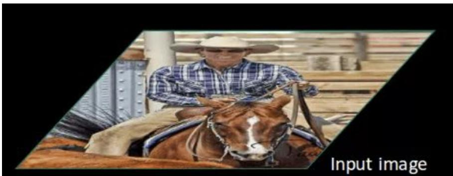

图像被送⼊到卷积⽹络进⾏特征提取，将通过选择性搜索获取的候选区域映射到特征图中：

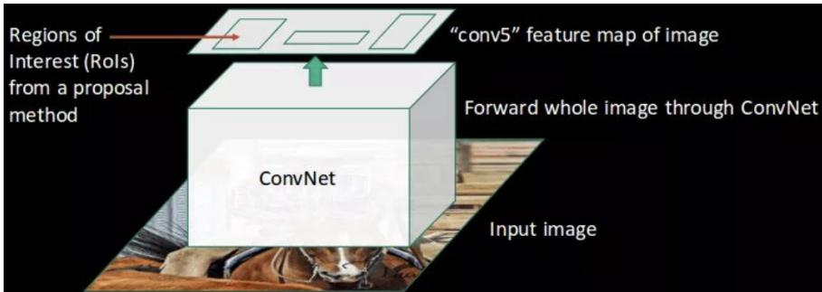

在特征图上Rol中应⽤RoIPooling，获取尺⼨相同的特征向量

209


深度学习

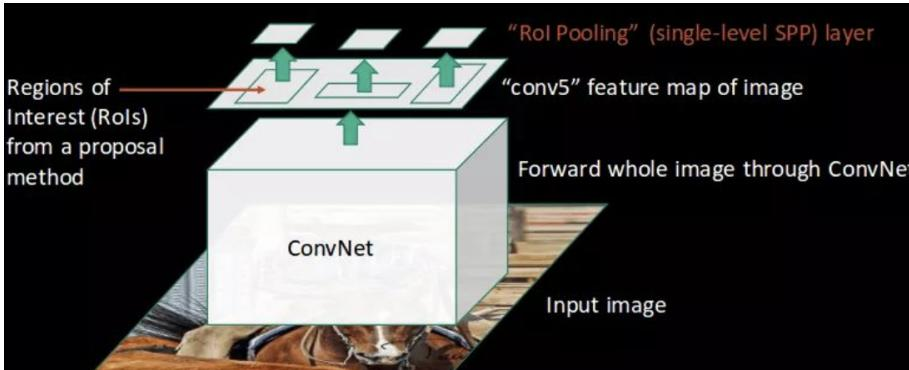

将这些区域传递到全连接的⽹络中进⾏分类和回归，得到⽬标检测的结果

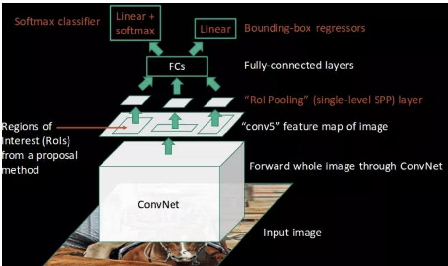

## 3.4 模型总结

Fast R-CNN是对R-CNN模型的⼀种改进：

1. CNN⽹络不再对每个候选区域进⾏特征提取，⽽是直接对整张图像进⾏出路，这样减少了很多重复计算

1. ⽤ROI pooling进⾏特征的尺⼨变换，来满⾜FC全连接层对输⼊数据尺度的要求

1. 将⽬标的回归和分类统⼀在⼀个⽹络中，使⽤FC+softmax进⾏⽬标分类，使⽤FC Layer进⾏⽬标框的回归

在Fast R-CNN中使⽤的⽬标检测识别⽹络，在速度和精度上都有了不错的结果 不⾜的是，其候选区域提取⽅法耗时较⻓，⽽且和⽬标检测⽹络是分离的，并不是端到端的，在2016年⼜提出了Faster-RCNN模型⽤于⽬标检测，在接下来的课程中我们着重介绍Faster-RCNN⽹络的原理与实现。

## 总结

210

## 

## 深度学习

## 了解Overfeat模型的移动窗⼝⽅法

滑动窗⼝使⽤固定宽度和⾼度的矩形区域，可以在图像上“滑动”，并将扫描送⼊到神经⽹络中进⾏分类和回归

## 了解RCNN⽬标检测的思想

R-CNN⽹络使⽤候选区域⽅法（region proposal method），利⽤CNN⽹络提取特征，SVM完成分类，线性回归进⾏bbox的修正

## 了解fastRCNN⽬标检测的思想

利⽤CNN⽹络进⾏特征提取，利⽤SS⽣成候选区域，进⾏映射，并使⽤ROIpooling进⾏维度调整，最后进⾏分类和回归

知道Fast-RCNN中提出的多任务损失：将分类和回归的损失函数联合训练⽹络

211


深度学习

## 4.3 Faster-RCNN⽹络

学习⽬标

熟悉FasterRCNN⽬标检测的思想

知道anchor（锚框）的思想

掌握RPN⽹络是如何进⾏候选区域的⽣成的

掌握ROIPooling的使⽤⽅法

知道fasterRCNN的训练⽅法

## Two-stage object detectors

R-CNN

Fast R-CNN

Faster R-CNN

在R-CNN和Fast RCNN的基础上，在2016年提出了Faster RCNN⽹络模型，在结构上，Faster RCNN已经将候选区域的⽣成，特征提取，⽬标分类及⽬标框的回归都整合在了⼀个⽹络中，综合性能有较⼤提⾼，在检测速度⽅⾯尤为明显 接下来我们给⼤家详细介绍fasterRCNN⽹络模型⽹络基本结构如下图所示：

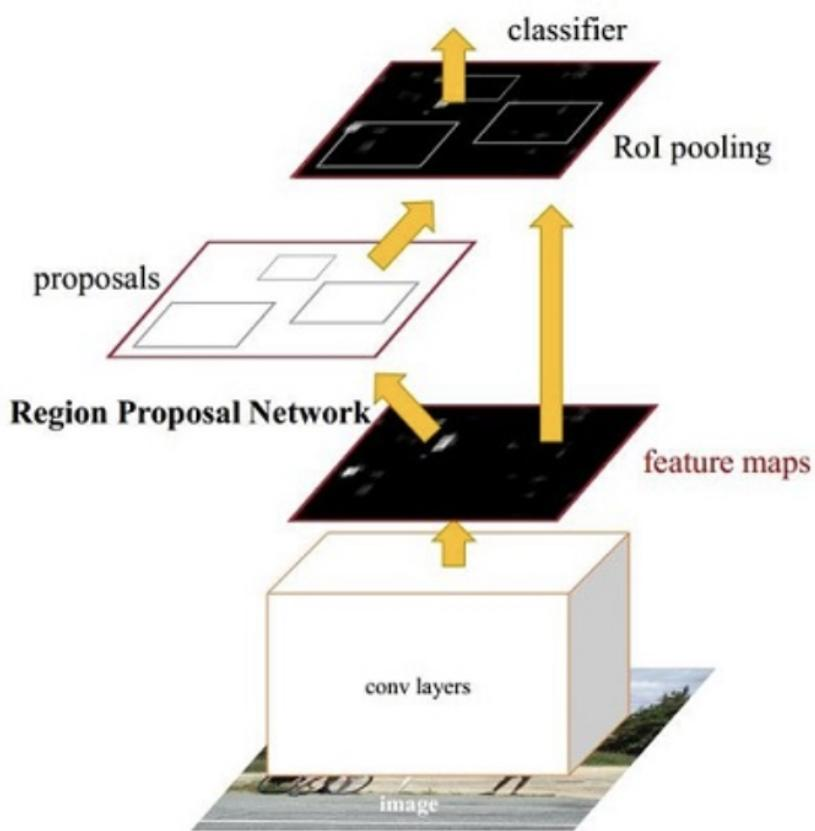

212


深度学习

Faster RCNN可以看成是区域⽣成⽹络(RPN)与Fast RCNN的组合，其中区域⽣成⽹络(RPN)替代选择性搜索来⽣成候选区域，Fast RCNN⽤来进⾏⽬标检测

## 1. ⽹络⼯作流程

FasterRCNN的⼯作流程是：

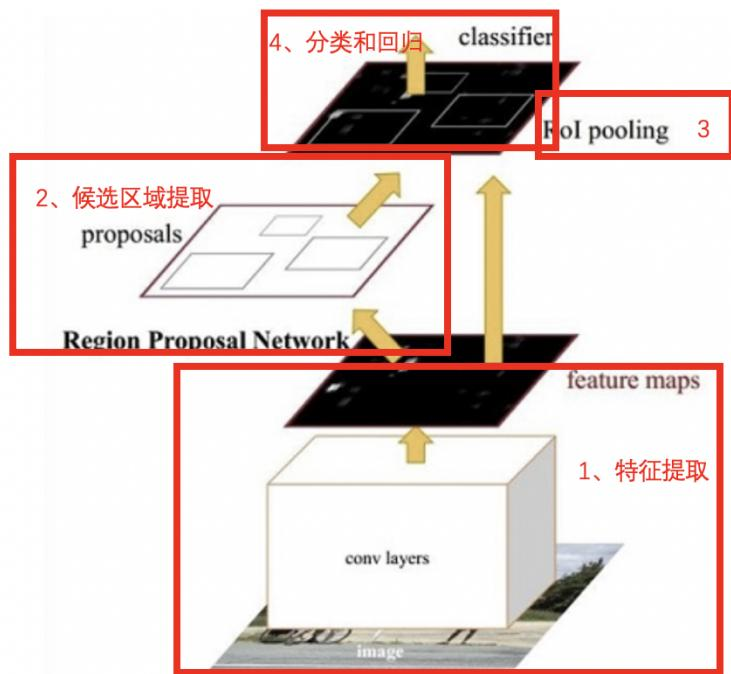

1 特征提取：将整个图像缩放⾄固定的⼤⼩输⼊到CNN⽹络中进⾏特征提取，得到特征图

2 候选区域提取：输⼊特征图，使⽤区域⽣成⽹络RPN，产⽣⼀些列的候选区域

3 ROIPooling: 与Fast RCNN⽹络中⼀样，使⽤最⼤池化固定候选区域的尺⼨，送⼊后续⽹络中进⾏处理

4 ⽬标分类和回归：与Fast RCNN⽹络中⼀样，使⽤两个同级层:K+1个类别的SoftMax分类层和边框的回归层，来完成⽬标的分类和回归

Faster R-CNN的流程与Fast R-CNN的区别不是很⼤，重要的改进是使⽤RPN⽹络来替代选择性搜索获取候选区域，所以我们可以将Faster R-CNN⽹络看做RPN和Fast R-CNN⽹络的结合

接下来我们来看下该⽹络预训练模型的使⽤过程，模型源码位置：

fasterRCNN中，如下图所示：

213


深度学习

```
Project
fasterRCNN ~/Desktop/fasterRCNN
    detection
    core
    datasets
    models
    utils
    weights
    faster_rcnn.h5 
```

detection⽂件夹中是模型，数据的实现，weights中包含⽹络的预训练模型 接下来我们按照以下步骤进⾏⽬标检测：

1 获取数据和加载预训练⽹络

2 获取RPN⽹络⽣成的候选区域

3 获取⽹络的⽬标检测结果

⾸先导⼊相应的⼯具包：

```
# 获取VOC数据使用
from detection.datasets import pascal_voc
# 绘图
import matplotlib.pyplot as plt
import numpy as np
# 模型构建
from detection.models.detectors import faster_rcnn
import tensorflow as tf
# 图像展示
import visualize
```

## 1.1 数据加载

加载voc数据集中的⼀张图⽚进⾏⽹络预测：

```
# 实例化voc数据集的类，获取送入网络中的一张图片
pascal = pascal_voc.pascal_voc("train")
# image: 送入网络中的数据，imagemeta:图像的yuan'x
image, imagemeta, bbox, label = pascal[218]
```

在将图像送⼊⽹络之前，我们对其进⾏了尺度的调整，标准化等处理，获取可展示的图像：

214


```
# 图像的均值和标准差
img_mean = (122.7717, 115.9465, 102.9801)
img_std = (1., 1., 1.)
# RGB图像
rgd_image = np.round(image + img_mean).astype(np.uint8)
```

## 获取原始图像，进⾏⽐较：

```
# 获取原始图像
from detection.datasets.utils import get_original_image ori_img = get_original_image(image[0], imagemeta[0], img_mean
```

## 将图像进⾏对⽐显示：

```
# 展示原图像和送入网络中图像
rgd_image= np.round(image+img_mean).astype(np.uint8)
fig,axes=plt.subplots(nrows=1,ncols=2,figsize=(10,8),dpi=10)
axes[0].imshow(ori_img.astype('uint8'))
axes[0].set_title("原图像")
axes[1].imshow(rgd_image[0])
axes[1].set_title("送入网络中的图像")
plt.show()
```

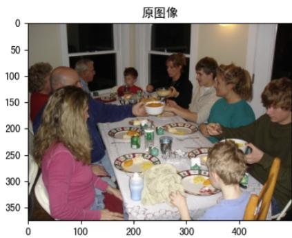

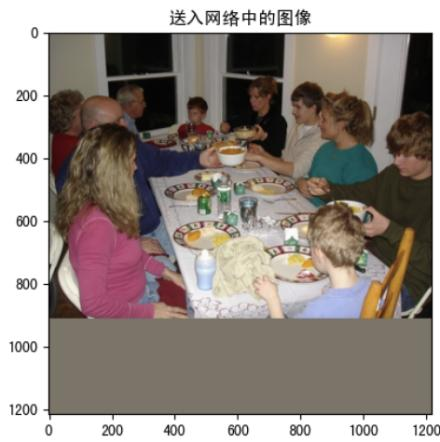

将原图像的⻓边缩放为1216，短边按相应⽐例进⾏调整后，并按照均值进⾏填充

```
# 原图像的大小
ori_img.shape
```

(375, 500, 3)

215


深度学习

```
# 送入网络中图像的大小
image.shape
(1, 1216, 1216, 3) 
```

imagemeta中的信息是：原图像⼤⼩，图像缩放后的⼤⼩，送⼊⽹络中图像的⼤⼩，图像缩放⽐例，图像是否翻转（未使⽤）

```
# 原始图像和送入网络中图像的信息
imagemeta
array([[375., 500., 3., 912., 1216., 1216., 1216., 3., 2.432, 0.]], 
```

## 1.2 模型加载

加载使⽤coco数据集预训练的模型，对图像进⾏预测

```
coco数据集的class，共80个类别：人，自行车，火车。。。
classes = ['bg', 'person', 'bicycle', 'car', 'motorcycle', 'tennis racket', 'bottle', 'wine glass', 'cup',
```

实例化faster-RCNN模型：

```
# 实例化模型
model = faster_rcnn.FasterRCNN(num_classes=len(classes))
```

加载预训练模型，由于fasterRCNN不是按照model的⼦类构建，所以⽆法通过h5⽂件直接加载模型结构，我们将结构实例化后，在加载权重获取整个预训练模型

```
model((image, imagemeta, bbox, label), training=True)
# 加载训练好的weights
model.load_weights("weights/faster_rcnn.h5")
```

通过model.summary()查看⽹络架构，如下：

216


深度学习

```
Model: "faster_rcnn_1" 
Layer (type) Output Shape Param #
res_net (ResNet) multiple 42658176
fpn (FPN) multiple 1. 特征提取 3344384
rpn_head (RPNHead) multiple 1189394
pyramid_roi_align (PyramidRO multiple 0
b_box_head (BBoxHead) multiple 14318997
Total params: 61,510,951
Trainable params: 61,401,511
Non-trainable params: 109,440
```

## 1.3 模型预测过程

模型的预测分为两部分：RPN⽣成候选区域和Fast RCNN进⾏⽬标的分类与回归

## 1.3.1 RPN获取候选区域

```
# RPN获取候选区域：输入图像和对应的元信息，输出是候选的位置信息
proposals = model.simple_test_rpn(image[0], imagemeta[0])
```

候选区域的结果如下所示：对于上述图像共产⽣1533个候选区域，每个候选区域使⽤相对于输⼊⽹络中图像归⼀化后的左上⻆坐标和右下⻆坐标

```
<tf.Tensor: shape=(1533, 4), dtype=float32, numpy=
array([[0.20729761, 0.00852748, 0.748096, 0.46975034],
    [0.42213044, 0.5887971, 0.7810232, 0.9806169],
    [0.40125194, 0.4384725, 0.48458642, 0.47913405],
    ...
    [0.25977597, 0.435113, 0.27290097, 0.4483906],
    [0.38884488, 0.41798416, 0.41393432, 0.4339822],
    [0.5885266, 0.65331775, 0.62330776, 0.6913476]], 
```

我们将这些候选区域绘制在图像上，需要获取绝对位置：

```
# 绘制在图像上(将proposal绘制在图像上)
visualize.draw_boxes(rgd_image[0],boxes=proposals[:,:4]*122
plt.show()
```

如下图所示：

217


深度学习

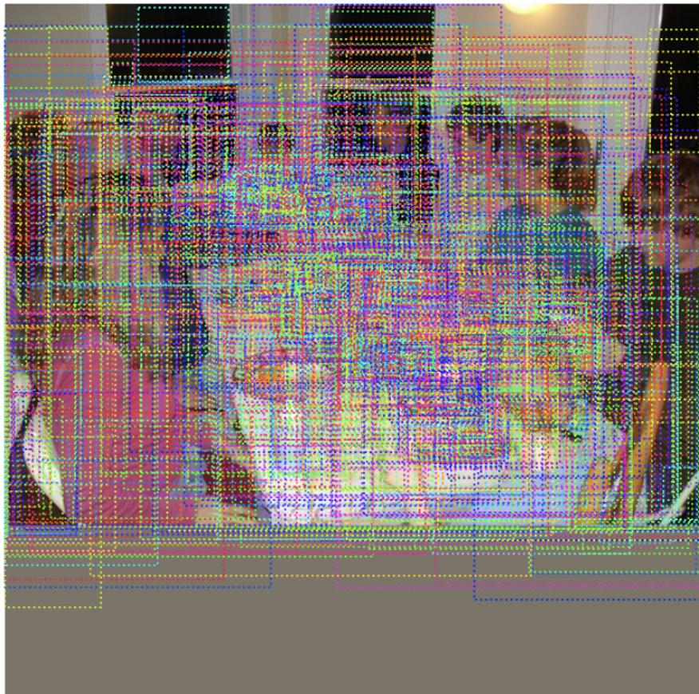

## 1.3.2 FastRCNN进⾏⽬标检测

我们将获取的候选区域送⼊到Fast RCNN⽹络中进⾏检测：

```
# rcnn进行预测,得到的是原图像的检测结果:
# 输入: 要检测的送入网络中的图像, 图像的元信息, RPN产生的候选区域
# 输出: 目标检测结果: 检测框(相对于原图像), 类别, 置信度
res = model.simple_test_bboxes(image[0], imagemeta[0], propos
```

res是⼀个字典，其结果如下所示：rois是⽬标框，class_ids是所属的类别，scores是置信度

218


深度学习

{'rois': array([[ 95.65208 , 8.963474 , 370.8639 , [ 57.620296 , 226.60101 , 159.39307 , 310.5221 [ 86.15405 , 323.98065 , 369.12762 , 497.7033 [ 83.67178 , 170.96815 , 135.69716 , 221.0586 [ 74.37474 , 327.855 , 210.86298 , 422.4879 [ 73.24604 , 0.97371644, 206.86272 , 47.9925 [ 63.968616 , 256.5716 , 192.52466 , 365.3871 [ 67.055145 , 88.534515 , 137.3221 , 130.7460 [227.8164 , 291.93015 , 370.9528 , 434.4086 [147.73048 , 218.15501 , 177.35306 , 260.5673 [ 82.44483 , 40.140255 , 133.15623 , 107.7262 [122.62652 , 239.552 , 141.19394 , 272.0635 [154.03288 , 115.91441 , 372.5167 , 426.5718 [218.90562 , 364.88345 , 247.20554 , 419.0384 [248.15126 , 407.61325 , 373.63068 , 479.5756 [139.69551 , 248.66753 , 154.51906 , 264.1605 [212.88734 , 195.23204 , 238.25243 , 209.2226 dtype=float32), 'class_ids': array([ 1, 1, 1, 1, 1, 1, 1, 1, 46 dtype=int32), 'scores': array([0.99917287, 0.992269 , 0.99193186, 0.989 0.98671734, 0.98594207, 0.97716457, 0.97271395, 0.9 0.9637522 , 0.9585419 , 0.9218482 , 0.8920589 , 0.8 0.81343234, 0.78660023], dtype=float32)}

将检测结果展示在图像上：

```
# 将检测结果绘制在图像上
visualize.display_instances(ori_img, res['rois'], res['class_plt.show()
```

219


深度学习

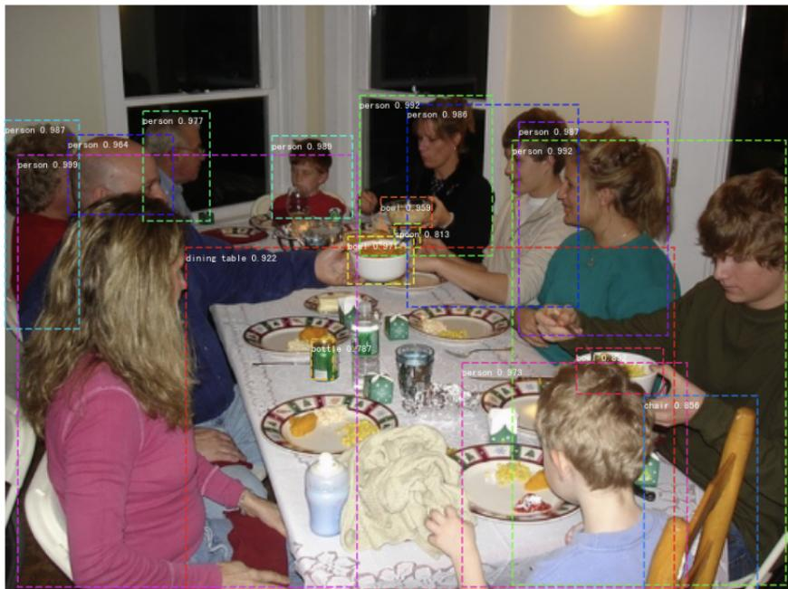

上述我们介绍了Faster RCNN的⼯作流程并且给⼤家展示了⽹络的检测结果 那接下来我们解决以下⼏个问题：

1 ⽹络中的每⼀部分是怎么构建，怎么完成相应的功能的？

2 怎么训练fastrcnn⽹络去完成我们⾃⼰的任务？

那接下来我们就解决上述问题

## 2.模型结构详解

Faster RCNN的⽹络结构如下图所示：

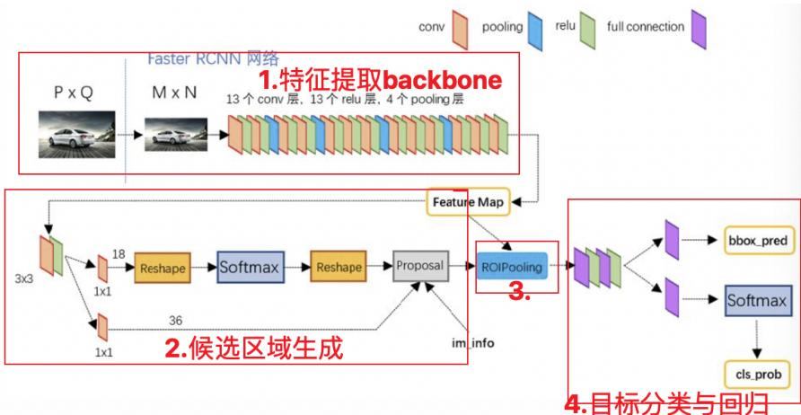

我们依然将⽹络分为四部分：

Backbone：Backbone由CNN卷积神经⽹络构成，常⽤的是VGG和resnet, ⽤来提取图像中的特征，获取图像的特征图 该特征图被共享⽤于后续RPN层⽣成候选区域和ROIPooling层中

RPN⽹络：RPN⽹络⽤于⽣成候选区域，⽤于后续的⽬标检测

220


深度学习

Roi Pooling: 该部分收集图像的特征图和RPN⽹络提取的候选区域位置，综合信息后获取固定尺⼨的特征，送⼊后续全连接层判定⽬标类别和确定⽬标位置

⽬标分类与回归: 该部分利⽤ROIpooling输出特征向量计算候选区域的类别，并通过回归获得检测框最终的精确位置

接下来我们就从这四个⽅⾯来详细分析fasterRCNN⽹络的构成，并结合源码理解每⼀部分实现的功能

## 2.1backbone

backbone⼀般为VGG，ResNet等⽹络构成，主要进⾏特征提取，将最后的全连接层舍弃，得到特征图送⼊后续⽹络中进⾏处理

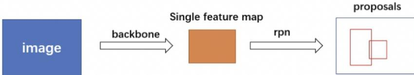

在源码中使⽤ResNet + FPN 结构来提取特征 与普通的 FasterRCNN 只需要将⼀个特征图输⼊到后续⽹络中不同，由于加⼊ FPN结构，需要将多个特征图逐个送⼊到后续⽹络中，如下图所示：

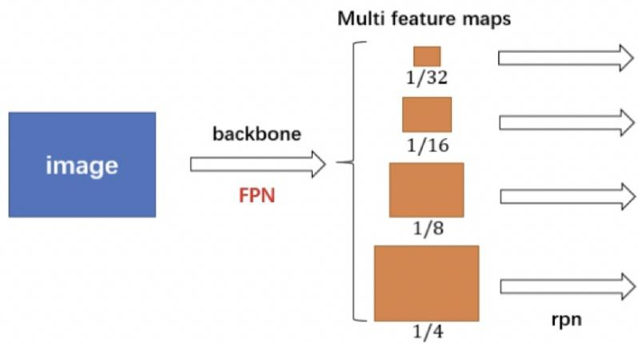

Resnet进⾏特征提取，FPN结构作⽤是当前层的特征图会融合未来层的特征进⾏上采样，并加以利⽤ 因为有了这样⼀个结构，当前的特征图就可以获取未来层的信息，也就将低阶特征与⾼阶特征就有机融合起来了，提升检测精度 如下图所示：

221


深度学习

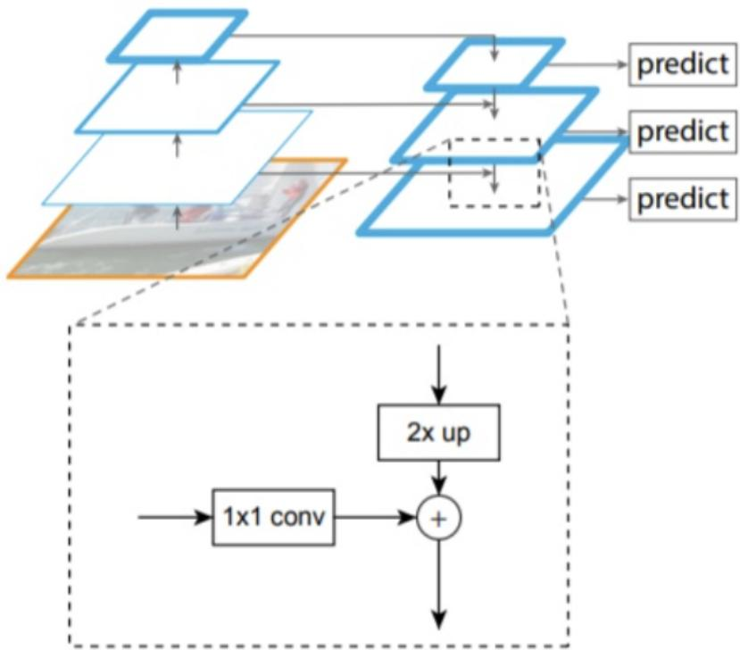

在这⾥ResNet和FPN的完整结构如下图所示:Resnet进⾏特征提取，FPN⽹络进⾏特征融合获取多个特征图后，输⼊到RPN⽹络中的特征图是[p2, p3, p4, p5, p6] ，⽽作为后续⽬标检测⽹络FastRCNN的输⼊则是[p2, p3, p4, p5] C

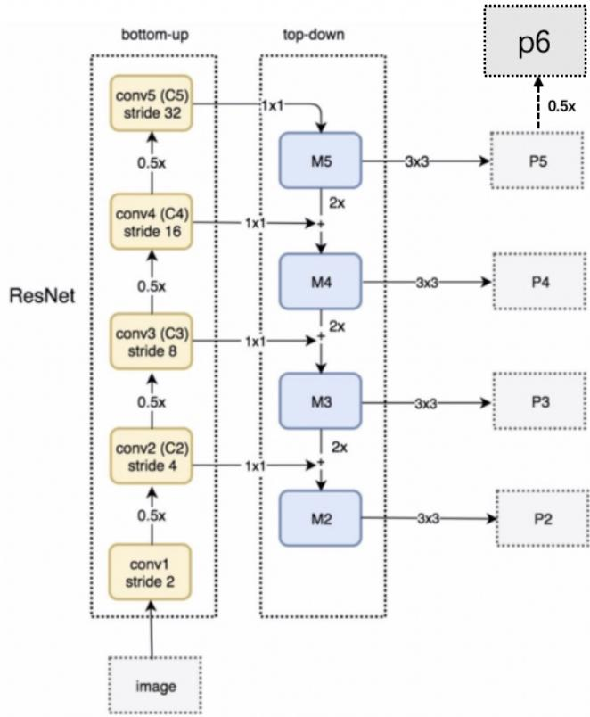

222


深度学习

## 我们看下源码实现的内容：

## 1 resnet特征提取的结果

```
# 使用backbone获取特征图
C2,C3,C4,C5 = model.backbone(image, training=False)
```

C2,C3,C4,C5是resnet进⾏特征提取的结果，送⼊⽹络中图像⼤⼩为（1216，1216，3），经过特征提取后特征图的⼤⼩为：

```
# C2.shape:1216/4
TensorShape([1, 304, 304, 256])
# C3.shape:1216/8
TensorShape([1, 152, 152, 512])
# C4.shape:1216/16
TensorShape([1, 76, 76, 1024])
# C5.shape:1216/32
TensorShape([1, 38, 38, 2048]) 
```

## 2 FPN特征融合的结果

```
# FPN网络融合：C2,C3,C4,C5是resnet提取的特征结果
P2,P3,P4,P5,P6 = model.neck([C2,C3,C4,C5], training=False)
```

P2,P3,P4,P5,P6是特征融合之后的结果，送⼊后续⽹络中，其特征图的⼤⼩：

```
# P2.shape:1216/4
TensorShape([1, 304, 304, 256])
# P3.shape:1216/8
TensorShape([1, 152, 152, 512])
# P4.shape:1216/16
TensorShape([1, 76, 76, 1024])
# P5.shape:1216/32
TensorShape([1, 38, 38, 2048])
# P6.shape:1216/64
TensorShape([1, 19, 19, 256]) 
```

## 那⽹络的整体架构表示成：

223

# 

深度学习

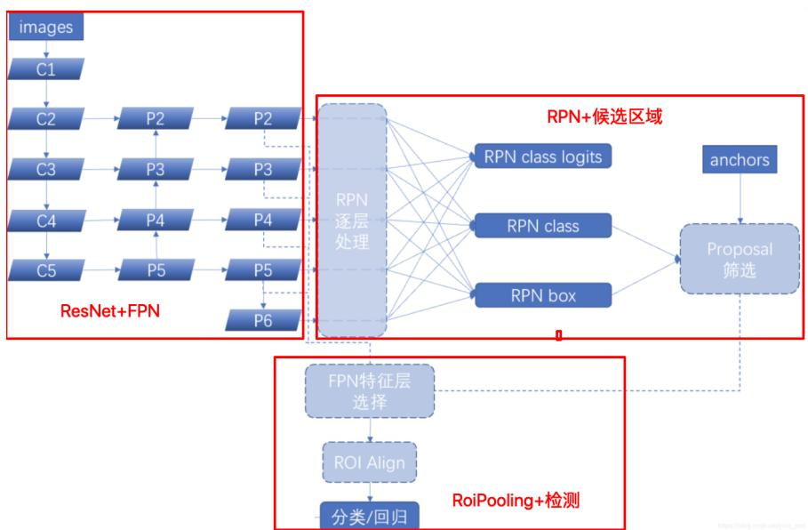

## 2.2 RPN⽹络

经典的检测⽅法⽣成检测框都⾮常耗时，如overfeat中使⽤滑动窗⼝⽣成检测框；或如R-CNN使⽤选择性搜索⽅法⽣成检测框 ⽽Faster RCNN则抛弃了传统的滑动窗⼝和选择性搜索的⽅法，直接使⽤RPN⽣成候选区域，能极⼤提升检测速度

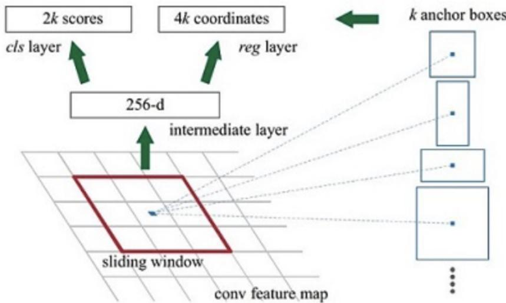

RPN⽹络的主要流程是：

1 ⽣成⼀系列的固定参考框anchors,覆盖图像的任意位置，然后送⼊后续⽹络中进⾏分类和回归

2 分类分⽀：通过softmax分类判断anchor中是否包含⽬标

3 回归分⽀：计算⽬标框对于anchors的偏移量，以获得精确的候选区域

4 最后的Proposal层则负责综合含有⽬标的anchors和对应bbox回归偏移量获取候选区域，同时剔除太⼩和超出边界的候选区域

224


深度学习

## 2.2.1 anchors

anchor在⽬标检测中表示 固定的参考框 ，⾸先预设⼀组不同尺度不同⻓宽⽐的固定参考框，覆盖⼏乎所有位置， 每个参考框负责检测与其交并⽐⼤于阈值 (训练预设值，常⽤0.5或0.7) 的⽬标 ，anchor技术将候选区域⽣成问题转换为 "这个固定参考框中有没有⽬标，⽬标框偏离参考框多远" ，不再需要多尺度遍历滑窗，真正实现了⼜好⼜快

在FastRCNN中框出多尺度 多种⻓宽⽐的anchors,如下图所示：下图中分别是尺度为32，64，128，⻓宽⽐为1：1，1:2，2：1的⼀组anchors,我们利⽤这组anchor在特征图上进⾏滑动，并对应到原图上即可获取⼀系列的固定参考框

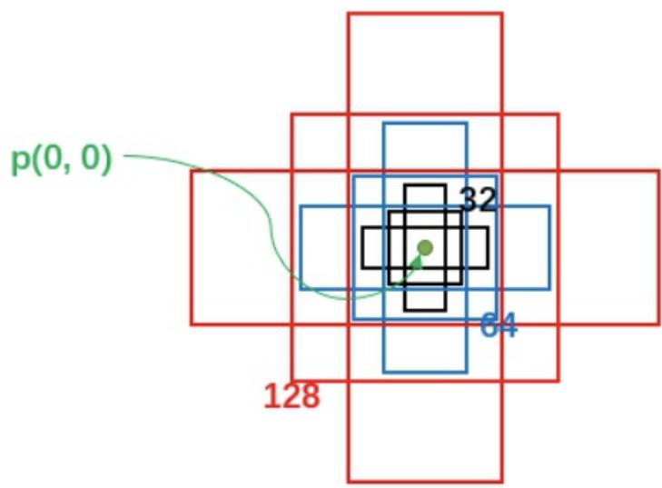

由于有 FPN ⽹络，所以会在多个不同尺度特征图中⽣成anchor，假设某⼀个特征图⼤⼩为hxw，⾸先会计算这个特征相对于输⼊图像的下采样倍数 stride：

$$ \text { stride } = \frac {\text { image\_size }}{\text { feature\_map\_size }} $$

如下图所示：

225


深度学习

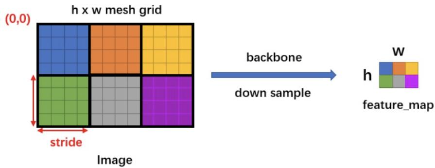

每⼀个尺度特征图上⽣成不同⽐列的anchor:

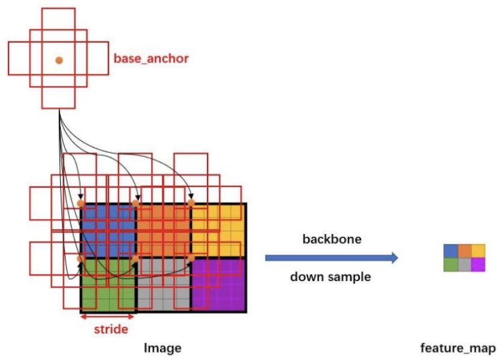

得到⼀系列的anchors后就可送⼊后续⽹络中进⾏分类和回归

在源码中我们可⽣成⼀幅图像对应的anchors:

```
产生anchor: 输入图像元信息即可，输出anchor对应于原图的坐标值
anchors,valid_flags = model.rpn_head.generator.generate_pyn
```

对于1216x1216的图像⽣成的anchor的数量为：

```
# anchors.shape:
#304*304*3+152*152*3+76*76*3+38*38*3+19*19*3=369303
TensorShape([369303, 4]) 
```

anchor的取值为：

226


深度学习

```
<tf.Tensor: shape=(369303, 4), dtype=float32, numpy=array([[ -22.627417, -11.313708, 22.627417, 11.313708]  
    [ -16., -16., 16., 16.]  
    [ -11.313708, -22.627417, 11.313708, 22.627417]  
...  
    [ 789.9613, 970.98065, 1514.0387, 1333.0193]  
    [ 896., 896., 1408., 1408.]  
    [ 970.98065, 789.9613, 1333.0193, 1514.0387]  
dtype=float32)> 
```

## 我们将前10000个anchor绘制在图像上：

```
# 绘制在图像上(将anchor绘制在图像上)
visualize.draw_boxes(rgd_image[0],boxes=anchors[:10000,:4])
plt.show()
```

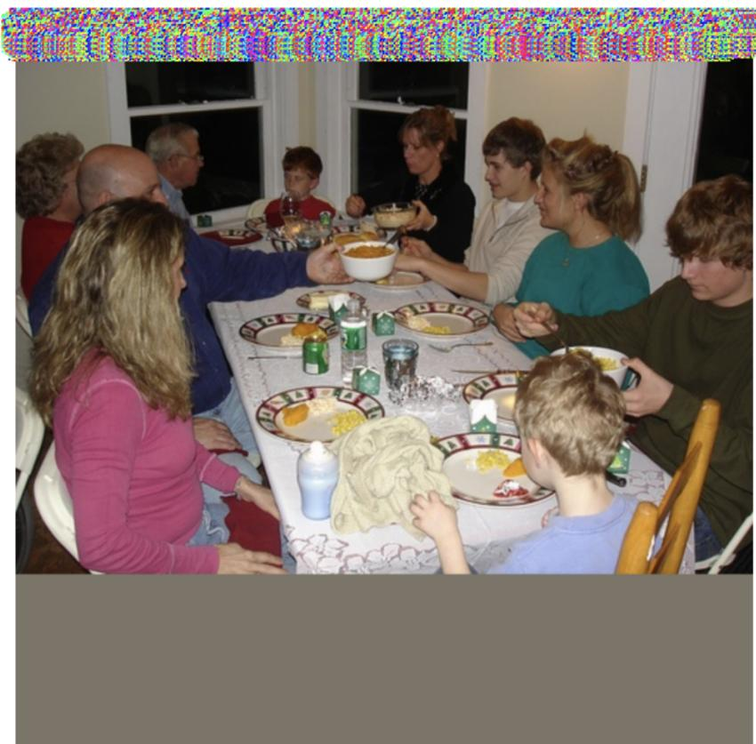

## 2.2.2 RPN分类

⼀副MxN⼤⼩的矩阵送⼊Faster RCNN⽹络后，经过backbone特征提取到RPN⽹络变为HxW⼤⼩的特征图 如下图所示，是RPN进⾏分类的⽹络结构：(k=9)

227


深度学习

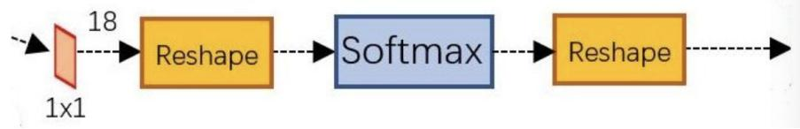

先做⼀个1x1的卷积，得到[batchsize,H,W,18]的特征图，然后进⾏变形,将特征图转换为[batchsize,9xH,W,2]的特征图后，送⼊softmax中进⾏分类，得到分类结果后，再进⾏reshape最终得到[batchsize,H,W,18]⼤⼩的结果,18表示k=9个anchor是否包含⽬标的概率值

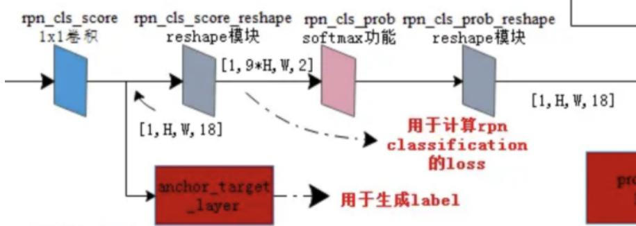

## 2.2.3 RPN回归

RPN回归的结构如下图所示：(k=9)


经过该卷积输出特征图为为[1, H, W,4x9]，这⾥相当于feature maps每个点都有9个anchors，每个anchors⼜都有4个⽤于回归的:

[*d**x*(*A*), *d**y*(*A*), *d**w*(*A*), *d**h*(*A*)]

变换量。

该变换量预测的是anchor与真实值之间的平移量和尺度因⼦：

*t**x* = (*x* − *x**a*)/*w**a*  *t**y* = (*y* − *y**a*)/*h**a*

*t**w* = log (*w*/*w**a*)  *t**h* = log (*h*/*h**a*)

利⽤源码我们可以获得对anchors的分类和回归结果：

228


## 深度学习

```
# RPN网络的输入:FPN网络获取的特征图
rpn_feature_maps = [P2,P3,P4,P5,P6]
# RPN网络预测，返回：logits送入softmax之前的分数，包含目标的概率，又
rpn_class_logits,rpn_probs,rpn_deltas = model.rpn_head(rpn_
```

## 结果分析：

```
# rpn_class_logits.shape, 每一个anchor都进行了分类分析
TensorShape([1, 369303, 2])
# rpn_probs.shape: softmax输出的概率值
TensorShape([1, 369303, 2])
# rpn_deltas.shape : 回归结果
TensorShape([1, 369303, 4])
```

## 其中 rpn_probs的取值为：

```
<tf.Tensor: shape=(1, 369303, 2), dtype=float32, numpy=array([[9.94552910e-01, 5.44707105e-03], [9.97310877e-01, 2.68914248e-03], [9.95540321e-01, 4.45961533e-03], ..., [9.99888301e-01, 1.11637215e-04], [9.99961257e-01, 3.87872169e-05], [9.99820888e-01, 1.79159630e-04]]], dtype=float32)> 
```

我们获取⼀些分类置信度较⾼的结果，将这些anchor绘制在图像上：

```
# 获取分类结果中包含目标的概率值
rpn_probs_tmp = rpn_probs[0, :, 1]
# 获取前100个较高的anchor
limit = 100
ix = tf.nn.top_k(rpn_probs_tmp, k=limit).indices[::-1]
# 获取对应的anchor绘制图像上，那这些anchor就有很大概率生成候选区域
visualize.draw_boxes(rgd_image[0], tf.gather(anchors, ix).num
```

229


深度学习


## 4.2.4 Proposal层

Proposal层负责综合RPN⽹络对anchors分类和回归的结果，利⽤回归的结果对包含⽬标的anchors进⾏修正，计算出候选区域，送⼊后续RoIPooling层中。

Proposal层处理流程如下：

1. 利⽤RPN⽹络回归的结果 对所有的anchors进⾏修正，得到修正后的检测框

1. 根据RPN⽹络分类的softmax输出的概率值由⼤到⼩对检测框进⾏排序，提取前6000个结果，即提取修正位置后的检测框

1. 限定超出图像边界的检测框为图像边界，防⽌后续roi pooling时候选区域超出图像边界


1. 对剩余的检测框进⾏⾮极⼤值抑制NMS

1. Proposal层的输出是对应输⼊⽹络图像尺度的归⼀化后的坐标值[x1,y1, x2, y2]

230


深度学习

到此RPN⽹络的⼯作就结束了

Proposal层有3个输⼊：RPN分类和回归结果，以及图像的元信息

```
# 获取候选区域
proposals_list = model.rpn_head.get_proposals(rpn_probs, rpr
```

## 结果为：

```
[<tf.Tensor: shape=(1533, 4), dtype=float32, numpy=array([[0.20729761, 0.00852748, 0.748096, 0.46975034], [0.42213044, 0.5887971, 0.7810232, 0.9806169], [0.40125194, 0.4384725, 0.48458642, 0.47913405], ..., [0.25977597, 0.435113, 0.27290097, 0.4483906], [0.38884488, 0.41798416, 0.41393432, 0.4339822], [0.5885266, 0.65331775, 0.62330776, 0.6913476]], 
```

## 将其绘制在图像上

# 绘制在图像上(将proposal绘制在图像上)visualize.draw_boxes(rgd_image[0],boxes=proposals_list[0].plt.show()


231


深度学习

## 2.3 ROIPooling

RoI Pooling层则负责收集RPN⽹络⽣成的候选区域，并将其映射到特征图中并固定维度，送⼊后续⽹络中进⾏分类和回归


RoI Pooling 的作⽤过程，如下图所示：


RoIpooling使⽤最⼤池化将任何有效的RoI区域内的特征转换成具有pool_H×pool_W的固定空间范围的⼩的特征图，其中pool_H和pool_W是超参数，⽐如设置为7x7, 它们独⽴于任何特定的RoI,如下图所示：


Fixed-length 7x7 representation

在实现过程中，FPN⽹络产⽣了多个尺度特征图，那候选区域要映射到哪个特征图中呢？

232


深度学习


在这⾥，不同尺度的ROI使⽤不同特征层作为ROI pooling层的输⼊，⼤尺度ROI就⽤后⾯⼀些的⾦字塔层，⽐如P5；⼩尺度ROI就⽤前⾯⼀点的特征层，⽐如P3，我们使⽤下⾯的公式确定ROI所在的特征层：

$$ k = \lfloor k _ {0} + \log_ {2} (\sqrt {w h} / 2 2 4) \rfloor $$

其中，224是ImageNet的标准输⼊，k0是基准值，设置为4，w和h是ROI区域的⻓和宽，假设ROI是112x112的⼤⼩，那 $\Delta { \sf k } = { \sf k } 0 - 1 = 4 - 1 = 3$ ，意味着该ROI应该使⽤P3的特征层 k值会做取整处理，防⽌结果不是整数，⽽且为了保证k值在2-5之间，还会做截断处理

```
# ROI Pooling层实现:输入是候选区域，特征图，图像的元信息
pool_region_list = model.roi_align((proposals_list, rcnn_fea
```

输出结果为：每⼀个候选区域都被固定为7x7⼤⼩

```
[<tf.Tensor: shape=(1533, 7, 7, 256), dtype=float32, numpy=array([[[-6.26428795e+00, 3.55317879e+00, 3.37260556e+00, 6.22574663e+00, 3.75851846e+00, -2.49103808e+00, [-9.01443863e+00, 7.67611027e-01, 7.18744850e+00, 6.20492172e+00, 4.09835625e+00, 6.05924249e-00, [-7.43907213e+00, -3.76329374e+00, 5.01457691e+00, 6.22656918e+00, 1.19414163e+00, 3.06410480e+00]…,
[1.39127302e+00, -1.71078873e+00, 4.01916075e+00, 5.94641972e+00, 3.63194764e-01, 2.91014194e+00, [-5.21681070e+00, 2.39917469e+00, 2.49682212e+00, 5.92232943e+00, 3.01222801e+00, 1.63518691e+00, [-1.26697767e+00, -6.90211892e-01, 4.50919747e-01, 1.97156405e+00, -1.07467103e+00, 4.54943466e+00] 
```

233


深度学习

## 2.4 ⽬标分类与回归

该部分利⽤获得的候选区域的特征图，通过全连接层与softmax计算每个候选区域具体属于的类别（如⼈，⻋，电视等），输出概率值；同时再次利⽤回归⽅法获得每个候选区域的位置偏移量，⽤于回归更加精确的⽬标检测框 该部分⽹络结构如下所示：


从RoI Pooling层获取到固定⼤⼩的特征图后，送⼊后续⽹络，可以看到做了如下2件事：

1. 通过全连接和softmax对候选区域进⾏分类

1. 再次对候选区域进⾏回归修正，获取更⾼精度的检测框

实现流程如下：

⾸先获取⽹络分类和回归的结果：

```
# RCNN网络的预测:输入是ROIPooling层的特征，输出：类别的score,类别的rcnn_class_logits,rcnn_class_probs,rcnn_deltas_list = model
```

利⽤结果对候选区域进⾏修正：

```
# 获取预测结果:输入：rcnn返回的分类和回归结果，候选区域，图像元信息，detection_list = model.bbox_head.get_bboxes(rcnn_class_prob)
```

结果为：⼀共检测出17个⽬标，每个⽬标右⽬标位置，⽬标类别id，⽬标类别置信度6个值构成

234

深度学习


[<tf.Tensor: shape=(17, 6), dtype=float32, numpy= array([[2.3262584e+02, 2.1799168e+01, 9.0194098e+02, 5.45 1.0000000e+00, 9.9917287e-01], [1.4013255e+02, 5.5109363e+02, 3.8764392e+02, 7.55 1.0000000e+00, 9.9226898e-01], [2.0952664e+02, 7.8792090e+02, 8.9771838e+02, 1.21 1.0000000e+00, 9.9193186e-01], [2.0348978e+02, 4.1579453e+02, 3.3001547e+02, 5.37 1.0000000e+00, 9.8929125e-01], [1.8087936e+02, 7.9734338e+02, 5.1281873e+02, 1.02 1.0000000e+00, 9.8689401e-01], [1.7813437e+02, 2.3680782e+00, 5.0309012e+02, 1.16 1.0000000e+00, 9.8671734e-01], [1.5557167e+02, 6.2398212e+02, 4.6821997e+02, 8.88 1.0000000e+00, 9.8594207e-01], [1.6307811e+02, 2.1531593e+02, 3.3396735e+02, 3.17 1.0000000e+00, 9.7716457e-01], [5.5404950e+02, 7.0997412e+02, 9.0215717e+02, 1.056 1.0000000e+00, 9.7271395e-01], [3.5928052e+02, 5.3055298e+02, 4.3132263e+02, 6.336 4.6000000e+01, 9.7136974e-01], [2.0050583e+02, 9.7621101e+01, 3.2383597e+02, 2.61 1.0000000e+00, 9.6375221e-01], [2.9822769e+02, 5.8259045e+02, 3.4338364e+02, 6.61 4.6000000e+01, 9.5854193e-01], [3.7460797e+02, 2.8190384e+02, 9.0596057e+02, 1.03 6.1000000e+01, 9.2184818e-01], [5.3237848e+02, 8.8739655e+02, 6.0120386e+02, 1.01 4.6000000e+01, 8.9205891e-01], [6.0350385e+02, 9.9131537e+02, 9.0866974e+02, 1.16 5.7000000e+01, 8.5597926e-01], [3.3973947e+02, 6.0475940e+02, 3.7579034e+02, 6.42 4.5000000e+01, 8.1343234e-01], [5.1774200e+02, 4.7480432e+02, 5.7942987e+02, 5.088 4.0000000e+01, 7.8660023e-01]], dtype=float32)>]

## 可以将其绘制在图像上：

# 绘制在图像上visualize.draw_boxes(rgd_image[0],boxes=detection_list[0][:plt.show(）

235

深度学习


到这我们就完成了整个⽹络的介绍

## 3 FasterRCNN的训练

Faster R-CNN的训练分为两部分，即RPN⽹络和检测⽹络fastRCNN的训练：

236

深度学习


整个训练过程分为四步：

第⼀步：RPN⽹络的训练，使⽤ImageNet预训练的模型初始化，并端到端微调⽤于区域建议任务

第⼆步：利⽤第⼀步的RPN⽣成的建议框，由Fast R-CNN训练⼀个单独的检测⽹络，这个检测⽹络同样是由ImageNet预训练的模型初始化的，这时候两个⽹络还没有共享卷积层

第三步：⽤检测⽹络初始化RPN训练，但是固定共享的卷积层，并且只微调RPN独有的层，现在两个⽹络共享卷积层了

第四步：保持共享的卷积层固定，微调Fast R-CNN的fc层 这样，两个⽹络共享相同的卷积层，构成⼀个统⼀的⽹络


接下来我们分别介绍各个训练步骤：

## 3.1 RPN⽹络的训练

237


深度学习

RPN⽹络的作⽤从众多的anchors中提取包含⽬标的，并且经过回归调整的候选区域 为了训练RPN，给每个anchor分配是否包含⽬标的标签，也就是正负样本的标记，然后进⾏训练

## 3.1.1正负样本标记

与真实框ground truth（GT）交并⽐IOU⼤于0.7的anchor是正样本，即anchor中包含⽬标，⽬标值设为1

与真实框ground truth（GT）交并⽐IOU⼩于0.3的anchor是负样本，即anchor中不包含⽬标，⽬标值设为-1

其他的anchor舍弃，不参与⽹络的训练，⽬标值设为0

## 3.1.2 RPN⽹络的损失函数

RPN⽹络的损失函数是：

$$ \mathrm{L} (\{p _ {i} \}, \{t _ {i} \}) = \frac {1}{N _ {\mathrm{cls}}} \sum_ {i} \mathrm{L} _ {\mathrm{cls}} (p _ {i}, p _ {i} ^ {*}) + \lambda \frac {1}{N _ {\mathrm{reg}}} \sum_ {i} p _ {i} ^ {*} \mathrm{L} _ {\mathrm{reg}} (t _ {i}, t _ {i} ^ {*}) $$

其中

*i*表示anchor的索引

*p**i*是第i个anchor 预测为⽬标的可能性，*p**i**为ground-truth标签 如果这个anchor是positive的，则ground-truth标签为1，否则为0 （即当第i个anchor与GT间IoU>0.7，认为是该anchor是positive，标签为1；反之IoU<0.3时，认为是该anchor是negative，标签为0）

*t**i*表示表示正样本anchor到预测区域bounding box的4个参数化预测结果,*t**i**是这个positive anchor对应的ground-truth box的偏移，如下所示：

预测值：

$$ t _ {x} = \frac {(x - x _ {a})}{w _ {a}}, t _ {y} = \frac {(y - y _ {a})}{h _ {a}}, t _ {w} = l o g \frac {w}{w _ {a}}, t _ {h} = l o g \frac {h}{h _ {a}} $$

真实值：

$$ t _ {x} ^ {*} = \frac {(x ^ {*} - x _ {a})}{w _ {a}}, t _ {y} ^ {*} = \frac {(y ^ {*} - y _ {a})}{h _ {a}}, t _ {w} ^ {*} = l o g \frac {w ^ {*}}{w _ {a}}, t _ {h} ^ {*} = l o g \frac {h ^ {*}}{h _ {a}} $$

其中，x，y，w，h表示窗⼝中⼼坐标和窗⼝的宽度和⾼度，变量x，

*x**a**和**x** 分别表示预测窗⼝ anchor窗⼝和Ground Truth的坐标（y，w，h同理）

整个Loss分为两部分：分类和回归的损失*L**c**l**s*分类的损失（classification loss），是⼀个⼆分类器的softmax loss。

238


深度学习

*L**c**l**s*(*p**i*, *p**i*⋆) = −log [*p**i* * *p**i*⋆ + (1 − *p**i*⋆)(1 − *p**i*)]

*L**r**e**g*是回归损失，为*s**m**o**o**t**h*(*x*)损失,并且只有正样本才参与回归损失计算

L reg (*t**i*, *t**i**) = ∑*i* ∈ {*x*, *y*, *w*, *h*}smoothL1(*t**i* − *t**i**)

*N**c**l**s*和*N**r**e**g*分别⽤来标准化分类损失项*L**c**l**s*和回归损失项*L**r**e**g*，默认⽤batch size设置*N**c**l**s* ⽤anchor位置数⽬~2000*N**r**e**g*

*N**c**l**s*和*N**r**e**g*相差过⼤，⽤参数λ来平衡两者，⼀般取值为*N**r**e**g*和*N**c**l**s*的⽐值10即可

## 3.1.3 训练过程

在训练时每次迭代的正负样本是由⼀幅图像的正负样本组成的：

随机采样256个anchor，计算损失函数，其中采样的正负anchor的⽐例是1:1。

通过从零均值标准差为0.01的⾼斯分布中获取的权重来随机初始化所有新层（最后⼀个卷积层其后的层），所有其他层（即共享的卷积层）是通过对ImageNet分类预训练的模型来初始化的

采⽤带动量的随机梯度下降算法对⽹络进⾏训练

## 3.1.4 实现

## 1、正负样本设置

将产⽣的369303个anchor与⽬标真实值的计算交并⽐设置正负样本：

```
# 获取对应的目标值：输入：要设置正负样本的anchors，anchor在有效区域rpn_target_matches, rpn_target_deltas = model.rpn_head.anchor
```

所有的anchor都设置了分类的⽬标值，回归的⽬标值只有正负样本设置了⽬标值，⼀共有369303个Anchor，参与训练的有256个anchor

```
# rpn_target_matches.shape
TensorShape([1, 369303])
# rpn_target_deltas.shape
TensorShape([1, 256, 4]) 
```

239


深度学习

获取正样本：正样本是包含⽬标的anchor，其⽬标值设为1，正样本的个数是29个

```
# 属于正样本的anchors，与GT交并比较大的anchor,目标值设为1
positive_anchors = tf.gather(anchors,tf.where(tf.equal(rpn_
# 正样本的个数：一共使用29个属于正样本的anchor
TensorShape([29, 4])
```

我们将这些正样本绘制在图像上：可以看出这些anchor与⽬标还是⾮常接近的


接下来，我们看下负样本的结果，负样本的⽬标值是-1，负样本的个数是227，与29个正样本⼀共是256个anchor参与⽹络训练，其余的不参与⽹络训练

```
# 负样本
negtivate_anchors = tf.gather(anchors,tf.where(tf.equal(rpr
# negtivate_anchors.shape
TensorShape([227, 4])
```

同样我们也将负样本展示在图像上，从图像可以看出这些负样本的ancho与⽬标差距还是很⼤的

240

# 

深度学习


## 2、损失函数

损失函数计算是将⽹络预测结果和真实值进⾏⽐较，获取两者之间的差别 损失函数由两部分组成：分类和回归

```
# RPN网络的损失函数
# 输入：rpn的分类结果rpn_class_logits，rpn的回归结果，bbox标注框，
# 输出：分类损失和回归损失
rpn_class_loss, rpn_bbox_loss = model.rpn_head.loss(
    rpn_class_logits, rpn_deltas, bbox, label,
# 分类损失：rpn_bbox_loss
<tf.Tensor: shape=(), dtype=float32, numpy=0.20614956>
# 回归损失：rpn_class_loss
<tf.Tensor: shape=(), dtype=float32, numpy=0.034301624>
```

接下来我们使⽤梯度下降算法对⽹络进⾏训练就可以了

## 3.2 FastRCNN⽹络的训练

使⽤RPN⽹络收集到的候选区域和imageNet预训练的卷积⽹络提取的特征对检测的FastRCNN⽹络进⾏训练

## 3.2.1 正负样本标记

241


深度学习

在FastRCNN⽹络训练时：

⾸先将与真实框ground truth（GT）交并⽐IOU⼤于0.5的候选区域设为正样本，类别的⽬标值是GT的类别

将与真实框ground truth（GT）交并⽐IOU⼩于0.5的候选区域设为负样本，类别的⽬标值是0

## 3.1.2 FastRCNN的损失函数

FastRCNN的输出由两部分组成：⼀部分是softmax层进⾏分类，输出类别有K个类别加上”背景”类，另⼀部分是回归bounding box regressor。也就是：

⼀部分输出在K+1个类别上的离散概率分布（每个候选区域），*p*=( \mathsf { p 0 } , \mathsf { p 1 } , . . . , \mathsf { p k } ) \ P$ 通常，通过全连接层的K+1个输出上的Softmax来计算p。

另⼀部分输出对于由K个类别中的每⼀个检测框回归偏移， $123, 456 $( \mathrm { t } { \small \{ X \} } ^ { \wedge } { \small \{ k \} } , t \{ \mathrm { y } \} ^ { \wedge } \{ \mathrm { k } \} , \mathrm { t } { \small \{ W \} } ^ { \wedge } { \small \{ k \} } , t \{ \mathrm { h } \} ^ { \wedge } \{ \mathrm { k } \} )$ $ 其中*t**k*指定相对于候选框的尺度不变转换和对数空间⾼度/宽度移位，与在RPN⽹络中是⼀样的

每个训练的候选区域⽤ 分类⽬标值u和检测框回归⽬标值v标记 背景样本⽤u=0来表示，对每个标记的候选区域使⽤多任务损失L以联合训练分类和检测框回归：

*L*(*p*, *u*, *t**u*, *v*) = *L**c**l**s*(*p*, *u*) + *λ*[*u* ≥ 1]*L**l**o**c*(*t**u*, *v*)

其中$L {*c**I**s*}(*p*, *u*) = − ∖ 1*o**g**p*_*u**Φ* 表示交叉熵损失 第⼆个损失*L**l**o**c*，是定义⽬标值和预测检测框的四元组之间的损失使⽤smoothL1损失计算，同样是只有正样本（⾮背景）的候选区域才计算回归损失，参数λ设为1

## 3.2.3.训练过程

FastRCNN的训练获取每张图⽚中的正负样本：

对所有正样本根据IOU值进⾏排序，每张图⽚取前256个区域，将这些区域的坐标保存下来，作为该图⽚的训练样本

⽤于Softmax分类和检测框回归的全连接层的权重分别使⽤具有⽅差0.01和0.001的零均值⾼斯分布初始化，偏置初始化为0，特征提取⽹络使⽤ImageNet的预训练⽹络

使⽤梯度下降算法进⾏优化

## 3.2.4 实现

## 1、正负样本设置

将proposal层产⽣的候选区域与⽬标真实值的计算交并⽐设置正负样本：

242

# 

深度学习

```
# fastRCNN的正负样本设置
# 输入：RPN网络生成的候选区域，bbox是标记框，label是目标类别
# 输出：参与训练的候选区域rois_list, 候选区域分类的目标值rcnn_target
rois_list, rcnn_target_matches_list, rcnn_target_deltas_list
model.bbox_target.build_targets(
    proposals_list,bbox, label, imagemeta)
```

获取正样本：正样本是负责⽬标检测的候选区域，其⽬标值不是0，正样本的个数是64个

```
# 获取正样本:
positive_proposal = tf.gather(rois_list[0], tf.where(tf.not_equal(rcnn_target_matches_list, 0))[:, 1])
# positive_proposal.shape
TensorShape([64, 4])
```

将其展示在图像上：可以这些框跟真实值是⾮常接近的

```
# 显示
visualize.draw_boxes(rgd_image[0], positive_proposal.numpy()
plt.show()
```


243


深度学习

同样我们也可以获取负样本（背景），并绘制在图像上：

```
# 负样本
negtivate_proposal = tf.gather(rois_list[0], tf.where(tf.equal(rcnn_target_matches_list, 0))[:, 1])
# negtivate_proposal.shape
TensorShape([192, 4])
# 显示
visualize.draw_boxes(rgd_image[0],negtivate_proposal.numpy(plt.show()
```


## 2 损失函数

损失函数计算是将⽹络预测结果和真实值进⾏⽐较，获取两者之间的差别 在这⾥我们需要将参与⽹络训练的候选区域进⾏ROIPooling后送⼊⽹络中训练 损失函数由两部分组成：分类和回归：

244


深度学习

```
# 将参与网络训练的候选区域rois_list送入到ROIpooling层中进行维度固定
pooled_regions_list = model.roi_align(
    (rois_list, rcnn_feature_maps, imagemeta), train:
# 送入网络中进行预测，得到预测结果
rcnn_class_logits_list, rcnn_probs_list, rcnn_deltas_list =
    model.bbox_head(pooled_regions_list, training=1)
# 计算损失函数：分类和回归
# 输入：网络的预测结果和目标值
rcnn_class_loss, rcnn_bbox_loss = model.bbox_head.loss(
    rcnn_class_logits_list, rcnn_deltas_list,
    rcnn_target_matches_list, rcnn_target_deltas
# 分类损失rcnn_class_loss
<tf.Tensor: shape=( ), dtype=float32, numpy=0.56958425>
# 回归损失rcnn_bbox_loss
<tf.Tensor: shape=( ), dtype=float32, numpy=0.28708345>
```

接下来使⽤梯度下降算法进⾏预测即可

## 3.3 共享卷积训练

⽤fastRCNN检测⽹络初始化RPN训练，但是固定共享的卷积层，并且只微调RPN独有的层，现在两个⽹络共享卷积层了，接下来保持共享的卷积层固定，微调Fast R-CNN的fc层 这样，RPN⽹络和Fast R-CNN⽹络共享相同的卷积层，构成⼀个统⼀的⽹络

Faster R-CNN还有⼀种端到端的训练⽅式，可以⼀次完成训练，将RPNloss与Fast RCNN loss相加，然后进⾏梯度下降优化，更新参数

## 3.4 端到端训练

前⾯我们已经介绍了⽹络模型架构和预测结果，在⽹络预测前我们需要对⽹络进⾏训练，接下来使⽤端到端的⽅式进⾏模型训练，基本步骤是：

1 加载数据集：我们在这⾥使⽤VOC数据集，所以需要加载VOC数据集

2 模型实例化：加载faster RCNN模型

3 模型训练：计算损失函数，使⽤反向传播算法对模型进⾏训练完成⽹络的训练 ⾸先导⼊相关的⼯具包：

245


深度学习

```
# 数据集加载
from detection.datasets import pascal_voc
# 深度学习框架
import tensorflow as tf
import numpy as np
# 绘图
from matplotlib import pyplot as plt
# 要训练的模型
from detection.models.detectors import faster_rcnn
```

## 3.4.1 数据加载

```
# 加载数据集
train_dataset = pascal_voc.pascal_voc('train')
# 数据的类别：train_dataset.classes
['background',
'person',
'aeroplane',
'bicycle',
'bird',
'boat',
'bottle',
'bus',
'car',
'cat',
'chair',
'cow',
'diningtable',
'dog',
'horse',
'motorbike',
'pottedplant',
'sheep',
'sofa',
'train',
'tvmonitor']
# 数据类别数量：21
num_classes = len(train_dataset.classes)
```

## 3.4.2. 模型实例化

```
# 指定数据集中类别个数
model = faster_rcnn.FasterRCNN(num_classes=num_classes)
```

## 3.4.3 模型训练

246


## 深度学习

模型训练也就是要使⽤损失函数，进⾏反向传播，利⽤优化器进⾏参数更新，训练的流程是：

1 指定优化器：在这⾥我们使⽤加动量的SGD⽅法

2 设置epoch，进⾏遍历获取batch数据送⼊⽹络中进⾏预测

3、计算损失函数，使⽤反向传播更新参数，我们使⽤tf.GradientTape实现：

定义上下⽂环境：tf.GradientTape

计算损失函数loss

使⽤ tape.gradient(loss,model.trainable_variables) ⾃动计算梯度，loss是损失结果，trainable_variables为所有需要训练的变量。

## 使⽤

optimizer.apply_gradients(zip(grads,model.trainable_variables)) ⾃动更新模型参数，zip(grads, trainable_variables)将梯度和参数关联起来，然后apply_gradients会⾃动的利⽤梯度对参数进⾏更新

接下来我们按照这个流程完成模型训练

247


## 深度学习

```
# 1. 定义优化器
optimizer = tf.keras.optimizers.SGD(1e-3, momentum=0.9, nes)
# 模型优化
loss_his = []
# 2. 设置epoch，进行遍历获取batch数据送入网络中进行预测
for epoch in range(7):
    # 获取索引
    indices = np.arange(train_dataset.num_gtlabels)
    # 打乱
    np.random.shuffle(indices)
    # 迭代次数
    iter = np.round(train_dataset.num_gtlabels/train_dataset num_gtlabels) for idx in range(iter):
    # 获取batch数据索引
    idx = indices[idx]
    # 获取batch_size
    batch_image,batch_metas,batch_bboxes,batch_label = 3.1
    # 3. 模型训练，计算损失函数，使用反向传播更新参数
    # 3.1 定义作用域
    with tf.GradientTape() as tape:
    # 3.2 计算损失函数
    rpn_class_loss,rpn_bbox_loss,rcnn_class_loss,rcn loss = rpn_class_loss + rpn_bbox_loss + rcnn_class_loss - 3.1
    # 3.3 计算梯度
    grads = tape.gradient(loss,model.trainable_var);
    # 3.4 更新参数值
    optimizer.apply_gradients(zip(grads,model.trainable)-log10)(loss:%d,batch:%d,loss:%f"%(epoch+1,idx,batch:%d,batch:%f)%f" % (loss+1,idx,batch:%d,batch:%f)%f" % (loss+1,idx,batch:%f)%f" % (loss+1,idx,batch:%f)%f" % (loss+1,idx,batch:%f)%f" % (loss+1,idx,batch:%f)%f" % (loss+1,idx,batch:%f)%f" % (loss+1,idx,batch:%f)%f" % (loss+1,idx,batch:%f)%f" % (loss+1,idx,bach:%f)%f" % (loss+1,idx,batch:%f)%f" % (loss+1,idx,batch:%f)%f" % (loss+1,idx,batch:%f)%f" % (loss+1,idx,batch:%f)%f" % (loss+1,idx,batch:%f)%f" % (loss+1,idx,batch:%f)%f" % (loss+1,idx,batch:%g)
```

## 结果为：

```
epoch: 1, loss: 147.117371  
epoch: 2, loss: 72.580498  
epoch: 3, loss: 79.347351  
epoch: 4, loss: 41.220577  
epoch: 5, loss: 5.238140  
epoch: 6, loss: 2.924250  
epoch: 7, loss: 5.287500 
```

## 损失函数的变换如下图所示：

```
# 绘制损失函数变化的曲线
plt.plot(range(len(loss_his)), [loss.numpy() for loss in loss
plt.grid()
```

248


深度学习

https://cdn-mineru.openxlab.org.cn/result/2026-10-20/bea30402-73ae-459b-80bf-d6eae7308f5f/f190521bc8d13d39a374c370512b5cf3e47916190f6c6d362487f75dfcca6aa4.jpg

当我们训练好模型后，就可以使⽤训练好的模型进⾏预测了，也就是本节开头给⼤家介绍的内容

## 总结

熟悉FasterRCNN⽬标检测的思想

利⽤CNN⽹络进⾏特征提取，利⽤RPN⽣成候选区域，最后进⾏分类和回归

知道anchor的思想anchor技术将检测问题转换为"这个固定参考框中有没有⽬标，⽬标框偏离参考框多远"，不再需要多尺度遍历滑窗

掌握RPN⽹络是如何进⾏候选区域的⽣成的

通过softmax判断anchors属于positive或者negative，再利⽤bounding box regression修正anchors获得精确的proposals

掌握ROIPooling的使⽤⽅法

RoIpooling使⽤最⼤池化将任何有效的RoI区域内的特征转换成具有H×W的固定空间范围的⼩feature map

知道fasterRCNN的训练⽅法

分步训练：RPN⽹络，fastrcnn训练，共享⽹络训练，端到端的⽹络训练

249


深度学习

## 4.4.yolo系列

## 学习⽬标

知道yolo⽹络架构，理解其输⼊输出

知道yolo模型的训练样本构建的⽅法

理解yolo模型的损失函数

知道yoloV2模型的改进⽅法

知道yoloV3的多尺度检测⽅法

知道yoloV3模型的⽹络结构及⽹络输出

了解yoloV3模型先验框设计的⽅法

知道yoloV3模型为什么适⽤于多标签的⽬标分类

了解yoloV4模型


YOLO系列算法是⼀类典型的one-stage⽬标检测算法，其利⽤anchor box将分类与⽬标定位的回归问题结合起来，从⽽做到了⾼效 灵活和泛化性能好，所以在⼯业界也⼗分受欢迎，接下来我们介绍YOLO 系列算法

## 1.yolo算法

Yolo算法采⽤⼀个单独的CNN模型实现end-to-end的⽬标检测，核⼼思想就是利⽤整张图作为⽹络的输⼊，直接在输出层回归 bounding box（边界框） 的位置及其所属的类别，整个系统如下图所示：

250


深度学习

R-CNN Test-Time Speed


⾸先将输⼊图⽚resize到448x448，然后送⼊CNN⽹络，最后处理⽹络预测结果得到检测的⽬标 相⽐R-CNN算法，其是⼀个统⼀的框架，其速度更快。

## 1.1 Yolo算法思想

在介绍Yolo算法之前，我们回忆下RCNN模型，RCNN模型提出了候选区(Region Proposals)的⽅法，先从图⽚中搜索出⼀些可能存在对象的候选区（Selective Search），⼤概2000个左右，然后对每个候选区进⾏对象识别，但处理速度较慢

https://cdn-mineru.openxlab.org.cn/result/2026-10-20/bea30402-73ae-459b-80bf-d6eae7308f5f/faf5c1411e418a0dc17670bb71cb9a41a05712bca0a3857f694fac6031bb1e0f.jpg

Yolo意思是You Only Look Once，它并没有真正的去掉候选区域，⽽是创造性的将候选区和⽬标分类合⼆为⼀，看⼀眼图⽚就能知道有哪些对象以及它们的位置

Yolo模型采⽤预定义预测区域的⽅法来完成⽬标检测，具体⽽⾔是将原始图像划分为 7x7=49 个⽹格（grid），每个⽹格允许预测出2个边框（bounding box，包含某个对象的矩形框），总共 49x2=98 个boundingbox 我们将其理解为98个预测区，很粗略的覆盖了图⽚的整个区域，就在这98个预测区中进⾏⽬标检测


251


深度学习

只要得到这98个区域的⽬标分类和回归结果，再进⾏NMS就可以得到最终的⽬标检测结果 那具体要怎样实现呢？

## 1.2 Yolo的⽹络结构

YOLO的结构⾮常简单，就是单纯的卷积 池化最后加了两层全连接，从⽹络结构上看，与前⾯介绍的CNN分类⽹络没有本质的区别，最⼤的差异是输出层⽤线性函数做激活函数，因为需要预测bounding box的位置（数值型），⽽不仅仅是对象的概率 所以粗略来说，YOLO的整个结构就是输⼊图⽚经过神经⽹络的变换得到⼀个输出的张量，如下图所示：


⽹络结构⽐较简单，重点是我们要理解⽹络输⼊与输出之间的关系

## 1.2.1 ⽹络输⼊

⽹络的输⼊是原始图像，唯⼀的要求是缩放到448x448的⼤⼩ 主要是因为Yolo的⽹络中，卷积层最后接了两个全连接层，全连接层是要求固定⼤⼩的向量作为输⼊，所以Yolo的输⼊图像的⼤⼩固定为448x448

## 1.2.2 ⽹络输出

⽹络的输出就是⼀个7x7x30 的张量（tensor） 那这个输出结果我们要怎么理解那？

## 1.7x7⽹格

根据YOLO的设计，输⼊图像被划分为 7x7 的⽹格（grid），输出张量中的 7x7 就对应着输⼊图像的 7x7 ⽹格 或者我们把 7x7x30 的张量看作7x7=49个30维的向量，也就是输⼊图像中的每个⽹格对应输出⼀个30维的向量 如下图所示，⽐如输⼊图像左上⻆的⽹格对应到输出张量中左上⻆的向量

252


深度学习

https://cdn-mineru.openxlab.org.cn/result/2026-10-20/bea30402-73ae-459b-80bf-d6eae7308f5f/e81824b0fa57424914e42e47d49e8ab0fa0ef12a5ba8c6c200661bb417827dd8.jpg

## 2.30维向量

30维的向量包含：2个bbox的位置和置信度以及该⽹格属于20个类别的概率

https://cdn-mineru.openxlab.org.cn/result/2026-10-20/bea30402-73ae-459b-80bf-d6eae7308f5f/6655eb73709e75979fe677b10f7c65783f859830ac429eea7d4907000d349c35.jpg

2个bounding box的位置 每个bounding box需要4个数值来表示其位置，(Center_x,Center_y,width,height)，即(bounding box的中⼼点的x坐标，y坐标，bounding box的宽度，⾼度)，2个bounding box共需要8个数值来表示其位置

2个bounding box的置信度 bounding box的置信度 = 该boundingbox内存在对象的概率 * 该bounding box与该对象实际bounding box的IOU，⽤公式表示就是：

*C**o**n**f**i**d**e**n**c**e* = *P**r*(*O**b**j**e**c**t*) * *I**O**U**p**r**e**d**t**r**u**t**h*

253


深度学习

## Pr(Object)是bounding box内存在对象的概率

## 20个对象分类的概率

Yolo⽀持识别20种不同的对象（⼈ ⻦ 猫 汽⻋ 椅⼦等），所以这⾥有20个值表示该⽹格位置存在任⼀种对象的概率.

## 1.3Yolo模型的训练

在进⾏模型训练时，我们需要构造训练样本和设计损失函数，才能利⽤梯度下降对⽹络进⾏训练

## 1.3.1训练样本的构建

将⼀幅图⽚输⼊到yolo模型中，对应的输出是⼀个7x7x30张量，构建标签label时对于原图像中的每⼀个⽹格grid都需要构建⼀个30维的向量 对照下图我们来构建⽬标向量：


## 20个对象分类的概率

对于输⼊图像中的每个对象，先找到其中⼼点 ⽐如上图中⾃⾏⻋，其中⼼点在⻩⾊圆点位置，中⼼点落在⻩⾊⽹格内，所以这个⻩⾊⽹格对应的30维向量中，⾃⾏⻋的概率是1，其它对象的概率是0 所有其它48个⽹格的30维向量中，该⾃⾏⻋的概率都是0 这就是所谓的"中⼼点所在的⽹格对预测该对象负责" 狗和汽⻋的分类概率也是同样的⽅法填写

254


深度学习

## 2个bounding box的位置

训练样本的bbox位置应该填写对象真实的位置bbox，但⼀个对象对应了2个bounding box，该填哪⼀个呢？需要根据⽹络输出的bbox与对象实际bbox的IOU来选择，所以要在训练过程中动态决定到底填哪⼀个bbox。

## 2个bounding box的置信度

预测置信度的公式为：

 Confidence  = Pr ( Object ) * *I**O**U* pred  truth

*I**O**U**p**r**e**d**t**r**u**t**h*利⽤⽹络输出的2个bounding box与对象真实bounding box计算出来 然后看这2个bounding box的IOU，哪个⽐较⼤，就由哪个bounding box来负责预测该对象是否存在，即该bounding box的Pr(Object)=1，同时对象真实bounding box的位置也就填⼊该bounding box。另⼀个不负责预测的bounding box的Pr(Object) = 0 。

上图中⾃⾏⻋所在的grid对应的结果如下图所示：


## 1.3.2 损失函数

损失就是⽹络实际输出值与样本标签值之间的偏差：


| 网络输出 | 0.03 | 0.1  | ...... | 0.6  | ...... | 0.05 | 0.7  | 0.2  | 预测边框坐标1 | 预测边框坐标2 |
| -------- | ---- | ---- | ------ | ---- | ------ | ---- | ---- | ---- | ------------- | ------------- |
|          |      |      |        |      |        |      |      |      |               |               |

yolo给出的损失函数：

255


深度学习

$$ \begin{array}{r l r} & {\lambda_ {\mathbf {c o o r d}} \sum_ {i = 0} ^ {S ^ {2}} \sum_ {j = 0} ^ {B} \mathbb {1} _ {i j} ^ {\mathrm{obj}} \left[ (x _ {i} - \hat {x} _ {i}) ^ {2} + (y _ {i} - \hat {y} _ {i}) ^ {2} \right]} & {\text {边框中心点误差}} \\ & {\quad + \lambda_ {\mathbf {c o o r d}} \sum_ {i = 0} ^ {S ^ {2}} \sum_ {j = 0} ^ {B} \mathbb {1} _ {i j} ^ {\mathrm{obj}} \left[ \left(\sqrt {w _ {i}} - \sqrt {\hat {w} _ {i}}\right) ^ {2} + \left(\sqrt {h _ {i}} - \sqrt {\hat {h} _ {i}}\right) ^ {2} \right]} & {\text {边框宽度、高度误差}} \\ & {\qquad + \sum_ {i = 0} ^ {S ^ {2}} \sum_ {j = 0} ^ {B} \mathbb {1} _ {i j} ^ {\mathrm{obj}} \left(C _ {i} - \hat {C} _ {i}\right) ^ {2}} & {\text {置信度误差(边框内有对象)}} \\ & {\qquad + \lambda_ {\mathbf {n o o b j}} \sum_ {i = 0} ^ {S ^ {2}} \sum_ {j = 0} ^ {B} \mathbb {1} _ {i j} ^ {\mathrm{noobj}} \left(C _ {i} - \hat {C} _ {i}\right) ^ {2}} & {\text {置信度误差(边框内无对象)}} \\ & {\qquad + \sum_ {i = 0} ^ {S ^ {2}} \mathbb {1} _ {i} ^ {\mathrm{obj}} \sum_ {c \in \mathrm{classes}} (p _ {i} (c) - \hat {p} _ {i} (c)) ^ {2}} & {\text {对象分类误差}} \end{array} $$

注：其中$1 {**I**}*s*{**o****b**}*β*𝒮 表示⽬标是否出现在⽹格单元i中 1*i**j**o**b**j*表示单元格i中的第j个边界框预测器负责该预测，YOLO设置 *λ**c**o**o**r**d*= 5 $ 8$ 来调⾼位置误差的权重 *λ**n**o**o**b**j* = 0.5 即调低不存在对象的bounding box的置信度误差的权重


## 1.3.3 模型训练

Yolo先使⽤ImageNet数据集对前20层卷积⽹络进⾏预训练，然后使⽤完整的⽹络，在PASCAL VOC数据集上进⾏对象识别和定位的训练

Yolo的最后⼀层采⽤线性激活函数，其它层都是Leaky ReLU 训练中采⽤了drop out和数据增强（data augmentation）来防⽌过拟合.

## 1.4 模型预测

将图⽚resize成448x448的⼤⼩，送⼊到yolo⽹络中，输出⼀个 7x7x30 的张量（tensor）来表示图⽚中所有⽹格包含的对象（概率）以及该对象可能的2个位置（bounding box）和可信程度（置信度） 在采⽤NMS（Non-maximal suppression，⾮极⼤值抑制）算法选出最有可能是⽬标的结果

256


深度学习

## 1.5 yolo总结

优点

速度⾮常快，处理速度可以达到45fps，其快速版本（⽹络较⼩）甚⾄可以达到155fps

训练和预测可以端到端的进⾏，⾮常简便

## 缺点

准确率会打折扣

对于⼩⽬标和靠的很近的⽬标检测效果并不好

## 2.yoloV2

YOLOv2相对v1版本，在继续保持处理速度的基础上，从预测更准确（Better），速度更快（Faster），识别对象更多（Stronger）这三个⽅⾯进⾏了改进 其中识别更多对象也就是扩展到能够检测9000种不同对象，称之为YOLO9000 下⾯我们看下yoloV2的都做了哪些改进？

## 2.1 预测更准确（better）

|                      | YOLO |      | YOLOv2 |      |      |      |      |      |      |
| -------------------- | ---- | ---- | ------ | ---- | ---- | ---- | ---- | ---- | ---- |
| batch norm?          |      | √    | √      | √    | √    | √    | √    | √    | √    |
| hi-res classifier?   |      |      | √      | √    | √    | √    | √    | √    | √    |
| convolutional?       |      |      |        | √    | √    | √    | √    | √    | √    |
| anchor boxes?        |      |      |        | √    | √    |      |      |      |      |
| new network?         |      |      |        |      | √    | √    | √    | √    | √    |
| dimension priors?    |      |      |        |      |      | √    | √    | √    | √    |
| location prediction? |      |      |        |      |      | √    | √    | √    | √    |
| passthrough?         |      |      |        |      |      |      | √    | √    | √    |
| multi-scale?         |      |      |        |      |      |      |      | √    | √    |
| hi-res detector?     |      |      |        |      |      |      |      |      | √    |
| VOC2007 mAP          | 63.4 | 65.8 | 69.5   | 69.2 | 69.6 | 74.4 | 75.4 | 76.8 | 78.6 |

## 2.1.1 batch normalization

批标准化有助于解决反向传播过程中的梯度消失和梯度爆炸问题，降低对⼀些超参数的敏感性，并且每个batch分别进⾏归⼀化的时候，起到了⼀定的正则化效果，从⽽能够获得更好的收敛速度和收敛效果 在yoloV2中卷积后全部加⼊Batch Normalization，⽹络会提升2%的mAP

## 2.1.2 使⽤⾼分辨率图像微调分类模型

YOLO v1使⽤ImageNet的图像分类样本采⽤ 224x224 作为输⼊，来训练CNN卷积层 然后在训练对象检测时，检测⽤的图像样本采⽤更⾼分辨率的 448x448 的图像作为输⼊ 但这样切换对模型性能有⼀定影响

257


深度学习


YOLOV2在采⽤ 224x224 图像进⾏分类模型预训练后，再采⽤ 448x448的⾼分辨率样本对分类模型进⾏微调（10个epoch），使⽹络特征逐渐适应 448x448 的分辨率 然后再使⽤ 448x448 的检测样本进⾏训练，缓解了分辨率突然切换造成的影响


使⽤该技巧后⽹络的mAP提升了约4%

## 2.1.3 采⽤Anchor Boxes

YOLO1并没有采⽤先验框，并且每个grid只预测两个bounding box，整个图像98个 YOLO2如果每个grid采⽤5个先验框，总共有13x13x5=845个先验框。通过引⼊anchor boxes，使得预测的box数量更多（13x13xn）。

## 2.2.4 聚类提取anchor尺度

Faster-rcnn选择的anchor⽐例都是⼿动指定的，但是不⼀定完全适合数据集 YOLO2尝试统计出更符合样本中对象尺⼨的先验框，这样就可以减少⽹络微调先验框到实际位置的难度 YOLO2的做法是对训练集中标注的边框进⾏聚类分析，以寻找尽可能匹配样本的边框尺⼨

https://cdn-mineru.openxlab.org.cn/result/2026-10-20/bea30402-73ae-459b-80bf-d6eae7308f5f/da5ba03dcdbe0d4ba8bcbe40b9db7c906260f141248285f5025e5043e11d126f.jpg


258


深度学习

YoloV2选择了聚类的五种尺⼨最为anchor box。

## 2.1.5 边框位置的预测

Yolov2中将边框的结果约束在特定的⽹格中：

*b**x* = *σ*(*t**x*) + *c**x*

*b**y* = *σ*(*t**y*) + *c**y*

*b**w* = *p**w**e**t**w*

*b**h* = *p**h**e**t**h*

*P**r*(*o**b**j**e**c**t*) * *I**O**U*(*b*, *o**b**j**e**c**t*) = *σ*(*t**o*)

其中，

*b**x*, *b**y*, *b**w*, *b**h*是预测边框的中⼼和宽⾼

*P**r*(*o**b**j**e**c**t*) ∗ *I**O**U*(*b*, *o**b**j**e**c**t*)是预测边框的置信度，YOLO1是直接预测置信度的值，这⾥对预测参数*t**o*进⾏σ变换后作为置信度的值

*c**x*, *c**y*是当前⽹格左上⻆到图像左上⻆的距离，要先将⽹格⼤⼩归⼀化，即令⼀个⽹格的宽=1，⾼=1 $p $\underline { { \mathsf { W } } } , \mathsf { p } .$ _h$是先验框的宽和⾼ σ是sigmoid函数 *t**x*, *t**y*, *t**w*, *t**h*, *t**o*是要学习的参数，分别⽤于预测边框的中⼼和宽⾼，以及置信度

如下图所示：


259


深度学习

由于σ函数将 *t**x*, *t**y*约束在(0,1)范围内，预测边框的蓝⾊中⼼点被约束在蓝⾊背景的⽹格内 约束边框位置使得模型更容易学习，且预测更为稳定。

假设⽹络预测值为：

(*σ**t**x*, *σ**t**y*, *t**w*, *t**h*) = (0.2, 0.1, 0.2, 0.32)

anchor框为：

*p**w* = 3.19275, *p**h* = 4.00944

则⽬标在特征图中的位置：

*b**x* = 0.2 + 1 = 1.2

*b**y* = 0.1 + 1 = 1.1

*b**w* = 3.19275 * *e*0.2 = 3.89963

*b**h* = 4.00944 * *e*0.32 = 5.52151

在原图像中的位置：

*b**x* = 1.2 * 32 = 38.4

*b**y* = 1.1 * 32 = 35.2

*b**w* = 3.89963 * 32 = 124.78

*b**h* = 5.52151 * 32 = 176.68

## 2.1.6 细粒度特征融合

图像中对象会有⼤有⼩，输⼊图像经过多层⽹络提取特征，最后输出的特征图中，较⼩的对象可能特征已经不明显甚⾄被忽略掉了 为了更好的检测出⼀些⽐较⼩的对象，最后输出的特征图需要保留⼀些更细节的信息

YOLO2引⼊⼀种称为passthrough层的⽅法在特征图中保留⼀些细节信息 具体来说，就是在最后⼀个pooling之前，特征图的⼤⼩是26x26x512，将其1拆4，直接传递（passthrough）到pooling后（并且⼜经过⼀组卷积）的特征图，两者叠加到⼀起作为输出的特征图

260

# 

深度学习


具体的拆分⽅法如下所示：


## 2.1.7 多尺度训练

YOLO2中没有全连接层，可以输⼊任何尺⼨的图像 因为整个⽹络下采样倍数是32，采⽤了{320,352,...,608}等10种输⼊图像的尺⼨，这些尺⼨的输⼊图像对应输出的特征图宽和⾼是{10,11,...19} 训练时每10个batch就随机更换⼀种尺⼨，使⽹络能够适应各种⼤⼩的对象检测

261

# 

## 深度学习


## 2.2 速度更快（Faster）

yoloV2提出了Darknet-19（有19个卷积层和5个MaxPooling层）⽹络结构作为特征提取⽹络 DarkNet-19⽐VGG-16⼩⼀些，精度不弱于VGG16，但浮点运算量减少到约1/5，以保证更快的运算速度

262


深度学习

| Type          | Filters | Size/Stride  | Output         |
| ------------- | ------- | ------------ | -------------- |
| Convolutional | 32      | 3 \times 3   | 224 \times 224 |
| Maxpool       |         | 2 \times 2/2 | 112 \times 112 |
| Convolutional | 64      | 3 \times 3   | 112 \times 112 |
| Maxpool       |         | 2 \times 2/2 | 56 \times 56   |
| Convolutional | 128     | 3 \times 3   | 56 \times 56   |
| Convolutional | 64      | 1 \times 1   | 56 \times 56   |
| Convolutional | 128     | 3 \times 3   | 56 \times 56   |
| Maxpool       |         | 2 \times 2/2 | 28 \times 28   |
| Convolutional | 256     | 3 \times 3   | 28 \times 28   |
| Convolutional | 128     | 1 \times 1   | 28 \times 28   |
| Convolutional | 256     | 3 \times 3   | 28 \times 28   |
| Maxpool       |         | 2 \times 2/2 | 14 \times 14   |
| Convolutional | 512     | 3 \times 3   | 14 \times 14   |
| Convolutional | 256     | 1 \times 1   | 14 \times 14   |
| Convolutional | 512     | 3 \times 3   | 14 \times 14   |
| Convolutional | 256     | 1 \times 1   | 14 \times 14   |
| Convolutional | 512     | 3 \times 3   | 14 × 14        |
| Maxpool       |         | 2 \times 2/2 | 7 \times 7     |
| Convolutional | 1024    | 3 \times 3   | 7 \times 7     |
| Convolutional | 512     | 1 \times 1   | 7 \times 7     |
| Convolutional | 1024    | 3 \times 3   | 7 \times 7     |
| Convolutional | 512     | 1 \times 1   | 7 \times 7     |
| Convolutional | 1024    | 3 \times 3   | 7 \ × 7        |
| Convolutional | 1000    | 1 \times 1   | 7 \times 7     |
| Avgpool       |         | Global       | 1000           |
| Softmax       |         |              |                |

yoloV2的⽹络中只有卷积+pooling，从416x416x3 变换到 13x13x5x25。增加了batch normalization，增加了⼀个passthrough层，去掉了全连接层，以及采⽤了5个先验框,⽹络的输出如下图所示：


## 2.3 识别对象更多

263


深度学习

VOC数据集可以检测20种对象，但实际上对象的种类⾮常多，只是缺少相应的⽤于对象检测的训练样本 YOLO2尝试利⽤ImageNet⾮常⼤量的分类样本，联合COCO的对象检测数据集⼀起训练，使得YOLO2即使没有学过很多对象的检测样本，也能检测出这些对象

## 3.yoloV3

yoloV3以V1，V2为基础进⾏的改进，主要有：利⽤多尺度特征进⾏⽬标检测；先验框更丰富；调整了⽹络结构；对象分类使⽤logistic代替了softmax,更适⽤于多标签分类任务

## 3.1算法简介

YOLOv3是YOLO (You Only Look Once)系列⽬标检测算法中的第三版，相⽐之前的算法，尤其是针对⼩⽬标，精度有显著提升

https://cdn-mineru.openxlab.org.cn/result/2026-10-20/bea30402-73ae-459b-80bf-d6eae7308f5f/1f1ec59c9012a9f71ead7cc6d2a7fd5b4ac3cd6cfc1c075730bc23b4db5a5716.jpg

yoloV3的流程如下图所示，对于每⼀幅输⼊图像，YOLOv3会预测三个不同尺度的输出，⽬的是检测出不同⼤⼩的⽬标


## 3.2多尺度检测

264


深度学习

通常⼀幅图像包含各种不同的物体，并且有⼤有⼩ ⽐较理想的是⼀次就可以将所有⼤⼩的物体同时检测出来 因此，⽹络必须具备能够“看到”不同⼤⼩的物体的能⼒ 因为⽹络越深，特征图就会越⼩，所以⽹络越深⼩的物体也就越难检测出来

在实际的feature map中，随着⽹络深度的加深，浅层的feature map中主要包含低级的信息（物体边缘，颜⾊，初级位置信息等），深层的featuremap中包含⾼等信息（例如物体的语义信息：狗，猫，汽⻋等等） 因此在不同级别的feature map对应不同的scale，所以我们可以在不同级别的特征图中进⾏⽬标检测 如下图展示了多种scale变换的经典⽅法


(a) Featurized image pyramid


(b) Single feature map


(c) Pyramidal feature hierarchy


(d) Feature Pyramia Netwok

(a) 这种⽅法⾸先建⽴图像⾦字塔，不同尺度的⾦字塔图像被输⼊到对应的⽹络当中，⽤于不同scale物体的检测 但这样做的结果就是每个级别的⾦字塔都需要进⾏⼀次处理，速度很慢

(b) 检测只在最后⼀层feature map阶段进⾏，这个结构⽆法检测不同⼤⼩的物体

(c) 对不同深度的feature map分别进⾏⽬标检测 SSD中采⽤的便是这样的结构 这样⼩的物体会在浅层的feature map中被检测出来，⽽⼤的物体会在深层的feature map被检测出来，从⽽达到对应不同scale的物体的⽬的，缺点是每⼀个feature map获得的信息仅来源于之前的层，之后的层的特征信息⽆法获取并加以利⽤

(d) 与(c)很接近，但不同的是，当前层的feature map会对未来层的featuremap进⾏上采样，并加以利⽤ 因为有了这样⼀个结构，当前的featuremap就可以获得“未来”层的信息，这样的话低阶特征与⾼阶特征就有机融合起来了，提升检测精度 在YOLOv3中，就是采⽤这种⽅式来实现⽬标多尺度的变换的

## 3.3⽹络模型结构

265


深度学习

在基本的图像特征提取⽅⾯，YOLO3采⽤了Darknet-53的⽹络结构（含有53个卷积层），它借鉴了残差⽹络ResNet的做法，在层之间设置了shortcut，来解决深层⽹络梯度的问题，shortcut如下图所示：包含两个卷积层和⼀个shortcut connections


yoloV3的模型结构如下所示：整个v3结构⾥⾯，没有池化层和全连接层，⽹络的下采样是通过设置卷积的stride为2来达到的，每当通过这个卷积层之后图像的尺⼨就会减⼩到⼀半

## ![


下⾯我们看下⽹络结构：

基本组件：蓝⾊⽅框内部分

1 CBL：Yolov3⽹络结构中的最⼩组件，由Conv+Bn+Leaky_relu激活函数三者组成 2 Res unit：借鉴Resnet⽹络中的残差结构，让⽹络可以构建的更深 3 ResX：由⼀个CBL和X个残差组件构成，是Yolov3中的⼤组件 每个Res模块前⾯的CBL都起到下采样的作⽤，因此经过5次Res模块后，得到的特征图是416->208->104->52->26->13⼤⼩

## 其他基础操作：

266


深度学习

1 Concat：张量拼接，会扩充两个张量的维度，例如26×26×256和26×26×512两个张量拼接，结果是26×26×768

2 Add：张量相加，张量直接相加，不会扩充维度，例如104×104×128和104×104×128相加，结果还是104×104×128

Backbone中卷积层的数量：

每个ResX中包含1+2×X个卷积层，因此整个主⼲⽹络Backbone中⼀共包含

1 + (1 + 2 × 1) + (1 + 2 × 2) + (1 + 2 × 8) + (1 + 2 × 8) + (1 + 2 × 4)

=52，再加上⼀个FC全连接层，即可以组成⼀个Darknet53分类⽹络 不过在⽬标检测Yolov3中，去掉FC层，仍然把Yolov3的主⼲⽹络叫做Darknet53结构。

## 3.4先验框

yoloV3采⽤K-means聚类得到先验框的尺⼨，为每种尺度设定3种先验框，总共聚类出9种尺⼨的先验框

| 特征图 | 13*13    | 26*26     | 52*52     |         |         |          |         |         |         |
| ------ | -------- | --------- | --------- | ------- | ------- | -------- | ------- | ------- | ------- |
| 感受野 | 大       | 中        | 小        |         |         |          |         |         |         |
| 先验框 | (116x90) | (156x198) | (373x326) | (30x61) | (62x45) | (59x119) | (10x13) | (16x30) | (33x23) |

在COCO数据集这9个先验框是：(10x13)，(16x30)，(33x23)，(30x61)，(62x45)，(59x119)，(116x90)，(156x198)，(373x326) 在最⼩的(13x13)特征图上（有最⼤的感受野）应⽤较⼤的先验框(116x90)，

(156x198)，(373x326)，适合检测较⼤的对象 中等的(26x26)特征图上（中等感受野）应⽤中等的先验框(30x61)，(62x45)，(59x119)，适合检测中等⼤⼩的对象 较⼤的(52x52)特征图上（较⼩的感受野）应⽤,其中较⼩的先验框(10x13)，(16x30)，(33x23)，适合检测较⼩的对象

直观上感受9种先验框的尺⼨，下图中蓝⾊框为聚类得到的先验框 ⻩⾊框式ground truth，红框是对象中⼼点所在的⽹格


## 3.5 logistic回归

267


深度学习


预测对象类别时不使⽤softmax，⽽是被替换为⼀个1x1的卷积层+logistic激活函数的结构 使⽤softmax层的时候其实已经假设每个输出仅对应某⼀个单个的class，但是在某些class存在重叠情况（例如woman和person）的数据集中，使⽤softmax就不能使⽹络对数据进⾏很好的预测。

## 3.6 yoloV3模型的输⼊与输出

YoloV3的输⼊输出形式如下图所示：


输⼊416×416×3的图像，通过darknet⽹络得到三种不同尺度的预测结果，每个尺度都对应N个通道，包含着预测的信息；

每个⽹格每个尺⼨的anchors的预测结果

268


深度学习

YOLOv3共有13×13×3 + 26×26×3 + 52×52×3个预测 每个预测对应85维，分别是4（坐标值） 1（置信度分数） 80（coco类别概率）

## 4.yoloV4[了解]

YOLO之⽗在2020年初宣布退出CV界，YOLOv4 的作者并不是YOLO系列 的原作者 YOLO V4是YOLO系列⼀个重⼤的更新，其在COCO数据集上的平均精度(AP)和帧率精度(FPS)分别提⾼了10% 和12%，并得到了Joseph Redmon的官⽅认可，被认为是当前最强的实时对象检测模型之⼀。

yoloV4总结了⼤部分检测技巧，然后经过筛选，排列组合，挨个实验（ablation study）哪些⽅法有效，总体来说，Yolov4并没有创造新的改进，⽽是使⽤了⼤量的⽬标检测的技巧 在这⾥我们主要给⼤家看下它的⽹络架构：


Yolov4的结构图和Yolov3是相似的，不过使⽤各种新的算法思想对各个⼦结构都进⾏了改进 先整理下Yolov4的结构组件

基本组件：

CBM：Yolov4⽹络结构中的最⼩组件，由Conv+Bn+Mish激活函数三者组成

CBL：由Conv+Bn+Leaky_relu激活函数三者组成

Res unit：借鉴Resnet⽹络中的残差结构，让⽹络可以构建的更深

CSPX：由三个卷积层和X个Res unint模块Concate组成

SPP：采⽤1×1，5×5，9×9，13×13的最⼤池化的⽅式，进⾏多尺度融合。

其他基础操作：

Concat：张量拼接，维度会扩充，和Yolov3中的解释⼀样，对应于cfg⽂件中的route操作

Add：张量相加，不会扩充维度，对应于cfg⽂件中的shortcut操作

Backbone中卷积层的数量： 每个CSPX中包含3+2×X个卷积层，因此整个主⼲⽹络Backbone中⼀共包含

2 + (3 + 2 × 1) + 2 + (3 + 2 × 2) + 2 + (3 + 2 × 8) + 2 + (3 + 2 × 8) + 2 + (3 + 2

269


## 深度学习

×4）+1=72。

## 注意：

⽹络的输⼊⼤⼩不是固定的，在yoloV3中输⼊默认是416×416，在yoloV4中默认是608×608，在实际项⽬中也可以根据需要修改，⽐如320×320，⼀般是32的倍数 输⼊图像的⼤⼩和最后的三个特征图的⼤⼩也是对应的，⽐如416×416的输⼊，最后的三个特征图⼤⼩是13×13，26×26，52×52， 如果是608×608，最后的三个特征图⼤⼩则是19×19，38×38，76×76。

## 总结

知道yolo⽹络架构，理解其输⼊输出

YOLO的整个结构就是输⼊图⽚经过神经⽹络的变换得到⼀个输出的张量

知道yolo模型的训练样本构建的⽅法

对于原图像中的每⼀个⽹格grid都需要构建⼀个30维的向量：分类，置信度，回归的⽬标值

理解yolo模型的损失函数

损失函数分为3部分：分类损失，回归损失，置信度损失

知道yoloV2模型的改进⽅法

使⽤了BN层，⾼分辨率训练，采⽤Anchorbox，聚类得到anchorbox的尺⼨，改进边界框预测的⽅法，特征融合，多尺度训练，⽹络模型使⽤darknet19，利⽤imagenet数据集识别更多的⽬标

yoloV3的多尺度检测⽅法

在YOLOv3中采⽤FPN结构来提⾼对应多尺度⽬标检测的精度，当前的feature map利⽤“未来”层的信息，将低阶特征与⾼阶特征进⾏融合，提升检测精度

yoloV3模型的⽹络结构

以darknet-53为基础，借鉴resnet的思想，在⽹络中加⼊了残差模块，利于解决深层次⽹络的梯度问题

整个v3结构⾥⾯，没有池化层和全连接层，只有卷积层

⽹络的下采样是通过设置卷积的stride为2来达到的

yoloV3模型先验框设计的⽅法

270


深度学习

采⽤K-means聚类得到先验框的尺⼨，为每种尺度设定3种先验框，总共聚类出9种尺⼨的先验框

## yoloV3模型为什么适⽤于多标签的⽬标分类

预测对象类别时不使⽤softmax，⽽是使⽤logistic的输出进⾏预测

## yoloV3模型的输⼊输出

对于416×416×3的输⼊图像，在每个尺度的特征图的每个⽹格设置3个先验框，总共有 13 × 13 × 3 + 26 × 26 × 3 + 52 × 52 × 3 = 10647 个预测 每⼀个预测是⼀个(4+1+80)=85维向量，这个85维向量包含边框坐标（4个数值），边框置信度（1个数值），对象类别的概率（对于COCO数据集，有80种对象）

271


深度学习

## 4.5 YoloV3 案例

学习⽬标

熟悉TFRecord⽂件的使⽤⽅法

知道YoloV3模型结构及构建⽅法

知道数据处理⽅法

能够利⽤yoloV3模型进⾏训练和预测


## 1.数据获取

272


深度学习

根据要实现的业务场景，需要收集⼤量的图像数据，⼀般来说包含两⼤来源，⼀部分是⽹络数据，可以是开源数据，也可以通过百度 Google图⽚爬⾍得到，另⼀部分是⽤户场景的视频录像，这⼀部分的数据量会更⼤对于开源数据我们不需要进⾏标注，⽽爬取的数据和视频录像需要进⾏标注，这时我们可以使⽤开源⼯具labelImg进⾏标注，该软件截图如下：

选择标注的文件


## 具体的操作：

labelImage使⽤⽅法

数据标注完成后，我们就可以使⽤其进⾏模型训练，在接下来的课程中我们就使⽤标注好的数据进⾏模型训练，模型预测 使⽤的⼯程如下所示：

## yoloV3-tf2~/Desktop/yoloV3-tf2

checkpoints config core dataset model utils weights

主要内容是：

1.config中是⽹络的配置信息：anchors,类别信息

2.core中是损失函数计算，⽹络预测的内容

3.dateset中是对数据的处理

273


深度学习

## 4.model是对模型的构建

5.utils是⼀些辅助⽂件，包括anchor,类别信息的获取等

6.weights中保存了⼀个使⽤coco数据集训练的预训练模型

## 2.TFrecord⽂件

该案例中我们依然使⽤VOC数据集来进⾏⽬标检测，不同的是我们要利⽤tfrecord⽂件来存储和读取数据，⾸先来看⼀下tfrecord⽂件的相关内容

为什么要使⽤tfrecord⽂件？

TFRecord是Google官⽅推荐使⽤的数据格式化存储⼯具，为TensorFlow量身打造的

TFRecord规范了数据的读写⽅式，数据读取和处理的效率都会得到显著的提⾼

## 2.1 什么是TFrecord⽂件

TFRecord 是Google官⽅推荐的⼀种数据格式，是Google专⻔为TensorFlow设计的⼀种数据格式，利⽤这种⽅式存储数据可以使其与⽹络架构更适配 TFRecord是⼀种⼆进制⽂件，其能更好的利⽤内存，与csv,hdf5⽂件是类似的

TFRecord的⽂件的内容如下图所示：


TFRecord内部包含多个tf.train.Example，⼀般来说对应⼀个图像数据，在⼀个Example消息体中包含了⼀系列的tf.train.feature属性，⽽ 每⼀个feature是⼀个key-value的键值对,key是特征名称，value是特征值

274


深度学习

TFRecord 并⾮是TensorFlow唯⼀⽀持的数据格式，也可以使⽤CSV或⽂本等其他格式，但是对于TensorFlow来说，TFRecord 是最友好的，最⽅便的，⽽且tensorflow也提供了丰富的API帮助我们轻松的创建和获取TFRecord⽂件

## 2.2 将数据转换为TFRecord⽂件

对于中⼤数据集来说，Google官⽅推荐先将数据集转化为TFRecord数据,这样可加快在数据读取, 预处理中的速度 接下来我们就将VOC数据集转换为Records格式，将数据写⼊TFRecords⽂件中,直接使⽤

write_to_tfrecord即可实现，⾸先导⼊⼯具包：

```
from dataset.vocdata_tfrecord import load_labels,write_to_t
import os 
```

将数据写⼊tfrecord中的流程是：

```
1. 指定要写入的数据集路径
```

1. 获取所有的XML标注⽂件

1. 指定tfrecord的存储位置

1. 获取图像的路径

1. 将数据写⼊到tfrecord⽂件中

实现如下：

https://cdn-mineru.openxlab.org.cn/result/2026-10-20/bea30402-73ae-459b-80bf-d6eae7308f5f/fc0fd81322070949845bd2cbc8eb5601f2b3ea8759901ca0271a3a7e0055b61a.jpg

```
# 指定要写入的数据集路径
data_path = '/Users/yaoxiaoying/Desktop/yoloV3-tf2/dataset'
# 获取所有的XML标注文件
all_xml = load_labels(data_path, 'train')
# 指定tfrecord的存储位置
tfrecord_path = 'voc_train.tfrecords'
# 获取图像的路径
voc_img_path = os.path.join(data_path, 'JPEGImages')
# 将数据写入到tfrecord文件中
write_to_tfrecord(all_xml, tfrecord_path, voc_img_path)
```

结果如下所示：

275


深度学习

```
第0张图片写入完毕  
第1张图片写入完毕  
第2张图片写入完毕  
第3张图片写入完毕  
第4张图片写入完毕  
第5张图片写入完毕  
第6张图片写入完毕  
第7张图片写入完毕  
第8张图片写入完毕  
第9张图片写入完毕  
第10张图片写入完毕  
第11张图片写入完毕  
第12张图片写入完毕  
第13张图片写入完毕  
第14张图片写入完毕  
第15张图片写入完毕  
第16张图片写入完毕  
第17张图片写入完毕  
第18张图片写入完毕
```

## 2.3 读取TFRecord⽂件

VOC数据集已经被写⼊到TFRecord⽂件中了，那我们就要从TFrecord⽂件中将数据读取出来 只使⽤ getdata就能够轻松的读取数据

## 导⼊⼯具包：

```
# 读取tfrecords文件所需的工具包
from dataset.get_tfdata import getdata
# 绘图
import matplotlib.pyplot as plt
from matplotlib.patches import Rectangle
```

接下来使⽤getdata就可以获取⽂件中的所有数据：

```
# 指定tfrecord文件的位置，获取tfrecord文件中的数据
datasets = getdata("dataset/voc_val.tfrecords")
```

我们将从TFRecord⽂件中读取的数据展示出来：

276


深度学习

```
from matplotlib.patches import Rectangle
# 数据类别
from utils.config_utils import read_class_names
classes = read_class_names("config/classname")
# 将tfrecord中的图像进行展示
plt.figure(figsize=(15, 10))
# 初始化：第几个图像
i = 0
# 从datasets中选取3个样本，获取图像，大小，框的标注信息和类别信息
for image, width, height, boxes, boxes_category in datasets
    # 进行绘图
    plt.subplot(1, 3, i+1)
    # 绘制图像
    plt.imshow(image)
    # 获取坐标区域
    ax = plt.gca()
    # 遍历所有的框
    for j in range(boxes.shape[0]):
    # 绘制框
    rect = Rectangle((boxes[j, 0], boxes[j, 1]), boxes[j, 2]), boxes[j, 3]), boxes[j, 4]), boxes[j, 5]), boxes[j, 6]), boxes[j, 7]), boxes[j, 8]), boxes[j, 9]), boxes[j, 10]), boxes[j, 11]), boxes[j, 12]), boxes[j, 13]), boxes[j, 14]), boxes[j, 15]), boxes[j, 16]), boxes[j, 17]), boxes[j, 18]), boxes[j, 19]), boxes[j, 20]), boxes[j, 21]), boxes[j, 22]), boxes[j, 23]), boxes[j, 24]), boxes[j, 25]), boxes[j, 26]), boxes[j, 27]), boxes[j, 28]), boxes[j, 29]), boxes[j, 30]), boxes[j, 31]), boxes[j, 32]), boxes[j, 33]), boxes[j, 34]), boxes[j, 35]), boxes[j, 36]), boxes[j, 37]), boxes[j, 38]), boxes[j, 39]), boxes[j, 40]), boxes[j, 41]), boxes[j, 42]), boxes[j, 43]), boxes[j, 44]), boxes[j, 45]), boxes[j, 46]), boxes[j, 47]), boxes[j, 48]), boxes[j, 49]), boxes[j, 50]), boxes[j, 51]), boxes[j, 52]), boxes[j, 53]), boxes[j, 54]), boxes[j, 55]), boxes[j, 56]), boxes[j, 57]), boxes[j, 58]), boxes[j, 59]), boxes[j, 60]), boxes[j, 61]), boxes[j, 62]), boxes[j, 63]), boxes[j, 64]), boxes[j, 65]), boxes[j, 66]), boxes[j, 67]), boxes[j, 68]), boxes[j, 69]), boxes[j, 70]), boxes[j, 71]), boxes[j, 72]), boxes[j, 73]), boxes[j, 74]), boxes[j, 75]), boxes[j, 76]), boxes[j, 77]), boxes[j, 78]), boxes[j, 79]), boxes[j, 80]), box[i]
```

## 结果为：


## 2.4. 数据处理

277


深度学习

yoloV3模型的输⼊图像的⼤⼩是32的倍数，所以我们需要对图像进⾏处理 在这⾥我们将图像的尺度调整为416x416的⼤⼩，为了保持⻓宽⽐，我将四周为0的像素以灰度值128进⾏填充，如下图所示：


实现该功能使⽤dataset.preprocess来完成，如下所示：

```
# 输入：原图像及图像上的标准框
# 输出：将尺度调整后的图像，及相应的目标框
image, bbox = preprocess(oriimage, oribbox, input_shape=(416, 4
```

我们对读取的数据进⾏处理并绘制结果：

```
# 1.导入工具包,
from dataset.preprocess import preprocess as ppro
# 2.创建画布
plt.figure(figsize=(15,10))
# 3.获取数据遍历
i = 0
for image,width,height,boxes,boxes_category in datasets.tal
    # 4.进行数据处理
    image,boxes = preprocess(image,boxes)
    # 5.划分不同的坐标轴subplot()
    plt.subplot(1,3,i+1)
    # 6.显示图像: plt.imshow()
    plt.imshow(image[0])
    # 7.显示box,遍历所有的bbox,rectangle进行绘制
    ax = plt.gca()
    for j in range(boxes.shape[0]):
    rect = Rectangle((boxes[j, 0], boxes[j, 1]), boxes
    ax.add_patch(rect)
    # 8.显示类别
    label_id = boxes_category[j]
    label = classes.get(label_id.numpy())
    ax.text(boxes[j, 0], boxes[j, 1] + 8, label,color=
    i+=1
plt.show()
```

## 3.模型构建

278


深度学习

yoloV3的模型结构如下所示：整个v3结构⾥⾯，没有池化层和全连接层，⽹络的下采样是通过设置卷积的stride为2来达到的，每当通过这个卷积层之后图像的尺⼨就会减⼩到⼀半


在构建⽹络时，使⽤model.yoloV3来进⾏构建：

```
# 导入工具包
from model.yoloV3 import YOL0v3
# 模型实例化：指定输入图像的大小，和类别数
yolov3 = YOL0v3((416, 416, 3), 80)
# 获取模型架构
yolov3.summary()
```

| Layer (type)                | Output Shape         | Param #  | Connected to                                    |
| --------------------------- | -------------------- | -------- | ----------------------------------------------- |
| input (InputLayer)          | [(None, 416, 416, 3) | 0        | input                                           |
| backbone (Functional)       | ((None, 13, 13, 1024 | 61640736 | input[0][0] backbone                            |
| output1 (Functional)        | ((None, 13, 13, 512) | 16014075 | backbone[0][0] x1,y1                            |
| functional_331 (Functional) | (None, 13, 13, 256)  | 132352   | output1[0][0] x1经CBL                           |
| upsampling1 (UpSampling2D)  | (None, 26, 26, 256)  | 0        | functional_331[0][0] 上采样                     |
| concatenate_8 (Concatenate) | (None, 26, 26, 768)  | 0        | upsampling1[0][0] backbone[0][1] 拼接           |
| output2 (Functional)        | ((None, 26, 26, 256) | 4141051  | concatenate_8[0][0] x2,y2                       |
| functional_347 (Functional) | (None, 26, 26, 128)  | 33408    | output2[0][0] x2经CBL                           |
| upsampling2 (UpSampling2D)  | (None, 52, 52, 128)  | 0        | functional_347[0][0]                            |
| concatenate_9 (Concatenate) | (None, 52, 52, 384)  | 0        | upsampling2[0][0] backbone[0][2] 上采样特征融合 |
| output3 (Functional)        | ((None, 52, 52, 128) | 1071739  | concatenate_9[0][0] x3,y3                       |
| reshape1 (Reshape)          | (None, 13, 13, 3, 85 | 0        | output1[0][1] 13*13的输出                       |
| reshape2 (Reshape)          | (None, 26, 26, 3, 85 | 0        | output2[0][1] 26*26的输出                       |
| reshape3 (Reshape)          | (None, 52, 52, 3, 85 | 0        | output3[0][1] 52*52的输出                       |

那到这⾥模型就构建好了

## 4.模型训练

279


深度学习

## 4.1损失函数的计算

YoloV3的损失函数分为三部分：

box的损失：

只有负责检测的gridcell中的anchor才会计⼊损失,对x,y,w,h分别求均⽅误差

$$ \sum_ {i = 0} ^ {K \times K} \sum_ {j = 0} ^ {M} I _ {i j} ^ {o b j} [ (x _ {i} - \hat {x} _ {i}) ^ {2} + (y _ {i} - \hat {y} _ {i}) ^ {2} + (w _ {i} - \hat {w} _ {i}) ^ {2} + (h _ {i} - \hat {h} _ {i}) ^ {2} ] $$

置信度的损失

置信度的损失是⼆分类的交叉熵损失函数，所有的box都计⼊损失计算

$$ \sum_ {i = 0} ^ {K \times K} \sum_ {j = 0} ^ {M} I _ {i j} ^ {o b j} [ \hat {C} _ {i} \log (C _ {i}) + (1 - \hat {C} _ {i}) \log (1 - C _ {i}) ] - $$

$$ \lambda_ {n o o b j} \sum_ {i = 0} ^ {K \times K} \sum_ {j = 0} ^ {M} I _ {i j} ^ {n o o b j} [ \hat {C} _ {i} \log (C _ {i}) + (1 - \hat {C} _ {i}) \log (1 - C _ {i}) ] - $$

分类的损失：

分类的损失是⼆分类的交叉熵损失，只有负责检测⽬标的才计算损失

$$ \sum_ {i = 0} ^ {K \times K} I _ {i j} ^ {o b j} \sum_ {c \in c l a s s e s} [ \hat {p} _ {i} (c) \log (p _ {i} (c)) + (1 - \hat {p} _ {i} (c)) \log (1 - p _ {i} (c)) ] $$

在计算损失函数时使⽤core.loss来完成：

```
# 导入所需的工具包
from core.loss import Loss
# 实例化
yolov3_loss = Loss((416, 416, 3), 80)
```

我们来看下损失的输⼊输出：

```
# 损失输入
yolov3_loss.inputs
[<tf.Tensor 'input_194:0' shape=(None, 13, 13, 3, 85) dtype=float32>,
<tf.Tensor 'input_195:0' shape=(None, 26, 26, 3, 85) dtype=float32>,
<tf.Tensor 'input_196:0' shape=(None, 52, 52, 3, 85) dtype=float32>,
<tf.Tensor 'input_197:0' shape=(None, 13, 13, 3, 85) dtype=float32>,
<tf.Tensor 'input_198:0' shape=(None, 26, 26, 3, 85) dtype=float32>,
<tf.Tensor 'input_199:0' shape=(None, 52, 52, 3, 85) dtype=float32>] 
```

280

深度学习


# 损失输出

yolov3_loss.outputs

[<tf.Tensor'lambda 85/AddN:0'shape=() dtype=float32>]

输出的结果就是⽹络的损失值，是⼀个标量，使⽤它就可以来完成⽹络的训练

## 4.2 正负样本的设定

在上述的loss计算中，负责进⾏⽬标预测的anchor就是正样本，⽽不负责进⾏⽬标预测的就是负样本，也就是背景，那在这⾥我们是如何设置正负样本的呢？如下图所示：


正样本：⾸先计算⽬标中⼼点落在哪个grid上，然后计算这个grid对应的3个先验框（anchor）和⽬标真实位置的IOU值，取IOU值最⼤的先验框和⽬标匹配 那么该anchor 就负责预测这个⽬标，那这个anchor就作为正样本，将其置信度设为1，其他的⽬标值根据标注信息设置

负样本：所有不是正样本的anchor都是负样本，将其置信度设为0，参与损失计算，其它的值不参与损失计算，默认为0

对于每⼀个anchor我们都要4+1+80维的⽬标值，其中前4维是坐标值，正样本是GT的bbox框的值，第5维是置信度，正样本设置为1，负样本设置为0，最后的80是类别数，正样本对应的类别设置为1，其余为0，若使⽤voc数据集类别数是20

281

# 

## 深度学习


可以通过bbox_to_target来完成样本的设置，获取图像及其标注信息，获取⽬标值，如下：

```
# 导入目标值设置所需方法
from core.bbox_target import bbox_to_target
# 获取图像及其标注信息
for image, width, height, boxes, labels in datasets.take(1)
    # 获取anchor的目标值，label1是13*13的目标值，label2是26*26的
    label1, label2, label3 = bbox_to_target(bbox=boxes, label=
```


正样本的anchor的置信度为1，所以我们通过置信度为1来获取正样本：

282

# 

## 深度学习

```
# 导入工具包
import tensorflow as tf
# label1[... , 0 : 4]坐标值，label1[... , 4]置信度，label1[... , 5: ]类
index = tf.where(tf.equal(label1[... , 4], 1))
# index.numpy()，说明索引为12 12 0 个像素中Anchor是正样本
array([[12, 12, 0]])
```

## 它对应的坐标值是：

```
# label1[12, 12,0,0:4].numpy()
array([209., 318., 88., 108.], dtype=float32) 
```

## 分类的⽬标值是：

```
# label1[12,12,0,5:].numpy()
array([0., 0., 0., 0., 0., 0., 0., 0., 1., 0., 0., 0., 0., 0., 0., 0.], dtype=float32) 
```

## 我们将⽬标值绘制在图像上：

283


深度学习

```
import matplotlib.pyplot as plt
from matplotlib.patches import Rectangle
# 1. 获取类别信息
from utils.config_utils import read_class_names
classes = read_class_names('config/classname')
# 2. 创建画布
plt.figure(figsize=(15,10))
# 3. 获取数据遍历
for image,width,height,boxes,boxes_category in datasets.tak
    # 4. 显示图像: plt.imshow()
    plt.imshow(image)
    # 5. 显示box,遍历所有的bbox,rectangle进行绘制
    ax = plt.gca()
    for j in range(boxes.shape[0]):
    rect = Rectangle((boxes[j, 0], boxes[j, 1]), boxes
    ax.add_patch(rect)
    # 6. 显示类别
    label_id = boxes_category[j]
    label = classes.get(label_id.numpy())
    ax.text(boxes[j, 0], boxes[j, 1] + 8, label,color=
    # 7. 绘制正样本的anchor的目标值
    anchor = label1[12, 12,0,0:4].numpy()
    rect2 = Rectangle((anchor[0]-anchor[2]/2, anchor[1]-anc
    ax.add_patch(rect2)
plt.show()
```


## 4.3 模型训练

284


深度学习

前⾯我们已经详细介绍了⽹络模型架构，在⽹络预测前我们需要对⽹络进⾏训练，接下来使⽤端到端的⽅式进⾏模型训练，基本步骤是：

1 加载数据集：我们在这⾥使⽤VOC数据集，所以需要从TFrecord⽂件中加载VOC数据集

2 模型实例化：加载yoloV3模型和损失函数的实现

3 模型训练：计算损失函数，使⽤反向传播算法对模型进⾏训练

## 4.3.1 获取数据集

我们从tfrecords⽂件中获取训练集数据

```
# 导入
from dataset.preprocess import dataset
# 设置batch_size
batch_size=1
# 获取训练集数据，并指定batchsize,返回训练集数据
trainset = dataset("dataset/voc_train.tfrecords", batch_size
```

## 4.3.2 加载模型

将在yoloV3模型和损失函数的计算进⾏实例化：

```
# V3模型的实例化，指定输入图像的大小，即目标检测的类别个数
yolov3 = YOL0v3((416, 416, 3), 20)
yolov3_loss = Loss((416, 416, 3), 20)
```

## 4.3.3 模型训练

模型训练也就是要使⽤损失函数，进⾏反向传播，利⽤优化器进⾏参数更新，训练的流程是：

1 指定优化器：在这⾥我们使⽤加动量的SGD⽅法

2 设置epoch，进⾏遍历获取batch数据送⼊⽹络中进⾏预测

3 计算损失函数，使⽤反向传播更新参数，我们使⽤tf.GradientTape实现：

定义上下⽂环境：tf.GradientTape

计算损失函数loss

使⽤ tape.gradient(loss,model.trainable_variables) ⾃动计算梯度，loss是损失结果，trainable_variables为所有需要训练的变量。

```
- 使用
```

optimizer.apply_gradients(zip(grads,model.trainable_variables)) ⾃动更新模型参数，zip(grads, trainable_variables)将梯度和参数关联起来，然后apply_gradients会⾃动的利⽤梯度对参数进⾏更新

285


深度学习

接下来我们按照这个流程完成模型训练，并保存模型训练结果

```
# 1、定义优化方法
optimizer = tf.keras.optimizers.SGD(0.1,0.9)
# 2.设置epoch，获取batch数据送入网络中进行预测
for epoch in range(300):
    loss_history = []
    # 遍历每一个batch的图像和目标值，进行更新
    for (batch, inputs) in enumerate(trainset):
    images, labels = inputs
    # 3.计算损失函数，使用反向传播更新参数
    # 3.1 定义上下文环境
    with tf.GradientTape() as tape:
    # 3.2 将图像送入网络中
    outputs = yolov3(images)
    # 3.3 计算损失函数
    loss = yolov3_loss([*outputs, *labels])
    # 3.4 计算梯度
    grads = tape.gradient(loss, yolov3.trainable_val)
    # 3.5 梯度更新
    optimizer.apply_gradients(zip(grads, yolov3.print)
    # 3.6 打印信息
    info = 'epoch: %d, batch: %d, loss: %f'%(epoch, print(info))
    loss_history.append(loss.numpy())
    yolov3.save('yolov3.h5')
```

## 损失函数的变化为：

```
epoch: 0, batch: 0, loss: 701318.312500  
epoch: 0, batch: 1, loss: 765384.625000  
epoch: 0, batch: 2, loss: 747363.000000  
epoch: 0, batch: 3, loss: 708547.187500  
epoch: 0, batch: 4, loss: 699261.500000  
epoch: 0, batch: 5, loss: 727906.812500  
epoch: 0, batch: 6, loss: 696439.875000  
epoch: 0, batch: 7, loss: 669801.500000  
epoch: 0, batch: 8, loss: 669526.875000 
```

当我们训练好模型后，就可以使⽤训练好的模型进⾏预测了

## 5.模型预测

286


深度学习

我们使⽤训练好的模型进⾏预测,在这⾥我们通过yoloV3模型进⾏预测，并将预测结果绘制在图像上 ⾸先导⼊⼯具包，预训练好的模型是使⽤coco数据集进⾏训练的，所以指定相应的类别信息：

```
# 读取图像，绘图的工具包
import cv2
import matplotlib.pyplot as plt
from matplotlib.patches import Rectangle
# yoloV3的预测器
from core.predicter import Predictor

# coco数据集中的类别信息
classes = ['person', 'bicycle', 'car', 'motorcycle', 'airplane', 'train', 'truck', 'boat', 'traffic light', 'fire', 'stop sign', 'parking meter', 'bench', 'bird', 'horse', 'sheep', 'cow', 'elephant', 'bear', 'ze', 'backpack', 'umbrella', 'handbag', 'tie', 'suit', 'skis', 'snowboard', 'sports ball', 'kite', 'base', 'skateboard', 'surfboard', 'tennis racket', 'bott', 'knife', 'spoon', 'bowl', 'banana', 'apple', 'sa', 'carrot', 'hot dog', 'pizza', 'donut', 'cake', 'bed', 'dining table', 'toilet', 'tv', 'laptop', 'cell phone', 'microwave', 'oven', 'toaster', 'saw', 'clock', 'vase', 'scissors', 'teddy bear', 'hair').
```

## 整个流程是：

1.读取要进⾏⽬标检测的图像

2.实例化yoloV3的预测器，并加载预训练模型

3.利⽤预测器对图⽚进⾏⽬标检测

4.将检测结果绘制在图像上

实现如下：

287


深度学习

```
# 1. 图像读取
img = cv2.imread("image.jpg")
# 2. 实例化，并加载预训练模型
predictor = Predictor(class_num=80, yolov3="weights/yolov3."
# 3. 获取检测结果
boundings = predictor.predict(img)
# 4. 将检测结果绘制在图像上
# 4.1 显示图像
plt.imshow(img[:, :, ::-1])
# 获取坐标区域
ax = plt.gca()
# 4.2 遍历检测框，将检测框绘制在图像上
for bounding in boundings:
    # 绘制框
    rect = Rectangle((bounding[0].numpy(), bounding[1].numpy(), bounding[0].numpy(), bounding[3].numpy() - bounding[1].numpy(), bounding[5].numpy().astype('int32'))
    # 将框显示在图像上
    ax.add_patch(rect)
    # 显示类别信息
    # 获取类别信息的id
    label_id = bounding[5].numpy().astype('int32')
    # 获取类别
    label = classes[label_id]
    # 将标注信息添加在图像上
    ax.text(bounding[0].numpy(), bounding[1].numpy() + 8, label, color='w', size=11, backgroundcolor="non")
```

## 预测结果如下图所示：


总结

288


## 深度学习

## 熟悉TFRecord⽂件的使⽤⽅法

TFRecord是Google官⽅推荐使⽤的数据格式化存储⼯具，为TensorFlow量身打造的。TFRecord内部包含多个tf.train.Example，⼀般来说对应⼀个图像数据，在⼀个Example消息体中包含了⼀系列的tf.train.feature属性，⽽ 每⼀个feature是⼀个key-value的键值对。

## 知道YoloV3模型结构及构建⽅法

基本组件的构建，backbone，output, yoloV3, 输出值的转换

知道数据处理⽅法

知道对图像进⾏resize,保持宽⾼⽐，进⾏pad的⽅法

能够利⽤yoloV3模型进⾏训练和预测

知道损失函数，正负样本设置，进⾏训练，并预测的过程

289


深度学习

## 4.6 SSD算法

## 学习⽬标

知道SSD的多尺度特征图的⽹络

知道SSD中先验框的⽣成⽅式

知道SSD的损失函数的设计

## ⽬标检测算法主要分为两类：

Two-stage⽅法：如R-CNN系列算法，主要思路就是通过SelectiveSearch或者CNN⽹络产⽣⼀系列的稀疏矩阵的候选区域，然后对这些候选区域进⾏分类和回归，two-stage的⽅法优势在于准确率度⾼；

One-stage⽅法：如YOLO系列⽅法，主要思路就是均匀地在图⽚上不同位置进⾏密集采样，采样时使⽤不同尺度和⻓宽⽐box，然后利⽤CNN提取特征后直接进⾏分类和回归，整个过程只需要⼀步，所以优势在于速度快 我们接下来介绍的SSD⽅法也是单阶段的算法


SSD算法的全名是Single Shot MultiBox Detector，Single shot指明了SSD算法属于one-stage⽅法，MultiBox指明了SSD是多框预测 对于Faster R-CNN，先通过CNN得到候选框，然后进⾏分类和回归，⽽YOLO和SSD可以⼀步完成检测，SSD的特点是：

SSD提取了不同尺度的特征图来做检测，⼤尺度特征图可以⽤来检测⼩物体，⽽⼩特征图⽤来检测⼤物体；

290


深度学习

SSD采⽤了不同尺度和⻓宽⽐的先验框，在faster r-cnn和yoloV2,V3中称为Anchors。

## 1 SSD⽹络结构

SSD是YOLO V1出来后，YOLO V2出来前的⼀款One-stage⽬标检测器 SSD⽤到了多尺度的特征图，在之后的YOLO V3的darknet53中，也是⽤到了多尺度特征图的思想 较浅层的特征图上，每个cell的感受野不是很⼤，所以适合检测较⼩的物体，⽽在较深的特征图上，每个cell的感受野就⽐较⼤了，适合检测较⼤的物体

SSD采⽤VGG16作为基础模型，然后在VGG16的基础上新增了卷积层来获得更多的特征图以⽤于检测 如下图所示：


整个特征图分为三部分：

backbone: VGGnet⽤于图⽚特征提取的⽹络

Extra: ⽤于引出多尺度特征图的⽹络

Loc和cls: ⽤于框位置回归和⽬标分类的⽹络

## 1.1 backbone

⽹络采⽤VGG16作为基础模型，使⽤imagenet数据进⾏预训练后，将conv4-1前⼀层的maxpooling中池化模式padding改为same(图中对应pytorch中的ceil_mode),使得输出为38x38，Conv4-3就是多尺度特征中的第⼀个38x38的特征图，因为该层⽐较靠前，所以在其后⾯增加了⼀个L2Normalization层，对每个像素点在channle维度做归⼀化 VGG16最后的两个全连接层转换成 3x3 卷积层 conv6和 卷积层conv7，同时将最后的池化层由原来的stride=2的 2x2 变成stride=1的 3x3的池化层

291

## 

## 深度学习

| VGG 16     | Output          |
| ---------- | --------------- |
| conv1-1    | [64, 300, 300]  |
| conv1-2    | [64, 300, 300]  |
| maxpooling | [64, 150, 150]  |
| conv2-1    | [128, 150, 150] |
| conv2-2    | [128, 150, 150] |
| maxpooling | [128, 75, 75]   |
| conv3-1    | [256, 75, 75]   |
| conv3-2    | [256, 75, 75]   |
| conv3-3    | [256, 75, 75]   |
| maxpooling | [512, 37, 37]   |
| conv4-1    | [512, 37, 37]   |
| conv4-2    | [512, 37, 37]   |
| conv4-3    | [512, 37, 37]   |
| maxpooling | [512, 18, 18]   |
| conv5-1    | [512, 18, 18]   |
| conv5-2    | [512, 18, 18]   |
| conv5-3    | [512, 18, 18]   |
| maxpooling | [512, 9, 9]     |
| FC-4096    | [1024x9x9]      |
| FC-4096    | [1024x9x9]      |
| FC-1000    | [1000]          |


其中conv6使⽤的Dilated Convolutions，可以翻译为扩张卷积或空洞卷积 与普通的卷积相⽐，增加了⼀个扩张率(dilation rate)参数，主要⽤来表示扩张的⼤⼩ 扩张卷积与普通卷积的相同点在于，卷积核的⼤⼩是⼀样的，在神经⽹络中参数数量不变，区别在于扩张卷积具有更⼤的感受野 如下图所示：


(a)


(b)


(c)

(a) 普通卷积，1-dilated convolution，卷积核的感受野为3 × 3 = 9 (b) 扩张卷积，2-dilated convolution，卷积核的感受野为7 × 7 = 49 (c) 扩张卷积，4-dilated convolution，卷积核的感受野为15 × 15 = 225

扩张卷积的感受野的计算⽅法是：

292


深度学习

*F* = 2 * (*d**i**l**a**t**i**o**n* − 1) * (*k**e**r**n**e**l* − 1) + *k**e**r**n**e**l*

在tensorflow中实现使⽤的是：(与普通卷积不同的是指定dilation_rate即可)

从上图中可以看出，卷积核的参数个数保持不变，感受野的⼤⼩随着“dilation rate”参数的增加呈指数增⻓

## 1.2 extra部分

为了进⾏后续的多尺度特征提取，在Backbone后⾯添加了卷积⽹络，如下图所示：

https://cdn-mineru.openxlab.org.cn/result/2026-10-20/bea30402-73ae-459b-80bf-d6eae7308f5f/395a6f645df693dddd111f81547e189a8a9a0e5e8a57abdb169f72974717bc42.jpg

新增的Conv8_2，Conv9_2，Conv10_2，Conv11_2提取⽤于检测的特征图，特征图的⼤⼩如下表所示：

293


深度学习

| Extra Layer    | Output        |
| -------------- | ------------- |
| conv8-1 (s=1)  | [256, 19, 19] |
| conv8-2 (s=2)  | [512, 10, 10] |
| conv9-1 (s=1)  | [128, 10, 10] |
| conv9-2 (s=2)  | [256, 5, 5]   |
| conv10-1 (s=1) | [128, 5, 5]   |
| conv10-2 (s=1) | [256, 3, 3]   |
| conv11-1 (s=1) | [128, 3, 3]   |
| conv11-2 (s=1) | [256, 1, 1]   |

红框中的内容是进⾏多尺度分析的特征图，在加上backbone部分的Conv4_3和Conv7获取的特征图，共提取了6个特征图，其⼤⼩分别是(38, 38), (19, 19), (10, 10), (5, 5), (3, 3), (1, 1)，我们将其送⼊到loc和cls中进⾏⽬标检测

## 1.3 loc和cls

在backbone和 Extras 在提取的6个特征图的基础上，进⾏位置信息和分类信息的提取，其结构如下图所示：

294


深度学习


该部分主要有3个⽀路构成，

PriorBox层，⽤来⽣成先验框，也就是在fasterRCNN中的anchorbox，假设先验框种类有3个（⼀个单元上有3个先验框），⼀共产⽣5x5x3=75个先验框

Localization: 采⽤⼀次 3 × 3 卷积来进⾏完成，每个先验框有四个坐标，共有5x5x3x4个预测结果

类别置信度confdence：采⽤⼀次 3 × 3 卷积来进⾏完成，每个先验框有21个类别预测结果（VOC数据集），共有5x5x3x21个预测结果

整个过程如下图所示：


## 1.3.1 PriorBox层先验框的⽣成⽅法

在这⾥我们着重介绍PriorBox层先验框的⽣成⽅法：

295


深度学习

SSD⼀共有6个不同尺度的特征图，每个特征图上设置的先验框数量不同的（同⼀个特征图上每个单元设置的先验框是相同的，这⾥的数⽬指的是⼀个单元的先验框数⽬）

先验框的设置：包括尺度（或者说⼤⼩）和⻓宽⽐两个⽅⾯


先验框的尺度

先验框的尺度遵守⼀个线性递增规则：随着特征图⼤⼩降低，先验框尺度线性增加，每个先验框的尺度有下式决定：

𝕊*s**k* = *s*{min } + ∖ frac {*s*{*m**a**x*} − *s*{min }}{*m* − 1}(*k* − 1), *k* ∖ *i**n*[1, *m*]

其中：

*m* 指的特征图个数，这⾥设为5 ，因为第⼀层（Conv43层） 是单独设*s**k* *s**m**i**n* 和*s**m**a**x*表示⽐例的最⼩值与最⼤值，取值为0.2和0.9

1 对于第⼀个特征图，其先验框的尺度⽐例⼀般设置为 *s**m**i**n*/2 = 0.1，尺度为 300 × 0.1 = 30

2、对于后⾯的特征图，先验框尺度按照 *s**k* 线性增加，增⻓步⻓为:$\lfloor\frac{\lfloor s{max}\rfloor - \lfloor s{min}\rfloor}{m-1}\rfloor=0.17$

3 根据上式，我们可以计算出各个尺度 *s**k* 的取值为0.20, 0.37,0. 54,0.71, 0.88

4 然后再乘以原图的⼤⼩300，再综合第⼀个特征图的先验框尺⼨，则可得各个特征图的先验框尺⼨为30,60,111, 162,213,264

## 先验框的⻓宽⽐

296


深度学习

⼀般选取 $a_r\in {1,2,3,\frac{1}{2},\frac{1}{3}}$，对于特定的⻓宽⽐，按如下公式计算先验框的宽度与⾼度（后⾯的 *s**k*均指的是先验框实际尺度，⽽不是尺度⽐例）:

𝕊*w*∧*a*{*k*} = *s*−*k* ∖ *s**q**r**t*{*a*−*r*}, ∖*s**p**a**c**e**h*∧*a*{*k*} = *s*−*k* ∖ *s**q**r**t*{*a*−*r*}

默认情况下，每个特征图会有⼀个 *a**r* = 1且尺度为 *s**k* 的先验框 除$s'{k}=\sqrt{sk s{k+1}}$且 *a**r* = 1的先验框，这样每个特征图都设置了两个⻓宽⽐为1但⼤⼩不同的正⽅形先验框。

因此，每个特征图⼀共有 6 个先验框 ${1,2,3,\frac{1}{2},\frac{1}{3},1'}$ ，但是在实现时，Conv4_3，Conv10_2和Conv11_2层仅使⽤4个先验框，它们不使⽤⻓宽⽐为 $3,\frac{1}{3}$ 的先验框

```
Loc_layer Conf_layer
#detections per class:
5776 (38*38*4)
#def.boxes: 4
#def.boxes: 6
#def.boxes: 6
#def.boxes: 6
#def.boxes: 6
#def.boxes: 4
#def.boxes: 4
Detector & classifier 1
2166 (19*19*6)
Detector & classifier 2
600 (10*10*6)
Detector & classifier 3
150 (5*5*6)
Detector & classifier 4
36 (3*3*4)
Detector & classifier 5
4 (1*1*4)
Detector & classifier 6 
```

令 *n**k*为该特征图所采⽤的先验框数⽬，那么类别置信度需要的卷积核数量为 *n**k*，⽽边界框位置需要的卷积核数量为 *n**k* × 4 由于每个先验框都会预测⼀个边界框，

| name    | Out_size | Prior_box_num | Total_num |
| ------- | -------- | ------------- | --------- |
| conv4-3 | 38x38    | 4             | 5776      |
| fc7     | 19x19    | 6             | 2166      |
| conv5-2 | 10x10    | 6             | 600       |
| conv7-2 | 5x5      | 6             | 150       |
| conv8-2 | 3x3      | 4             | 36        |
| conv9-2 | 1x1      | 4             | 4         |
|         |          |               | 8732      |

所以SSD⼀共可以预测

38 × 38 × 4 + 19 × 19 × 6 + 10 × 10 × 6 + 5 × 5 × 6 + 3 × 3 × 4 + 1 × 1 × 4 = 8732个边界框，对于⼀个300x300的图像就有8732个预测结果，是⾮常的多的，所以说SSD本质上是密集采样

## 1.3.2 loc的预测结果

⽹络预测输出的边界框与真实的边界框之间存在转换关系，具体如下：

先验框位置：

𝕊 = (*I*∧{*c**x*}, *I*∧{*c**y*}, *I*∧{*w*}, *I*∧{*h*})

真实框的位置：

297


深度学习

𝕊*p* = (*p*∧{*c**x*}, *p*∧{*c**y*}, *p*∧{*w*}, *p*∧{*h*})

那么⽹络输出结果*d*与边界框的位置存在关系：

𝕊*p*∧{*c**x*} = *l*∧{*w*}*d*∧{*c**x*} + *l*∧{*c**x*}, *p*∧{*c**y*} = *l*∧{*y*}*d*∧{*c**y*} + *l*∧{*c**y*}

𝕊*p*∧{*w*} = *l*∧{*w*}exp (*d*∧{*w*}), *p*∧{*h*} = *l*∧{*h*}exp (*d*∧{*h*})

## 2.模型训练

## 2.1 正负样本标记

在训练过程中，⾸先需要确定训练图⽚中的 ground truth 与哪⼀个先验框来进⾏匹配，与之匹配的先验框所对应的边界框将负责预测它

SSD的先验框和ground truth匹配原则：

正样本

1 对于图⽚中的每个gt，找到与其IOU最⼤的先验框，该先验框与其匹配，这样可以保证每个gt⼀定与某个先验框匹配

2 对于剩余未匹配的先验框，若某个gt的IOU⼤于某个阈值(⼀般

0.5)，那么该先验框与这个gt匹配

负样本

其它的先验框标记为负样本

注意：

1 某个gt可以和多个先验框匹配，⽽每个先验框只能和⼀个gt进⾏匹配

2 如果多个gt和某⼀个先验框的IOU均⼤于阈值，那么先验框只与IOU最⼤的那

## 2.2 损失函数

SSD的损失函数是位置损失（ loc）与类别置信度损失（conf）的加权和：

𝕊*L*(*x*, *c*, *l*, *g*) =  frac {1}{*N*}(*L*{ conf }(*x*, *c*) +  alpha *L*{ loc }(*x*, *l*, *g*))

其中*N* 是先验框的正样本数量，*c*为类别置信度预测值， *l*为先验框的所对应边界框的位置预测值，⽽ *g*是ground truth的位置参数，权重系数 *α* 设置为1

1. 位置损失函数：

针对所有的正样本，采⽤ Smooth L1 Loss损失

298


深度学习

$$ \operatorname{smooth} _ {L _ {1}} (x) = \left\{ \begin{array}{l l} 0. 5 x ^ {2} & \text { if } | x | <   1 \\ | x | - 0. 5 & \text { otherwise } \end{array} \right. $$

1. 分类损失函数

对于分类损失，与fasterRCNN⼀样采⽤交叉熵损失

## 2.3 困难样本挖掘

困难样本挖掘的思想是使⽤⽹络对样本进⾏处理，把其中预测错误的负样本(hard negative)放⼊负样本集合再继续训练⽹络模型


在SSD中处理⽅式是：

使⽤1：3的正负样本⽐例训练⽹络，

对输⼊的预测结果按照类别置信度进⾏降序排序，取出前k个负样本

将这k个负样本加⼊下次迭代的负样本中对⽹络进⾏训练

## 3.模型预测

预测过程⽐较简单，


主要步骤如下：

对于每个预测框，⾸先根据类别置信度确定其类别（置信度最⼤者）与置信度值，并过滤掉属于背景的预测框

然后根据置信度阈值（如0.5）过滤掉阈值较低的预测框

299


## 深度学习

对于留下的预测框进⾏解码，根据先验框得到其真实的位置参数（解码后⼀般还需要做clip，防⽌预测框位置超出图⽚）

解码之后，⼀般需要根据置信度进⾏降序排列，然后仅保留top-k（如400）个预测框

进⾏NMS算法，过滤掉那些重叠度较⼤的预测框

最后剩余的预测框就是检测结果了

## 总结

知道SSD的多尺度特征图的⽹络

SSD提取了6个不同特征图进⾏⽬标检测

知道SSD中先验框的⽣成⽅式

SSD在不同尺度的特征图上⽣成的先验框的尺度和⻓宽⽐是不⼀样的

知道SSD的损失函数的设计

分类和回归损失函数的加权和

300


深度学习

⽬标分割(Object Segmentation)

301


深度学习

## 5.1 图像分割

## 学习⽬标

知道图像分割的⽬的

知道图像分割的任务类型

知道图像分割的常⻅数据集

知道图像分割的评估⽅法

计算机视觉旨在识别和理解图像中的内容，包含三⼤基本任务：图像分类(图a) ⽬标检测(图b)和图像分割,其中图像分割⼜可分为：语义分割(图c)和实例分割(图d)


(a) Image classification


(b) Object localization


(c) Semantic segmentation


(d) Instance segmentation

## 这三个任务对图像的理解逐步深⼊ 假设给定⼀张输⼊图像，

图像分类旨在判断该图像所属类别

⽬标检测是在图像分类的基础上，进⼀步判断图像中的⽬标具体在图像的什么位置，通常是以外包矩形(bounding box)的形式表示

图像分割是⽬标检测更进阶的任务，⽬标检测只需要框出每个⽬标的包围盒，语义分割需要进⼀步判断图像中哪些像素属于哪个⽬标 但是，语义分割不区分属于相同类别的不同实例 如上图所示，当图像中有多个cube时，语义分割会将所有⽴⽅体整体的所有像素预测为“cube”这个类别 与此不同的是，实例分割需要区分出哪些像素属于第⼀个cube 哪些像素属于第⼆个cube……

302


深度学习

## 1.1 图像分割的定义

定义：在计算机视觉领域，图像分割（Object Segmentation）指的是将数字图像细分为多个图像⼦区域（像素的集合）的过程，并且同⼀个⼦区域内的特征具有⼀定相似性，不同⼦区域的特征呈现较为明显的差异


图像分割的⽬标就是为图像中的每个像素分类 应⽤领域⾮常的⼴泛：⾃动驾驶 医疗影像，图像美化 三维重建等等

⾃动驾驶（Autonomous vehicles）：汽⻋需要安装必要的感知系统以了解它们的环境，这样⾃动驾驶汽⻋才能够安全地驶⼊现有的道路


医疗影像诊断（Medical image diagnostics）：机器在分析能⼒上⽐放射科医⽣更强，⽽且可以⼤⼤减少诊断所需时间

303


图像分割是⼀个⾮常困难的问题，尤其是在深度学习之前 深度学习使得图像分割的准确率提⾼了很多，接下来我们主要围绕深度学习⽅法给⼤家介绍图像分割的内容

深度学习

Input Image


Segmented Image

## 1.2 任务类型

## 1.2.1 任务描述

简单来说，我们的⽬标是输⼊⼀个RGB彩⾊图⽚（*h**e**i**g**h**t* × *w**i**d**t**h* × 3）或者⼀个灰度图（*h**e**i**g**h**t* × *w**i**d**t**h* × 1），然后输出⼀个包含各个像素类别标签的分割图（*h**e**i**g**h**t* × *w**i**d**t**h* × 1） 如下图所示：


Input


Semantic Labels

与我们处理分类值的⽅式类似，预测⽬标可以采⽤one-hot编码，即为每⼀个可能的类创建⼀个输出通道 通过取每个像素点在各个channel的argmax可以得到最终的预测分割图，（如下图所示）：


304


深度学习

⽐如：person的编码为：10000，⽽Grass的编码为：00100

当将预测结果叠加到单个channel时，称这为⼀个掩膜mask，它可以给出⼀张图像中某个特定类的所在区域：


0: Background/Unknown

1: Person

2: Purse

## 1.2.2 任务类型

⽬前的图像分割任务主要有两类： 语义分割和实例分割

我们以下图为例，来介绍这两种分割⽅式：


语义分割就是把图像中每个像素赋予⼀个类别标签，如下图我们将图像中的像素分类为⼈，⽺，狗，草地即可


305


深度学习

实例分割，相对于语义分割来讲，不仅要区分不同类别的像素，还需要需要对同⼀类别的不同个体进⾏区分 如下图所示，不仅需要进⾏类别的划分，还要将各个个体划分出来：⽺1，⽺2，⽺3，⽺4，⽺5等。


⽬前图像分割的任务主要集中在语义分割，⽽⽬前的难点也在于“语义”，表达某⼀语义的同⼀物体并不总是以相同的形象出现，如包含不同的颜⾊ 纹理等，这对精确分割带来了很⼤的挑战 ⽽且以⽬前的模型表现来看，在准确率上还有很⼤的提升空间 ⽽实例分割的思路主要是⽬标检测+语义分割，即⽤⽬标检测⽅法将图像中的不同实例框出，再⽤语义分割⽅法在不同检测结果内进⾏逐像素标记

## 1.3 常⽤的开源数据集

图像分割常⽤的数据集是PASCAL VOC，城市⻛光数据集，coco数据集等。

## 1.3.1 VOC数据集

VOC数据集共有20类数据，⽬录结构如下图所示：

Annotations

ImageSets

JPEGImages

SegmentationClass

SegmentationObject这个在⽬标检测概述⼀节中已经给⼤家介绍过，接下来我们主要介绍⽬标分割相关的内容：

306


深度学习

JPEGImages中存放图⽚⽂件

imagesets中的segmentation中记录了⽤于分割的图像信息

SegmentationClass中是语义分割的标注信息

SegmentationObject中是实例分割的标注信息

VOC中的图⽚并不是所有都⽤于分割，⽤于分割⽐赛的图⽚实例都记录在txt⽂件中，如下图所示：

https://cdn-mineru.openxlab.org.cn/result/2026-10-20/bea30402-73ae-459b-80bf-d6eae7308f5f/4064ef810b50ab055231a39cea1b0a73812ecfc4ac4fd6b576d24825b8ba72ef.jpg

相关的图像记录在相应的⽂本⽂件中，如训练集数据记录在train.txt⽂件中，其中内容如下：

https://cdn-mineru.openxlab.org.cn/result/2026-10-20/bea30402-73ae-459b-80bf-d6eae7308f5f/a1734cbc33f6b38ff008b928d7fdfbf5f34a977cc2da38f7c1eb45b84e3b559f.jpg

那我们就可以使⽤这些数据进⾏图像分割模型的训练 图像的标注效果如下图所示:


原图像(JPEGlmages中的002378.jpg)


语义分割(SegmentationClass


实例分割(SegmentationObiect）

原图像002378.jpg的语义分割和实例分割的标注结果如上所示，背景是⿊⾊的，不同类别的像素标注为不同的颜⾊ 可以看出，语义分割只标注了像素的类别，⽽实例分割不仅标注了类别，还对同⼀类别的不同个体进⾏了区分

在写程序的时候就利⽤ train.txt 对图⽚进⾏挑选，因为不是所有的图⽚都有分割真实值，获取图⽚及其对应的真实值，对⽹络进⾏训练即可

## 1.3.2城市⻛光Cityscapes数据集

307


深度学习

Cityscapes是由奔驰于2015年推出的，提供⽆⼈驾驶环境下的图像分割数据集 它包含50个城市不同场景 不同背景 不同季节的街景，提供了5000张在城市环境中驾驶场景的⾼质量像素级注释图像（其中 2975 fortrain，500 for val，1525 for test）

Cityscapes是⽬前公认的⾃动驾驶领域内最具权威性和专业性的图像语义分割评测集之⼀，其关注真实场景下的城区道路环境理解，任务难度更⾼且更贴近于⾃动驾驶等热⻔需求 接下来我们看下数据的内容，数据集的⽂件⽬录结构如下图所示：

leftImg8bit valLabels.txt vallnstances.txt vallmages.txt valDepth.txt val_multitask.txt trainLabels.txt trainlnstances.txt trainlmages.txt trainDepth.txt train_multitask.txt testLabels.txt testlmages.txt read_depth.py preprocess.py gtFine.zip

其中txt⽂件中保存了相关样本图⽚的路径和⽂件名，便于查找相应的数据，我们主要使⽤数据是leftImg8bit和gtFine中的内容，如下所示：

https://cdn-mineru.openxlab.org.cn/result/2026-10-20/bea30402-73ae-459b-80bf-d6eae7308f5f/d77fce282924fcd80f16e9d76f72dba78815c42c36b3b4bb632d52d19144a28b.jpg

308


## 深度学习

leftImg8bit⽂件夹有三个⼦⽬录：test， train以及val，分别为测试集，训练集以及验证集图⽚ 这三个⼦⽬录的图⽚⼜以城市为单元来存放，如下图所示：

https://cdn-mineru.openxlab.org.cn/result/2026-10-20/bea30402-73ae-459b-80bf-d6eae7308f5f/d05d035a1a18e9b47e439893c31bbffaa36fec82c6ab7a839dcc930ed7e8d2bc.jpg

这⾥解释下leftImg8bit的含义，因为cityscapes实际上来源于双摄像头拍摄的⽴体视频序列，所以这⾥的leftImg就是来⾃于左摄像头的图⽚，⽽8bit意味着该图⽚集都为RGB每个分量为8bit的图⽚

gtFine是样本图⽚对应的标注信息，gtFine下⾯也是分为train， test以及val，然后它们的⼦⽬录也是以城市为单位来放置图⽚ 这些都是和leftImg8bit的⼀⼀对应 不同的是，在城市⼦⽬录下⾯，每张样本图⽚对应有6个标注⽂件，如下所示：


精细标注数据集⾥⾯每张图⽚只对应四张标注⽂件：

xxx_gtFine_color.png, xxx_gtFine_instanceIds.png,

xxx_gtFine_labelsIds.png以及xxx_gtFine_polygons.json。 xxx_color.png是标注的可视化图⽚，真正对训练有⽤的是后⾯三个⽂件

xxx_instanceIds.png是⽤来做实例分割训练⽤的，⽽xxx_labelsIds.png是语义分割训练需要的。⽽最后⼀个⽂件xxx_polygons.json主要记录了每个多边形标注框上的点集坐标

该数据集的标注效果可视化如下所示：

309


深度学习


## 1.4 评价指标

图像分割中通常使⽤许多标准来衡量算法的精度 这些标准通常是像素精度及IoU的变种，以下我们将会介绍常⽤的⼏种逐像素标记的精度标准

为了便于解释，假设如下：共有*k* + 1个类（从*L*0到*L**k* 其中包含*p**i**j*表示本属于类*i*但被预测为类*j*的像素 即*p**i**i*表示预测正确的像素

## 1.4.1 像素精度

Pixel Accuracy(PA，像素精度)：这是最简单的度量，为预测正确的像素占总像素的⽐例

$$ P A = \frac {\sum_ {i = 0} ^ {k} p _ {i i}}{\sum_ {i = 0} ^ {k} \sum_ {j = 0} ^ {k} p _ {i j}} $$

310


深度学习

对于样本不均衡的情况，例如医学图像分割中，背景与标记样本之间的⽐例往往严重失衡 因此并不适合使⽤这种⽅法进⾏度量

## 1.4.2 平均像素精度

Mean Pixel Accuracy(MPA，平均像素精度)：是PA的⼀种简单提升，计算每个类内被正确分类像素数的⽐例，之后求所有类的平均

$$ M P A = \frac {1}{k + 1} \sum_ {i = 0} ^ {k} \frac {p _ {i i}}{\sum_ {j = 0} ^ {k} p _ {i j}} $$

## 1.4.3 平均交并⽐

Mean Intersection over Union(MIoU，平均交并⽐)：为语义分割的标准度量，其计算两个集合的交集和并集之⽐，在语义分割的问题中，这两个集合为真实值（ground truth）和预测值（predicted segmentation） 交集为预测正确的像素数（intersection），并集为预测或真实值为*i*类的和减去预测正确的像素，在每个类上计算IoU，之后求平均即可

$$ M I o U = \frac {1}{k + 1} \sum_ {i = 0} ^ {k} \frac {p _ {i i}}{\sum_ {j = 0} ^ {k} p _ {i j} + \sum_ {j = 0} ^ {k} p _ {j i} - p _ {i i}} $$

那么，如何理解这⾥的公式呢？如下图所示，红⾊圆代表真实值，⻩⾊圆代表预测值 橙⾊部分红⾊圆与⻩⾊圆的交集，即预测正确的部分，红⾊部分表示假负（真实值为该类预测错误）的部分，⻩⾊表示假正（预测值为i类，真实值为其他）的部分

https://cdn-mineru.openxlab.org.cn/result/2026-10-20/bea30402-73ae-459b-80bf-d6eae7308f5f/34da106e45f54e87e6cfc10cd7f44699383ea5258a78fbf3a75766c72af113c2.jpg

311


深度学习

MIoU计算的是计算A与B的交集（橙⾊部分）与A与B的并集（红⾊+橙⾊+⻩⾊）之间的⽐例，在理想状态下A与B重合，两者⽐例为1

在以上所有的度量标准中，MIoU由于其简洁 代表性强⽽成为最常⽤的度量标准，⼤多数研究⼈员都使⽤该标准报告其结果 PA对于样本不均衡的情况不适⽤

## 总结

图像分割的定义

图像分割（Object Segmentation）指的是将数字图像细分为多个图像⼦区域（像素的集合）的过程，并且同⼀个⼦区域内的特征具有⼀定相似性，不同⼦区域的特征呈现较为明显的差异

图像分割的任务类型

图像分割的任务就是给图像中的每⼀个像素点进⾏分类

语义分割和实例分割

图像分割的常⻅数据集

Voc 数据集，城市⻛光数据集，coco数据集等

图像分割的评估指标

像素精度（PA），平均像素精度（mPA）和 平均交并⽐（mIOU）

最常⽤的是MIOU

312


深度学习

## 5.3 UNet案例

## 学习⽬标

了解宠物图像分割数据集

能够完成UNet⽹络的搭建

能够完成UNet⽹络的训练与预测

## 1.1 任务及数据集简介

使Oxford-IIIT Pet Dataset宠物图像分割数据集，包含37种宠物类别，其中有12种猫的类别和25种狗的类别，每个类别⼤约有200张图⽚，所有图像都具有品种，头部ROI和像素级分割的标注，如下图所示：


图像分割时共分为前景，背景和不确定3种，图像数据包含的类别及对应的数量如下图所示：

313


深度学习

| Breed                      | Count |
| -------------------------- | ----- |
| American Bulldog           | 200   |
| American Pit Bull Terrier  | 200   |
| Basset Hound               | 200   |
| Beagle                     | 200   |
| Boxer                      | 199   |
| Chihuahua                  | 200   |
| English Cocker Spaniel     | 196   |
| English Setter             | 200   |
| German Shorthaired         | 200   |
| Great Pyrenees             | 200   |
| Havanese                   | 200   |
| Japanese Chin              | 200   |
| Keeshond                   | 199   |
| Leonberger                 | 200   |
| Miniature Pinscher         | 200   |
| Newfoundland               | 196   |
| Pomeranian                 | 200   |
| Pug                        | 200   |
| Saint Bernard              | 200   |
| Samyoed                    | 200   |
| Scottish Terrier           | 199   |
| Shiba Inu                  | 200   |
| Staffordshire Bull Terrier | 189   |
| Wheaten Terrier            | 200   |
| Yorkshire Terrier          | 200   |
| Total                      | 4978  |

| Breed             | Count |
| ----------------- | ----- |
| Abyssinian        | 198   |
| Bengal            | 200   |
| Birman            | 200   |
| Bombay            | 200   |
| British Shorthair | 184   |
| Egyptian Mau      | 200   |
| Main Coon         | 190   |
| Persian           | 200   |
| Ragdoll           | 200   |
| Russian Blue      | 200   |
| Siamese           | 199   |
| Sphynx            | 200   |
| Total             | 2371  |

2.Cat Breeds

| Family | Count |
| ------ | ----- |
| Cat    | 2371  |
| Dog    | 4978  |
| Total  | 7349  |

3.Total Pets

数据集的⽬录结果如下所示：\segdata

https://cdn-mineru.openxlab.org.cn/result/2026-10-20/bea30402-73ae-459b-80bf-d6eae7308f5f/ff3a517bf7779678d3f1d0514c4be06f6f653e87bf2f0f1aa6ea7bd9ae0ece49.jpg

1 Images：存储数据集的图⽚数据，其中图⽚⽂件名是以⼤写开头为“cat”，⼩写开头为“dog”

2 Annotations：标注信息，内容如下所示：

314


深度学习

https://cdn-mineru.openxlab.org.cn/result/2026-10-20/bea30402-73ae-459b-80bf-d6eae7308f5f/ed28a7d453c098327f6df216de2f532bb49ce896c24369c7a2e49f591bb880e4.jpg

list.txt中的内容格式如下所示，其中Class ID对应着37类中的某⼀类，SPECIES是总分类，1是猫，2是狗；BreedID是猫狗分类中的⼦分类，猫的⼦分类为12类，⽽狗的⼦分类为25类

| Name                  | Class ID | SPECIES | BREED ID |
| --------------------- | -------- | ------- | -------- |
| Abyssinian_100        | 1        | 1       | 1        |
| Abyssinian_101        | 1        | 1       | 1        |
| ...                   |          |         |          |
| Siamese_157           | 33       | 1       | 11       |
| Siamese_158           | 33       | 1       | 11       |
| ...                   |          |         |          |
| yorkshire_terrier_189 | 37       | 2       | 25       |
| yorkshire_terrier_18  | 37       | 2       | 25       |
| yorkshire_terrier_190 | 37       | 2       | 25       |

trimaps是图像的像素级标注信息，是我们的⽬标值

接下来我们利⽤UNET⽹络进⾏宠物数据集分割

## 1.2 数据集获取

在进⾏模型构建之前，我们将读取数据集，导⼊相应的⼯具包：

```
import os
from IPython.display import Image, display
from tensorflow.keras.preprocessing.image import load_img
import PIL
from PIL import ImageOps 
```

## 1.2.1 路径及相关参数设置

315


深度学习

在这⾥我们设置数据的路径，图像的⼤⼩，batch_size和类别数量，在这⾥使⽤了⼀个技巧，图像分割时共分为前景，背景和不确定3种，分别标注为：1，2，3，对类别进⾏热编码时，我们编码为：1：0010；2：0100；3：1000，这样在设置类别个数时设为4即可

```
# 图片位置
input_dir = "segdata/images/"
# 标注信息位置
target_dir = "segdata/annotations/trimaps/"
# 图像大小设置及类别信息
img_size = (160, 160)
batch_size = 32
num_classes = 4
# 图像的路径
input_img_paths = sorted(
    [
    os.path.join(input_dir, fname)
    for fname in os.listdir(input_dir)
    if fname.endswith(".jpg")
    ]
)
# 目标值路径
target_img_paths = sorted(
    [
    os.path.join(target_dir, fname)
    for fname in os.listdir(target_dir)
    if fname.endswith(".png") and not fname.startswith()
    ]
)
```

## 1.2.2 数据展示

将图像及对应的结果进⾏展示：

```
# 显示一个图像
display(Image(filename=input_img_paths[10]))
```

316

# 

深度学习


标注信息中只有3个值，我们使⽤PIL.ImageOps.autocontrast进⾏展示，该⽅法计算输⼊图像的直⽅图，然后重新映射图像，最暗像素变为⿊⾊，即0，最亮的变为⽩⾊，即255，其他的值以其他的灰度值进⾏显示，在这⾥前景，背景和不确定分别标注为：1，2，3，所以前景最⼩显示为⿊⾊，不确定的区域最⼤显示为⽩⾊

# 显示标注图像

img = PIL.ImageOps.autocontrast(load_img(target_img_paths[ display(img)

317


深度学习


## 1.2.3 构建数据集⽣成器

利⽤keras.utils.Sequence构建图像⽣成器来读取数据，每个Sequence必须实现 getitem 和 len ⽅法，通过 getitem 应返回完整的批次，Sequence是进⾏多处理的更安全⽅法 这种结构保证了⽹络在每个时间段的每个样本上只会训练⼀次 主要实现3个⽅法；init,len和getitem即可。

318


深度学习

```
from tensorflow import keras
import numpy as np
from tensorflow.keras.preprocessing.image import load_img

# 数据集获取:
class OxfordPets(keras.utils.Sequence):

    # 在 __init__ 方法中指定 batch_size, img_size, input_img_paths
    def __init__(self, batch_size, img_size, input_img_paths)
    self.batch_size = batch_size  # 批量大小
    self.img_size = img_size  # 图像大小
    self.input_img_paths = input_img_paths  # 输入图像路径
    self.target_img_paths = target_img_paths  # 标注图像路径

    def __len__(self):
    # 计算迭代次数
    return len(self.target_img_paths) // self.batch_size)

    def __getitem__(self, idx):
    """
    获取每一个batch数据
    """
    i = idx * self.batch_size
    # 获取输入的图像数据
    batch_input_img_paths = self.input_img_paths[i: i + (3, 1)]
    # 获取标签数据
    batch_target_img_paths = self.target_img_paths[i: i + (3, 1)]
    # 构建特征值数据：获取图像数据中每个像素的数据存储在x中
    x = np.zeros((batch_size,) + self.img_size + (3,), for j, path in enumerate(batch_input_img_paths):
    img = load_img(path, target_size=self.img_size)
    x[j] = img
    # 构建目标值数据：获取标注图像中每个像素中的数据存在y中
    y = np.zeros((batch_size,) + self.img_size + (1,), for j, path in enumerate(batch_target_img_paths):
    img = load_img(path, target_size=self.img_size,
    color_mode="grayscale")
    y[j] = np.expand_dims(img, 2)
    return x, y
```

接下来，我们就可以使⽤该⽅法来获取数据

## 1.3 模型构建

Unet的⽹络的结构如下图所示，主要分为两部分：编码和解码部分，我们分别进⾏构建

319


深度学习


导⼊相关的⼯具包：

```
import tensorflow as tf
import tensorflow.keras as keras
from tensorflow.keras.layers import Input, Conv2D, Conv2DT
from tensorflow.keras.layers import MaxPooling2D, Cropping2
from tensorflow.keras.layers import Lambda, Activation, Bat
from tensorflow.keras.models import Model 
```

## 1.3.1 编码部分

编码部分的特点是：

架构中含有着⼀种重复结构，每次重复中都有2个 3 x 3卷积层 ⾮线性ReLU层和⼀个 2 x 2 max pooling层（stride为2）


每⼀次下采样后我们都把特征通道的数量加倍

每次重复都有两个输出：⼀个⽤于编码部分进⾏特征提取，⼀个⽤于解码部分的特征融合

构建的代码如下所示：

320

深度学习


```
# 输入：输入张量，卷积核个数
def downsampling_block(input_tensor, filters):
    # 输入层
    x = Conv2D(filters, kernel_size=(3, 3), padding='same') (x)
    # BN层
    x = BatchNormalization()(x)
    # 激活函数
    x = Activation('relu')(x)
    # 卷积层
    x = Conv2D(filters, kernel_size=(3, 3), padding="same") (x)
    # BN层
    x = BatchNormalization()(x)
    # 激活层
    x = Activation('relu')(x)
    # 返回的是池化后的值和激活未池化的值，激活后未池化的值用于解码部分
    return MaxPooling2D(pool_size=(2, 2))(x), x)
```

## 1.3.2 解码部分

解码部分也使⽤了重复模块：


每⼀个模块有两个输⼊：⼀个是编码阶段的特征图，⼀个是解码部分的特征图

每⼀步都⾸先使⽤反卷积(up-convolution)，每次使⽤反卷积都将特征通道数量减半，特征图⼤⼩加倍 （图中绿箭头）

反卷积过后，将反卷积的结果与编码部分中对应步骤的特征图拼接起来 （⽩/蓝块）

编码部分中的特征图尺⼨稍⼤，将其修剪过后进⾏拼接 （左边深蓝虚线）

对拼接后的map再进⾏2次3 x 3的卷积 （右侧蓝箭头）

编码实现如下：

321


深度学习

```
# 输入：输入张量，特征融合的张量，卷积核个数
def upsampling_block(input_tensor, skip_tensor, filters):
    # 反卷积
    x = Conv2DTranspose(filters, kernel_size=(2,2), strides)
    # 获取当前特征图的尺寸
    _, x_height, x_width, _ = x.shape
    # 获取要融合的特征图的尺寸
    _, s_height, s_width, _ = skip_tensor.shape
    # 获取特征图的大小差异
    h_crop = s_height - x_height
    w_crop = s_width - x_width
    # 若特征图大小相同不进行裁剪
    if h_crop == 0 and w_crop == 0:
    y = skip_tensor
    # 若特征图大小不同，使级联时像素大小一致
    else:
    # 获取特征图裁剪后的特征图的大小
    cropping = ((h_crop//2, h_crop - h_crop//2), (w_crop//2), w cattle) / (w cattle + 1) / (w cattle + 1) / (w cattle + 1) / (w cattle + 1) / (w cattle + 1) / (w cattle + 1) / (w cattle + 1) / (w cattle + 1) / (w cattle + 1) / (w cattle + 1) / (w cattle + 1) / (w cattle + 1) / (w cattle + 1) / (W_tensor)
    # 特征图裁剪
    y = Cropping2D(cropping=cropping)(skip_tensor)
    # 特征融合
    x = Concatenate()( [x, y])
    # 卷积
    x = Conv2D(filters, kernel_size=(3,3), padding="same")(x)) / (x) / (x) / (x) / (x) / (x) / (x) / (x) / (x) / (x) / (x) / (x) / (x) / (x) / (x) / (x) / (x) / (x) / (x) / (x) / (x) / (x) / (x) / (x) / (x) / (x) / (x)
    # BN层
    x = BatchNormalization()(x)
    # 激活层
    x = Activation('relu')(x)
    # 卷积层
    x = Conv2D(filters, kernel_size=(3,3), padding="same")(x)) / (x) / (x) / (x) / (x) / (x) / (x) / (x) / (x) / (x) / (x) / (x) / (x) / (x) / (x)
    # BN层
    x = BatchNormalization()(x)
    # 激活层
    x = Activation('relu')(x)
    return x
```

## 1.3.3 模型构建

将编码部分和解码部分组合⼀起，就可构建unet⽹络，在这⾥unet⽹络的深度通过depth进⾏设置，并设置第⼀个编码模块的卷积核个数通过filte进⾏设置，通过以下模块将编码和解码部分进⾏组合：

322

深度学习


```
# 使用3个深度构建unet网络
def unet(imagesize, classes, features=64, depth=3):
    # 定义输入数据
    inputs = keras.Input(shape=img_size + (3,))
    x = inputs
    # 用来存放进行特征融合的特征图
    skips = []
    # 构建编码部分
    for i in range(depth):
    x, x0 = downsampling_block(x, features)
    skips.append(x0)
    # 下采样过程中，深度增加，特征翻倍，即每次使用翻倍数目的滤波器
    features *= 2
    # 卷积
    x = Conv2D(filters=features, kernel_size=(3, 3), padding);
    # BN层
    x = BatchNormalization()(x)
    # 激活
    x = Activation('relu')(x)
    # 卷积
    x = Conv2D(filters=features, kernel_size=(3, 3), padding);
    # BN层
    x = BatchNormalization()(x)
    # 激活
    x = Activation('relu')(x)
    # 解码过程
    for i in reversed(range(depth)):
    # 深度增加，特征图通道减半
    features //= 2
    # 上采样
    x = upsampling_block(x, skips[i], features)
    # 卷积
    x = Conv2D(filters=classes, kernel_size=(1, 1), padding);
    # 激活
    outputs = Activation('softmax')(x)

    # 模型定义
    model = keras.Model(inputs, outputs)
    return model
```

我们可以通过：

323


```
深度学习
model = unet(img_size, 4)
model.summary() 
```

查看模型结构，也可使⽤：

```
keras.utils.plot_model(model) 
```

进⾏可视化。

## 1.4 模型训练

## 1.4.1 数据集划分

数据集中的图像是按顺序进⾏存储的，在这⾥我们将数据集打乱后，验证集的数量1000，剩余的为训练集，划分训练集和验证集：

```
import random
# 将数据集划分为训练集和验证集，其中验证集的数量设为1000
val_samples = 1000
# 将数据集打乱（图像与标注信息的随机数种子是一样的，才能保证数据的正确）
random.Random(1337).shuffle(input_img_paths)
random.Random(1337).shuffle(target_img_paths)
# 获取训练集数据路径
train_input_img_paths = input_img_paths[:-val_samples]
train_target_img_paths = target_img_paths[:-val_samples]
# 获取验证集数据路径
val_input_img_paths = input_img_paths[-val_samples:]
val_target_img_paths = target_img_paths[-val_samples:]
```

## 1.4.2 数据获取

读取划分好的数据集得到训练集和验证集数据进⾏模型训练：

```
# 获取训练集
train_gen = OxfordPets(
    batch_size, img_size, train_input_img_paths, train_target() 
# 模型验证集
val_gen = OxfordPets(batch_size, img_size, val_input_img_path)
```

## 1.4.3 模型编译

324


## 深度学习

进⾏模型编译，设置：

优化⽅法：使⽤rmsprop优化⽅法

损失函数：使⽤交叉熵损失函数，因为没有对⽬标值进⾏热编码，所以使⽤sparse_categorical_crossentropy

```
# 模型编译
model.compile(optimizer="rmsprop", loss="sparse_categorical
```

## 1.4.4 模型训练

设置epoch对模型进⾏训练，指明验证集数据：

```
# 模型训练，epoch设为5
epochs = 15
model.fit(train_gen, epochs=epochs, validation_data=val_gen)
```

## 训练过程如下：

325

深度学习


| Epoch 1/15                                                 |
| ---------------------------------------------------------- |
| 199/199 [====================] - 44s 223ms/step -          |
| Epoch 2/15                                                 |
| 199/199 [====================] - 44s 221ms/step -          |
| Epoch 3/15                                                 |
| 199/199 [====================] - 44s 222ms/step -          |
| Epoch 4/15                                                 |
| 199/199 [====================] - 44s 221ms/step -          |
| Epoch 5/15                                                 |
| 199/199 [====================] - 44s 223ms/step -          |
| Epoch 6/15                                                 |
| 199/199 [====================] - 44s 220ms/step -          |
| Epoch 7/15                                                 |
| 199/199 [====================] - 44s 219ms/step -          |
| Epoch 8/15                                                 |
| 199/199 [====================] - 44s 220ms/step -          |
| Epoch 9/15                                                 |
| 199/199 [====================] - 43s 219ms/step -          |
| Epoch 10/15                                                |
| 199/199 [====================] - 44s 222ms/step -          |
| Epoch 11/15                                                |
| 199/199 [====================] - 43s 218ms/step -          |
| Epoch 12/15                                                |
| 199/199 [====================] - 43s 218ms/step -          |
| Epoch 13/15                                                |
| 199/199 [====================] - 43s 218ms/step -          |
| Epoch 14/15                                                |
| 199/199 [====================] - 44s 220ms/step -          |
| Epoch 15/15                                                |
| 199/199 [====================] - 44s 222ms/step -          |
| <tensorflow.python.keras.callbacks.History at 0x110063898> |

## 随着迭代次数的增加，训练集和验证集的损失函数变换如下图所示：

https://cdn-mineru.openxlab.org.cn/result/2026-10-20/bea30402-73ae-459b-80bf-d6eae7308f5f/372942bc4a7bab652b5ef5e1c486e0183367e7aa5012df6f5acd502e774fb664.jpg

https://cdn-mineru.openxlab.org.cn/result/2026-10-20/bea30402-73ae-459b-80bf-d6eae7308f5f/5ac974d57a339505cf45665393b8293d34024bc2ac63f4c0da655e61577f0bf8.jpg

## 1.5 模型预测

获取验证数据并进⾏预测

326


深度学习

```
# 获取验证集数据，并进行预测
val_gen = OxfordPets(batch_size, img_size, val_input_img_pa)
val_preds = model.predict(val_gen)
```

## 定义预测结果显示的⽅法

```
# 图像显示
def display_mask(i):
    # 获取到第i个样本的预测结果
    mask = np.argmax(val_preds[i], axis=-1)
    # 维度调整
    mask = np.expand_dims(mask, axis=-1)
    # 转换为图像，并进行显示
    img = PIL.ImageOps.autocontrast(keras.preprocessing.img)
    display(img)
```

## 选择某⼀个图像进⾏预测

```
# 选中验证集的第10个图像
i = 10
```

## 原图像展示

```
# 输入图像显示
display(Image(filename=val_input_img_paths[i]))
```


⽬标值展示

327


深度学习

# 真实值显示

img = PIL.ImageOps.autocontrast(load_img(val_target_img_pa display(img)


模型预测结果

# 显示预测结果

display_mask(i)


总结

了解宠物图像分割数据集

宠物数据集进⾏分割时只有前景 背景和不确定的像素三种

328

# 

深度学习

能够完成UNet⽹络的搭建

搭建编码，解码部分的⽹络，并将两者结合在⼀起构建Unet⽹络

能够完成UNet⽹络的训练与预测

329